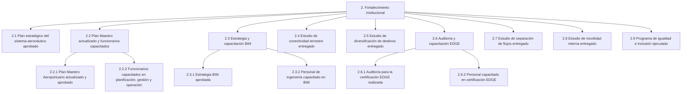

# Estructura de desglose del trabajo

Programa de Modernización del Aeropuerto Internacional de El Salvador (ES-L1173).

La EDT descompone el alcance completo del programa en entregables. El nombre de cada elemento describe un resultado terminado. No incluye actividades, duraciones, costos ni recursos: las actividades se definirán en el cronograma, a partir de los paquetes de trabajo.

La jerarquía sigue la lógica de la clase: objetivo, componentes, productos, entregables y paquetes de trabajo. El primer corte corresponde a los tres componentes del préstamo. El paquete de trabajo es el último nivel: es estimable, se puede controlar y tiene un responsable. Donde un producto ya tiene ese tamaño, el producto y el paquete coinciden.

Queda fuera de esta EDT la ejecución de las demás fases del Plan Maestro, la apertura de rutas o frecuencias aéreas y cualquier adquisición de tierras o reasentamiento. Esas exclusiones están en el acta de constitución.

## 1. Diagrama general

```mermaid
graph TD
    Root["Programa de Modernización del AIES"] --> C1["1. Obras y adecuaciones"]
    Root --> C2["2. Fortalecimiento institucional"]
    Root --> C3["3. Administración, evaluación y auditorías"]

    C1 --> N11["1.1 Diseños de las obras aprobados"]
    C1 --> N12["1.2 Terminal de pasajeros ampliada"]
    C1 --> N13["1.3 Plataformas de contacto y remotas"]
    C1 --> N14["1.4 Calle de rodaje Foxtrot"]
    C1 --> N15["1.5 Estacionamiento y energía solar"]
    C1 --> N16["1.6 SSEI reubicado y en operación"]
    C1 --> N17["1.7 Supervisión, PGAS de obra y recepción"]

    C2 --> N21["2.1 Plan estratégico del sistema aeronáutico"]
    C2 --> N22["2.2 Plan Maestro actualizado y funcionarios capacitados"]
    C2 --> N23["2.3 Estrategia y capacitación BIM"]
    C2 --> N24["2.4 Estudio de conectividad terrestre"]
    C2 --> N25["2.5 Estudio de diversificación de destinos"]
    C2 --> N26["2.6 Auditoría y capacitación EDGE"]
    C2 --> N27["2.7 Estudio de separación de flujos"]
    C2 --> N28["2.8 Estudio de movilidad interna"]
    C2 --> N29["2.9 Programa de igualdad e inclusión"]

    C3 --> N31["3.1 Condiciones de arranque cumplidas"]
    C3 --> N32["3.2 Planes de ejecución aprobados"]
    C3 --> N33["3.3 Condiciones socioambientales y de seguridad operacional"]
    C3 --> N34["3.4 Contratos del programa firmados"]
    C3 --> N35["3.5 Control financiero, evaluación y cierre"]
```

## 2. Componente I. Obras y adecuaciones

Cubre los productos P1.1.1 a P1.4.3. Los diseños de la fase 2 ya existen; el paquete correspondiente es su revisión y aprobación antes de licitar, no un diseño nuevo del aeropuerto. La supervisión queda en este componente porque la matriz de resultados la registra como producto del Componente I.

```mermaid
graph TD
    C1["1. Obras y adecuaciones"] --> N11["1.1 Diseños de las obras aprobados"]
    C1 --> N12["1.2 Terminal de pasajeros ampliada"]
    C1 --> N13["1.3 Plataformas de contacto y remotas"]
    C1 --> N14["1.4 Calle de rodaje Foxtrot"]
    C1 --> N15["1.5 Estacionamiento y energía solar"]
    C1 --> N16["1.6 SSEI reubicado y en operación"]
    C1 --> N17["1.7 Supervisión, PGAS de obra y recepción"]

    N11 --> N111["1.1.1 Diseños de la terminal revisados y aprobados"]
    N11 --> N112["1.1.2 Diseños de plataformas y calle Foxtrot revisados y aprobados"]
    N11 --> N113["1.1.3 Diseños del estacionamiento y del sistema solar revisados y aprobados"]
    N11 --> N114["1.1.4 Diseños del SSEI revisados y aprobados"]

    N12 --> N121["1.2.1 Estructura y envolvente de la terminal construidas"]
    N12 --> N122["1.2.2 Salas de espera, circulación y áreas de apoyo terminadas"]
    N12 --> N123["1.2.3 Instalaciones eléctricas, hidráulicas, climatización y contra incendio recibidas"]
    N12 --> N124["1.2.4 Puentes de abordaje, mobiliario y equipos instalados"]
    N12 --> N125["1.2.5 Accesibilidad universal, movilidad del cuidado y criterios de sostenibilidad incorporados"]

    N13 --> N131["1.3.1 Plataforma de posiciones de contacto construida"]
    N13 --> N132["1.3.2 Plataforma de posiciones remotas construida"]
    N13 --> N133["1.3.3 Señalización, luces y torres de iluminación de plataforma instaladas"]

    N14 --> N141["1.4.1 Pavimento y hombros de la calle Foxtrot construidos"]
    N14 --> N142["1.4.2 Señalización y balizamiento de la calle Foxtrot instalados"]

    N15 --> N151["1.5.1 Edificio de estacionamiento construido"]
    N15 --> N152["1.5.2 Sistemas de acceso, tráfico y áreas de alquiler instalados"]
    N15 --> N153["1.5.3 Sistema de generación solar instalado"]

    N16 --> N161["1.6.1 Edificio del SSEI y vías de acceso construidos"]
    N16 --> N162["1.6.2 SSEI en funcionamiento en la nueva ubicación"]

    N17 --> N171["1.7.1 Supervisión de la terminal y del estacionamiento ejecutada"]
    N17 --> N172["1.7.2 Supervisión de plataformas, calle Foxtrot y SSEI ejecutada"]
    N17 --> N173["1.7.3 PGAS de construcción implementado"]
    N17 --> N174["1.7.4 Planos de obra ejecutada y actas de recepción aprobados"]
```

## 3. Componente II. Fortalecimiento institucional

Cubre los productos P2.1 a P2.9. Cada estudio o plan es un entregable de consultoría. Se separan plan y capacitación solo cuando la matriz pide los dos resultados por separado.

## 4. Administración, evaluación y auditorías

Cubre la dirección del programa, las condiciones previas al desembolso y a las obras, los contratos, el control financiero, las auditorías y el cierre. Estos elementos consumen recursos del programa y forman parte del alcance.

```mermaid
graph TD
    C3["3. Administración, evaluación y auditorías"] --> N31["3.1 Condiciones de arranque cumplidas"]
    C3 --> N32["3.2 Planes de ejecución aprobados"]
    C3 --> N33["3.3 Condiciones socioambientales y de seguridad operacional"]
    C3 --> N34["3.4 Contratos del programa firmados"]
    C3 --> N35["3.5 Control financiero, evaluación y cierre"]

    N31 --> N311["3.1.1 Unidad ejecutora conformada y en funciones"]
    N31 --> N312["3.1.2 Reglamento operativo vigente"]
    N31 --> N313["3.1.3 Convenio de transferencia de recursos vigente"]
    N31 --> N314["3.1.4 Cuenta especial aperturada"]

    N32 --> N321["3.2.1 Plan de ejecución plurianual aprobado"]
    N32 --> N322["3.2.2 Planes operativos anuales aprobados"]
    N32 --> N323["3.2.3 Plan de adquisiciones aprobado"]

    N33 --> N331["3.3.1 Sistema de gestión ambiental y social y plan de acción vigentes"]
    N33 --> N332["3.3.2 Protocolo de seguridad operacional aprobado por la AAC"]
    N33 --> N333["3.3.3 Mecanismo de quejas y reclamos en operación"]
    N33 --> N334["3.3.4 Informes de cumplimiento socioambiental presentados"]

    N34 --> N341["3.4.1 Contratos de obras del Componente I firmados"]
    N34 --> N342["3.4.2 Contrato de supervisión firmado"]
    N34 --> N343["3.4.3 Contratos de consultorías del Componente II firmados"]
    N34 --> N344["3.4.4 Contratos de la unidad ejecutora, evaluación y auditoría firmados"]

    N35 --> N351["3.5.1 Desembolsos justificados e informes financieros presentados"]
    N35 --> N352["3.5.2 Auditorías externas emitidas"]
    N35 --> N353["3.5.3 Evaluaciones de medio término y de cierre realizadas"]
    N35 --> N354["3.5.4 Informe de terminación y cierre administrativo del programa"]
```

## 5. Diccionario básico

El diccionario cubre los paquetes de trabajo, que son las hojas de la EDT. El responsable indicado es el rol de la Unidad Ejecutora que rinde cuentas del paquete. El contratista, la supervisión o la firma consultora ejecutan el trabajo según el contrato; esa relación se precisará en la matriz RACI.

La EDT no fija el orden de ejecución. La dependencia entre el SSEI y la plataforma remota, y entre el protocolo de la AAC y las obras del lado aire, queda anotada en el criterio de aceptación para usarla después en el cronograma.

### 5.1 Componente I. Obras y adecuaciones

| Código | Paquete de trabajo | Descripción | Criterio de aceptación | Responsable | Referencia |
|---|---|---|---|---|---|
| 1.1.1 | Diseños de la terminal revisados y aprobados | Revisión de los diseños de la terminal de fase 2, sus especificaciones y los ajustes necesarios antes de la licitación, incluida la coordinación con la metodología BIM. | Expediente de diseño aprobado por la UEP, sin observaciones que impidan licitar la terminal. | Especialista técnico | P1.1.1 |
| 1.1.2 | Diseños de plataformas y calle Foxtrot revisados y aprobados | Revisión de los diseños de la plataforma de contacto, la plataforma remota y la calle de rodaje Foxtrot, con la geometría del lado aire. | Diseños aprobados por la UEP y compatibles con el protocolo de seguridad operacional que debe autorizar la AAC. | Especialista técnico | P1.1.2, P1.1.3 |
| 1.1.3 | Diseños del estacionamiento y del sistema solar revisados y aprobados | Revisión del edificio de estacionamiento, sus sistemas de acceso y el sistema fotovoltaico, con la capacidad definida en el diseño adoptado para el préstamo. | Expediente de diseño aprobado, con accesibilidad universal y el sistema solar incorporados. | Especialista técnico | P1.2.1 |
| 1.1.4 | Diseños del SSEI revisados y aprobados | Revisión del diseño del nuevo edificio del Servicio de Salvamento y Extinción de Incendios y de sus vías de acceso. | Diseños aprobados y aptos para construir el SSEI antes de la plataforma remota. | Especialista técnico | P1.3.1 |
| 1.2.1 | Estructura y envolvente de la terminal construidas | Estructura de concreto, cubierta metálica, fachadas y cerramientos del edificio de tres niveles de la fase 2. | Estructura y envolvente recibidas conforme a planos y especificaciones, con el aeropuerto en operación. | Coordinador general de obra | P1.1.1 |
| 1.2.2 | Salas de espera, circulación y áreas de apoyo terminadas | Seis salas de espera, pasillos, locales, áreas técnicas y espacios de apoyo de los tres niveles, integrados a la terminal existente. | Áreas terminadas y habilitadas para circulación y espera de pasajeros, en continuidad con la fase 1. | Coordinador general de obra | P1.1.1 |
| 1.2.3 | Instalaciones eléctricas, hidráulicas, climatización y contra incendio recibidas | Redes y equipos de energía, agua, drenaje, climatización y protección contra incendios de la nueva terminal. | Sistemas probados, recibidos y aptos para la operación de la terminal. | Coordinador general de obra | P1.1.1 |
| 1.2.4 | Puentes de abordaje, mobiliario y equipos instalados | Puentes de las nuevas salas, mobiliario, escáneres y demás equipamiento previsto para la ampliación. | Equipos instalados, probados y entregados con sus manuales. | Coordinador general de obra | P1.1.1 |
| 1.2.5 | Accesibilidad universal, movilidad del cuidado y criterios de sostenibilidad incorporados | Recorridos, servicios y medidas de eficiencia de la terminal para personas con discapacidad, movilidad del cuidado y el estándar previsto para EDGE. | Verificación de accesibilidad y de las medidas de sostenibilidad del diseño aprobado. La certificación EDGE corresponde al paquete 2.6.1. | Especialista socioambiental | P1.1.1 |
| 1.3.1 | Plataforma de posiciones de contacto construida | Pavimento, drenaje y servicios de la plataforma asociada a las seis nuevas posiciones de contacto. | Plataforma construida conforme al diseño y apta para el estacionamiento de aeronaves en posiciones de contacto. | Coordinador general de obra | P1.1.2 |
| 1.3.2 | Plataforma de posiciones remotas construida | Nueva plataforma remota que repone el área ocupada por la ampliación y mantiene la capacidad de posiciones remotas. | Plataforma remota construida. Su inicio requiere el paquete 1.6.2 ya aceptado: el SSEI operando en la nueva ubicación. | Coordinador general de obra | P1.1.2 |
| 1.3.3 | Señalización, luces y torres de iluminación de plataforma instaladas | Señalización horizontal, luces de plataforma y torres de iluminación de las plataformas nuevas. | Ayudas visuales instaladas y recibidas para la operación. | Coordinador general de obra | P1.1.2 |
| 1.4.1 | Pavimento y hombros de la calle Foxtrot construidos | Calle de rodaje Foxtrot, incluidos terracería, pavimento y hombros, como enlace entre la nueva plataforma y la calle de rodaje Alfa. | Calle construida conforme al diseño y conectada a la calle Alfa. | Coordinador general de obra | P1.1.3 |
| 1.4.2 | Señalización y balizamiento de la calle Foxtrot instalados | Señalización horizontal, balizamiento e iluminación de borde y de los puntos de espera de la calle Foxtrot. | Ayudas visuales instaladas y operativas. | Coordinador general de obra | P1.1.3 |
| 1.5.1 | Edificio de estacionamiento construido | Edificio de estacionamiento vehicular de la ampliación, con la capacidad del diseño aprobado para el préstamo. | Edificio construido, con circulaciones y plazas conformes al diseño, incluida la accesibilidad universal. | Coordinador general de obra | P1.2.1 |
| 1.5.2 | Sistemas de acceso, tráfico y áreas de alquiler instalados | Control de acceso, gestión de tráfico interno y áreas de alquiler de vehículos del nuevo estacionamiento. | Sistemas probados y áreas de alquiler habilitadas. | Coordinador general de obra | P1.2.1 |
| 1.5.3 | Sistema de generación solar instalado | Sistema fotovoltaico del edificio de estacionamiento, previsto para cubrir una parte sustancial de la demanda eléctrica del aeropuerto. | Sistema instalado, probado y entregado. La energía generada se medirá después, con el indicador T1. | Coordinador general de obra | P1.2.1, T1 |
| 1.6.1 | Edificio del SSEI y vías de acceso construidos | Nuevo edificio del Servicio de Salvamento y Extinción de Incendios y las vías que permiten su salida a la plataforma. | Edificio y vías construidos conforme al diseño y a los requisitos del servicio de salvamento. | Coordinador general de obra | P1.3.1 |
| 1.6.2 | SSEI en funcionamiento en la nueva ubicación | Traslado del servicio, pruebas y puesta en operación del SSEI en el edificio nuevo, con el servicio actual cubierto durante el traslado. | SSEI operando en la nueva sede. Esta aceptación es condición para iniciar el paquete 1.3.2. | Coordinador del Programa | P1.3.1 |
| 1.7.1 | Supervisión de la terminal y del estacionamiento ejecutada | Supervisión técnica de la terminal, el estacionamiento y el sistema solar, incluidas estimaciones y control de calidad. | Informes de supervisión y estimaciones revisadas durante toda la obra, sin saldos de supervisión pendientes al recibir. | Firma de supervisión | P1.4.1 |
| 1.7.2 | Supervisión de plataformas, calle Foxtrot y SSEI ejecutada | Supervisión técnica de las obras del lado aire y del SSEI, con control de las restricciones operacionales. | Informes de supervisión del lado aire completos y estimaciones revisadas. | Firma de supervisión | P1.4.2, P1.4.3 |
| 1.7.3 | PGAS de construcción implementado | Aplicación del Plan de Gestión Ambiental y Social durante las obras: residuos, agua, aire, ruido, tráfico, seguridad y salud, flora y fauna, hallazgos y cierre de instalaciones temporales. | Informes de cumplimiento del PGAS aceptados por la supervisión y por el especialista socioambiental. | Especialista socioambiental | P1.4.1 a P1.4.3 |
| 1.7.4 | Planos de obra ejecutada y actas de recepción aprobados | Planos de lo construido, levantamiento de observaciones y actas de recepción de las obras del Componente I. | Actas de recepción firmadas y planos de obra ejecutada entregados a CEPA. | Coordinador general de obra | P1.1.1 a P1.3.1 |

### 5.2 Componente II. Fortalecimiento institucional

| Código | Paquete de trabajo | Descripción | Criterio de aceptación | Responsable | Referencia |
|---|---|---|---|---|---|
| 2.1 | Plan estratégico del sistema aeronáutico aprobado | Plan estratégico para el desarrollo del sistema aeronáutico de El Salvador, con lineamientos de infraestructura, operación, normativa y sostenibilidad del sector. | Documento aprobado por CEPA y recibido por el BID conforme a los términos de referencia. | Especialista de planificación y monitoreo | P2.1 |
| 2.2.1 | Plan Maestro Aeroportuario actualizado y aprobado | Actualización del Plan Maestro del AIES con la demanda vigente y las obras de esta fase, como guía de las inversiones posteriores. | Plan Maestro actualizado, aprobado por CEPA y entregado al BID. | Especialista de planificación y monitoreo | P2.2 |
| 2.2.2 | Funcionarios capacitados en planificación, gestión y operación | Capacitación del personal de CEPA para implementar el Plan Maestro, dirigida a ingeniería, planificación, proyectos estratégicos y gerencia aeroportuaria. | Al menos 21 funcionarios con la asistencia mínima y la evaluación aprobadas. | Especialista de planificación y monitoreo | P2.2, R2.1 |
| 2.3.1 | Estrategia BIM aprobada | Estrategia para aplicar Building Information Modelling en el diseño, la construcción y la operación de la infraestructura de CEPA. | Estrategia aprobada por CEPA, con el arreglo de datos y los roles definidos. | Especialista técnico | P2.3 |
| 2.3.2 | Personal de ingeniería capacitado en BIM | Capacitación del personal de ingeniería de CEPA para usar la estrategia BIM en este programa y en los siguientes. | Personal previsto capacitado y materiales de la capacitación entregados. | Especialista técnico | P2.3 |
| 2.4 | Estudio de conectividad terrestre entregado | Estudio de acceso terrestre al AIES, con alternativas hacia San Salvador y destinos turísticos, y criterios de sostenibilidad e inclusión. | Informe final aprobado, con recomendaciones utilizables en el Plan Maestro. | Especialista de planificación y monitoreo | P2.4 |
| 2.5 | Estudio de diversificación de destinos entregado | Estudio de mercado de orígenes y destinos internacionales y de aerolíneas potenciales. No incluye la apertura de rutas. | Informe final aprobado, con mercados y destinos priorizados. | Especialista de planificación y monitoreo | P2.5 |
| 2.6.1 | Auditoría para la certificación EDGE realizada | Auditoría y acompañamiento para obtener la certificación EDGE de las edificaciones incluidas en el programa. | Informe de auditoría entregado y dictamen del proceso de certificación emitido. | Especialista técnico | P2.6 |
| 2.6.2 | Personal capacitado en certificación EDGE | Capacitación para que CEPA mantenga los criterios de la certificación en la operación y en obras futuras. | Personal previsto capacitado y registro de la capacitación entregado. | Especialista técnico | P2.6 |
| 2.7 | Estudio de separación de flujos entregado | Estudio de las obras necesarias para separar llegadas y salidas en la terminal antigua. El estudio no incluye ejecutar esas obras. | Informe aprobado, con las intervenciones identificadas y priorizadas. | Especialista técnico | P2.7 |
| 2.8 | Estudio de movilidad interna entregado | Estudio de tráfico en las vías internas del AIES, con énfasis en el acceso al nuevo estacionamiento y en los flujos de dejar y recoger pasajeros. | Informe aprobado, con los puntos de conflicto y las medidas recomendadas. | Especialista técnico | P2.8 |
| 2.9 | Programa de igualdad e inclusión ejecutado | Capacitación a personal de CEPA en igualdad de oportunidades, prevención de violencia y acoso, inclusión de personas con discapacidad y comunicación no sexista. | Programa ejecutado y al menos 300 funcionarios con la capacitación completada. | Especialista socioambiental | P2.9, T2 |

### 5.3 Administración, evaluación y auditorías

| Código | Paquete de trabajo | Descripción | Criterio de aceptación | Responsable | Referencia |
|---|---|---|---|---|---|
| 3.1.1 | Unidad ejecutora conformada y en funciones | Selección del coordinador, del coordinador general de obra y de los especialistas de adquisiciones, finanzas, planificación, técnica y socioambiental, con dedicación exclusiva. | Nombramientos vigentes y equipo trabajando antes del primer desembolso. | Coordinador del Programa | Condición de desembolso |
| 3.1.2 | Reglamento operativo vigente | Reglamento Operativo del Programa, con el sistema de gestión ambiental y social y el plan de acción ambiental y social como anexos. | ROP con no objeción del BID y aprobación de CEPA. | Coordinador del Programa | Condición de desembolso |
| 3.1.3 | Convenio de transferencia de recursos vigente | Convenio entre la República de El Salvador y CEPA para transferir los recursos del préstamo y fijar las obligaciones de ejecución. | Convenio suscrito y vigente. | Coordinador del Programa | Condición de desembolso |
| 3.1.4 | Cuenta especial aperturada | Cuenta especial del programa en el Banco Central de Reserva, gestionada con la Dirección General de Tesorería. | Cuenta abierta y habilitada para recibir desembolsos. | Especialista financiero | Arreglo de ejecución |
| 3.2.1 | Plan de ejecución plurianual aprobado | Plan de ejecución del periodo del programa, con la EDT, las adquisiciones, los hitos y los recursos por componente. | PEP aprobado por CEPA y presentado al BID. | Especialista de planificación y monitoreo | ROP, PEP |
| 3.2.2 | Planes operativos anuales aprobados | Programación anual de actividades, metas y recursos de cada año de ejecución. | POA de cada año aprobado antes del periodo que cubre. | Especialista de planificación y monitoreo | POA |
| 3.2.3 | Plan de adquisiciones aprobado | Plan de adquisiciones del programa y sus actualizaciones, alineado con los contratos del paquete 3.4. | PA con no objeción del BID y actualizado cuando cambien los procesos. | Especialista de adquisiciones | PA |
| 3.3.1 | Sistema de gestión ambiental y social y plan de acción vigentes | Instrumentos con los que CEPA gestiona los riesgos ambientales y sociales del programa, acordados con el BID. | SGAS y PAAS vigentes e incorporados al ROP. | Especialista socioambiental | Condición de desembolso |
| 3.3.2 | Protocolo de seguridad operacional aprobado por la AAC | Protocolo para ejecutar obras en el lado aire sin interrumpir la operación, de uso obligatorio para contratistas y supervisión. | Protocolo aprobado por la Autoridad de Aviación Civil antes de iniciar obras del lado aire. | Coordinador general de obra | Condición de ejecución |
| 3.3.3 | Mecanismo de quejas y reclamos en operación | Canal de atención a trabajadores, usuarios, arrendatarios, aerolíneas y comunidades del área de influencia. | Mecanismo instalado, difundido y con registro de casos. | Especialista socioambiental | PGAS |
| 3.3.4 | Informes de cumplimiento socioambiental presentados | Reportes periódicos del cumplimiento ambiental y social exigidos por el préstamo y por el PGAS. | Informes presentados al BID en los plazos del MEL y del ROP. | Especialista socioambiental | MEL |
| 3.4.1 | Contratos de obras del Componente I firmados | Licitación, adjudicación y firma de los contratos de terminal, plataformas y calle Foxtrot, estacionamiento con energía solar, y SSEI. | Contratos firmados, con garantías verificadas, para los cuatro grupos de obra. | Especialista de adquisiciones | P1.1.1 a P1.3.1 |
| 3.4.2 | Contrato de supervisión firmado | Selección y contrato de la firma que supervisa las obras del Componente I. | Contrato de supervisión firmado y firma en condiciones de iniciar con las obras. | Especialista de adquisiciones | P1.4.1 a P1.4.3 |
| 3.4.3 | Contratos de consultorías del Componente II firmados | Selección y contrato de los planes, estudios y capacitaciones del Componente II. | Contratos firmados para los productos P2.1 a P2.9. | Especialista de adquisiciones | P2.1 a P2.9 |
| 3.4.4 | Contratos de la unidad ejecutora, evaluación y auditoría firmados | Contratos del personal clave de la UEP, de las evaluaciones de medio término y cierre, y de la auditoría externa. | Contratos firmados y personal o firmas en funciones según el plan de adquisiciones. | Especialista de adquisiciones | Administración |
| 3.5.1 | Desembolsos justificados e informes financieros presentados | Solicitudes de desembolso, justificaciones de gasto e informes financieros del programa. | Desembolsos tramitados y justificaciones aceptadas, sin saldos injustificados al cierre. | Especialista financiero | Administración |
| 3.5.2 | Auditorías externas emitidas | Auditorías financieras externas de los periodos de ejecución. | Informes de auditoría entregados al BID por cada periodo exigido. | Especialista financiero | Administración |
| 3.5.3 | Evaluaciones de medio término y de cierre realizadas | Evaluación intermedia y evaluación final de efectividad, sin atribución empírica, según el plan de monitoreo y evaluación. | Dos informes de evaluación aceptados. | Especialista de planificación y monitoreo | MEL |
| 3.5.4 | Informe de terminación y cierre administrativo del programa | Informe de terminación, liquidación de contratos, lecciones aprendidas y cierre del programa. | Informe de terminación presentado y contratos liquidados. | Coordinador del Programa | MEL, PCR |

## 6. Lectura de la EDT

Hay 54 paquetes de trabajo: 23 de obras y adecuaciones, 12 de fortalecimiento institucional y 19 de administración, evaluación y auditorías. Los elementos de los niveles superiores agrupan esos paquetes y no se ejecutan por sí mismos.

Cada paquete del Componente I y del Componente II apunta a un producto de la matriz de resultados. Los del tercer componente cubren las condiciones del préstamo y la gestión que el programa necesita para llegar a esos productos. El cronograma, la curva S, las adquisiciones, los riesgos, las comunicaciones y la matriz RACI deben salir de esta lista, sin agregar obras ni estudios que no estén aquí.
