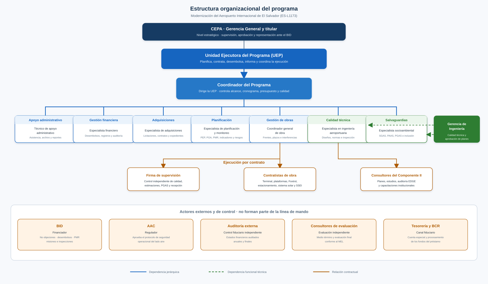

# Estructura organizativa del proyecto

Programa de Modernización del Aeropuerto Internacional de El Salvador (ES-L1173). Esta sección detalla los roles y responsabilidades que usan la EDT, las adquisiciones y las comunicaciones. Sale del Reglamento Operativo del Programa (BID y CEPA, 2025, capítulo 3) y se completa con el personal clave que exige la propuesta de préstamo (BID, 2025g, párrafo 4.5).

La EDT descompone el trabajo. Aquí se define quién rinde cuentas de ese trabajo. La asignación paquete por paquete queda para la matriz RACI.

## 1. Niveles de la organización

El ROP organiza la ejecución en tres niveles (BID y CEPA, 2025, sección 3.1). CEPA es el organismo ejecutor. La UEP depende de la Gerencia General y conduce el día a día. La calidad técnica de las obras la respaldan la Gerencia de Ingeniería y los especialistas de dedicación exclusiva.

| Nivel | Quién | Qué decide o ejecuta |
|---|---|---|
| Estratégico | CEPA, por su Gerencia General y su titular | Representa al prestatario ante el BID, aprueba el ROP y el POA, administra los recursos del préstamo y supervisa a la UEP |
| Administrativo | Unidad Ejecutora del Programa | Planifica, contrata, desembolsa, informa y coordina la ejecución |
| Calidad técnica | Gerencia de Ingeniería de CEPA, con el especialista en ingeniería aeroportuaria y el especialista socioambiental | Aprueba diseños, vigila especificaciones, salvaguardias y el avance físico de las obras |

El BID no forma parte de la línea de mando. Revisa, da no objeción y desembolsa. La AAC aprueba el protocolo de lado aire. Los contratistas, la firma de supervisión y los consultores ejecutan por contrato; no sustituyen a la UEP.

El organigrama del ROP (BID y CEPA, 2025, ilustración 1) coloca bajo el Coordinador al técnico de apoyo, al financiero, al de adquisiciones, al de planificación y monitoreo, al especialista socioambiental y al especialista en ingeniería aeroportuaria, con línea funcional punteada hacia la Gerencia de Ingeniería. Aquí se agrega el **coordinador general de obra**, que la propuesta de préstamo exige como personal clave de la UEP (BID, 2025g, párrafos 3.3 y 4.5) y que el ROP no desglosa en una tabla propia.

## 2. Correspondencia de nombres

Los documentos del préstamo no usan siempre el mismo título (BID y CEPA, 2025, tablas 2 a 8; BID, 2025g, párrafo 4.5). En este trabajo se unifica así:

| Nombre en este trabajo | Nombre en el ROP | Nombre en la Propuesta de Préstamo |
|---|---|---|
| Coordinador del Programa | Coordinador(a) UEP | Coordinador del programa |
| Coordinador general de obra | No tiene tabla propia | Coordinador general de obra (enfoque PMO) |
| Especialista de planificación y monitoreo | Especialista en Planificación y Monitoreo | Especialista de planificación y monitoreo |
| Especialista de adquisiciones | Especialista de Adquisiciones / Analista de Adquisiciones | Especialista de adquisiciones |
| Especialista financiero | Especialista Financiero / Analista Financiero | Especialista financiero |
| Especialista en ingeniería aeroportuaria | Especialista en Ingeniería Aeroportuaria | Especialista técnico |
| Especialista socioambiental | Especialista social y ambiental | Especialista socioambiental |
| Técnico de apoyo administrativo | Técnico en Apoyo Administrativo | No lo lista; el ROP lo agrega |

Los siete primeros, más el técnico de apoyo, son el personal de dedicación exclusiva de la UEP (paquete 3.1.1). El ROP permite contratar expertos adicionales si hace falta.

## 3. Nivel estratégico: CEPA

CEPA representa al Gobierno ante el BID, coordina a sus direcciones y gerencias, ejecuta el programa conforme al contrato de préstamo y a este ROP, y presenta al Banco los informes, auditorías y evaluaciones. Supervisa la contratación y el funcionamiento de la UEP, y garantiza el acceso del BID a registros y obras (BID y CEPA, 2025, sección 3.2.1).

El titular de CEPA aprueba el POA a más tardar el 30 de noviembre de cada año y respalda los informes que se remiten al Banco. La Gerencia General es la jefatura jerárquica de la UEP.

Apoyan a la UEP, sin formar parte de su plantilla exclusiva, la Unidad de Planificación, la Unidad de Compras Públicas, la Dirección Financiera y el Departamento de Seguimiento y Supervisión de la Gerencia de Ingeniería (BID y CEPA, 2025, sección 3.3).

## 4. Nivel administrativo: Unidad Ejecutora

La UEP elabora y actualiza el PEP, el POA y el Plan de Adquisiciones; lleva el monitoreo físico, técnico y financiero; prepara el PMR y los demás informes; inicia y adjudica las licitaciones; tramita desembolsos y pagos; registra la ejecución financiera; y atiende evaluaciones y auditorías. La administración técnica de cada contrato la delega en el área requirente (BID y CEPA, 2025, sección 3.2.2).

### Coordinador del Programa

Dirige la UEP. Coordina las operaciones administrativas, financieras y técnicas; da seguimiento al equipo; informa al titular de CEPA el avance físico y financiero del POA; controla cronograma, presupuesto, alcance y calidad; gestiona las no objeciones como firma autorizada ante el BID; aprueba y remite los informes de avance; vela por la auditoría externa; y apoya las misiones del Banco. Es el responsable de los paquetes de arranque y de cierre (3.1.1 a 3.1.3 y 3.5.4).

### Especialista de planificación y monitoreo

Prepara y actualiza el PEP, el POA, la Matriz de Resultados y la matriz de riesgos. Elabora el PMR semestral y los informes para CEPA y para las misiones del BID. Da seguimiento a indicadores, metas, contrataciones frente al POA y a la gestión de riesgos. Contrata y da seguimiento a las evaluaciones de medio término y de cierre (3.2.1, 3.2.2 y 3.5.3).

### Especialista de adquisiciones

Conduce los procesos conforme a las políticas del BID, el ROP y el Plan de Adquisiciones. Actualiza el PA al menos cada tres meses, prepara documentos de licitación, gestiona comités de evaluación y no objeciones, atiende consultas e inconformidades de oferentes, resguarda expedientes y produce el informe mensual de adquisiciones. Asesora a las áreas requirentes en términos de referencia y especificaciones. Es el responsable de los paquetes 3.2.3 y 3.4.

### Especialista financiero

Ejecuta la gestión fiduciaria: apertura y conciliación de la cuenta especial, plan financiero, solicitudes de desembolso, disponibilidades presupuestarias, registros y cierres mensuales, semestrales y anuales. Coordina la auditoría externa y entrega los estados financieros auditados en los plazos del préstamo (3.1.4, 3.5.1 y 3.5.2).

### Técnico de apoyo administrativo

Asiste a los especialistas, redacta notas e informes, apoya el archivo físico y electrónico, y reporta al Coordinador los hechos relevantes de la ejecución. No es área requirente ni administrador de contrato.

## 5. Nivel técnico y de obras

### Coordinador general de obra

La propuesta de préstamo lo exige en la UEP con enfoque de oficina de gestión de proyectos, para articular a los distintos contratistas y reducir desfases, en especial en lado aire (BID, 2025g, párrafo 3.3). En este trabajo es el área requirente de los cuatro contratos de obra y del de supervisión, y el responsable de los paquetes de construcción y de recepción (1.2 a 1.6 y 1.7.4), del protocolo de la AAC (3.3.2) y de las reuniones semanales de obra.

No sustituye a la firma de supervisión ni al especialista en ingeniería aeroportuaria. Coordina frentes, interferencias operativas y el cumplimiento de plazo; la supervisión certifica calidad y estimaciones; el especialista en ingeniería aeroportuaria responde por diseños y especificaciones.

### Especialista en ingeniería aeroportuaria

Prepara y revisa la información técnica de los componentes, inspecciona obras, emite reportes de avance físico, aplica normas OACI/FAA, articula con la AAC y los contratistas, e incorpora sostenibilidad, eficiencia energética y accesibilidad (BID y CEPA, 2025, sección 3.2.3). Es el responsable de la revisión de diseños (1.1), de BIM y EDGE (2.3 y 2.6) y de los estudios técnicos del Componente II que no lleva planificación (2.7 y 2.8). Depende jerárquicamente de la UEP y funcionalmente de la Gerencia de Ingeniería. En la propuesta de préstamo este puesto aparece como especialista técnico.

### Especialista socioambiental

Gestiona salvaguardias, el SGAS y el PAAS, el PGAS de construcción (1.7.3), el mecanismo de quejas (3.3.3) y los informes de cumplimiento (3.3.4). Coordina la consulta y la divulgación de categoría B, y el programa de igualdad e inclusión (2.9). También depende de la UEP y, en lo funcional, de la Gerencia de Ingeniería. En el ROP este puesto aparece como especialista social y ambiental.

### Gerencia de Ingeniería de CEPA

Toma decisiones sobre el uso de los recursos técnicos del préstamo, asigna personal de apoyo, aprueba planes de los proyectos y sostiene la coordinación interinstitucional. No reemplaza a la UEP.

## 6. Roles contratados y externos

Estos actores no están en la plantilla de la UEP. Aparecen en la EDT como ejecutores o como destinatarios de la comunicación.

| Rol | Relación con el programa | Responsabilidad principal |
|---|---|---|
| Firma de supervisión | Un contrato SBCC (P1.4.1 a P1.4.3) | Control independiente de calidad, estimaciones, PGAS de obra y apoyo a la recepción. Implementa el protocolo de la AAC. Reporta a la UEP cada mes |
| Contratistas de obra | Cuatro contratos LPI del Componente I | Ejecutan terminal, plataformas y Foxtrot, estacionamiento con solar, y SSEI, con el aeropuerto en operación |
| Consultores del Componente II | Contratos SBCC o SCC | Entregan planes, estudios y capacitaciones; el área requirente acepta el producto |
| Firma de auditoría externa | Contrato SBMC plurianual | Emite los estados financieros auditados anuales y finales |
| Consultores de evaluación | Dos contratos SCC | Evaluación de medio término y evaluación final, según el MEL |
| BID | Financiador | No objeciones, desembolsos, PMR, misiones de administración e inspecciones |
| AAC | Regulador | Aprueba el protocolo de seguridad operacional de lado aire |
| Tesorería y BCR | Canal fiduciario | Cuenta especial y procesamiento de los fondos del préstamo |

## 7. Criterios

- **Un responsable por paquete.** El diccionario de la EDT nombra al rol de la UEP que rinde cuentas. Quien ejecuta (contratista, supervisión o consultor) se precisa en la RACI.
- **Área requirente y adquisiciones.** El especialista de adquisiciones conduce el proceso. El área requirente prepara términos de referencia o especificaciones y administra el contrato, como en la matriz de adquisiciones.
- **Doble dependencia técnica.** El especialista en ingeniería aeroportuaria y el especialista socioambiental reportan al Coordinador y, en lo funcional, a la Gerencia de Ingeniería. Las decisiones de diseño y salvaguardias no se toman solo en la UEP.
- **Lo que no cubre este documento.** No sustituye los términos de referencia de cada consultor ni la matriz RACI. Si el ROP o el préstamo cambian un perfil, se actualizan esta estructura y, en cascada, la EDT, las adquisiciones y las comunicaciones.
