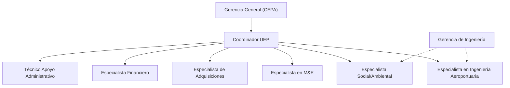

logo: CEPA

logo: BID Banco Interamericano de Desarrollo

## **Reglamento Operativo**

### **Programa de Modernización del Aeropuerto Internacional de El Salvador (ES-L1173)**

#### **Comisión Ejecutiva Portuaria Autónoma (CEPA)**

photo: Aerial view of an airport terminal at dusk with illuminated runways and a modern blue-lit building

Reglamento Operativo del Programa ES-1173

## **CONTENIDO**

| 1. | REGLAMENTO OPERATIVO DEL PROGRAMA | 7 |
| --- | --- | --- |
| 1.1. | FINALIDAD | 7 |
| 1.2. | OBJETIVO | 7 |
| 1.3. | ALCANCE | 7 |
| 1.4. | MARCO NORMATIVO | 7 |
|  | 1.4.1. Políticas Operativas Generales del BID | 8 |
| 1.5. | APROBACIÓN DEL ROP | 9 |
| 1.6. | MODIFICACIÓN DEL ROP | 9 |
| 1.7. | GESTIÓN DE CAMBIOS DEL ROP | 9 |
| 1.8. | ESTRUCTURA DEL ROP | 9 |
| 2. | PROGRAMA DE FACILITACIÓN DEL COMERCIO Y DE LAS INVERSIONES EN EL SALVADOR | 10 |
| 2.1. | ANTECEDENTES | 10 |
| 2.2. | OBJETIVOS | 10 |
|  | 2.2.1. Objetivo General | 10 |
|  | 2.2.2. Objetivos Específicos | 10 |
| 2.3. | COMPONENTES | 10 |
|  | 2.3.1. Componente I. Obras, adecuaciones | 11 |
|  | 2.3.2. Componente II. Fortalecimiento institucional | 11 |
|  | 2.3.3. Administración, evaluación y auditorías | 11 |
| 2.4. | BENEFICIARIOS | 11 |
| 2.5. | COSTO | 11 |
| 2.6. | CONDICIONES CONTRACTUALES DEL PROGRAMA | 12 |
|  | 2.6.1 Condiciones contractuales especiales previas al primer desembolso del financiamiento: | 12 |
|  | 2.6.2 Condiciones contractuales especiales de ejecución: | 12 |
| 3. | EJECUCIÓN DEL PROGRAMA | 12 |
| 3.1. | ESQUEMA ORGANIZACIONAL | 12 |
|  | 3.1.1. Nivel Estratégico | 12 |
|  | 3.1.2. Nivel Administrativo | 13 |
|  | 3.1.3. Nivel de Gestión de la Calidad Técnica | 13 |
| 3.2. | DEFINICIÓN DE RESPONSABILIDADES | 14 |
|  | 3.2.1. Nivel Estratégico | 14 |
|  | 3.2.2. Nivel Administrativo | 14 |
|  | 3.2.3. Nivel de Gestión de la Calidad Técnica de los Componentes | 21 |
| 3.3. | DEFINICIÓN Y RESPONSABILIDAD DEL EQUIPO DE APOYO A LA UEP | 23 |
| 3.4. | EJECUCIÓN DE LOS COMPONENTES A CARGO DE CEPA | 23 |
| 4. | PROCESO DE EJECUCIÓN FINANCIERA | 24 |
| 4.1. | RESPONSABILIDADES | 25 |

icon: page number 2 in a banner

Reglamento Operativo del Programa ES-1173

| 4.2. | GESTIÓN FINANCIERA | 25 |
| --- | --- | --- |
| 4.3. | DESEMBOLSO DE FONDOS | 26 |
| 4.3.1. | Flujo de Recursos | 28 |
| 4.4. | CONTROL INTERNO | 28 |
| 4.5. | AUDITORIA EXTERNA | 28 |
| 5. | PROCESO DE EJECUCIÓN DE ADQUISICIONES | 28 |
| 5.1. | RESPONSABILIDADES | 29 |
| 5.2. | GESTIÓN DE ADQUISICIONES | 29 |
| 5.3. | REGULACIONES PARA LAS ADQUISICIONES Y CONTRATACIONES | 30 |
| 5.4. | MECANISMOS PARA LAS ADQUISICIONES | 30 |
| 5.4.1. | Aprobación Del Plan De Adquisiciones | 30 |
| 5.4.2. | De las Adquisiciones y Contrataciones con fondos BID | 30 |
| 5.4.3. | Montos límites para procesos de adquisición y contratación | 31 |
| 5.4.4. | Criterios De Sostenibilidad en las Adquisiciones Del Programa | 33 |
| 5.4.5. | De los impuestos de las Adquisiciones y Contrataciones | 33 |
| 5.4.6. | De la elegibilidad durante los procesos de Adquisiciones y Contrataciones . | 33 |
| 5.4.7. | Comité/Comisión de Evaluación | 33 |
| 5.4.8. | Del conflicto de interés | 34 |
| 5.4.9. | De las Prácticas Prohibidas | 34 |
| 5.4.10. | Niveles de Autorización y Responsabilidad de las Adquisiciones y Medidas Pertinentes | 34 |
| 5.4.11. | Mecanismo de Búsqueda y Selección de Proveedores / Consultores para los Procesos de adquisiciones y contrataciones | 34 |
| 5.5. | REVISIONES DEL BANCO | 34 |
| 5.5.1. | Lineamientos para No Objeción a proceso de adquisiciones | 35 |
| 5.5.2. | Modificaciones a contratos | 36 |
| 5.6. | DISPOSICIONES ESPECIALES | 37 |
| 5.6.1. | Confidencialidad | 37 |
| 5.6.2. | Integridad | 38 |
| 5.6.3. | Resguardo de documentación | 38 |
| 6. | MONITOREO Y EVALUACIÓN DEL PROGRAMA | 38 |
| 6.1. | HERRAMIENTAS DE PLANIFICACIÓN Y MONITOREO | 38 |
| 6.1.1. | Plan Financiero (PF) | 39 |
| 6.1.2. | Plan Operativo Anual (POA) | 39 |
| 6.1.3. | Plan de Adquisiciones (PA) | 39 |
| 6.1.4. | Elaboración del PA | 39 |
| 6.2. | VISITAS DE INSPECCIÓN | 40 |
| 6.3. | REPORTES | 40 |
| 6.3.1. | Reportes de monitoreo y seguimiento | 40 |

icon: page number 3 in a banner

Reglamento Operativo del Programa ES-1173

| 6.4. | EVALUACIONES | 40 |
| --- | --- | --- |
| 6.4.1. | Informe de terminación del Programa | 41 |
| 6.4.2. | Evaluación de Impacto | 41 |
| 6.5. | EVALUACIÓN DE RIESGOS | 41 |
| 6.5.1. | Riesgos socio medioambientales | 41 |
| 7. | ANEXOS | 42 |
| 7.1. | ANEXO 1. PROCESO DE ADQUISICIONES | 42 |
| 7.2. | Anexo 2. PROCESO/ DIAGRAMA PARA FIRMAS CONSULTORAS | 47 |
| 7.3. | Anexo 3. PLAN DE ADQUISICIONES DEL PROGRAMA | 47 |
| 7.4. | Anexo 4. RIESGO DE INTEGRIDAD E IMPACTO REPUTACIONAL | 48 |
| 7.5. | Anexo 5. MATRIZ DE RESULTADOS | 59 |
| 7.6. | Anexo 6. ESTRUCTURA DESGLOSADA DEL TRABAJO- EDT | 59 |

icon: page number 4 in a banner

Reglamento Operativo del Programa ES-1173

## **LISTA DE ILUSTRACIONES**

| LISTA DE ILUSTRACIONES |  |
| --- | --- |
| Ilustración 1. Estructura Organizacional | 13 |
| Ilustración 2. Ejecución de Desembolsos y Pagos | 27 |

## **LISTA DE TABLAS**

| LISTA DE TABLAS |  |
| --- | --- |
| Tabla 1. Tabla de Costos del Programa de Modernización del Aeropuerto Internacional de El Salvador | 11 |
| Tabla 2. Funciones Coordinador UEP | 16 |
| Tabla 3. Funciones Especialista en Planificación y Monitoreo | 17 |
| Tabla 4. Funciones Especialista de Adquisiciones | 19 |
| Tabla 5. Funciones Especialista Financiero | 20 |
| Tabla 6. Funciones Técnico en Apoyo Administrativo | 20 |
| Tabla 7. Funciones Especialista en Infraestructura | 22 |
| Tabla 8. Funciones Especialista Social y Ambiental | 22 |
| Tabla 9. Mecanismos de Desembolso: Soporte | 27 |
| Tabla 10. Montos límites para los procesos de adquisiciones y contrataciones y tipo de revisión.. | 32 |
| Tabla 11. Documentación Requerida para solicitar No Objeción al inicio del Proceso | 36 |

icon: page number 5 in a banner

Reglamento Operativo del Programa ES-1173

## **SIGLAS Y ACRÓNIMOS**

| AA | Área adquisiciones |
| --- | --- |
| BID | Banco Interamericano de Desarrollo |
| BCR | Banco Central de Reserva de El Salvador |
| CEPA | Corporación Ejecutiva Portuaria Autónoma |
| EDT | Estructura Desglosada del Trabajo |
| GOES | Gobierno de El Salvador |
| MPAS | Marco de Política Ambiental y Social |
| MR | Matriz de Resultados |
| OE | Organismo Ejecutor del Programa |
| PA | Plan de Adquisiciones |
| PCR | Project Completion Report - Informe de cierre del Programa |
| PF | Plan Financiero |
| PEP | Plan de Ejecución Plurianual del Programa |
| PME | Plan de Monitoreo y Evaluación |
| POA | Plan Operativo Anual |
| ROP | Reglamento Operativo del Programa |
| TDR | Términos de Referencia |
| UEP | Unidad Ejecutora del Programa |

icon: page number 6 in a ribbon

Reglamento Operativo del Programa ES-L1157

## **1. REGLAMENTO OPERATIVO DEL PROGRAMA**

### **1.1. FINALIDAD**

El presente Reglamento Operativo del Programa (ROP), junto con sus respectivos anexos, tiene por finalidad establecer los términos, condiciones y definiciones que regirán la administración y ejecución del Programa de Modernización del Aeropuerto Internacional de El Salvador —en adelante, el Programa—, integrando para ello el marco normativo, las políticas y regulaciones aplicables durante su período de implementación.

El Organismo Ejecutor es la Comisión Ejecutiva Portuaria Autónoma (CEPA), con el acompañamiento de la Unidad Ejecutora del Programa (UEP), que depende jerárquicamente de la Gerencia General, quien articulará y será responsable de coordinar y dar seguimiento al cumplimiento de los objetivos, implementación y resultados del Programa.

El ROP en su versión vigente será de uso obligatorio para la ejecución del Programa.

### **1.2. OBJETIVO**

El propósito del presente Reglamento Operativo del Programa (ROP) es proporcionar a CEPA, en su calidad de Organismo Ejecutor, un instrumento formal que consolide los principales elementos del Programa, incluyendo los procedimientos, criterios técnicos y normativos que orientarán los distintos procesos involucrados en la ejecución de sus componentes.

### **1.3. ALCANCE**

La función principal del Reglamento Operativo del Programa (ROP) es facilitar la ejecución del Programa, en cumplimiento de la normativa vigente aplicable a la operación ES-L1173. Asimismo, el ROP establece las reglas y procedimientos que rigen las actividades de direccionamiento estratégico, gestión de adquisiciones, administración financiera, control y monitoreo del Programa, en concordancia con los lineamientos definidos por el Banco Interamericano de Desarrollo (BID), en su calidad de entidad financiadora.

En caso de que alguna disposición contenida en el presente ROP entre en contradicción o no se ajuste al Contrato de Préstamo suscrito entre el Gobierno de El Salvador (GOES) y el BID, prevalecerán las estipulaciones establecidas en dicho instrumento contractual.

### **1.4. MARCO NORMATIVO**

El Programa de Modernización del Aeropuerto Internacional de El Salvador (ES-L1173), es una operación financiera entre el GOES y el BID, por intermedio de la suscripción del

icon: page number 7

Reglamento Operativo del Programa ES-L1157

Contrato de Préstamo xxxxxx, conferida por Decreto Legislativo No.xxxx publicado en el Diario Oficial No. xx Tomo xxx del xx de xxxx de xxxx.

El marco legal que tendrá como referencia para la ejecución del Programa es el siguiente:

* Contrato de Préstamo xxxxxx, documento integrado por las Estipulaciones Especiales, las Normas Generales y el Anexo Único.
* Políticas para la Adquisición de Bienes y Obras Financiadas por el Banco Interamericano de Desarrollo, GN-2349-15.
* Políticas para la Selección y Contratación de Consultores Financiado por el Banco Interamericano de Desarrollo, GN-2350-15.
* Guías de Desembolsos para Proyectos de BID.
* Montos límites para adquisición de bienes, obras y servicios de consultoría.
* Guía de Gestión Financiera para Programas Financiados por el Banco Interamericano de Desarrollo, GN-2811-1.
* El Marco de Política Ambiental y Social (MPAS).
* Ley de Presupuesto General de la Nación vigente y sus reglamentaciones.
* Otras normas aplicables.

### **1.4.1. Políticas Operativas Generales del BID**

Las políticas operativas comprenden el conjunto de disposiciones generales que regulan la asistencia técnica y financiera brindada por el Banco Interamericano de Desarrollo (BID) a sus prestatarios. Estas políticas definen estrategias de desarrollo y ofrecen directrices de alto nivel que orientan la toma de decisiones en el ámbito operativo.

En el marco de la supervisión del Programa, deberán considerarse dichas guías generales de acción, con el propósito de verificar el cumplimiento de las cláusulas contractuales, los procedimientos de adquisiciones y la tramitación de desembolsos. Las acciones derivadas de este proceso deben estar orientadas a:

* Verificar que la ejecución del Programa se realice en concordancia con los objetivos estratégicos establecidos.
* Asegurar que la utilización de los recursos financieros aprobados en los contratos de financiamiento se lleve a cabo conforme a las cláusulas contractuales vigentes, así como a las políticas, normas y procedimientos aplicables.
* Comprobar el cumplimiento, por parte de los prestatarios, beneficiarios y ejecutores, de las disposiciones contractuales y normativas generales establecidas por el BID.
* Brindar asesoría técnica a los prestatarios, beneficiarios y ejecutores en la resolución de situaciones que surjan durante la implementación del Programa, con el fin de asegurar su impacto esperado en el desarrollo de los países.
* Mantener un sistema de información eficaz y eficiente que permita el seguimiento integral de las operaciones vinculadas al préstamo.

icon: page number 8 in a banner

Reglamento Operativo del Programa ES-L1157

## **1.5. APROBACIÓN DEL ROP**

Para su entrada en vigor, el presente Reglamento Operativo del Programa (ROP) deberá contar previamente con la No Objeción por parte del Banco Interamericano de Desarrollo (BID), así como con la aprobación formal del Organismo Ejecutor. La fecha de firma del ROP será considerada como la fecha oficial de inicio de su vigencia.

## **1.6. MODIFICACIÓN DEL ROP**

El presente Reglamento Operativo del Programa (ROP) podrá ser actualizado en función de ajustes derivados de cambios en las condiciones operativas que impacten su adecuada ejecución. Toda modificación estará sujeta a la obtención de la correspondiente No Objeción por parte del BID. La responsabilidad de mantener actualizado el ROP recaerá en la Comisión Ejecutiva Portuaria Autónoma (CEPA), a través de la Unidad Ejecutora del Programa (UEP), conforme a lo estipulado en el Contrato de Préstamo.

## **1.7. GESTIÓN DE CAMBIOS DEL ROP**

En el marco del proceso de seguimiento y ejecución del Programa, se establecerá un registro formal de las modificaciones que se presenten, especialmente aquellas vinculadas con metas, entregables, costos, plazos y procedimientos operativos.

Toda solicitud de cambio deberá ser comunicada por las dependencias correspondientes al Coordinador de la UEP, quien, tras su revisión técnica, procederá a remitirla al BID para la obtención de la No Objeción y su correspondiente aprobación, acompañando la documentación técnica de respaldo.

La UEP mantendrá el registro actualizado de todas las versiones del Reglamento Operativo del Programa (ROP), incluyendo la versión original, conforme a los lineamientos establecidos en el Contrato de Préstamo.

## **1.8. ESTRUCTURA DEL ROP**

El Reglamento Operativo del Programa (ROP) se estructura en seis secciones principales, que se resumen a continuación:
(i) Reglamento Operativo del Programa
(ii) Descripción del Programa
(iii) Ejecución del Programa
(iv) Directrices para la administración financiera
(v) Procedimientos para la gestión de adquisiciones y contrataciones
(vi) Monitoreo y evaluación de los resultados del Programa

Asimismo, el ROP incorpora anexos técnicos que detallan los procesos administrativos requeridos para la implementación efectiva del Programa.

icon: page number 9 in a banner

Reglamento Operativo del Programa ES-L1157

## <u>**2. PROGRAMA DE FACILITACIÓN DEL COMERCIO Y DE LAS</u> INVERSIONES EN EL SALVADOR**

### **2.1. ANTECEDENTES**

Se estima que el incremento en la atención de pasajeros obedece, en gran medida, a los procesos de modernización y expansión de la infraestructura del Aeropuerto Internacional de El Salvador. Gracias a instalaciones más amplias y modernas, los usuarios experimentan una atención ágil y comfortable desde su ingreso a la terminal hasta el abordaje de sus vuelos. La incorporación de tecnología de vanguardia, junto con programas de capacitación especializada al personal, ha permitido elevar los estándares de servicio, consolidando una experiencia aeroportuaria de clase mundial1.

Actualmente se vislumbra una oportunidad estratégica para actualizar la planificación del Aeropuerto Internacional de El Salvador (AIES), con el propósito de alinearla a las condiciones actuales y proyectadas de la demanda aeroportuaria. En paralelo, la operación portuaria exige un proceso continuo de capacitación y una articulación efectiva con otras entidades, a fin de consolidar una gestión integrada, eficiente y conforme a los estándares internacionales.2.

Como resultado de lo anterior, el Gobierno de El Salvador (GOES), con el acompañamiento técnico del BID, llevó a cabo un análisis integral orientado a identificar oportunidades de mejora. Los hallazgos de dicho proceso fueron incorporados en el Programa de Modernización del Aeropuerto Internacional de El Salvador, diseñado para su implementación en un período de cinco (5) años.

### **2.2. OBJETIVOS**

#### **2.2.1. Objetivo General**

El objetivo general de desarrollo es fortalecer la conectividad aérea de El Salvador para un mayor desarrollo económico e integración regional.

#### **2.2.2. Objetivos Específicos**

El objetivo específico es contribuir a mejorar la calidad del servicio del Aeropuerto Internacional de El Salvador San Óscar Arnulfo Romero y Galdámez (AIES) con enfoque sostenible e inclusivo.

### **2.3. COMPONENTES**

El Programa se encuentra conformado por dos (2) componentes fundamentales, los cuales se describen a continuación:

1 CEPA, Noticias, tomado de: https://www.cepa.gob.sv/incrementa-el-flujo-de-pasajeros-en-el-aeropuerto-internacional-de-el-salvador/
2 Perfil del Programa de Modernización del Aeropuerto Internacional de El Salvador

icon: page number decoration | 10

Reglamento Operativo del Programa ES-L1157

## **2.3.1. Componente I. Obras, adecuaciones**

Financiará: (i) construcción de la segunda etapa de la ampliación de la terminal de pasajeros y la plataforma del AIES incluyendo medidas de eficiencia energética y enfoque sostenible e inclusivo, techos resilientes ante vientos huracanados y drenajes con periodos de retorno ampliado de 25 a 50 años de retorno por los impactos del cambio climático; (ii) ampliación de áreas de circulación y estacionamiento vehicular; (iii) mobiliario, adecuación; (vi) escáneres, equipos; (v) supervisión técnica y ambiental.

## **2.3.2. Componente II. Fortalecimiento institucional.**

Financiará: (i) estrategia de fortalecimiento institucional de CEPA e implementación de prácticas sostenibles y eficientes en gestión aeroportuaria; (ii) capacitaciones en BIM, gestión de riesgos, atención a PcD y prevención de violencia de género; (iii) actualización del PMA; (iv) estudio para mejorar la conectividad terrestre del AIES, con enfoque de sostenibilidad e inclusión; (v) estudio de mercado para diversificación de destinos; (vi) diseño e implementación de estrategia de inclusión laboral de jóvenes, mujeres y PcD.

## **2.3.3. Administración, evaluación y auditorías**

Financiará: (i) coordinación técnica de la ejecución; (ii) evaluaciones; (iii) auditorías.

## **2.4. BENEFICIARIOS**

Se estima que los beneficiarios directos de la nueva infraestructura alcanzarán los 7.600.000 pasajeros que utilizarán sus servicios en el año 2029. De manera indirecta, la operación impactará positivamente a los 6.000.000 habitantes de El Salvador, mediante el fortalecimiento estructural y operativo del sector transporte a nivel nacional.

## **2.5. COSTO**

El monto total de la operación asciende a US$190.000.000, financiado en su totalidad mediante un préstamo con recursos provenientes del Capital Ordinario Regular. El período de desembolso está previsto para cinco (5) años, conforme a la siguiente distribución:

| Componente | Valor (USD $) | % |
| --- | --- | --- |
| Componente I. Obras, adecuaciones | 174.000.000 |  |
| Componente II. Fortalecimiento institucional | 15.000.000 |  |
| Administración, evaluación y auditorías | 1.000.000 |  |
| Total | 190.000.000 |  |

***Tabla 1. Tabla de Costos del Programa de Modernización del Aeropuerto Internacional de El Salvador.***

icon: page number 11

Reglamento Operativo del Programa ES-L1157

## **2.6. CONDICIONES CONTRACTUALES DEL PROGRAMA**

### **2.6.1 Condiciones contractuales especiales previas al primer desembolso del financiamiento:**

Como condiciones previas al primer desembolso, se requerirá:
(i) la conformación formal de la Unidad Ejecutora del Programa (UEP), con la correspondiente designación y/o contratación de un coordinador del programa, un analista de adquisiciones, un analista financiero y un especialista en planificación y monitoreo; y
(ii) la aprobación y vigencia del Reglamento Operativo del Programa (ROP), conforme a los términos previamente acordados con el Banco Interamericano de Desarrollo (BID).

### **2.6.2 Condiciones contractuales especiales de ejecución:**

Las condiciones contractuales de carácter ambiental y social están contenidas en el Anexo xxx del Resumen de la Revisión Ambiental y Social xxx.

## **3. EJECUCIÓN DEL PROGRAMA**

La ejecución del Programa estará encaminada al cumplimiento de los objetivos definidos en la operación e identificados en la Matriz de Resultados (MR), siendo responsabilidad de la Unidad Ejecutora de CEPA mantener la coherencia e integralidad de las actividades, procesos, productos y resultados definidos en las herramientas de gestión del Programa.

Se contará con un esquema organizacional con sus respectivas funciones y/o responsabilidades, que brindarán en sus diferentes niveles apoyo a la gestión en pro del cumplimiento de los objetivos trazados.

Así mismo, se han identificado los principales actores que intervienen en la ejecución, que se relacionan a continuación:

a) República de El Salvador, por intermedio de CEPA como Organismo Ejecutor (OE) del Programa.
b) Banco interamericano de desarrollo (BID), como institución que financia el Programa y actor clave en la supervisión del uso de recursos, adquisiciones y gestión técnica de los componentes contemplados en el Programa, con la participación directa en las No Objeciones de la mayoría de los procesos.
c) Contratistas, Proveedores y Consultores
d) Beneficiarios: pasajeros nacionales e internacionales.
e) Otros que CEPA pueda identificar en el desarrollo de la operación.

### **3.1. ESQUEMA ORGANIZACIONAL**

#### **3.1.1. Nivel Estratégico**

La Comisión Ejecutiva Portuaria Autónoma (CEPA) asumirá la responsabilidad de gestionar y articular estratégicamente la ejecución de todas las actividades del Programa que le han sido

icon: page number 12

Reglamento Operativo del Programa ES-L1157

asignadas en calidad de Organismo Ejecutor. En este marco, corresponderá a CEPA la planificación, ejecución integral, administración, monitoreo y uso eficiente de los recursos del Programa, conforme a los lineamientos establecidos.

### **3.1.2. Nivel Administrativo**

La gestión administrativa del Programa estará a cargo de la Unidad Ejecutora del Programa (UEP), la cual operará bajo la dirección de la Gerencia General (CEPA). Esta unidad estará integrada, como mínimo, por: un(a) Coordinador(a) del Programa, un(a) Especialista en Planificación y Monitoreo, un(a) Analista Financiero, un(a) Analista de Adquisiciones y un(a) Técnico en Apoyo Administrativo. Este equipo será responsable de coordinar la ejecución del Programa, asumiendo funciones de dirección administrativa, así como las responsabilidades operativas y financieras necesarias para el desarrollo de la operación.

Las actividades que lleven a cabo los Analistas de Adquisiciones y Financieros deberán realizarse en coordinación con los responsables de cada componente del Programa, y conforme a los lineamientos establecidos por la Unidad de Compras Públicas y la Gerencia Financiera, respectivamente.

### **3.1.3. Nivel de Gestión de la Calidad Técnica**

El Departamento de Seguimiento y Supervisión de la Gerencia de Ingeniería se encargará de la gestión de la calidad técnica de los componentes del Programa, que contarán con un(a) (1) Especialista en ingeniería aeroportuaria y un(a) (1) Especialista social y ambiental que tendrán dedicación exclusiva al Programa. Durante la ejecución del Programa se podrá realizar la contratación de Expertos, con el fin de apoyar la operación en el caso que se requiera.

Los especialistas enunciados dependerán jerárquicamente de la UEP y funcionalmente de unidades técnicas de CEPA, quienes tendrán la responsabilidad directa de todas las actividades relacionadas con la ejecución de los componentes, así como la de establecer los mecanismos de coordinación del Programa.

flow_chart: Organizational structure diagram

*Ilustración 1. Estructura Organizacional*

icon: page number 13 | 13

Reglamento Operativo del Programa ES-L1157

## **3.2. DEFINICIÓN DE RESPONSABILIDADES**

### **3.2.1. Nivel Estratégico**

#### 3.2.1.1. La Corporación Ejecutiva Portuaria Autónoma

A continuación, se detallan las principales responsabilidades asignadas al cargo:

1. Representar oficialmente al Gobierno de la República de El Salvador en las negociaciones y relaciones con el BID, respecto a la implementación del Programa.
2. Actuar como representante del Programa ante autoridades gubernamentales, organismos multilaterales y entidades públicas relacionadas.
3. Coordinar la participación activa de las diferentes direcciones y gerencias de CEPA, cuya especialización contribuya al cumplimiento de los productos, metas y objetivos establecidos.
4. Ejecutar el Programa conforme a lo dispuesto en el Contrato de Préstamo, a las normas generales aplicables y al presente Reglamento Operativo del Programa (ROP).
5. Gestionar el uso de los recursos del Programa para financiar las adquisiciones de bienes y servicios requeridos para su ejecución eficiente.
6. Administrar financieramente los componentes del Programa, aplicando el sistema aprobado por el BID y garantizando un entorno de control interno que asegure la utilización racional de los recursos.
7. Supervisar los procesos de contratación y la operatividad de la Unidad Ejecutora del Programa (UEP).
8. Facilitar en todo momento el acceso del BID para inspeccionar registros, documentación y avances del Programa.
9. Remitir oportunamente la información técnica, financiera y administrativa solicitada por el BID.
10. Presentar al BID los informes de monitoreo, evaluación de resultados, auditorías y demás reportes requeridos, conforme a lo estipulado en el Contrato de Préstamo.

### **3.2.2. Nivel Administrativo**

De forma general la UEP de CEPA tendrá la responsabilidad de:

1. Elaborar y mantener actualizados los instrumentos y documentos operativos que rigen el Programa.
2. Implementar un sistema de monitoreo integral que permita evaluar el avance físico, técnico y financiero del Programa.
3. Formular y actualizar el Plan Estratégico de Ejecución (PEP) y el Plan Operativo Anual (POA) del Programa, conforme a los lineamientos establecidos
4. Desarrollar y revisar periódicamente el Plan de Adquisiciones del Programa, en concordancia con las normativas vigentes y los requerimientos operativos.
5. Elaborar los informes periódicos de seguimiento, monitoreo, Progreso Mensual Relevante (PMR), y otros documentos requeridos por las instancias correspondientes.
6. Coordinar los procesos de evaluación externa y auditoría vinculados al Programa, garantizando la transparencia y el cumplimiento de estándares técnicos y financieros.
7. Asumir otras responsabilidades que sean asignadas y estén directamente relacionadas con la ejecución eficaz del Programa.

icon: page number decoration | 14

Reglamento Operativo del Programa ES-L1157

Para la ejecución de los Componentes la UEP de CEPA tendrá la responsabilidad de:

1. Elaborar la planificación, actualizar y ejecutar el monitoreo.
2. El Plan de Adquisición de los Componentes.
3. La gestión de inicio de los procesos de licitación.
4. Gestionar la adjudicación de los procesos de licitación.
5. Preparar los expedientes para la suscripción de los contratos/órdenes de compra con los proveedores de bienes y servicios, delegando la administración técnica y conformidad a la entidad correspondiente.
6. Preparar las solicitudes de desembolsos.
7. Registrar la ejecución financiera.
8. Elaborar los estados financieros.
9. El registro y ejecución de los pagos a los proveedores de bienes y servicios.
10. Elaborar los informes que sean requeridos.
11. Atender las evaluaciones y auditorías.
12. Verificar el ingreso y registro de bienes (según corresponda) en los inventarios institucionales, para su debida identificación.
13. Coordinar las evaluaciones de las ofertas recibidas, según las modalidades de contratación.
14. Aprobar los productos y entregables vinculados con los contratos y servicios.
15. Solicitar los pagos según lo establecido en los contratos/órdenes de compra.
16. Verificar el ingreso y registro de bienes (según corresponda) en los inventarios institucionales, para su debida identificación.

Se describen a continuación las funciones esenciales asociadas a cada perfil de la Unidad de Coordinación del Programa (UCP). Los Términos de Referencia que se formulen para su contratación incluirán con mayor detalle los elementos aquí contenidos.

| Cargo: | Coordinador(a) UEP |
| --- | --- |
| Funciones |  |
| ▪ | Coordinar las operaciones administrativas, financieras y técnicas del Programa. |
| ▪ | Dar seguimiento al equipo de técnicos y especialistas responsables de la ejecución del Programa. |
| ▪ | Velar por que se cumplan los lineamientos conforme a lo establecido en el contrato de préstamo, ROP y demás instrumentos contractuales |
| ▪ | Implementar esquemas de ejecución eficaces teniendo en cuenta los alcances a nivel contractual. |
| ▪ | Mantener una fluida comunicación y cooperación recíproca con las demás unidades organizativas de CEPA y otros actores involucrados en el desarrollo del Programa. |
| ▪ | Informar periódicamente al titular sobre los avances físico/financieros logrados a través de la ejecución del POA. |
| ▪ | Controlar y monitorear que los entregables del Programa estén dentro del cronograma, presupuesto, alcance y calidad. |
| ▪ | Coordinar la planificación y las actualizaciones al Plan de Adquisiciones (PA), Plan de Ejecución Plurianual (PEP) y Plan Operativo Anual (POA). |

icon: page number 15

Reglamento Operativo del Programa ES-L1157

| TABLA_PLACEHOLDER_TOP_LEFT_0 |
| --- |

### ***Tabla 2. Funciones Coordinador UEP***

| Cargo: | Especialista en Planificación y Monitoreo |
| --- | --- |
| Funciones |  |
| ▪ | Facilitar los procesos de planificación en coordinación con el(la) Especialista Financiero(a), Especialista en Adquisiciones y el resto de las direcciones involucradas en la ejecución del Programa. |
| ▪ | Desarrollar y actualizar las herramientas de planificación, Plan de Ejecución del Programa (PEP), Plan Operativo Anual (POA), Matriz de Resultados (MR), Matriz de Riesgos y el correspondiente Plan de Mitigación de Riesgos. |
| ▪ | Revisar los instrumentos de planificación aprobados, Contrato de Préstamo y otros documentos relacionados a la ejecución del Programa. |

| Cargo: | Coordinador(a) UEP |
| --- | --- |
| Funciones |  |
| ▪ Gestionar las solicitudes de No Objeción que le sean requerida como firma autorizada ante el Banco; las cuales no serán vinculantes a la UCP, sino que serán responsabilidad de la instancia pertinente que las requirió. |  |
| ▪ Apoyar la ejecución de los procesos de contratación, asegurando el cumplimiento de las Políticas del Banco. |  |
| ▪ Verificar la adecuada administración de los contratos y el cumplimiento programático de la ejecución de los componentes. |  |
| ▪ Asegurar el seguimiento de la administración financiera de los fondos del Programa a su cargo en coordinación con el(la) Especialista Financiero(a). |  |
| ▪ Dar seguimiento a la disponibilidad y asignación de recursos. |  |
| ▪ Aprobar la gestión de riesgos en pro de minimizar los riesgos inherentes a la ejecución del Programa. |  |
| ▪ Aprobar y remitir los informes periódicos de avance propios del Programa. |  |
| ▪ Asegurar el mantenimiento y resguardo de la documentación propia del Programa. |  |
| ▪ Planificar, dirigir, supervisar, coordinar y evaluar la realización y desarrollo de todas las actividades propias del Programa. |  |
| ▪ Implementar acciones preventivas y correctivas en beneficio del Programa, reportar avances, problemática y proponer cambios o ajustes a los Programas al Comité de Coordinación. |  |
| ▪ Ejecutar el seguimiento y monitoreo de la matriz de productos y matriz de resultados, incluyendo las evaluaciones previstas. |  |
| ▪ Velar por el adecuado desarrollo de la auditoría externa del Programa, debiendo remitir al Banco los informes de auditoría en las fechas indicadas. |  |
| ▪ Atender las observaciones de los informes de auditoría realizadas a la ejecución del Programa. |  |
| ▪ Apoyar la implementación de estrategias definidas o aprobadas por el Director Técnico en lo relacionado a las funciones bajo la responsabilidad de la UCP. |  |
| ▪ Participar en los casos que se estimen, en los procesos de selección de proveedores y/o propuestas para la evaluación de proveedores. |  |
| ▪ Dar apoyo a las misiones de supervisión, administración, evaluación y cierre del Programa que realice el BID, labor que realizará en conjunto con los encargados del Componentes del Programa. |  |
| ▪ Cualquier otra actividad afín o necesaria para el cumplimiento satisfactorio de los objetivos y condiciones contractuales asociadas a la ejecución del Programa. |  |

icon: page number 16

Reglamento Operativo del Programa ES-L1157

| Cargo: | Especialista en Planificación y Monitoreo |
| --- | --- |
| Funciones |  |
| ▪ | En coordinación con el Especialista en Adquisiciones, apoyar en la elaboración y actualizaciones del Plan de Adquisiciones (PA). |
| ▪ | Dar seguimiento a los procesos de contratación, asegurando el cumplimiento del POA y de las Políticas del Banco. |
| ▪ | Dar seguimiento a la disponibilidad y asignación de recursos. |
| ▪ | Dar seguimiento a la gestión de riesgos en pro de minimizar la probabilidad de ocurrencia o impacto de los riesgos inherentes a la ejecución del Programa. |
| ▪ | Elaborar los informes periódicos de avance propios del Programa, incluyendo los informes de Progreso Semestrales definidos en el Contrato de Préstamo, Reglamento Operativo y otros que le sean requeridos. |
| ▪ | Realizar el monitoreo de indicadores y metas previstas en la Matriz de Productos y Matriz de Resultados. |
| ▪ | Elaborar las presentaciones e informes del Programa para las misiones de administración, revisiones de cartera, titulares dCEPA y a otras instancias institucionales. |
| ▪ | Asegurar el mantenimiento y resguardo de la documentación propia del Programa en lo relacionado a sus funciones. |
| ▪ | Gestionar la contratación y ejecución de las evaluaciones del Programa. |
| ▪ | Participar en los casos que se estimen, en los procesos de selección de proveedores y/o propuestas para la evaluación de proveedores. |
| ▪ | Otras actividades afines necesarias para el cumplimiento satisfactorio de los objetivos y condiciones contractuales asociadas a la ejecución del Programa. |

***Tabla 3. Funciones Especialista en Planificación y Monitoreo***

| Cargo: | Especialista de Adquisiciones |
| --- | --- |
| Funciones |  |
| ▪ | Desarrollar los procesos de adquisición y contratación de conformidad a lo establecido en el Contrato de Préstamo, Reglamento Operativo, Plan de Adquisiciones del Programa y Políticas de Adquisiciones del BID. |
| ▪ | Elaborar y actualizar el Plan de Adquisiciones para la ejecución del Programa3. |
| ▪ | Revisar los instrumentos de planificación aprobados, Contrato de Préstamo y otros documentos relacionados a la ejecución del Programa. |
| ▪ | Atender las solicitudes de consultores/proveedores relacionados con aclaraciones, inconformidades o solicitudes de información sobre los procesos. |
| ▪ | Verificar la asignación presupuestaria antes de iniciar un proceso de contratación. |
| ▪ | Consolidar las necesidades de adquisición de bienes, consultorías, contratación de obras y servicios que requiera la ejecución del Programa y gestionarlas con las áreas competentes. |
| ▪ | Elaborar los documentos de contratación para la ejecución del Programa, conforme a la modalidad de adquisición establecida en el PA autorizado. |
| ▪ | Efectuar las operaciones de revisión y trámite de contratación de adquisiciones de bienes o las contrataciones de obras, servicios de consultoría o servicios con el apoyo de las áreas técnicas, validando que cuenten con los soportes requeridos de acuerdo con las normas de administración y control de procesos. |

3 Debe incluir procesos para contratación de operación, equipamiento, y consultores necesarios.

17

Reglamento Operativo del Programa ES-L1157

| Cargo: | Especialista de Adquisiciones |
| --- | --- |
| Funciones |  |
| ▪ Revisar y monitorear la ejecución del Plan de Adquisiciones (PA) de los procesos de contratación de consultorías y adquisición de bienes, obras y servicios necesarios planificados para el Programa. |  |
| ▪ Preparar las bases, convocatorias, los avisos específicos, actas, notificaciones, cualquier comunicado o acto administrativo/legal que garantice la oportuna publicación y difusión de los aspectos relevantes del proceso conforme a las normas de la institución y políticas del BID. |  |
| ▪ Gestionar a través de la Coordinación de la UEP, los nombramientos de las comisiones de evaluación de ofertas. |  |
| ▪ Desarrollar y/o supervisar los procedimientos de contratación encabezando los eventos y asegurando el cumplimiento de los requisitos que precisan las políticas del BID. |  |
| ▪ Elaborar los documentos contractuales que se generan en el Programa. |  |
| ▪ Tramitar ante la Unidad solicitante, las consultas realizadas por las empresas participantes a las bases de licitación de los procesos de contratación y en su caso, elaborar las notas aclaratorias, adendas y enmiendas. |  |
| ▪ Preparar los cuadros de actas de recepción de ofertas, las actas de aclaraciones, los análisis comparativos de ofertas, los documentos de evaluación y demás documentación relacionada con los procesos de contratación, así como la gestión de las órdenes de compra y preparación de contratos, velando por el cumplimiento de los principios básicos establecidos en las políticas del BID. |  |
| ▪ Preparar la documentación pertinente para la gestión y obtención de las No Objeciones del BID, en las etapas correspondientes de los procesos de contratación. |  |
| ▪ Llevar el registro de la validez de las ofertas y garantías tramitadas por los oferentes y adjudicados para en su caso, tramitar las ampliaciones correspondientes. |  |
| ▪ Brindar respuesta inmediata sobre la queja o inconformidad que en su caso se reciba de los oferentes para que sea atendido según lo establecido en las Políticas del Banco y comunicar el proyecto al Banco para no objeción. |  |
| ▪ Apoyar en la compilación y análisis estadístico de la calidad y eficiencia de procesos de adquisiciones. |  |
| ▪ Elaborar los informes mensuales y el informe final en lo correspondiente al avance de las adquisiciones para la ejecución del Programa. |  |
| ▪ Dar seguimiento y facilitar la información requerida para las auditorías, procesos de control interno, revisiones ex post y las misiones de inspección realizadas por el BID. |  |
| ▪ Realizar la compilación de los documentos y evidencias de los procedimientos de contratación, abrir y resguardar el expediente administrativo y electrónico, el cual debe ser ordenado cronológicamente, foliado y actualizado de acuerdo con la ejecución de las fases del procedimiento hasta el cierre de este. |  |
| ▪ Cuando se le designe como administrador de orden de compra o contrato, implementar una metodología de administración de contratos teniendo en cuenta el seguimiento técnico y administrativo que permita su administración, cumplimiento, entrega de actividades, posibles enmiendas y cierre oportuno. |  |
| ▪ Garantizar el cumplimiento de las condiciones de elegibilidad que establece el BID en los diferentes métodos de adquisición/ contratación. |  |
| ▪ Asesorar en lo relacionado a la Política y normativa que rigen las adquisiciones y contrataciones del Programa. |  |
| ▪ Asesorar a los responsables de los componentes en la preparación de términos de referencia para las consultorías y las especificaciones técnicas para la adquisición de bienes, obras y servicios. |  |

icon: decorative banner with page number

18

Reglamento Operativo del Programa ES-L1157

| Cargo: | Especialista de Adquisiciones |
| --- | --- |
| Funciones |  |
| ▪ | Atender los lineamientos específicos de la jefatura Unidad de Compras Públicas, responsable de la gestión de adquisiciones y contrataciones del Programa, y que sean aplicables de acuerdo con las políticas del BID. |
| ▪ | Realizar cualquiera otra actividad afín, necesaria para el cumplimiento satisfactorio de los objetivos y condiciones contractuales para la ejecución del Programa. |

***Tabla 4. Funciones Especialista de Adquisiciones***

| Cargo: | Especialista Financiero(a) |
| --- | --- |
| Funciones |  |
| ▪ | Asegurar una ejecución financiera eficiente y eficaz de los recursos relativos a la ejecución del Programa, para que se realicen en un ambiente de control interno de acuerdo con las políticas del BID, estipulaciones especiales y el presente ROP. |
| ▪ | Actualizar la Programación financiera de acuerdo con las necesidades de recursos requeridas en la ejecución del Programa en complemento al PEP, PA, POA y respectivo presupuesto asignado. |
| ▪ | Dar seguimiento a la gestión del presupuesto asignado al Programa. |
| ▪ | Realizar la solicitud de apertura y mantenimiento de las cuentas bancarias específicas requeridas para el Programa. |
| ▪ | Implementar las políticas de control interno necesarias para la adecuada gestión fiduciaria del Programa, que incluya procedimientos contables, administrativos, presupuestarios y financieros. |
| ▪ | Expedir de manera oportuna las disponibilidades presupuestales requeridas para la ejecución del Programa. |
| ▪ | Gestionar y realizar el trámite correspondiente de las solicitudes de desembolso, asegurando que estas cumplan con las normas y políticas BID. |
| ▪ | Elaborar los informes financieros periódicos de ejecución presupuestaria y financiera, como la ejecución presupuestaria, conciliaciones bancarias, flujos de fondos, plan financiero, Programación de desembolsos, etc., asimismo, identificar las causas de desviación y sus posibles soluciones. |
| ▪ | Mantener actualizado el ROP en relación con los procesos presupuestarios, financieros y contables del Programa. |
| ▪ | Preparar el PF, en correspondencia con el POA y el PA. El PF, será el insumo para elaborar la Programación de Flujo de Caja y Desembolsos, la cual se constituirá en el documento de respaldo para la solicitud de anticipos de fondos BID y para el monitoreo de la ejecución financiera del Programa. |
| ▪ | Elaborar las solicitudes de desembolsos, con la documentación de respaldo requerida por el BID y cumplir con el resguardo de la información. |
| ▪ | Efectuar el seguimiento de la respectiva cuenta especial y cuenta operativa si la hubiere, donde se manejarán los recursos del Programa. |
| ▪ | Asegurar que los registros financieros asociados al Programa se realicen de manera oportuna atendiendo los requerimientos del BID, aplicando los respectivos procesos de control interno. |
| ▪ | Procesar las obligaciones financieras asociadas a la ejecución del Programa de forma adecuada y oportuna asegurando la disponibilidad de fondos para cubrir los compromisos adquiridos. |
| ▪ | Preparar los cierres financieros y contables mensuales, semestrales, anuales y el cierre final del Programa. |

icon: page number 19

Reglamento Operativo del Programa ES-L1157

| Cargo: | Especialista Financiero(a) |
| --- | --- |
| Funciones |  |
| ▪ | Contar con los insumos requeridos en tiempo y forma para asegurar la entrega oportuna de los estados financieros auditados al BID en cumplimiento del compromiso contractual. |
| ▪ | Coordinar la contratación de Auditores Externos del Programa. |
| ▪ | Colaborar en los procesos de auditorías (Externa e Interna). |
| ▪ | Implementar acciones correctivas que resulten de las auditorías y procesos de control interno. |
| ▪ | Disponer de un adecuado control de los documentos soporte del Programa, de manera que estos se encuentren actualizados, custodiados y organizados con el fin de garantizar una gestión eficaz de la documentación asociada a la gestión financiera del Programa. |
| ▪ | Participar como analista financiero en el panel de evaluación de los procesos de contratación. |
| ▪ | Elaborar conciliaciones de los recursos del Banco con los saldos de la cuenta especial y cuenta operativa si la hubiere, de forma mensual de acuerdo con el formato establecido. |
| ▪ | Integrar los Planes Financieros (PF) de cada componente. |
| ▪ | Participar en las reuniones de avance del Programa. |
| ▪ | Verificar que la documentación contenga los visto bueno y autorizaciones de las áreas responsables del proceso. |
| ▪ | Atender requerimientos de asistencia administrativa/financiera en la ejecución del Programa, que así lo requieran. |

***Tabla 5. Funciones Especialista Financiero***

| Cargo: | Técnico en Apoyo Administrativo |
| --- | --- |
| Funciones |  |
| ▪ | Ejecutar labores asistenciales en el desarrollo de los componentes del Programa. |
| ▪ | Asistir a los especialistas en las actividades relacionadas con la gestión del Programa en todas sus fases. |
| ▪ | Redactar informes, memorandos, procedimientos, notas y otros documentos. |
| ▪ | Apoyar en el seguimiento del desarrollo de los componentes del Programa. |
| ▪ | Participar en reuniones con los equipos de trabajo que designe la Coordinación General de la UCP, en materia de gestión y seguimiento del Programa. |
| ▪ | Informar oportunamente a la Coordinación General de la UCP cuando ocurran hechos relevantes en la ejecución de los componentes del Programa. |
| ▪ | Proponer nuevas formas y procedimientos que permitan resolver y facilitar la gestión de los componentes del Programa. |
| ▪ | Atender las consultas que le presentan personas usuarias internas o externas relacionadas con las actividades de su cargo. |
| ▪ | Elaborar informes de las labores realizadas. |
| ▪ | Apoyar en el archivo y resguardo de la documentación física y electrónica del Programa. |
| ▪ | Cualquier otra actividad relacionada con el alcance de la consultoría que el Coordinador General le asigne. |

***Tabla 6. Funciones Técnico en Apoyo Administrativo***

icon: page number decoration | 20

Reglamento Operativo del Programa ES-L1157

## **3.2.3. Nivel de Gestión de la Calidad Técnica de los Componentes.**

### 3.2.3.1. Especialistas Técnicos

La Gerencia de Ingeniería tendrá la responsabilidad de la toma de decisiones relacionadas con el manejo de los recursos asignados en el Contrato de Préstamo, quienes a su vez asignarán el personal técnico a su cargo, la ejecución directa de las acciones que conlleven al logro de las metas y objetivos del Programa, asegurando que cada una de las actividades estén contenidas en las herramientas de planificación aprobadas por el BID.

Las funciones serán las siguientes:

* Realizar la coordinación interinstitucional del Programa que apoye la ejecución de los componentes, de acuerdo con lo establecido en el Contrato de Préstamo.
* Coordinar las actividades con los especialistas técnicos en la preparación de la información técnica para el desarrollo de los componentes definidos en el Contrato de Préstamo,
* Mantener una fluida comunicación y cooperación recíproca con las demás Direcciones y Unidades de CEPA y otras instituciones que se involucren en el desarrollo del Programa.
* Aprobar los planes de cada uno de los proyectos, garantizando la elegibilidad de las actividades programadas, al ser estas congruentes con el alcance de metas y objetivos del Programa.
* Participar en las reuniones de seguimiento y evaluación de los Componentes del Programa.
* Asesoramiento en las definiciones estratégicas del Programa.
* Asistir en el diseño y planificación de los Programas de las áreas sustantivas.
* Presentación de Informes de actividades con una periodicidad mensual.
* Apoyar en la evaluación de procesos de contratación de los Programas para las áreas sustantivas.
* Otras funciones que le sean asignadas por el coordinador de la UEP.
* Realizar el monitoreo y seguimiento de la ejecución de todas las actividades programadas en los POA, con el apoyo de los Gerentes Técnicos.
* Gestionar ante la UEP los cambios/actualizaciones de los instrumentos de planificación, previamente autorizados por las instancias correspondientes.
* En coordinación con los Gerentes Técnicos, examinar los supuestos de los proyectos, determinando el riesgo de no cumplir con objetivos e identificar acciones de mitigación.
* Proporcionar información necesaria para alimentar el Sistema de Monitoreo, Seguimiento y Evaluación del Componente.
* Proporcionar información oportuna para el establecimiento de línea base y evaluaciones.
* Dar cumplimiento a las recomendaciones plasmadas en los informes de las diferentes Auditorías, evaluaciones y de las revisiones periódicas realizadas por el BID o en su defecto fundamentar la no viabilidad del no cumplimiento.

icon: page number decoration | 21

Reglamento Operativo del Programa ES-L1157

Para la gestión técnica del Programa, de contará con el apoyo de especialistas con dedicación parcial que hacen parte de su área y personal con dedicación total al programa cuyos perfiles se relacionan a continuación:

| Cargo: | Especialista en Ingeniería Aeroportuaria |
| --- | --- |
| Funciones |  |
| ▪ | Elaborar estudios de factibilidad y diseño para terminales, pistas, plataformas y calles de rodaje. |
| ▪ | Aplicar normativas internacionales (ICAO, FAA, OACI) en el desarrollo de infraestructura aeroportuaria. |
| ▪ | Coordinar la ejecución de proyectos aeroportuarios, asegurando el cumplimiento de especificaciones técnicas. |
| ▪ | Realizar inspecciones periódicas en obra y emitir reportes de avance físico. |
| ▪ | Participar en la elaboración de cronogramas, presupuestos y matrices de entregables. |
| ▪ | Articular con contratistas, autoridades aeronáuticas y equipos multidisciplinarios. |
| ▪ | Garantizar la integración de criterios de sostenibilidad, eficiencia energética y accesibilidad universal. |
| ▪ | Asegurar que los diseños y obras cumplan con los requisitos técnicos, ambientales y de seguridad. |
| ▪ | Participar en auditorías técnicas y revisiones regulatorias. |
| ▪ | Implementar medidas correctivas ante hallazgos técnicos o desviaciones constructivas. |
| ▪ | Cualquier otra actividad relacionada con el alcance de la consultoría que el Coordinador General le asigne. |

***Tabla 7. Funciones Especialista en Infraestructura***

| Cargo: | Especialista social y ambiental |
| --- | --- |
| Funciones |  |
| ▪ | Apoyar la gestión de salvaguardas ambientales y sociales, y brindar servicios a los diferentes socios y beneficiarios del Programa. |
| ▪ | Coordinar las acciones de reporte y divulgación de riesgos sociales y ambientales requeridos en la ejecución del Programa. |
| ▪ | Apoyar en los procesos de revisión a nivel técnico de los reportes generados durante la operación. |
| ▪ | Mantener una comunicación productiva, regular y profesional con otras partes interesadas en el Programa. |
| ▪ | Garantizar el seguimiento y evaluación de los riesgos ambientales y sociales durante la ejecución del Proyecto |
| ▪ | Garantizar la gestión de los beneficios ambientales y sociales con perspectivas de género, inclusión y diversidad, y la reducción de los riesgos relacionados con estos ámbitos |
| ▪ | Asegurar el cumplimiento de las políticas ambientales y sociales que rigen el Programa. |
| ▪ | Cualquier otra actividad relacionada con el alcance de la consultoría que el Coordinador General le asigne. |

***Tabla 8. Funciones Especialista Social y Ambiental***

22

Reglamento Operativo del Programa ES-L1157

## <u>**3.3. DEFINICIÓN Y RESPONSABILIDAD DEL EQUIPO DE APOYO A LA UEP**</u>

Con el propósito de asegurar una ejecución eficaz del Programa, CEPA dispondrá de personal técnico especializado, contando con el apoyo articulado de la Unidad de Planificación, la Unidad de Compras Públicas, la Dirección Financiera, entre otras áreas institucionales pertinentes. Se establecerán sinergias interdepartamentales orientadas al logro de los objetivos estratégicos del Programa.

## **3.4. EJECUCIÓN DE LOS COMPONENTES A CARGO DE CEPA**

CEPA coordinará la ejecución del Programa con el acompañamiento de la Unidad Ejecutora del Programa (UEP), haciendo uso de herramientas de planificación y supervisión previamente establecidas y alineadas con los requerimientos del BID.

La ejecución de la operación iniciará con la etapa de planificación, que comprende entre otras actividades: (i) identificar cuáles son los resultados y productos esperados del Programa, (ii) identificar qué actividades deben implementarse, la secuencia lógica y los responsables de las actividades, y (iii) identificar las contrataciones y recursos financieros necesarios para alcanzar los productos esperados en cada una de las actividades planificadas. Los instrumentos que se tendrán en cuenta son:

**(i) Matriz de Resultados (MR):** es una herramienta elaborada durante el diseño del Programa que permite desarrollar y presentar la correlación entre los objetivos de desarrollo y objetivos de resultado, así como los indicadores en cada ámbito y las metas previstas. La MR proporciona insumos para el proceso de planificación y a la vez que sirve como instrumento de seguimiento durante la implementación del Programa4. <u>(Ver Anexo No.xx).</u>

Específicamente, la MR se compone de:

a) **Objetivo de desarrollo del Programa:** es la meta final del Programa.
b) **Indicadores de resultado:** miden el logro del objetivo. De igual forma deben ser específicos, medibles, alcanzables, relevantes y ubicados temporalmente.
c) **Línea de base:** son los valores o el estado de los indicadores de resultado al inicio del Programa.
d) **Meta:** representa lo que el Programa espera lograr. Valores o el estado de los indicadores a la conclusión del Programa.
e) **Componente:** identifica las líneas de intervención del Programa.
f) **Productos:** son bienes, propiedad intelectual o servicios que se generan con el Programa, los cuales responden al alcance de los objetivos del Programa.

La MR deberá ser validada en el Taller de Arranque del Programa con la participación de las Instituciones vinculadas y partes involucradas en cada institución. En esta validación se podrán revisar los indicadores, metas y metodología para la identificación, monitoreo y sistematización de la información. La MR quedará confirmada seis meses después de la elegibilidad y los indicadores y metas acordadas, serán el criterio de evaluación para el informe de cierre del Programa (PCR).

4 Tomado de la Metodología PM4R.

23

Reglamento Operativo del Programa ES-L1157

Las posteriores modificaciones a la MR podrán ser requeridas al Banco, quién analizará las propuestas con el área especializada en la materia de la SPD.

**(ii) Estructura Desglosada del Trabajo (EDT):** Esta herramienta técnica que consiste en la descomposición jerárquica del trabajo para lograr los objetivos del Programa y crear los entregables requeridos, en este sentido, la EDT será elaborada por todo el equipo de la UEP bajo la coordinación del Especialista en Ingeniería Aeroportuaria (<u>Ver Anexo xx</u>).

Específicamente, la EDT se compone de cuatro niveles cumpliendo con la siguiente estructura básica:

a) Nivel 1 - Componente: Relacionado con el resultado u objetivo específico.
b) Nivel 2 - Productos/Entregables: Insumos que aportaran al cumplimiento del objetivo o resultado.
c) Nivel 3 - Paquetes de Trabajo: conjunto de actividades que forman parte del proceso para la consecución de un producto.
d) Nivel 4 - Actividades; acciones específicas que forman parte del paquete de trabajo.

**(iii) Plan de Ejecución Plurianual (PEP) del Programa:** Consiste en la creación de un plan de ejecución que abarca el período de ejecución de la obra, con el fin de tener una mejor comprensión de sus resultados, el PEP presenta el detalle de las herramientas que incluye la información necesaria sobre los objetivos, costos y tiempos para completar los objetivos propuestos.

Específicamente, en el PEP se plasma:

a) La -EDT-.
b) Detalle del proceso de Adquisiciones necesarias
c) Cronograma de ejecución física y financiera pactado con contratistas
d) Recursos financieros para cada componente y actividad.
e) Duración de las actividades.
f) Hitos Técnicos.
g) Hitos de Pago.
h) Responsables por actividad

## **4. PROCESO DE EJECUCIÓN FINANCIERA**

La ejecución financiera del Programa estará a cargo de CEPA. La UEP de CEPA llevará los registros contables de los componentes del Programa.

La UEP se encargará de gestionar los aspectos financieros para la ejecución de los componentes y asume total responsabilidad financiera frente al BID por el uso de los recursos, incluyendo la responsabilidad de los fondos que, posterior revisión o auditoría externa hayan sido pagados de forma indebida o utilizados incorrectamente.

La UEP será responsable de mantener y resguardar los registros asociados al Programa en las instalaciones de CEPA. Deberán atender las auditorías externas y presentar los expedientes de cada proceso, asegurando el cumplimiento de las normas de control interno y las políticas del BID.

icon: page number decoration | 24

Reglamento Operativo del Programa ES-L1157

## **4.1. RESPONSABILIDADES**

Las responsabilidades de la Unidad Ejecutora del Programa (UEP) en relación con la implementación de los respectivos componentes del Programa se detallan a continuación:

* Elaborar la planificación financiera.
* Gestionar los desembolsos.
* Realizar los procesos financieros de presupuesto, tesorería, pagos y contabilidad durante la ejecución de sus respectivos Componentes del Programa.
* Preparar y aprobar los Estados Financieros.
* Realizar los pagos autorizados por los supervisores de contratos.
* Suministrar la información requerida para la elaboración de informes financieros requeridos en el período de ejecución del Programa.
* Presentar las justificaciones de desembolso ante el BID.
* Atender las auditorías financieras.
* Mantener el registro financiero actualizado.

## **4.2. GESTIÓN FINANCIERA**

La UEP llevará los registros contables con sus respectivos documentos soporte para atender cualquier requerimiento de información financiera establecidos en los documentos contractuales del Programa.

Los parámetros y lineamientos para la administración y gestión financiera para la ejecución del Programa se relacionan a continuación:

* Definición de la estructura presupuestaria requerida para una gestión financiera eficaz que permita un adecuado seguimiento y control.
* Adopción de las normas de contabilidad gubernamental, así como lo correspondiente a la integración de los procesos de planificación, programación de actividades y adquisiciones con los de gestión presupuestaria, contabilidad y tesorería/pagos.
* Aplicación de la Guías de Gestión Financiera para Programas Financiado por el BID (OP-273-12)5.
* Identificar las actividades necesarias para el óptimo desempeño de la gestión financiera, teniendo en cuenta las normas aplicables de control interno, sin afectar las responsabilidades y vinculación en los procesos de adquisiciones, pagos, entre otros.
* Formulación, ejecución y monitoreo del presupuesto en concordancia con las herramientas de planificación y gestión del Programa incluyendo PEP, POA y PA, en los respectivos componentes.
* Disposición de información financiera pertinente y transparente de las transacciones presupuestarias, contables y de tesorería, así como la solicitud y justificación de anticipos de fondos al BID y la elaboración de estados financieros.
* La firma de cheques, la firma de estados financieros y la firma de certificación de disponibilidad presupuestaria por las correspondientes autoridades de CEPA.
* Presentación de los avances físicos y financieros de la ejecución de los respectivos Componentes.

5 <u>https://projectprocurement.iadb.org/es/politicas</u>

25

Reglamento Operativo del Programa ES-L1157

* Conservar los registros originales y los documentos soporte por un período mínimo de cinco (5) años después del vencimiento del plazo para el desembolso de los recursos o cualquiera de sus extensiones.

## 4.3. DESEMBOLSO DE FONDOS

La UEP gestionará los desembolsos de los respectivos Componentes a su cargo, para lo cual preparará los planes financieros. La solicitud de desembolso deberá contemplar las necesidades de recursos previstas en los Componentes para la correspondiente gestión de desembolsos ante el BID, así como la rendición y conciliación financiera.

CEPA será responsable de registrar las firmas ante BID para la solicitud y justificación de los desembolsos de los Componentes a su cargo, así como del registro financiero de los recursos, elaboración y aprobación de los Estados Financieros.

Con el apoyo de sus equipos, CEPA realizará un estricto control de los anticipos de fondos, como del pago directo a contratistas y proveedores (si aplica) y, de esta manera, permitir una efectiva y oportuna conciliación y verificación de saldos y balances entre los registros presupuestarios, contables y los registros del BID contenidos en su Sistema de Administración de Préstamos.

La tabla 10 detalla los requerimientos a presentar al Banco para la ejecución de desembolsos, a ser presentados a través del Portal del Cliente BID.

| Documentación Requerida | Transacción solicitada |  |  |  |  |  |
| --- | --- | --- | --- | --- | --- | --- |
| Anticipo de Fondos ANT | Pago Directo a Terceros DPS | Reembolso de Gastos (ejecución DPB) | Reembolso de Gastos Retroactivo DRP | Justificación de Gastos ANJ | Incremento Anticipo de Fondos ANI |  |
| Solicitud Transacciones Financieras | X | X | X | X | X | X |
| Plan Financiero (Período acordado Banco) | X |  |  |  |  | Se define caso a caso Se define caso a caso |
| Estado de Ejecución |  | X | X | X | X |  |
| Conciliación de Recursos |  |  | X | X |  |  |
| Extractos Bancarios |  |  | X | X |  |  |
| Conciliaciones Bancarias |  |  | X | X |  |  |
| Estado de Gastos o Pagos |  |  | X | X | X |  |
| No Objeción del Banco |  |  | X | X |  |  |
| Factura |  | X |  |  |  |  |
| Evidencia Recepción Obra, Bien o Servicio |  | X |  |  |  |  |
| Opcional | Detalle Compromiso Informes Avance Físico |  |  |  | Conciliación recursos Extractos Bancarios Mayores Contables |  |

26

Reglamento Operativo del Programa ES-L1157

| Documentación Requerida | Transacción solicitada |  |  |  |  |  |
| --- | --- | --- | --- | --- | --- | --- |
| Anticipo de Fondos ANT | Pago Directo a Terceros DPS | Reembolso de Gastos (ejecución DPB) | Reembolso de Gastos Retroactivo DRP | Justificación de Gastos ANJ | Incremento Anticipo de Fondos ANI |  |
|  |  |  |  |  | Conciliaciones Bancarias |  |

***Tabla 9. Mecanismos de Desembolso: Soporte***

El proceso de desembolsos contará con la participación de la UEP, GF, CEPA, BID y BCR, como se muestra a continuación:

flow_chart: Ejecución de Desembolsos y Pagos

***Ilustración 2. Ejecución de Desembolsos y Pagos***

Previo a la realización del primer desembolso, corresponderá a CEPA llevar a cabo las actividades indicadas a continuación, en el marco de sus funciones como Organismo Ejecutor:

a) La suscripción y entrada en vigor del contrato de préstamo entre el Prestatario y MH para la transferencia de los recursos del préstamo y la ejecución de las actividades del Programa, y la aprobación y la entrada en vigor del ROP en los términos y condiciones previamente acordados con el Banco.
b) Gestionar y demostrar al BID la incorporación de los recursos del Programa en el Presupuesto General del Estado.
c) Gestionar la apertura de las cuentas bancarias.
d) Presentar ante el BID las firmas de los funcionarios autorizados de CEPA y la UEP para la toma de decisiones en el marco de ejecución del Programa indicando si su actuación deberá ser de manera conjunta o separada.
e) Que el Prestatario haya presentado evidencia de la suscripción del acuerdo con la transferencia de recursos del préstamo, en los términos previamente acordados con el BID.
f) Creación de la UEP.

27

Reglamento Operativo del Programa ES-L1157

### **4.3.1. Flujo de Recursos**

El presupuesto destinado a la ejecución del Programa asciende a ciento noventa millones de dólares de los Estados Unidos de América (US$190.000.000,00), distribuidos en un período de cinco años. Para acceder al primer desembolso, CEPA deberá cumplir con las condiciones establecidas por el Banco Interamericano de Desarrollo (BID).

CEPA garantizará la disponibilidad del espacio fiscal necesario durante el período de ejecución de los respectivos componentes, en concordancia con la programación de actividades establecida en el PEP, POA y PA.

## **4.4. CONTROL INTERNO**

CEPA es responsable de garantizar el control interno en todas las operaciones vinculadas a la ejecución de sus respectivos componentes. Para ello, deberá asegurar que los mecanismos de control interno contemplan, como mínimo, los siguientes aspectos: (i) Uso eficiente de los recursos, (ii) Registro contable de la ejecución financiera, (iii) Cumplimiento de lo establecido en el Contrato de Préstamo, (iv) Archivo y custodia de la documentación, donde CEPA garantiza el resguardo de la información y/o documentación asociada a la ejecución.

## **4.5. AUDITORIA EXTERNA**

Se tiene previsto el desarrollo de una Auditoría Externa, cuyo proceso de contratación estará a cargo de CEPA. La Auditoría tendrá como alcance la integralidad de los recursos del Programa, para lo cual todas las instituciones apoyarán la ejecución desde sus niveles de participación y la responsabilidad.

La UEP atenderá los requerimientos de información que los auditores externos necesiten al cierre del período fiscal de los estados financieros asociados a la ejecución del Programa. Asimismo, se notificará al MH sobre cualquier tema al momento del desarrollo de la Auditoría.

CEPA a través de la UEP, entregará la información del avance físico/financiero para la oportuna entrega de los EFAS al BID, los cuales son auditados por Firma Auditora contratada por CEPA teniendo en cuenta los procedimientos estándar aplicables para el BID.

CEPA tiene bajo su responsabilidad realizar mensualmente una conciliación de la cuenta asociada al Programa y la conciliación de las cifras de ejecución del Programa con los respectivos reportes del sistema del BID.

## **5. PROCESO DE EJECUCIÓN DE ADQUISICIONES**

Las Unidades de Compras Públicas de CEPA con el apoyo de los Especialista de Adquisiciones serán los responsables de garantizar el cumplimiento del debido proceso de adquisiciones y contrataciones, definido en las políticas vigentes del BID.

A continuación, se relacionan los lineamientos mediante los cuales se realizarán los procesos de adquisición y contratación para la ejecución del Programa6.

6 En el Anexo No.1 de describen los tiempos correspondientes del proceso de Adquisiciones

icon: page number 28

Reglamento Operativo del Programa ES-L1157

## **5.1. RESPONSABILIDADES**

El PA derivado del PEP dispuesto para la ejecución del Programa debe incluir todos los bienes, obras y servicios diferentes de consultorías y servicios de consultoría a ser contratados con recursos del Programa, requeridos para la ejecución de la operación mínimo durante los próximos dieciocho (18) meses.

Tanto el PA como el PEP deberá elaborarse con la participación de las instituciones bajo la coordinación de los co-ejecutores para asegurar que se cubren todas actividades previstas y requeridas dentro del alcance del Programa.

El PA se ejecutará en los términos acordados con el BID y se actualizará al menos cada tres meses o cada que las circunstancias lo justifiquen. Cada versión actualizada será sometida a la revisión y aprobación del BID, para los tres Componentes, cada PA acordado previamente con el BID, detalla principalmente: (i) los contratos particulares para bienes y servicios de consultoría requeridos, (ii) las fechas de adjudicación y el costo estimado de cada contrato; (iii) los procedimientos que se utilicen para la selección de los consultores y adquisiciones de bienes; (iv) el tipo de revisión de las adquisiciones por parte del BID; así como (v) las fechas y monto reales una vez suscritos los contratos.

Todas las contrataciones deben considerar las directrices del BID relacionadas con los riesgos de integridad y elegibilidad.

## **5.2. GESTIÓN DE ADQUISICIONES**

A continuación, se describen las etapas para la gestión del proceso de adquisiciones del Programa:

I. **Etapa preparatoria del Proceso:** Actividad previa al inicio de los procesos lo cuales comprenden:
a. PA
b. Elaboración de especificaciones, TDR, alcance de servicios u obras, etc.
c. Estudios de mercado
d. Costo estimado
e. Información del Plan Financiero
f. Solicitud de adquisición/contratación

II. **Selección del proveedor y Contratación:** En esta etapa se realiza la preparación de los documentos de licitación hasta la formalización del contrato, conforme se detalle a continuación:
a. Preparación de Documento de Licitación o de Solicitud de Propuestas
b. Solicitud de No Objeción (si aplica)
c. Aprobación interna o la del BID cuando corresponda
d. Publicación (la difusión de información utilizará en primer lugar el sitio de avisos de adquisiciones del BID para todos los llamados internacionales además del sistema electrónico del país (<u>www.comprasal.gov.sv</u>).
e. Aclaraciones y enmiendas
f. Preparación de ofertas o propuestas
g. Recepción de ofertas o propuestas

29

Reglamento Operativo del Programa ES-L1157

h. Apertura
i. Evaluación, solicitudes de información y Recomendación de Adjudicación
j. Solicitud de No Objeción (si aplica)
k. Notificación de intención de adjudicar
l. Plazo suspensivo
m. Resolución de adjudicación
n. Notificación y publicación de resultado
o. Solicitud de documentos para la suscripción del contrato y Constitución de garantías
p. Formalización del Contrato
q. Publicación de los datos relevantes y envío del contrato al Banco

## **5.3. REGULACIONES PARA LAS ADQUISICIONES Y CONTRATACIONES**

Las adquisiciones y contrataciones se desarrollarán teniendo en cuenta el Contrato de Préstamo y las siguientes regulaciones:

a) Políticas para la adquisición de bienes y obras financiados por el BID (GN-2349-15)7
b) Políticas para la selección y contratación de consultores financiados por el BID (GN-2350-15).
c) Planes de adquisiciones aprobadas por el BID.
d) Normas, pautas y guías emitidas por el BID relacionadas con adquisiciones.
e) Documentos estándar de licitación y solicitud de propuestas internacionales publicados por el BID y aquellos acordados con el país para procedimientos nacionales.
f) Reglamento Operativo.

## **5.4. MECANISMOS PARA LAS ADQUISICIONES**

Los procesos de adquisiciones y contrataciones se llevarán a cabo conforme a lo estipulado en el Contrato de Préstamo suscrito para la ejecución del Programa, y en apego a las políticas vigentes del BID.

### **5.4.1. Aprobación Del Plan De Adquisiciones**

El Área adquisiciones (AA) de la UEP se encargará de la carga y actualización del PA en el módulo de Adquisiciones del Portal del Cliente BID. El PA requerirá de la aprobación del Coordinador de la UEP o funcionario designado, para su remisión y aprobación del BID a través del Portal del Cliente o el medio que el Banco designe8.

### **5.4.2. De las Adquisiciones y Contrataciones con fondos BID**

De acuerdo con sus necesidades del Programa contratará al menos a un Especialista de Adquisiciones (EA) de la UEP, para que ejecute los procesos de adquisiciones de bienes, obras y servicios. Los EA trabajarán en coordinación con los responsables de la ejecución de los Componentes, aplicando las Políticas de Adquisición de Bienes y Servicios vigentes del Banco.

7 <u>https://projectprocurement.iadb.org/es/documentos</u>
8 En el Anexo No.2 se adjunta PA del Proyecto

icon: page number decoration | 30

Reglamento Operativo del Programa ES-L1157

El proceso desarrollado por los EA y la nota de solicitud de No Objeción (cuando corresponda) será revisado y aprobado por la Unidad de Compras de cada entidad, juntamente con la nota de solicitud de No Objeción al Banco, la cual será suscrita por la firma autorizada ante el Banco.

CEPA presentará directamente al Banco los trámites para solicitar la No Objeción (cuando corresponda) de los documentos a ser requeridos en los diversos procesos de adquisición y contratación, y a la adjudicación de los contratos correspondientes, a través del Portal del Cliente BID.

Los documentos de contratación a utilizar serán los dispuestos en la página del Banco para el caso de procedimientos internacionales y los armonizados con el país para los procedimientos nacionales, dispuestos en el canal de Teams de Adquisiciones, en todos los casos sin cambios ni modificaciones, más que en las secciones de “condiciones especiales”.

Para los Gastos Operativos se solicitará al Banco la No Objeción al listado conteniendo el detalle de las compras a realizar trimestral o anualmente.

Los viajes, pasantías y misiones que realice el personal técnico para las actividades de los Componentes, deberán contar con la No Objeción del Banco. La solicitud deberá incluir al menos: nombre del participante, fechas de viaje, objetivo de este y su contribución al cumplimiento de los indicadores de la MR del Programa.

Los recursos del Programa destinados a los viajes, pasantías y misiones únicamente financiarán gastos del personal técnico de las Instituciones, no así de sus Titulares de las instituciones vinculadas al Programa.

Los costos de misiones capacitaciones, talleres, entre otros, a ser realizados en el exterior del país, de los miembros de la UEP, serán cargados a los recursos del Programa según su planificación en el PEP, previa autorización de CEPA y la No Objeción del BID.

Antes de realizar cualquier llamado de expresión de interés o de licitación, según sea el caso, para la adjudicación de un contrato, CEPA por intermedio de UEP, deberá presentar a la revisión y aprobación del Banco un PA y deberá ser actualizado por lo menos cada 6 meses o con mayor frecuencia, según las necesidades del Programa, y cada versión actualizada de cada plan deberá ser sometida a la revisión y aprobación del Banco.

Los Gastos Operativos podrán ser incluidos en el PA y en el Presupuesto Anual. Todas las cotizaciones deberán emitirse a nombre del Programa y se gestionan mediante la norma nacional.

## **5.4.3. Montos límites para procesos de adquisición y contratación**

La información de los umbrales para procesos con competencia abierta internacional, licitación pública nacional y comparación de precios, pueden ser consultados en el enlace dispuesto por el BID (getdocument.aspx (iadb.org), esta información por ser dinámica y se sugiere ser consultada de forma periódica.

A continuación, se relacionan los métodos y montos de contratación vigentes a la fecha de elaboración de este documento:

icon: page number decoration | 31

Reglamento Operativo del Programa ES-L1157

| Categoría de Inversión | Monto Límite (en US$) | Procedimiento de Adquisición | Tipo de revisión |
| --- | --- | --- | --- |
| Obras | Mayor o igual a 5,000,000.00 | Licitación Pública Internacional | Ex ante |
| Mayor o igual a 350,000 .00 y menor a 5,000,000.00 | Licitación Pública Nacional | Ex post |  |
| Menor o igual a 350,000.00 | Comparación de Precios | Ex post |  |
| Sin límite de monto | Contratación Directa | Ex ante |  |
| Bienes y servicios de No Consultoría | Mayor o igual a 250,000.00 | Licitación Pública Internacional | Ex ante |
| Mayor o igual a 50,000.00 y menor a 250,000.00 | Licitación Pública Nacional | Ex post |  |
| Menor o igual a | Comparación de Precios | Ex post |  |
| 0 000 00 Sin límite de monto | Contratación Directa | Ex ante |  |
| Servicios de Consultoría Individual | Consultores estratégicos | Comparación de Calificaciones de los Consultores Individuales | Ex ante9 |
| Consultores no estratégicos | Es post |  |  |
| Sin límite de monto | Selección Directa | Ex ante |  |
| Servicios de Consultoría Firmas Consultoras | Mayor o igual a 200,000.00 | Lista corta con llamado internacional | Ex ante |
| Menor a 200,000.00 | Lista corta con llamado nacional. | Ex post |  |
| Sin límite de monto | Selección Directa | Ex ante |  |

### ***Tabla 10. Montos límites para los procesos de adquisiciones y contrataciones y tipo de revisión***

Todas las adquisiciones y contrataciones deberán cumplir con los principios básicos de adquisiciones del BID.

Los Gastos Operativos, corresponden a aquellos costos relacionados con el funcionamiento de la Unidad Ejecutora del Proyecto, los cuales se realizarán conforme a la normativa que dispone el país en su Ley nacional, pero en todos los casos se requiere que el proveedor cumpla con los requisitos o especificaciones exigidos y que su costo se encuentre acorde al mercado.

Estos gastos serán autorizados previo al inicio de cada año por el Jefe de equipo en el marco del programa, no superan los 5 mil dólares anuales en su conjunto y podrán ser utilizados para el

9 Ex ante únicamente al personal clave del programa

icon: page number decoration | 32

Reglamento Operativo del Programa ES-L1157

pago de servicios públicos como luz, agua, o la compra de insumos y material de oficina, gasolina, pasajes aéreos, renta de inmuebles, servicios de mensajería, limpieza, vigilancia, internet, entre otros.

Las Comparaciones de Precios y las Consultorías Individuales con proveedores nacionales se realizarán bajo las Políticas del Banco y recibirse al menos 3 cotizaciones o currículas competitivas.

### **5.4.4. Criterios De Sostenibilidad en las Adquisiciones Del Programa**

Los procesos de aprovisionamiento y contrataciones del Programa deben incorporar criterios de sostenibilidad (social, ambiental o económica) en las diferentes fases. Estos criterios se aplican a la planificación de adquisiciones y contratos, la preparación de documentos para procesos de selección, la definición de especificaciones técnicas, los criterios de evaluación y selección de licitadores, y la evaluación y adjudicación de propuestas.

Para los equipos de modernización de la Plataforma Tecnológica del parque tecnológico, los procesos de adquisiciones principalmente los vinculados a equipamiento primario, equipo de cómputo, redes de comunicación y hardware, incluirán la exigencia de etiquetado de eficiencia energética, como Energy Star o equivalente, para asegurar, el uso de la mejor tecnología disponible o igualar o superar la mejor referencia para el país en términos de desempeño. En el caso de adquisición de servicios de TI, los criterios incluirán indicadores mínimos de eficiencia energética y de huella de carbono y los puntajes en dichos indicadores contribuirán al puntaje total asignado a los licitantes.

En el caso de las infraestructuras, deberán contar con sus respectivos planes de mantenimiento y se deberá evidenciar la provisión de los recursos para su implementación.

### **5.4.5. De los impuestos de las Adquisiciones y Contrataciones**

A las Adquisiciones y Contrataciones que se realicen con los fondos del Programa les aplicarán los impuestos de ley correspondientes.

### **5.4.6. De la elegibilidad durante los procesos de Adquisiciones y Contrataciones**

La selección y contratación de bienes, servicios diferentes a consultorías, obras y consultorías, se realizará de acuerdo con los requisitos de elegibilidad, aplicables a los procesos de adquisiciones y contrataciones del Banco, que se encuentran definidos en el numeral 1.8 de las Políticas para la Adquisición de Bienes y Obras financiados por el BID (GN-2349-15) y Clausula 1.13 de las Políticas para la Selección y Contratación de consultores financiados por el BID (GN-2350-15), así como lo indicado en el Contrato de Préstamo.

### **5.4.7. Comité/Comisión de Evaluación**

De acuerdo con las necesidades de Evaluación, la Institución con apoyo de la UEP deberá conformar Comités Evaluadores que aseguren la evaluación técnica y de cumplimiento de forma objetiva e imparcial. La designación de los miembros de cada comité deberá tener una designación institucional, y deberá al menos disponer de 3 miembros: un presidente del comité, un secretario, un experto técnico en la materia, así mismo, se podrá incorporar a un miembro de la UEP y funcionarios que estén vinculados o posean experiencia técnica para el tema a evaluar.

icon: page number decoration | 33

Reglamento Operativo del Programa ES-L1157

La designación del comité evaluador podrá hacerse atendiendo el método de la licitación (ejemplo, un comité para las CP) o de forma específica para una licitación, pero siempre deberá hacerse previo al inicio del proceso de licitación, teniendo presente el método, alcance y complejidad de la licitación.

Las evaluaciones deberán documentarse y ser firmadas por todos los miembros, asegurando que se dispone de un registro de cada sesión, con los respectivos acuerdos, recomendaciones y observaciones que de estas sesiones deriven, la cual será base para disponer de un criterio en las fases del proceso según corresponda y conforme a las políticas del Banco.

### **5.4.8. Del conflicto de interés**

Para los conflictos de interés tanto para la adquisición de bienes y obras como de la contratación de servicios, se procederá de acuerdo con el numeral 1.10 de las Políticas para la Adquisición de Bienes y Obras financiados por el BID (GN-2349-15) y el numeral 1.11 de las Políticas para la Selección y Contratación de consultores financiados por el BID (GN-2350-15).

### **5.4.9. De las Prácticas Prohibidas**

La UCP y la UE las Instituciones observar los más altos niveles éticos y lo relativo a este tema incluido en el numeral 1.16 de las Políticas para la Adquisición de Bienes y Obras financiados por el BID (GN-2349-15) y en el numeral 1.23 de las Políticas para la Selección y Contratación de Consultores financiados por el BID (GN-2350-15).

El Banco insta a denunciar a su oficina de integridad, todo acto sospechoso de constituir una Práctica Prohibida, del cual, cualquiera de las partes tenga conocimiento o sea informado durante el proceso de selección y las negociaciones o la ejecución de un contrato.

### **5.4.10. Niveles de Autorización y Responsabilidad de las Adquisiciones y Medidas Pertinentes**

Los niveles de autorización de las adquisiciones de CEPA se desarrollará según lo indicado en el **Anexo X X : Niveles de autorización y responsabilidad de CEPA para procesos de adquisiciones y pagos.**

### **5.4.11. Mecanismo de Búsqueda y Selección de Proveedores / Consultores para los Procesos de adquisiciones y contrataciones**

Las Instituciones podrán utilizar el banco de consultores, proveedores o prestadores de servicio que propicien la participación los procesos y aseguren la competitividad.

## **5.5. REVISIONES DEL BANCO**

La supervisión de los procedimientos de contratación de bienes, obras y servicios y servicios de consultoría que se realicen con recursos del Programa se llevarán a cabo, sin perjuicio de las excepciones que se acuerden en el PA, de manera ex ante para los casos de procedimientos internacionales y excepciones, Las revisiones ex post serán de manera general todos los procedimientos por debajo del umbral internacional, conforme se establezca en el Plan de

icon: page number decoration | 34

Reglamento Operativo del Programa ES-L1157

Adquisiciones (LPN; CP; 3CV aplicables a contratos no estratégicos; Firmas con umbrales menores a U$ 200 mil).

Considerando que la revisión ex ante lleva implícita una contratación de más alto riesgo, la política dispone la revisión de cada una de dichas etapas en forma integral para asegurar el debido proceso, derivando una No Objección por cada etapa de revisión. En esa medida, es importante que el Banco cuente con toda la información necesaria para llevar a cabo el análisis correspondiente. Los procesos bajo supervisión ex post de acuerdo con el Plan de Adquisiciones no requieren de No Objección al procedimiento, sin embargo, para asegurar el debido proceso, serán objeto de revisión aleatoria por parte del Banco.

Todos los documentos de Precalificación, Preselección, Licitación o Concurso explicitarán los procedimientos que se utilizarán para la selección.

### **5.5.1. Lineamientos para No Objección a proceso de adquisiciones**

De acuerdo con las políticas de Adquisiciones, la supervisión ex ante del Banco se hace en distintas etapas según el tipo de objeto, tal como se indica a continuación:

Para el caso de bienes y obras, se revisan dos etapas: (i) previo al inicio de la convocatoria a los documentos de contratación y avisos estándar; y (ii) a la recomendación de adjudicación. Para firmas consultoras, se revisan en tres etapas: (i) previo al inicio de la convocatoria a los documentos de contratación y lista corta; (ii) a los resultados técnicos; y (iii) al informe de evaluación combinado y contrato negociado.

Para contrataciones directas, se revisa en una sola etapa todo el expediente incluyendo justificación, informe de evaluación, cumplimiento de Especificaciones Técnicas o de Términos de Referencia, oferta y modelo de contrato previo a su adjudicación

A continuación, se presenta la documentación requerida para solicitar No Objección al inicio del Proceso (cuando corresponda según el PA aprobado).

| Categoría | Documentación requerida |
| --- | --- |
| Para Obras | 1) Nota solicitando la No Objección10. 2) Documento de aprobación del inicio del proceso y suficiencia presupuestaria. 3) Especificaciones Técnicas de la obra, cronograma y estimación del precio referencial. 4) Licencia ambiental (si aplica). 5) Pliego de Bases, borrador de contrato y Condiciones. 6) Planos. 7) Planilla de cómputo métrico y costo estimado. 8) Informe de evaluación con análisis de cumplimiento y recomendación y anexos de soporte. |

10 Es importante que en la nota venga la referencia a los datos del proceso como “Nombre del Proceso” uniformado a la denominación en el Plan de Adquisiciones, ID del Proceso, Monto Estimado, Modalidad, Fuente de Financiamiento.

35

Reglamento Operativo del Programa ES-L1157

| Categoría | Documentación requerida |
| --- | --- |
| Para Bienes | 1) Nota solicitando la No Objeción 2) Documento de aprobación del inicio del proceso y suficiencia presupuestaria. 3) Especificaciones Técnicas de los bienes a adquirir, cronograma y estimación del precio referencial. 4) Pliego de Base, borrador de contrato y Condiciones. 5) Informe de evaluación con análisis de cumplimiento y recomendación y anexos de soporte. |
| Para Firmas Consultoras | 1) Nota solicitando la No Objeción 2) Documento de aprobación del inicio del proceso y suficiencia presupuestaria. 3) Informe de Expresiones de Interés y conformación de Lista corta.11 4) Términos de Referencia de la consultoría a desarrollar, cronograma y estimación del precio referencial. 5) Documento de Solicitud de Propuestas, borrador de contrato y condiciones. 6) Informe de evaluación técnica con análisis de cumplimiento y anexos de soporte. 7) Informe de evaluación técnica y económica, acta de negociación y contrato rubricado. |
| Para Consultorías Individuales | 1) Nota solicitando la No Objeción 2) Documento de aprobación del inicio del proceso y suficiencia presupuestaria. 3) Términos de Referencia de la consultoría a desarrollar, cronograma y estimación del precio referencial. 4) Convocatoria y Grilla de evaluación. 5) Informe de evaluación técnica con análisis de cumplimiento y anexos curriculares. 6) Contrato negociado. |

***Tabla 11. Documentación Requerida para solicitar No Objeción al inicio del Proceso***

Los procesos de adquisiciones serán remitidos, por un usuario con firma autorizada, a través del Portal del Cliente BID, y caso requerido por el Banco se podrá enviar correspondencia complementaria en forma electrónica desde el correo oficial del Programa. Los documentos anexos de cada proceso de adquisición deberán enviarse en archivo en algún formato de MS Office. La revisión del documento de solicitud de ofertas/propuestas será remitido siempre en formato Word.

## **5.5.2. Modificaciones a contratos**

### 5.5.2.1. Bienes, servicios y consultorías

Antes de conceder una prórroga sustancial, la Institución vinculada, por medio dCEPA debe solicitar al Banco su No Objeción a la prórroga, modificación, sustitución de personal clave,

11 La lista corta por sí misma es un proceso, que la conforma en llamado a la expresión de interés, evaluación de la lista corta, revisión y No Objeción a la lista corta, anterior a la invitación a las firmas.

icon: page number decoration | 36

Reglamento Operativo del Programa ES-L1157

dispensa o cambio propuestos de todos los contratos que en conjunto eleven el monto original del contrato en más del 15% ni superior al establecido por el país del 20%.

Para los casos de ampliación de plazo se considerarán sustanciales aquellos que:
a. en conjunto eleven el plazo original del contrato en más del 20% del plazo original del contrato;
b. constituyan ruta crítica para el inicio de otras actividades del Programa; y/o
c. afecten el cumplimiento de la entrega de productos más allá de la gestión anual prevista en las herramientas de planificación.

La fecha de ampliación de plazo de los contratos no deberá superar la fecha del último desembolso del Programa.

Las solicitudes de modificación que requieran la No Objeción del Banco deberán ser presentadas por lo menos dentro de los [15] días calendario previos a la finalización del contrato o a la fecha prevista para su aplicación, según corresponda.

CEPA debe enviar al Banco a través del Portal del Cliente BID, para sus archivos, una copia de todas las enmiendas que se hagan al contrato

### 5.5.2.2. Incumplimiento en plazos de entrega y/o pagos

Los contratos de bienes y servicios diferentes de consultorías deben establecer cláusulas sobre penalidades aplicables al incumplimiento del cronograma de entrega -total o parcial- o al incumplimiento del plazo para efectuar los pagos.

Las modificaciones de los cronogramas de entrega y/o pagos no podrán tener efecto retroactivo sobre las penalidades ya incurridas.

Las penalidades aplicables por incumplimiento serán las establecidas en la Ley de Compras Públicas del País.

No existe aplicación de penas a consultorías.

## 5.6. DISPOSICIONES ESPECIALES

### 5.6.1. Confidencialidad

En ninguna circunstancia se divulgará a terceros (oferentes, personas que no estén oficialmente involucradas en el proceso para la adjudicación del contrato) el proceso de licitación, información relacionada con el examen, aclaración, evaluación, comparación de las Ofertas, ni la recomendación de adjudicación hasta que se publique la adjudicación del Contrato.

El oferente que requiera información recibirá únicamente información de su evaluación, no de los demás oferentes.

Cuando un oferente desee comunicarse con el contratante, este deberá realizarlo por escrito, toda vez que cualquier intento de influir o afectar la adjudicación del contrato o el procesamiento de las ofertas resultaría en el rechazo de esta.

icon: page number decoration | 37

Reglamento Operativo del Programa ES-L1157

### **5.6.2. Integridad**

Cuando un oferente desee comunicarse con el contratante, este deberá realizarlo por escrito, toda vez que cualquier intento de influir o afectar la adjudicación del contrato o el procesamiento de las ofertas resultaría en el rechazo de esta.

CEPA realizarán las actividades y medidas para identificar, analizar, evaluar, atender y monitorear riesgos de integridad con el propósito de prevenir que estos riesgos se materialicen o mitigar su impacto. (<u>Ver Anexo No.3</u>).

El país deberá observar los requisitos de integridad estipulados por el BID para todos sus procesos de contratación.

### **5.6.3. Resguardo de documentación**

CEPA será responsable de mantener y conservar, tanto en formato físico como electrónico, los registros y documentos asociados a los procesos de licitación y comparación de precios durante un período de siete (7) años posteriores al último desembolso, o por el plazo que establezca la legislación nacional aplicable.

## **6. MONITOREO Y EVALUACIÓN DEL PROGRAMA**

a Unidad Ejecutora del Programa (UEP) será responsable del seguimiento general de la ejecución, haciendo uso de los instrumentos previamente establecidos, así como de la información suministrada por CEPA, en cumplimiento de las herramientas aprobadas por el BID para la administración de operaciones.

Dicho seguimiento comprende la recolección, sistematización y análisis de información basada en los objetivos, resultados y actividades previstas, con el propósito de mejorar la eficacia operativa, evaluar el desempeño del Programa e identificar impactos, efectos y avances en materia de fortalecimiento institucional.

### **6.1. HERRAMIENTAS DE PLANIFICACIÓN Y MONITOREO**

Para el proceso de supervisión se relacionan a continuación las herramientas para los procesos de planificación y monitoreo del Programa:

* Matriz de Resultados (MR)
* Plan Financiero (PF), que incluye la proforma presupuestaria y la programación del flujo de caja y desembolsos
* Plan de Ejecución del Programa (PEP)
* Plan Operativo Anual (POA)
* Plan de Adquisiciones (PA)
* Plan de Monitoreo y Evaluación (PME)
* Matriz de Gestión de Riesgos del Programa (GRP).
* Plan de Gestión Ambiental y Social

icon: page number 38

Reglamento Operativo del Programa ES-L1157

## **6.1.1. Plan Financiero (PF)**

El PF se vincula a las herramientas de planificación: PEP, POA y PA; teniendo en cuenta que debe ir acorde a la Planificación General del Programa y conforme a la política del Banco sobre gestión financiera vigente (OP-273-12) y sus instructivos complementarios que establece que se realizarán desembolsos sobre la base de las necesidades estimadas de liquidez del Programa, atendiendo lo descrito en la cláusula 2.02 (c) de las Estipulaciones Especiales del Contrato de Préstamo.

El PF considera las necesidades de recursos financieros que tendrá el Programa a lo largo del tiempo de ejecución, de acuerdo con el presupuesto aprobado en el Contrato de Préstamo y las transferencias entre categorías de inversión aprobadas por el Banco.

La planificación financiera refleja una proyección de utilización de fondos de la cual se deriva la proyección de solicitudes de desembolsos al Banco.

## **6.1.2. Plan Operativo Anual (POA)**

La formulación del POA es responsabilidad de la UEP dCEPA utilizando las herramientas de planificación. Una vez formulado el POA de los Componentes del Programa, debe ser presentado y aprobado por CEPA a más tardar cada 30 de noviembre, para su ejecución en el siguiente año calendario.

Los instrumentos que servirán de apoyo para la formulación del POA son: PEP, PA, PF, PMR y GRP.

La propuesta del POA de los años subsiguientes deberá ser presentada al Banco de acuerdo con lo establecido en el Contrato de Préstamo, a efectos de ser revisada y contar con la No Objeción necesaria antes de dar comienzo a la ejecución de las actividades incorporadas en el mismo.

## **6.1.3. Plan de Adquisiciones (PA)**

El PA es un instrumento de planificación y monitoreo que sirve para el cumplimiento de los requerimientos de adquisiciones y contrataciones establecidos en el Programa. El PA al igual que las otras herramientas será preparado por componentes.

Esta herramienta es el instrumento mediante el cual se establecen los procesos, presupuesto, fechas, tiempos y la selección del método que corresponda para la Adquisición de Bienes, obras y la contratación de servicios de consultoría y otros servicios en tiempo y forma.

## **6.1.4. Elaboración del PA**

En el PA se describen todos los procesos que se ejecutarán en los diferentes componentes del Programa para la contratación de consultorías, adquisición de bienes, obras y servicios; sin importar los montos.

El PA incluirá en cada contrato o grupos de contratos el procedimiento de adquisición o de contratación de bienes, obras y servicios o métodos de selección de consultores; tomando en

icon: page number 39 in a banner

Reglamento Operativo del Programa ES-L1157

cuenta los casos que necesiten presentación de expresiones de interés, los costos estimados, las revisiones ex ante o ex post por el BID y las fechas estimadas de publicaciones.

Esta herramienta deberá estar clasificada de acuerdo con las políticas del BID en: (i). Bienes (ii). Obras, (iii). Servicios diferente de consultorías y iv. Consultorías; deberá tener estrecha relación con el presupuesto y demás herramientas financieras; así como con el PEP a lo largo de la ejecución.

El PA deberá ser revisado y actualizado al menos cada tres meses o cada que sea necesario a lo largo de la ejecución del Programa. Los ajustes a dicho plan que fuesen requeridos durante la ejecución del Programa deben ser presentados al Banco para su no objeción en forma electrónica a través del Portal del Cliente BID. Una vez aprobado el PA por el BID, podrán iniciar los procesos de adquisición y contratación de consultoría o bienes, obras y servicios y otros en cumplimiento con los procesos establecidos en el presente reglamento.

## **6.2. VISITAS DE INSPECCIÓN**

El Banco Interamericano de Desarrollo (BID) podrá efectuar misiones de administración para verificar la gestión de los procesos de contratación, la información financiera y los mecanismos de control interno. Asimismo, podrá realizar inspecciones periódicas al sitio de obra, con el propósito de supervisar el desarrollo y ejecución física del proyecto.

## **6.3. REPORTES**

### **6.3.1. Reportes de monitoreo y seguimiento**

En cumplimiento de sus obligaciones como organismo ejecutor, CEPA presentará ante el BID los informes pertinentes a la ejecución de los componentes aquí enumerados, garantizando su conformidad con los criterios técnicos y administrativos establecidos:

* Informe de seguimiento del Progreso (PMR) semestral, incluye notas explicativas con las razones por las cuales ha existido una desviación de lo originalmente planteado, si lo existiera.
* El informe semestral de seguimiento deberá enviarse al BID dentro de los sesenta días (60) siguientes a la finalización de cada semestre.

## **6.4. EVALUACIONES**

Conforme a lo previsto en el contrato se harán dos evaluaciones independientes:

a) Evaluación intermedia: por medio de la cual se dispondrá de un criterio sobre el avance del Programa, considerando los ámbitos de cumplimiento físicos y financieros, recomendaciones sobre el avance en la ejecución, el cumplimiento de productos y la perspectiva de cumplimiento de los resultados. Los TDR para esta evaluación serán acordados entre las partes y la metodología de base es la establecidas en las políticas del Banco. La evaluación deberá ejecutarse una vez el Programa haya alcanzado una ejecución del 50% del plazo a partir de la elegibilidad o 50% de los desembolsos.

icon: page number decoration | 40

Reglamento Operativo del Programa ES-L1157

b) Evaluación final: se realizará con el objetivo de determinar el cumplimiento del Programa a nivel de Productos y Resultados. Se deberá realizar cuando el Programa haya alcanzado el 90% de ejecución temporal o el 95% de los desembolsos, preferible antes de la fecha de último desembolso deberá estar contratada la evaluación. Se tomará como referencia la metodología del Banco y los TDR serán acordados. La evaluación final del Programa examinará: i) los resultados alcanzados por el Programa, medidos en cuanto al logro de las metas y desempeño de los indicadores establecidos en el Marco de Resultados; ii) los procesos e intervenciones en cuanto a su pertinencia y eficacia; y iii) el manejo de los recursos del préstamo. Esta evaluación deberá incluir un análisis financiero, que podrá ser de tipo Costo-Beneficio y Costo Efectividad.

c) Evaluación de impacto: se deberá realizar cuando el Proyecto haya alcanzado el 80% cumplimiento de los productos. El Banco apoyará en la metodología y preparación de los TDR para la contratación.

Los recursos para estas evaluaciones serán incorporados en el presupuesto del Componente de Administración del Programa.

### **6.4.1. Informe de terminación del Programa**

La política del BID requiere de un Informe de Terminación de Programa (PCR) por sus siglas en inglés) para cada operación de préstamo completada, en este proceso las instituciones vinculadas al Programa suministrarán la información correspondiente para documentar los resultados concretos de la ejecución a la unidad responsable del Programa dentro del BID. El informe será elaborado por el BID y los recursos para su ejecución correrán a cuenta del Banco. El PCR será iniciado inmediatamente después de la fecha de último desembolso, para lo cual es necesario que el organismo ejecutor disponga:

1) PEP de Cierre.
2) PMR final.
3) Informe de Progreso del último periodo.
4) Plan de Adquisiciones final.
5) Ejecución financiera final o proyección de cierre.
6) Información relativa a los indicadores y metas establecidas en la Matriz de Resultados.

### **6.4.2. Evaluación de Impacto**

El Programa también contempla una evaluación de impacto XXXXX. XXX

## **6.5. EVALUACIÓN DE RIESGOS**

### **6.5.1. Riesgos socio medioambientales.**

De acuerdo con la Política de Medio Ambiente y Cumplimiento de Salvaguardias, el Programa clasifica como Categoría “B”, debido a que las actividades de construcción y operación pueden generar impactos ambientales y sociales negativos moderados. La calificación de riesgo (ESRR) se ha establecido como Sustancial debido a los potenciales impactos directos e indirectos y la clasificación de riesgo de desastre y cambio climático se ha establecido preliminarmente como Alto debido a la exposición de las áreas del proyecto a amenazas naturales.

icon: page number 41

Reglamento Operativo del Programa ES-L1157

## **7. ANEXOS**

### **7.1. ANEXO 1. PROCESO DE ADQUISICIONES**

#### **Licitación Pública Internacional (LPI): estimado en 125 días hábiles**

| No. | Responsable | Acción | Tiempos estimados (días) |
| --- | --- | --- | --- |
| 1 | Coordinador General y Coordinadores Técnicos según corresponda | Con base en el PEP y PA aprobado, así como con la suficiencia presupuestaria, realizar la solicitud de bienes o servicios de no consultoría, al menos 10 días antes de iniciar el proceso de adquisición y remitir al Área de Contrataciones | 45 |
| 2 | Preparar los documentos que respaldan la solicitud de adquisición para los bienes o servicios requeridos, que deben contener como mínimo la siguiente información: (i) lista de bienes o servicios requeridos y las cantidades; (ii) monto estimado desagregado para cada ítem solicitado; (iii) especificaciones técnicas para cada ítem solicitado; (iv) criterios de evaluación; (v) lugar de entrega; (vi) cronograma estimado de entrega; y (vii) cualquier otro documento que se estime necesario. |  |  |
| 3 | Especialista en Adquisiciones de la UCP y la UTC | Revisar que lo que va a requerir este incluido en el PA del Programa aprobado por el BID. |  |
| 4 | En caso de observaciones, informar al Coordinador y entregar sus comentarios para las correcciones que ameriten. |  |  |
| 5 | Elaborar los documentos de bases de licitación y trasladarlo al BID para la No Objeción. |  |  |
| 6 | BID | Revisar los documentos y si corresponde, emitir la No Objeción. | 5 |
| 7 | Especialista en Adquisiciones de la UCP y la UTC | Publicar el Llamado a Licitación en los medios que corresponda (https://projectprocurement.iadb.org/es/avisos-adquisicion, Diario de mayor circulación y CompraSal). | 42 |
| 8 | Tiempo para recibir ofertas. |  |  |
| 9 | Gestionar la conformación del Comité de Evaluación, elaborar nombramientos y gestionar la firma de la Autoridad Superior del Organismo CO-Ejecutor. |  |  |
| 10 | Recibir consultas, atender las aclaraciones y en su caso gestionar para no objeción del Banco y publicar las enmiendas que haya lugar. |  |  |
| 11 | Recibir las ofertas y coordinar la apertura pública de ofertas y Monitorear el proceso de apertura y evaluación de ofertas. |  |  |
| 12 | Resguardar las ofertas de precio |  |  |
| 13 | Comité de Evaluación | Evaluar y analizar las ofertas recibidas y elabora el Informe de Evaluación. | 15 |

42

Reglamento Operativo del Programa ES-L1157

| No. | Responsable | Acción | Tiempos estimados (días) |
| --- | --- | --- | --- |
| 14 | nombrado por la Autoridad superior del Organismo CO-Ejecutor | Realizar las consultas necesarias a los oferentes participantes (cuando corresponda) |  |
| 15 | Especialista en Adquisiciones de la UCP y la UTC | Revisar el Informe de Evaluación que elabora el Comité y remitir al BID para su No Objeción. |  |
| 16 | BID | Revisar el Informe de Evaluación y si corresponde emitir la No Objeción. | 5 |
| 17 | Especialista en Adquisiciones de la UCP y la UTC | Emitir la notificación de intención de adjudicación | 10 |
| 18 | Plazo suspensivo (10 días). En su caso recibir y dar atención inmediata a las quejas y comunicarlas al Banco. |  |  |
| 19 | Comunicar la recomendación de adjudicación |  |  |
| 20 | Gestionar los recursos con Especialista en Administración Financiera y elaborar la Resolución de Adjudicación. |  |  |
| 21 | Coordinator General y Coordinadores Técnicos según corresponda | Revisar y aprobar la Resolución de Adjudicación. |  |
| 22 | Especialista en Adquisiciones de la UCP y la UTC | Elaborar y gestionar la firma del contrato. Publicar los datos relevantes del contrato en CompraSal y en portal del cliente (https://projectprocurement.iadb.org/es). |  |
| 23 | Registrar en Portal del Cliente BID copia del contrato y, si hubieren, enmiendas al contrato. |  |  |

## **Licitación Pública Nacional (LPN): estimado en 120 días hábiles**

| No. | Responsable | Acción | Tiempos estimados (días) |
| --- | --- | --- | --- |
| 1 | Coordinator General y Coordinadores Técnicos según corresponda | Con base en el PA aprobado, así como con la suficiencia presupuestaria, realizan la solicitud de bienes o servicios de no consultoría, al menos 10 días antes de iniciar el proceso de adquisición y la remiten al Área de Contrataciones de la DP. | 45 |
| 2 | Preparar los documentos que respaldan la solicitud de adquisición para los bienes o servicios requeridos, que deben contener como mínimo la siguiente información: (i) lista de bienes o servicios requeridos y las cantidades; (ii) monto estimado desagregado para cada ítem solicitado; (iii) especificaciones técnicas para cada ítem solicitado; (iv) criterios de evaluación; (v) lugar de entrega; (vi) cronograma estimado de entrega; y (vii) cualquier otro documento que se estime necesario. |  |  |

43

Reglamento Operativo del Programa ES-L1157

| No. | Responsable | Acción | Tiempos estimados (días) |
| --- | --- | --- | --- |
| 3 | Especialista en Adquisiciones de la UCP y la UTC | Revisar que lo que se vaya a requerir este incluido en el y PA del Programa aprobado por el BID. |  |
| 4 | En caso de observaciones, informar al Coordinador Operativo y entregar sus comentarios para las correcciones que ameriten. |  |  |
| 5 | Elaborar los documentos de bases de licitación y trasladarlo al BID para la No Objeción. |  |  |
| 6 | BID | Revisar los documentos y si corresponde, emitir la No Objeción. | 5 |
| 7 | Especialista en Adquisiciones de la UCP y la UTC | Publicar el Llamado a Licitación en los medios que corresponda (Development Business, Diario de mayor circulación y CompraSal). | 28 |
| 8 | Tiempo para recibir ofertas. |  |  |
| 9 | Gestionar la conformación del Comité de Evaluación, elaborar nombramientos y gestionar la firma de la Autoridad Superior del Organismo CO-Ejecutor. |  |  |
| 10 | Recibir las ofertas y coordinar la apertura pública de ofertas y monitorear el proceso de apertura y evaluación de ofertas. |  |  |
| 11 | Comité de Evaluación | Evaluar y analizar las ofertas recibidas y elaborar el Informe de Evaluación. |  |
| 12 | Especialista en Adquisiciones de la UCP y la UTC | Revisar el Informe de Evaluación que elabora el Comité y remitirlo al BID para su No Objeción. |  |
| 13 | BID | Revisar el Informe de Evaluación y si corresponde emitir la No Objeción. | 5 |
| 14 | Especialista en Adquisiciones de la UCP y la UTC | Verificar la disponibilidad presupuestaria con el Especialista Financiero y elaborar la Resolución de Adjudicación. | 10 |
| 15 | Coordinador General y Coordinadores Técnicos según corresponda | Revisar y aprobar la Resolución de Adjudicación. |  |
| 16 | Especialista en Adquisiciones de la UCP y la UTC | Elaborar y gestionar la firma del contrato. Publicar el contrato en CompraSal y en Portal del cliente (https://projectprocurement.iadb.org/es) |  |

## **Comparación de Precios de Bienes y Servicios: estimado en 48 días hábiles**

El procedimiento para utilizar es la obtención de un mínimo de tres cotizaciones que serán reflejadas en un cuadro comparativo técnico y financiero. La adjudicación se realizará mediante Orden de Compra.

icon: page number 44

Reglamento Operativo del Programa ES-L1157

| No. | Responsable | Acción | Tiempos estimados (días) |
| --- | --- | --- | --- |
| 1 | Coordinador General y Coordinadores Técnicos según corresponda | Con base en el PA aprobados realizan la solicitud de los bienes o servicios de no consultoría, al menos 15 días antes de requerirlos y la remiten al Área de Contrataciones de la DP. Preparar los documentos que respaldan la solicitud de adquisición para los bienes y/o servicios requeridos, que deben contener como mínimo la siguiente información: i) lista de bienes o servicios requeridos y las cantidades, ii) monto estimado por bien o servicio solicitado, iii) especificaciones técnicas por bien o servicio, iv) lugar de entrega, v) tiempo estimado de entrega, vi) cualquier otro documento que se estime necesario. | 10 |
| 2 | Especialista en Adquisiciones de la UCP y la UTC | Revisar que el requerimiento esté debidamente incluido en PA aprobado por el Banco. En caso de observaciones, informa al Coordinador Operativo y entrega sus comentarios para las correcciones. Elabora los documentos de Solicitud de cotización y los envía al Banco para su No Objeción. | 5 |
| 3 | BID | Revisar los documentos y si corresponde, emite la No Objeción. | 5 |
| 4 | Especialista en Adquisiciones de la UCP y la UTC | Publicar la invitación en el portal de CompraSal. | 2 |
| Gestiona el nombramiento del Comité de Evaluación (Invitación a proveedores, preparación de ofertas, recepción) | 6 |  |  |
| 5 | Plazo para recepción de cotizaciones | 15 |  |
| 6 | Comité de Evaluación | Aperturar, evaluar y analizar las ofertas recibidas y elaborar el cuadro comparativo de Evaluación. | 3 |
| 7 | Especialista en Adquisiciones de la UCP y la UTC | Revisar el cuadro comparativo de evaluación que elabora el Comité y lo remite a No Objeción al Banco si corresponde. | 2 |
| 8 | BID | Revisar el Informe de Evaluación de ofertas y si corresponde emitir la No Objeción | 5 |
| 9 | Especialista en Adquisiciones de la UCP y la UTC | Verificar la disponibilidad presupuestaria con el Especialista Financiero de la UCP. Elaborar la Orden de Compra. | 7 |
| 10 | Trasladar para la firma correspondiente. | 2 |  |
| 11 | Publicar en el sitio web CompraSal12 los resultados del proceso. | 1 |  |

12 <u>https://www.comprasal.gob.sv/login</u>

icon: page number 45

Reglamento Operativo del Programa ES-L1157

| No. | Responsable | Acción | Tiempos estimados (días) |
| --- | --- | --- | --- |
| 12 | Coordinador de la UCP | Enviar al BID el contrato | 1 |

## **Contratación de Consultores Individuales (modalidad 3 CV, publicación): estimado en 50 días hábiles**

| No. | Responsable | Acción | Tiempos estimado s (días) |
| --- | --- | --- | --- |
| 1 | Coordinador General y Coordinadores Técnicos según corresponda | Con base en el PA aprobados realizan la solicitud de contratación de Consultores, al menos 15 días antes de requerirlos y la remiten al Área de Contrataciones de la UCP. Preparar la solicitud de contratación y los Términos de Referencia según formato aprobado, que debe incluir aspectos como: (i) antecedentes y justificación; (ii) objetivos de la Consultoría, (iii) actividades y responsabilidades; (iv) condiciones técnicas y administrativas; (v) responsabilidades de la DP; (vi) productos esperados o informe de actividades de la consultoría; (vii) perfil del consultor a contratar, y (viii) duración de la consultoría. | 10 |
| 2 | Especialista en Adquisiciones de la UCP y la UTC | Revisar que el proceso esté debidamente incluido en el PA, y acorde a los objetivos del Programa. | 7 |
| 3 | Revisar los TDRs preparados y en caso de observaciones, informa al Coordinador. Entregar sus comentarios para las correcciones, prepara los documentos (matriz) de evaluación y el documento de invitación. |  |  |
| 4 | Solicitar la No Objeción del BID a los Términos de Referencia y documento de invitación. |  |  |
| 5 | BID | Revisar los términos de referencia y documento de invitación y si corresponde, emite la No Objeción. | 5 |
| 7 | Especialista en Adquisiciones de la UCP y la UTC | Publicar el evento en los medios que considere convenientes, recibe expedientes y trasladarlo al Comité de Evaluación. | 3 |
| 8 | Comité de Evaluación | Designar al Comité de Evaluación quien conforma la lista corta según los expedientes recibidos. | 5 |
| 9 | Tiempo para recibir CV’s | 7 |  |
| 10 | Comité de Evaluación | Revisar los currículos recibidos de los candidatos y verificar que cumplan con los requisitos solicitados en los TDRs. Elaborar los documentos de evaluación y selecciona al candidato mejor evaluado de acuerdo con los criterios de evaluación establecidos. | 3 |

46

Reglamento Operativo del Programa ES-L1157

| No. | Responsable | Acción | Tiempos estimado s (días) |
| --- | --- | --- | --- |
| 11 | Especialistas Técnicos | Presentar el expediente de evaluación, que deben incluir como mínimo lo siguiente: i) currículo de los candidatos evaluados con sus credenciales, ii) cuadros de evaluación, iii) informe de selección, iv) invitación de participar en el proceso, v) manifestación de interés, y vi) otros documentos que se consideren necesarios, de acuerdo con las disposiciones legales emitidas al respecto. | 5 |
| 12 | Especialista en Adquisiciones de la UCP y la UTC | Revisar el expediente de contratación. En caso de observaciones, entrega sus comentarios para las correcciones. Notificar al Coordinador el resultado de la revisión. Solicitar la No Objeción al Banco. | 2 |
| 13 | BID | Revisar los documentos de evaluación y si corresponde, emitir la No Objeción. | 5 |
| 14 | Especialista en Adquisiciones de la UCP y la UTC | Notificar al Consultor. Elaborar el contrato y gestionar la firma. | 5 |
|  |  | Registrar en el Portal del Cliente BID copia del contrato y, si aplica, enmiendas o renovaciones anuales al proceso de contratación. | 1 |

## **7.2. Anexo 2. PROCESO/ DIAGRAMA PARA FIRMAS CONSULTORAS**

## **7.3. Anexo 3. PLAN DE ADQUISICIONES DEL PROGRAMA**

icon: page number 47

Reglamento Operativo del Programa ES-L1157

## **7.4. Anexo 4. RIESGO DE INTEGRIDAD E IMPACTO REPUTACIONAL**

El propósito de este Anexo es ofrecer orientación los Organismo Co-Ejecutores sobre acciones y medidas que puede implementar para la gestión de riesgos de integridad13 durante la ejecución de los Programas a su cargo en materia de manejo de conflictos de interés, debida diligencia de integridad y conformación de comités de evaluación. OII sugiere que todos los mecanismos que se describen a continuación sean tomados en cuenta y se incorporen a los reglamentos operativos de los Programas que sean financiados por el BID.

### **A. Manejo de Conflictos de Interés**

Esta sección describe el proceso para el Manejo de Conflictos de Interés en actividades financiadas con recursos del BID. El objetivo es orientar a los participantes del Programa acerca de cómo proceder en estas situaciones.

Los pasos descritos a continuación no reemplazan las normas legales nacionales aplicables a esta materia. El procedimiento para identificar, manejar y mitigar los riesgos de integridad comprende cinco pasos, identificación, valoración, mitigación, divulgación y archivo.

#### **I. Definición**

Para propósitos del Programa, un conflicto de interés se genera cuando intereses privados (de cualquier naturaleza) se contraponen a los intereses del Programa, según lo acordado por el Prestatario y el Banco.

Los intereses privados a los que se hace referencia incluyen intereses personales, pecuniarios o financieros que puedan generar un beneficio personal directo o indirecto (no necesariamente económico). Las relaciones familiares y personales, las afiliaciones/asociaciones personales y políticas, y los empleos anteriores y subsiguientes, pueden generar un conflicto de interés si éstos llegan a influir de manera indebida las decisiones y/o acciones de las partes que tienen responsabilidad en el Programa o el desempeño de las actividades financiadas por el Banco.

Un conflicto de interés puede presentarse en cualquier etapa del ciclo de Programa; desde la preparación de la contratación, hasta la ejecución del contrato. Los conflictos pueden surgir tanto por el lado del oferente/contratista como por el lado de los miembros del equipo encargado de implementar y gestionar el Programa dentro de la Unidad Ejecutora del Programa e incluyendo a los Comités Evaluadores.

En toda ocasión en que se suscite un conflicto de interés potencial, los intereses del Programa deberán prevalecer sobre intereses privados. Un conflicto de interés aparente puede ser tan grave como uno real.

#### **II. Identificación**

Las siguientes son algunas situaciones que en ausencia de medidas de mitigación podrían presentar un conflicto de interés para un oferente, candidato, consultor, contratista o funcionario

13 Actividades y medidas para identificar, analizar, evaluar, atender y monitorear riesgos de integridad con el propósito de prevenir que estos riesgos se materialicen o mitigar su impacto.

icon: page number decoration | 48

Reglamento Operativo del Programa ES-L1157

de la UCP y la UE. La lista presentada no es exhaustiva y se recomienda estar alerta ante todas las posibles circunstancias que pudieran generar un conflicto de interés real o aparente.

De acuerdo con las Políticas de Adquisiciones del Banco, las partes que participen en una actividad financiada por el Banco tienen la obligación de revelar las situaciones que pueden generar un conflicto de interés. De tal manera, cuando un oferente, candidato, consultor o contratista confronte este tipo de situación deberá notificar oficialmente a la UCP y la UE. Si se trata de un miembro de la UCP o la UE, éste(a) deberá notificar cualquier posible conflicto de interés al Coordinador respectivo. En el caso del Coordinador, éste(a) deberá reportar la situación directamente responsable institucional del Programa. Los conflictos de intereses revelados deberán ser comunicados al Banco para que se determine si han sido resueltos a su satisfacción.

## **B. Oferentes, Proponentes, Contratistas o Consultores Individuales**

Los consultores individuales, oferentes y contratistas deberán revelar las situaciones que pueden presentar un conflicto de interés durante todas las etapas del proceso de contratación, desde la presentación de ofertas o propuestas, hasta la ejecución y evaluación.

Los consultores individuales deben completar la Certificación de Elegibilidad y de Integridad del Banco. La declaración debe ser actualizada si durante cualquier etapa de la implementación del contrato surge un conflicto de interés (real o aparente).

1. **Consultores Individuales14**. Un consultor o candidato a consultor tendrá un conflicto de interés, real o aparente, si:

    a) Mantiene simultáneamente más de un contrato financiado con diferentes fuentes de financiamiento del Programa (e.g. recursos del Banco, de una compañía contratista del Programa; de la Unidad Ejecutora).
    b) Ha participado directamente o participará en una operación que se encuentra vinculada a la contratación de los servicios de consultoría objeto de este contrato.
    c) Tiene una relación de trabajo o familiar con algún miembro del personal de la UCE o la UE; del personal del Prestatario; de los Organismo Co-Ejecutores del Programa o del Beneficiario de una Cooperación Técnica que esté directa o indirectamente involucrado de cualquier manera con: (i) la preparación de los Términos de Referencia (TR) de este contrato; (ii) el proceso de selección de dicho contrato; o (iii) la supervisión de dicho contrato.

2. **Empresas**. Las empresas a las que les será adjudicado un contrato para la realización de obras, provisión de bienes o servicios tendrán un conflicto de interés, real o aparente, si:

    a) Ellas, sus afiliadas o personal clave ofrecido proveyeron servicios de consultoría para la preparación del Programa en cuestión o su objeto esté directamente relacionado con los servicios de consultoría de preparación.

14 Si el consultor ha sido empleado del Banco dentro de los cuatro (4) años anteriores a la fecha de la consultoría en cuestión se deberá informar al Jefe del Equipo de Proyecto para que consulte con la Oficina de Ética del Banco si esa consultoría podría resultar en un conflicto de interés.

icon: page number decoration | 49

Reglamento Operativo del Programa ES-L1157

b) Fueron consultadas durante la fase de diagnóstico e identificación de necesidades para la preparación de las especificaciones técnicas y otros documentos que se están utilizando en los documentos de licitación.

c) Alguno de sus socios mayoritarios, empleados en posiciones clave o personal ofrecido en la propuesta tiene una relación familiar con personal de la UCP o la UE, los Organismo Co-Ejecutores o el Prestatario.

d) Están, o han estado asociados, con una firma o con cualquiera de sus afiliados que haya sido contratada por la UCP o UE, los Organismos Co- Ejecutor, el Prestatario o el Banco para la prestación de servicios de consultoría relacionados a la preparación del diseño, las especificaciones técnicas y otros documentos que se utilizarán en la licitación para la adquisición de los bienes objeto de la licitación, o presentan más de una oferta en dicho proceso licitatorio.

a. Tiene socios mayoritarios en común y/o el mismo representante legal que otros participantes en el proceso licitatorio, recibe o ha recibido algún subsidio directo o indirecto de cualquiera de los otros oferentes, o tiene una relación mutua, directa o a través de terceros en común, que les permita tener acceso a información sobre la oferta de otro oferente.

b. Está o ha estado asociada, directa o indirectamente, con una firma o con cualquiera de sus afiliados, que ha sido contratada por el Contratante para la prestación de servicios de consultoría para la preparación del diseño, las especificaciones y otros documentos que se utilizarán en la licitación para la contratación de las obras objeto de los Documentos de Licitación.

c. Puede influir sobre la licitación en cuestión o sobre las decisiones del Contratante respecto de ese proceso de licitación.

d. Participa en más de una oferta en este proceso de licitación.

e. Ha estado afiliada a una empresa o entidad que el contratante o el Prestatario haya contratado o haya propuesto contratar en calidad de Ingeniero o Supervisor para el contrato.

f. Posteriormente participará como oferente de bienes, obras o servicios que resulten o estén directamente relacionados con el contrato en cuestión.

g. Si posteriormente planea contratar un miembro de la UCP o UE en cualquier capacidad.

h. En el caso de un contrato de provisión de servicios diferentes a consultoría o bienes, alguno de sus socios mayoritarios, empleados en posiciones clave o personal ofrecido en la propuesta tiene una relación familiar con algún beneficiario directo de esos bienes o servicios.

## 3. **Unidad Coordinadora del Programa y Unidad Ejecutora:** Un miembro de la UCP o a UE incluyendo a miembros de Comités Evaluadores, tiene un conflicto de interés, real o aparente si:

a. Tiene o ha tenido una relación familiar, personal, laboral o financiera con un oferente, alguno de sus socios mayoritarios o de su personal clave que esté presentándose a un proceso de licitación particular.

icon: page number 50 in a banner

Reglamento Operativo del Programa ES-L1157

b. Tiene o ha tenido una relación familiar, personal, laboral o financiera con un contratista, alguno de sus socios mayoritarios o de su personal clave que esté ejecutando un Programa financiado con recursos del Programa.
c. Tiene una relación laboral, personal cercano o de familia con algún otro miembro del personal de la UCEP o la UE, los Organismos Co-Ejecutor del Programa o del personal del Prestatario que tengan influencia sobre las decisiones del Programa.
d. Tiene una relación familiar con algún beneficiario directo de los bienes, obras o servicios diferentes de consultoría que son objeto de un contrato financiado con recursos del Programa.
e. Después de haber sido miembro de la UCP o la UE, es contratado por una empresa que reciba financiación del Programa.

Es importante mencionar que el mentir, tergiversar u ocultar deliberadamente una situación que pudiese generar un conflicto de interés puede constituir una práctica prohibida (i.e. fraude) tal y como lo definen las Políticas de Adquisiciones del Banco y puede ser objeto de una sanción por parte del Sistema de Sanciones del Grupo BID.

## **III. Valoración**

En esta etapa se debe determinar si la situación revelada puede afectar negativamente la calidad de las obras, bienes o servicios financiados con recursos del Programa o afectar negativamente el principio de competencia establecido en las políticas de adquisiciones del Banco.

La valoración de la situación deberá realizarse por un grupo de personas que será convocado para tal propósito. Idealmente deberá participar el Coordinador, el Especialista Financiero y el Especialista de Adquisiciones de la UCP y UE. Si alguna de estas personas es quien se encuentra en la situación de potencial conflicto se puede conformar el grupo incluyendo personal de los Organismos Co-Ejecutor (según corresponda) ajeno a las circunstancias.

El grupo deberá valorar el impacto que puede tener la situación revelada en los Programas, y considerar los efectos que puede tener el conflicto de interés en la decisión de contratación de un consultor o contratista, las decisiones que involuren modificaciones al contrato en cuestión, la aprobación de pagos, certificación de entrega de bienes o avance o finiquito de obras, la selección de los beneficiarios, entre otros.

Para realizar dicho análisis, el grupo puede, además de su juicio profesional, orientarse por lo que está establecido en las Sección 1.11 de las <u>Políticas para la Selección y Contratación de Consultores Financiados por el Banco</u> y en los <u>documentos estándar de licitación</u> aprobados por el Banco.

Al efectuar el análisis, podría ser de utilidad hacerse las siguientes preguntas: ¿cuál es el objetivo del contrato; si la empresa o el consultor han tenido acceso a información que no está disponible para todos los licitantes o candidatos; si su relación personal afectaría la imparcialidad de la evaluación que haga de la propuesta/oferta; si se afectaría el tipo de supervisión a la empresa el hecho que tenga una relación con el individuo X; si tiene este consultor una ventaja sobre otros candidatos porque es familiar de X; si tienen estos

icon: page number decoration | 51

Reglamento Operativo del Programa ES-L1157

beneficiarios una probabilidad más alta de obtener acceso al bien o recibir el servicio porque están relacionados con personal de la UE; si obtendría un mejor reporte la empresa X si es auditada por un familiar del socio mayoritario; es probable que si una empresa que es contratista financiado con recursos del Programa le ofrece trabajo al funcionario X de la UCP, obtendrá un trato preferencial durante la ejecución del contrato?

Al momento de evaluar la situación es importante considerar los detalles específicos y la temporalidad/duración de los hechos que presentan el conflicto de interés. Por ejemplo, el especialista técnico de la UCP o la UE fue empleado de la empresa X hace 15 años versus trabajó en esa empresa hasta hace dos años.

## **IV. Mitigación.**

En la mayoría de las situaciones el riesgo de integridad y el impacto reputacional que surge por un conflicto de interés se puede mitigar a través de la recusación de las partes involucradas o en ocasiones a través de la venta de activos. Sin embargo, es importante asegurarse que la recusación o la venta de activos sean efectivas en la práctica.

En el caso de la recusación de un miembro de la UCP o la UE, el supervisor del funcionario y/o los miembros del Comité Evaluador deberán asegurarse de que el funcionario que se ha recusado del proceso tenga acceso restringido a cualquier información del proceso de toma de decisiones durante la adjudicación y supervisión del contrato. Si se trata de venta de activos o cesión del poder decisorio en una empresa, es necesario asegurarse que la propiedad accionaria o el manejo de la empresa sean transferidos a un individuo o entidad independiente.

En algunos casos, como la participación de una empresa en la elaboración de los términos de referencia o en la creación de oportunidades laborales o de negocio en el futuro, el conflicto no puede ser mitigado y la empresa no podrá participar en el proceso licitario.

## **V. Divulgación.**

La naturaleza de los conflictos de intereses revelados, junto con su valoración y mitigación respectiva, deberán ser comunicados al Banco para que éste determine si han sido resueltos a su satisfacción.

## **VI. Documentación.**

Las declaraciones y resoluciones sobre conflictos de interés deben realizarse de manera escrita y ser archivadas como parte del expediente del contrato respectivo para poder ser consultadas en caso de ser necesario.

### **<u>Implementación de medidas de debida diligencia:</u>**

La debida diligencia en materia de integridad se entiende como el proceso de recolectar información para confirmar la capacidad técnica y financiera del oferente o proponente y monitorear banderas rojas relacionadas con el contratista para reducir la probabilidad de ocurrencia de una práctica prohibida, y reducir el impacto en la consecución de los objetivos de desarrollo del Programa o en la reputación del Banco/ Programa.

Previo a la recomendación de adjudicar un contrato, los integrantes del Comité Evaluador deberán confirmar que el oferente efectivamente tiene la capacidad técnica y financiera que acredita en su oferta, mediante verificaciones sobre su experiencia y validez de documentos y/o garantías de oferta. Estas medidas permitirán a la UCP o UE conocer y monitorear al

icon: page number 52

Reglamento Operativo del Programa ES-L1157

contratista potencial con el objetivo de reducir las probabilidades de ocurrencia de prácticas prohibidas durante la ejecución del contrato.

El Comité Evaluador deberá también verificar la Lista de Partes Sancionadas del Banco Interamericano de Desarrollo para asegurarse que tanto la firma/consultor recomendado para adjudicación, como sus representantes legales, directivos y personal clave no se encuentran sancionados por el Banco, ni por otros bancos multilaterales de desarrollo.15 La información sobre las firmas e individuos sancionados, y toda la información sobre cómo denunciar una posible práctica prohibida puede encontrarse en <u>www.iadb.org/integridad</u>.

Cualquier irregularidad detectada durante el procedimiento de debida diligencia deberá ser reportada al Equipo de Programa para discutir medidas de mitigación y manejo de riesgo de integridad. Y el proceso deberá ser documentado para facilitar la rendición de cuentas, responder posibles protestas y garantizar los derechos de auditoría e inspección del Banco.

A continuación, se incluyen algunos ejemplos de la información que debe ser verificada antes de recomendar la adjudicación a una empresa para ejecutar contratos de obras, compra de bienes o consultoría, especialmente si son de gran valor o complejos.

* Verificar en el **portal web de la empresa** los logos, dirección, teléfonos, gerencia e información general sobre su historial y/o experiencia, y asegurarse que coincida con la información presentada en la oferta.
* Verificar la información e historial de la entidad o individuo en el **registro de proveedores del Estado** y valorar si alguna inconformidad o inhabilitación pasada representa un factor de riesgo para la adecuada ejecución del contrato.
* Si la empresa ha sido ya contratista con el Organismo Ejecutor o cualquier institución del gobierno, se recomienda verificar el expediente y comparar la información que haya presentado, para otros procesos similares, en términos de experiencia e información financiera para confirmar la congruencia de la información presentada.
* Validar la garantía o fianza de mantenimiento de la oferta con la institución financiera que la emitió mediante consulta telefónica o por otro medio de comunicación ágil.
* En el caso de adquisición de bienes, si el oferente no es el fabricante del bien, confirmar con el fabricante que el oferente sea un distribuidor autorizado.
* Si es una empresa nueva en el mercado proveniente de otro país, confirmar las certificaciones de experiencia y financieras con alguno de los emisores de dichas certificaciones. Asimismo, es conveniente realizar una búsqueda en internet sobre el historial de la empresa en su país de origen y en otros mercados donde tenga participación, incluyendo posibles inhabilitaciones, litigios y prensa con el propósito de valorar algún posible indicador de riesgo en la adjudicación y ejecución del contrato.
* Correr una búsqueda del nombre de la empresa o individuo con palabras clave [corrupción, sobrecostos, irregularidades, fraude, demoras, penalidades] para obtener información sobre posibles investigaciones, vínculos con altos funcionarios del gobierno o entidad contratante, modificaciones recientes a la ley que puedan beneficiar a la

15 Si la firma o individuo no aparece como sancionado en la lista del BID pero sí en la de otro banco multilateral de desarrollo, dicha sanción deberá tomarse como un factor de riesgo de integridad que debe ser analizado, mas no constituye una causal de inelegibilidad.

icon: page number decoration | 53

Reglamento Operativo del Programa ES-L1157

empresa en relación al contrato, sanciones o multas que pudieran tener un impacto en la ejecución del contrato o en la reputación del Banco y del Organismo Ejecutor.

* En el caso de procesos de selección de firmas consultoras, es recomendable verificar directamente con el personal clave su disponibilidad para trabajar en el periodo estimado de duración del contrato.
* Verificar que no exista un conflicto de interés entre el potencial contratista y personal de la Unidad Ejecutora que tenga o vaya a tener participación en la toma de decisiones en relación con ese contrato. Dicha de verificación se podrá hacer mediante la información que provean ambas partes en las certificaciones de declaración de conflictos de interés que les corresponden.
* Si se utiliza el formulario sobre propiedad efectiva, verificar que el beneficiario último no esté en lista de partes sancionadas del Banco, y que dicha empresa o individuo no tenga un conflicto de interés con personal de Organismo Ejecutor.
* Específicamente para la **verificación de la información financiera** se recomienda llevar a cabo los siguientes procedimientos, sobre todo tratándose de adquisiciones clave para el Programa :

f. **Realizar un análisis vertical del balance y de la cuenta de ganancias y pérdidas** para asegurarse que cuadra. Por ejemplo, expresar los componentes del balance y/o cuenta de ganancias y pérdidas como porcentajes (debería sumar 100%).
g. Si es un requerimiento que el oferente demuestra su experiencia técnica a través de la facturación, asegurar que el oferente proporcione la **facturación para cada año finalizado** (no incluir facturaciones futuras) y que el oferente considere debidamente las **políticas de reconocimiento de ingresos**.
h. Asegurarse que los estados financieros corresponden a los **períodos contables ya completados y auditados**. Estados financieros por periodos parciales no deberían ser aceptados.
    - Asegurarse que la situación financiera refleja la **situación del oferente** y <u>**no de una filial o casa matriz**</u>.
    - Asegurarse que hay una **seguridad de la oferta y una garantía** de un banco comercial. Es decir, el oferente debería indicar debidamente sus fuentes de financiamiento disponible para cobrar sus necesidades de efectivo (liquidez) para proporcionar la obra o bien. Por ejemplo, activos líquidos (caja y banco), activos no sujetos a ninguna reserva de propiedad, líneas de crédito.
    - Asegurar/recalcular que los **índices financieros** cuadran con la información financiera proporcionada.
    - Los Comités Evaluadores podrán apoyarse en su especialista financiero en caso de requerir apoyo en la evaluación financiera de las ofertas.

## <u>**Definiciones de prácticas prohibidas conforme a las Políticas de Adquisiciones del BID**</u>

* Práctica corrupta: consiste en ofrecer, dar, recibir, o solicitar, directa o indirectamente, cualquier cosa de valor para influenciar indebidamente las acciones de otra parte;
* Práctica fraudulenta: es cualquier acto u omisión, incluida la tergiversación de hechos y circunstancias, que deliberada o imprudentemente engañen, o intenten engañar, a alguna parte para obtener un beneficio financiero o de otra naturaleza o para evadir una obligación;

icon: page number 54

Reglamento Operativo del Programa ES-L1157

* **Práctica colusoria**: es un acuerdo entre dos o más partes realizado con la intención de alcanzar un propósito inapropiado, lo que incluye influenciar en forma inapropiada las acciones de otra parte;
* **Práctica coercitiva**: consiste en perjudicar o causar daño, o amenazar con perjudicar o causar daño directa o indirectamente, a cualquier parte o a sus bienes para influenciar indebidamente las acciones de una parte;
* **Práctica obstructiva**: consiste en (i) destruir, falsificar, alterar u ocultar evidencia significativa para una investigación del Grupo BID, o realizar declaraciones falsas ante los investigadores con la intención de impedir una investigación del Grupo BID; (ii) amenazar, hostigar o intimidar a cualquier parte para impedir que divulgue su conocimiento de asuntos que son importantes para una investigación del Grupo BID o que prosiga con la investigación; o (iii) actos realizados con la intención de impedir el ejercicio de los derechos contractuales de auditoría e inspección del Grupo BID, o sus derechos de acceso a la información;
* ***Apropiación indebida***: consiste en el uso de fondos o recursos del Grupo BID para un propósito indebido o para un propósito no autorizado, cometido de forma intencional o por negligencia grave.16

## <u>**Reporte de posibles prácticas prohibidas**</u>

El Banco requiere que se observen los más altos estándares éticos de parte de todos los Prestatarios, organismos ejecutores y organismos contratantes, al igual que todas las firmas, entidades o individuos oferentes por participar o participando en actividades financiadas por el Banco incluidos, entre otros, solicitantes, oferentes, contratistas, firmas de consultoría y consultores individuales, miembros del personal, subcontratistas, subconsultores, y proveedores de bienes o servicios (incluidos sus respectivos funcionarios, empleados y representantes, ya sean sus atribuciones expresas o implícitas).

El personal de la Unidad Ejecutora tiene la obligación de reportar al Banco todo acto sospechoso de constituir una práctica prohibida del cual tenga conocimiento o sea informado durante el proceso de selección, negociación o la ejecución de un contrato. Es importante que el personal de la Unidad Ejecutora le comunique también a sus órganos internos y externos de control la importancia de reportar al Banco si tienen conocimiento de alguna denuncia de práctica prohibida relacionada al Programa .

Cualquier información relacionada con un posible suceso de prácticas prohibidas en el Programa deberá ser comunicada a la menor brevedad posible a OII por medio del correo electrónico oii-reportfraud@iadb.org o través de la forma electrónica en <u>https://cuentame.iadb.org</u>. Otros canales de reporte pueden encontrarse en la página web del BID <u>www.iadb.org/integridad</u>.

## <u>**Cláusulas de integridad en contratos de consultoría individual o adjudicados por comparación de precios**</u>

16 Esta nueva práctica prohibida entró en vigor el 1º de enero de 2020, a la par de las Políticas de Adquisiciones actualizadas.

icon: page number 55

Reglamento Operativo del Programa ES-L1157

El Especialista de Adquisiciones de la UCP y UE deberá asegurarse que <u>todos los contratos</u>, incluyendo los de consultoría individual o adjudicados por método de comparación de precios incluyan <u>las cláusulas de integridad del Banco</u>.

En las solicitudes de cotización debe incluirse referencia por lo menos a que el proceso es financiado con los recursos del contrato de préstamo firmado con el BID y que aplicarán las Políticas de Adquisiciones del Banco.

Los contratos firmados como resultado de comparaciones de precios o que no empleen los documentos previamente acordados con el BID17 deben incluir la siguiente información:

1. El Contratista/Consultor se compromete a cumplir con las reglas y políticas del Banco referentes a las prácticas prohibidas tal y como se definen en el inciso "a" de la cláusula 1.16 de las Políticas para la Adquisición de Bienes y Obras Financiadas por el Banco (documento GN-2349-15) (o en su caso el inciso "a" en la cláusula 1.23 de la Política de Selección y Contratación de Consultores GN-2350-15).
2. El Contratista/Consultor se compromete a observar los más altos estándares éticos y denunciar al Banco todo acto sospechoso de constituir una práctica prohibida del cual tenga conocimiento o sea informado durante el proceso de selección, negociación, o ejecución del contrato.
3. El Contratista/Consultor declara tener conocimiento de que el Banco podrá sancionar a la parte que haya incurrido en una práctica prohibida (cualquier empresa, entidad o individuo actuando como proponente o participando en una actividad financiada por el Banco, incluyendo, entre otros, solicitantes, licitantes, proveedores de bienes de acuerdo con lo establecido en el párrafo 1.16, inciso "e", de las Políticas para la Adquisición de Bienes y Obras financiadas por el BID (documento GN-2349-15 ) (o párrafo 1.23, inciso "e" la Política de Selección y Contratación de Consultores GN-2350-15).
4. El Contratista/Consultor, incluyendo miembros del personal clave y subcontratistas, declaran no tener un Conflicto de Interés con ningún miembro del personal de la Unidad Ejecutora que tenga relación con el contrato.

## <u>**Conformación de Comités de Evaluación**</u>

Los integrantes del Comité Evaluador que representen la parte técnica deberán tener pleno conocimiento del proceso que se está evaluando. Para comprobar su capacidad se requerirá que el miembro nominado al Comité proporcione su hoja de vida para demostrar que cumple con el perfil mínimo requerido.

No podrán participar personas en el Comité de Evaluación que tengan un conflicto de interés con alguno de los oferentes que vayan a ser evaluados. Todos los miembros del Comité de Evaluación deberán firmar una declaración que certifique que no tiene un conflicto de interés al momento de iniciar la evaluación y que se compromete a revelar y gestionar cualquier conflicto

17 Los ~~documentos~~ estándar del Banco y los contratos acordados entre el OE y el Banco incluyen referencia a las cláusulas de prácticas prohibidas.

icon: page number 56

Reglamento Operativo del Programa ES-L1157

de interés que pudiera surgir durante el proceso de evaluación, según lo establecido en el capítulo de Conflictos de Interés de este Manual.

Los miembros del Comité Evaluator deberán también firmar una declaración de confidencialidad del proceso de evaluación que asegure que toda la información relacionada al proceso de evaluación de las ofertas se mantendrá confidencial hasta la publicación de la adjudicación del contrato.18

Es recomendable que los miembros del Comité Evaluator documenten sus deliberaciones en minutas para que conformen parte del expediente. Dichas minutas deberán ser firmadas por todos los miembros del Comité Evaluator y archivadas con los documentos del proceso.

El Especialista de Adquisiciones de la UCP y la UE deberá capacitar previamente a todos los miembros que conformen Comités de Evaluación sobre la aplicabilidad de las Políticas de Adquisiciones del Banco y cómo deberán ser reflejadas a la hora de elaborar el Informe de Evaluación y la recomendación de adjudicación.

Los Comités de Evaluación podrán apoyarse en el Especialista de Adquisiciones y/o Especialista Financiero de la UCP y la UE si surgen dudas en el proceso de evaluación con respecto a la aplicabilidad de las Políticas del Banco.

Para los procesos de adquisiciones y de selección de consultores individuales que formarán parte del personal de la UCEP y la UE se recomienda incluir un observador independiente de la sociedad civil que no tendrá voto, pero podrá levantar observaciones al proceso que deberán quedar documentadas en las minutas de deliberación del Comité. Se requerirá que quienes participen como observadores también firmen una declaración de confidencialidad del proceso de evaluación.

## **Declaración de Confidencialidad y Conflictos de Interés**

Yo, ****, en calidad de miembro de la comisión evaluadora del proceso de contratación **** financiado con recursos del préstamo **** me comprometo a llevar a cabo mis funciones de manera imparcial y honesta, respetando los principios de competencia, confidencialidad, integridad y transparencia.

Como miembro de esta comisión, declaro que mantendré secreto profesional durante y después de la evaluación, y no revelaré a ningún tercero que no esté autorizado para conocerla, ninguna información confidencial concerniente a las recomendaciones hechas o como resultado de la evaluación. Entiendo que es mi deber y me comprometo a resguardar de manera confidencial toda la información y documentación relacionada a la evaluación del proceso referido con estricta reserva, de acuerdo con las Políticas de Adquisiciones del Banco Interamericano de Desarrollo (BID) que guían este proceso. Me comprometo a no utilizar la información a la cual se me está dando acceso para mi beneficio personal o financiero, ni a

18 Al final de este documento puede encontrar un modelo de declaración de confidencialidad y conflicto de interés que se recomienda utilizar para los miembros del Comité de Evaluación.

icon: page number 57

Reglamento Operativo del Programa ES-L1157

copiar a o diseminar información relacionada al proceso en ningún momento antes o durante la evaluación.

También hago constancia de que al momento de la firma de esta declaración no tengo ningún interés financiero o personal que pudiera representar un conflicto de interés, real o aparente, con ninguna de las empresas que esta comisión evaluará, ni con sus representantes, accionistas o empleados. Declaro haber o no haber tenido una relación laboral previa con alguna(s) empresa(s) y/o individuos que será(n) evaluada(s), con el propósito de que se determine si mi participación en este comité podría presentar un conflicto de interés. (*De ser afirmativo, indicar el nombre de la(s) empresa(s) y periodo laboral en el que se estuvo empleado*):

Si en algún momento del proceso de evaluación tengo conocimiento de poder incurrir en un conflicto de interés, real o aparente, que me impida actuar de manera imparcial y objetiva, haré una divulgación de dicho conflicto ante mi supervisor o instancia competente para su evaluación y me recusaré de seguir participando en la evaluación de ser necesario.

Conozco que mi incumplimiento de estos compromisos resultaría en mi expulsión de esta comisión evaluadora sin derecho a apelación, además de poder incurrir en posibles penalidades disciplinarias y/o de otra índole.

**Nombre:**

**Firma:**

**Fecha:**

icon: page number 58

Reglamento Operativo del Programa ES-L1157

## **7.5. Anexo 5. MATRIZ DE RESULTADOS**

## **7.6. Anexo 6. ESTRUCTURA DESGLOSADA DEL TRABAJO- EDT**

icon: page number 59 in a banner