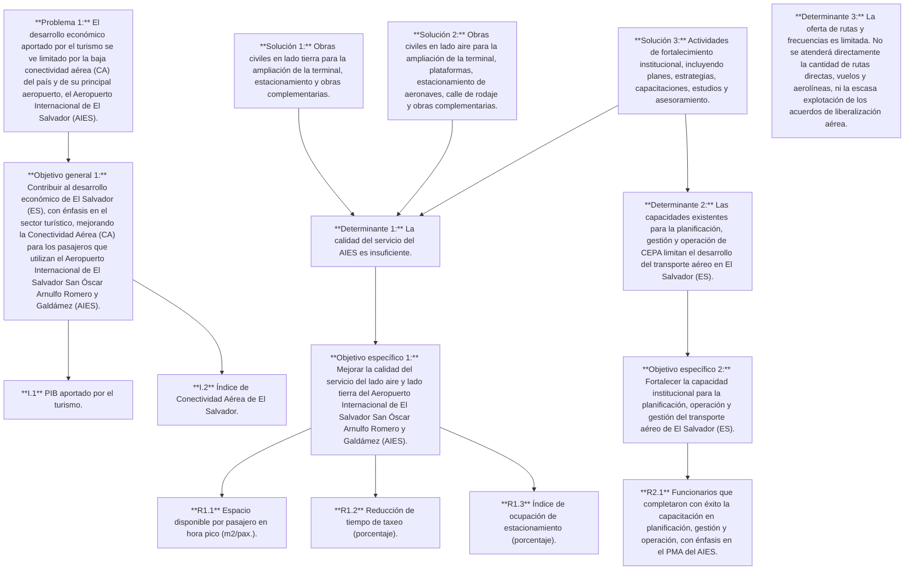
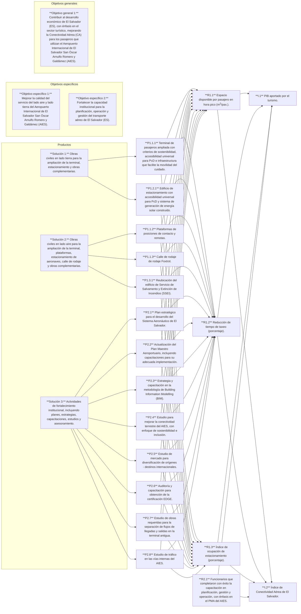
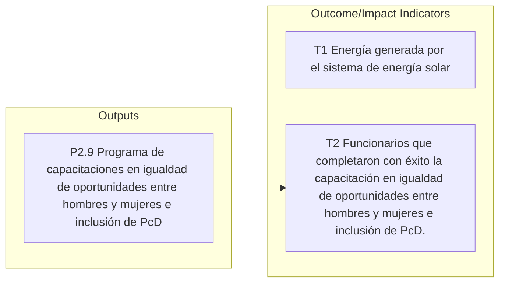

DOCUMENTO DEL BANCO INTERAMERICANO DE DESARROLLO

## **EL SALVADOR**

### **PROGRAMA DE MODERNIZACIÓN DEL AEROPUERTO INTERNACIONAL DE EL SALVADOR (ES-L1173)**

#### **Teoría del Cambio**

**Etapa: APROBACIÓN**
**Fecha: 09/19/2025**

Este documento fue preparado por: Daniel Ramírez (INE/TSP); Jonathan Bernal (INE/TSP); y José Villascusa (PTI/TIN).

1

## Índice

| 1. | Gráficos | 3 |
| --- | --- | --- |
| 1.1 | Gráfico 1 de Teoría del Cambio | 3 |
| 1.2 | Gráfico 2 de Teoría del Cambio | 4 |
| 2. | Descripción del problema principal y objetivo general | 5 |
| 2.1 | Definición del problema principal que abordará el programa | 5 |
| 2.2 | Cuantifique el problema | 5 |
| 2.3 | Enuncie el objetivo general de desarrollo (OGD) | 7 |
| 2.4 | Indicadores del OGD | 7 |
| 3. | Determinantes del problema principal y objetivos específicos | 8 |
| 3.1 | Definición de los determinantes y descripción de su vínculo con el problema | 8 |
| 3.2 | Identifique los determinantes que abordará el programa y justifique su selección | 13 |
| 3.3 | Cuantifique las deficiencias asociadas a cada determinante que abordará el programa | 13 |
| 3.4 | Enuncie los objetivos específicos de desarrollo (OED) asociados a los determinantes que abordará el programa | 16 |
| 3.5 | Indicadores de los OED | 16 |
| 4. | Soluciones propuestas | 18 |
| 4.1 | Descripción de las soluciones propuestas y la cadena de resultados para el logro del objetivo específico | 18 |
| 4.1.1 | Defina las soluciones propuestas | 18 |
| 4.1.2 | Aporte evidencia de la efectividad de las soluciones | 19 |
| 4.1.3 | Cadena de resultados | 22 |
| 5. | Contribuciones esperadas | 28 |
| 5.1 | Beneficiarios | 28 |
| 5.2 | Reducción esperada de las deficiencias identificadas | 28 |

2

## 1. **Gráficos**

### 1.1 **Gráfico 1 de Teoría del Cambio**

*Ilustración 1. Gráfico 1 de la teoría del cambio*

flow_chart: Diagrama de teoría del cambio

**No abordado por el proyecto**

**Determinante 3:** La oferta de rutas y frecuencias es limitada. No se atenderá directamente la cantidad de rutas directas, vuelos y aerolíneas, ni la escasa explotación de los acuerdos de liberalización aérea.

3

## 1.2 Gráfico 2 de Teoría del Cambio

*Ilustración 2. Gráfico 2 de la teoría del cambio*

flow_chart: Diagrama de flujo que conecta productos, objetivos específicos y objetivos generales

4

*Ilustración 3. Otros Indicadores de Temas Transversales1*

flow_chart: Diagrama de flujo que muestra la relación entre Outputs y Outcome/Impact Indicators

## 2. Descripción del problema principal y objetivo general

### 2.1 Definición del problema principal que abordará el programa.

El desarrollo económico del país presenta restricciones por parte de los aportes del sector turístico debido a la limitada Conectividad Aérea (CA) de ES. La CA define el nivel en que un aeropuerto, ciudad, región o país está conectado mediante transporte aéreo y es la ponderación del número de pasajeros y destinos aéreos del sitio analizado. Existe un fuerte lazo entre CA y desarrollo económico2, toda vez que esta permite conectar personas y ofrecer a los ciudadanos mejores y mayores oportunidades de acceso a bienes y servicios, además de alcanzar tiempos eficientes y costos generalizados de viaje razonables mediante la reducción de tiempos de recorrido, lo que mejora la competitividad en los mercados internacionales3.

Gracias a lo anterior, la mejora en la conectividad aérea fomenta el turismo y permite recibir un flujo más alto de turistas, atrayéndolos gracias a menores costos generalizados de viaje en términos de tiempo y dinero. Una infraestructura aeroportuaria moderna, eficiente y con alta conectividad es crítica para sostener el crecimiento turístico, aumentar el gasto medio por visitante y diversificar mercados emisores4,5,6. Lo anterior impulsa el desarrollo económico, generando mayores ingresos por medio del sector hotelero, cultural, de deportes, transporte y turístico en general, además de incrementar el consumo de bienes y servicios en otros sectores.

### 2.2 Cuantifique el problema

ES ha experimentado un crecimiento económico históricamente bajo. Entre 2004-2023, el Producto Interno Bruto (PIB) creció 2,1% por año, debajo del promedio de 3,8% en

1 El detalle de los otros indicadores relacionados con las Áreas Transversales que no forman parte de la teoría del cambio central del programa se encuentra en el Plan de Monitoreo, Evaluación, y Aprendizaje (MEL, EER#2) y los anexos temáticos correspondientes.
2 <u>BID,</u> 2018.
3 <u>BID,</u> 2018.
4 <u>OMT,</u> 2025.
5 <u>ATAG,</u> 2024.
6 <u>ACI Europe,</u> 2023.

5

Centroamérica y República Dominicana7. La economía de ES depende altamente de remesas (24% del PIB [2023]) y presenta bajos niveles de inversión (entre 2012-2023, la formación bruta de capital fijo promedió el 18% del PIB), abajo del promedio de América Latina y el Caribe (ALC) (20%). Para 2025, el Banco Central de Reserva y el Fondo Monetario Internacional (FMI) proyectan un crecimiento del 3% del PIB.

Históricamente, el PIB de ES se distribuye principalmente en los sectores de servicios (59,6%), industria (15,0%), y agricultura y pesca (4,7%)8. Como parte de los servicios, se encuentra el sector turismo. En 2024 el sector turismo contribuyó directamente alrededor de US$2.400 millones a la economía salvadoreña, es decir, 6,9% del PIB9. El aporte del turismo al PIB del país ha crecido un 11,4% anual desde 2018, muy por encima que el resto de la región. Cuando los impactos indirectos e inducidos del sector son contabilizados, se puede observar que el turismo contribuyó alrededor de US$4.954 millones, 14,5% del PIB, en 2023 y US$5.255 millones, 15,2% del PIB, en 202410. En 2023, la contribución total al empleo fue de 417.900 personas o un 14,1% de la fuerza laboral a nivel nacional en 2024 (contribución directa de empleo: 151.400 personas o 5,1% de la fuerza laboral)11. Las proyecciones del Economic Impact Research del WTTC12 estiman que ES mantendrá un crecimiento más limitado de la contribución del turismo en la próxima década, lo que muestra la necesidad de una revigorización del destino. Partiendo de un récord de 3,18 millones de visitantes internacionales en 202413, y un incremento del 28% respecto al año anterior, el país podría superar los 5 millones de llegadas internacionales en 2030 si se garantizan como mínimo las condiciones actuales de seguridad, se produce una mejora de la conectividad y se fortalece la promoción turística más allá de los mercados y segmentos actuales. De manera específica, 50% de los turistas internacionales de ES llegan por vía aérea. Desde el 2019, el número de turistas que llegan por este medio ha crecido en 108%14. A pesar de la creciente oportunidad de crecimiento económico para el país otorgada por el importante aumento de viajeros, ES tiene un amplio grado de mejora para su gestión turística. El índice de competitividad turística del país15 es de 3,34, ubicándolo en el puesto 97 de 140 países evaluados.

De acuerdo con la medición realizada por el Foro Económico Mundial (WEF), ES tiene una limitada conectividad aérea que restringe el desarrollo económico aportado por el sector turístico. En 2024, el país registró un índice de conectividad aérea de 1.403.066, inferior al promedio de ALC (3.312.545)16, lo que lo ubica en puesto 82 (vs. Costa Rica [65]; Panamá [53]; República Dominicana [41]; México [16]), con 33 destinos internacionales y 922 frecuencias semanales17, muy por debajo de referentes regionales como Panamá (84 destinos y 1.260 frecuencias semanales)18. Esta brecha limita el crecimiento del turismo y la competitividad internacional del país, limitando la captación plena de beneficios económicos y sociales asociados a un sistema aeroportuario moderno, eficiente y conectado.

| 7 | FMI, 2025. |
| --- | --- |
| 8 | FocusEconomics, 2022. |
| 9 | WTTC, 2025. |
| 10 | WTTC, 2024. |
| 11 | WTTC, 2025. |
| 12 | WTTC, 2025. |
| 13 | MITUR, 2024 |
| 14 | WTTC, 2025. |
| 15 | WEF, 2025. |
| 16 | IATA, 2023; IATA, 2024. |
| 17 | CEPA, 2024. |
| 18 | Tocumen, 2025. |

6

Por su parte, el indicador de infraestructura de transporte aéreo de ES tiene una puntuación de 2,95, por debajo del promedio de la región de ALC, 3,219. Este índice refleja una deficiencia en el nivel en que la infraestructura de transporte aéreo ofrece conectividad aérea y acceso para los turistas20. Se estima que, por cada punto porcentual de incremento en CA, el comercio internacional incrementa un 6,3% y la participación en actividades de las cadenas de suministro se incrementan en 2,9%21. Asimismo, varios estudios han identificado una correlación y relación causal bidireccional entre la oferta de servicios aéreos y el flujo del turismo22, en donde por cada 10% de incremento en la llegada de turistas se evidencia un 1% de aumento en el movimiento de aeronaves23.

Según <u>Oxford Economics,</u> un aumento del 10% en CA directa puede generar un incremento de hasta el 0,5 % en el PIB per cápita y del 1,6% en el empleo, reflejando el fuerte impacto multiplicador del transporte aéreo en economías turísticas24.

## 2.3 Enuncie el objetivo general de desarrollo (OGD).

El Objetivo General es contribuir al desarrollo económico de El Salvador (ES), con énfasis en el sector turístico, mejorando la Conectividad Aérea (CA) para los pasajeros que utilizan el Aeropuerto Internacional de El Salvador San Óscar Arnulfo Romero y Galdámez (AIES).

## 2.4 Indicadores del OGD

Los indicadores para medir el logro del objetivo general son dos:

Primero, el PIB aportado por el turismo. Los insumos para este indicador se obtendrán de cifras oficiales y permitirá identificar el crecimiento obtenido gracias a la nueva infraestructura aeroportuaria. Este indicador permite identificar el impacto generado en el desarrollo económico gracias a la mejora de la CA.

image: formula and definitions

$$\Delta PIB_{Tur} = TC * GI$$

* **$\Delta PIB_{Tur}$**: Variación del aporte del turismo al PIB
* **$TC$**: Número de turistas considerados
* **$GI$**: Gasto turista individual por estadía

Segundo, el Índice de Conectividad Aérea de El Salvador. Este indicador será calculado usando como referencia el indicador “Air Connectivity Score” de <u>IATA,</u> basado en datos de la organización británica Official Airline Guide (OAG), la cual recopila datos del sector aeronáutico a nivel global. Para garantizar la consistencia y precisión de los cálculos realizados, se validará la aplicación

19 <u>WEF</u>, 2025.
20 <u>WEF</u>, 2025.
21 <u>IATA</u>, 2016.
22 Tang, 2023.
23 Mazzola et al., 2022.
24 <u>Oxford Economics</u>, s.f.

7

del método estimando el indicador para fechas pasadas y comparándolo con los valores publicados por la IATA. Este indicador permite determinar el aumento de la CA gracias a la mejora en la calidad del servicio del AIES.

$$ICA = \sum Oas \times PAd$$

**OAs.** Oferta de Asientos (salida) por destino

**PAd.** Peso del Aeropuerto de destino (medido en función escala comparativa de pasajeros totales, en donde el que recibe el valor 1 es el aeropuerto con mayor afluencia de pasajeros a nivel global)

## 3. Determinantes del problema principal y objetivos específicos

### 3.1 Definición de los determinantes y descripción de su vínculo con el problema

La baja CA en ES plantea una problemática que limita el nivel de conexión e interacción del país con el resto del mundo, el cual involucra elementos estrechamente relacionados entre sí, incluyendo la cantidad de pasajeros, la oferta del transporte aéreo, la infraestructura instalada y la gestión y planificación correspondiente. En ES, la conectividad aérea se concentra en el AIES, único aeropuerto con vuelos comerciales regulares, el cual atiende el 99,8% de las operaciones aéreas del país y el 100% de los vuelos internacionales. El AIES es gestionado por la Comisión Ejecutiva Portuaria Autónoma (CEPA)25. Para mejorar la CA y, con ello, impulsar el desarrollo del sector turístico, es esencial comprender los determinantes que la condicionan. En el caso de ES, estos determinantes se agrupan en tres grandes categorías: (i) la calidad del servicio aeroportuario otorgada por la infraestructura aeroportuaria; (ii) la gestión y planificación estratégica; y (iii) la oferta y demanda de rutas y frecuencias aéreas26. A partir de ahí, se definen los tres determinantes de esta operación: (i) la calidad del servicio del AIES es insuficiente; (ii) las capacidades existentes para la planificación, gestión y operación de CEPA limitan el desarrollo del transporte aéreo en ES; y (iii) la oferta de rutas y frecuencias es limitada

**Primer determinante: La calidad del servicio del AIES es insuficiente.** De acuerdo con la Organización de Aviación Civil Internacional (OACI), la calidad de la experiencia de los pasajeros es fundamental para la CA, pues fomenta una mayor demanda de servicios de transporte aéreo e incentiva el crecimiento de la oferta27. Los usuarios del transporte aéreo, en general, buscan recibir un servicio de calidad, en donde puedan utilizar las instalaciones de manera fluida, cómoda y asequible, sin demoras ni dificultades28. Esta calidad del servicio se vincula con los diferentes servicios y aspectos del aeropuerto, como la atención al cliente, la limpieza, la eficiencia y la seguridad. Adicionalmente, la Asociación Internacional de Transporte Aéreo

25 <u>CEPA</u>, 2025.
26 Los determinantes han sido planteados con base en <u>OACI</u>, 2017.
27 <u>OACI</u>, 2013.
28 <u>OACI</u>, 2017.

8

(IATA)29 establece que la calidad del servicio aeroportuario depende de: (i) la definición de Niveles de Servicio (NdS) y estándares de calidad sustentados en las necesidades de los usuarios; (ii) la implementación de indicadores de desempeño (KPI) objetivos con metodologías de medición claras y, en lo posible, automatizadas; (iii) la disponibilidad y confiabilidad de la infraestructura y activos críticos del aeropuerto; (iv) la gestión eficiente de los procesos y puntos de contacto con los pasajeros; y (v) un sistema de gobernanza que asegure la rendición de cuentas, la transparencia en los resultados y la mejora continua del desempeño. Estos factores, cuando se gestionan adecuadamente, garantizan una experiencia aeroportuaria de alta calidad.

En línea con el concepto de calidad, la IATA ha generado históricamente lineamientos de diseño para estandarizar conceptualmente el NdS en infraestructura aeroportuaria30, el cual se puede analizar de manera general o por cada uno de los subsistemas existentes. Un NdS adecuado permite al sistema aeroportuario atender de manera eficiente la demanda de sus usuarios en hora pico, incluyendo, según el subsistema analizado, a pasajeros, aeronaves, autos, carga, equipaje, entre otros. Lo anterior se logra contando con capacidad suficiente y procesos eficientes que permiten que los tiempos de cola y de servicio sean óptimos y las demoras se minimicen. Esto, a su vez, permite cubrir los picos de demanda y el crecimiento natural de la demanda y oferta aérea. Bajos NdS, por su parte, generan sobrecostos y retrasos, lo cual puede reducir la CA de dos maneras: por un lado, estas ineficiencias reducen el atractivo del aeropuerto y el interés de operar por parte de las aerolíneas debido a la menor demanda (ya que los usuarios que tengan la oportunidad optarían por utilizar una manera diferente de llegar, o bien cambiar de destino turístico); y, por el otro lado, los mayores costos y demoras disminuyen la capacidad operativa, por lo que se reduce la cantidad de aeronaves y pasajeros que el aeropuerto puede atender en un mismo lapso. Por lo tanto, un bajo NdS puede llevar a una reducción de los vuelos programados y, consecuentemente, la CA.

El NdS del lado tierra correspondiente al área disponible por pasajero, específicamente en las áreas de intervención de la presente operación es uno de los indicadores que permite medir la calidad del servicio prestado en el AIES. Este usualmente se determina evaluando la superficie que tienen los pasajeros para transitar y esperar. Este factor suele ser mayor que en otras infraestructuras, al considerar el espacio ocupado por el equipaje. La Tabla 1 muestra los valores de referencia para este indicador.

29 <u>IATA, 2022.</u>
30 La infraestructura aeroportuaria se clasifica en lado aire o lado tierra. El lado aire consiste en componentes como la pista de aterrizaje, las calles de rodaje, las plataformas, las posiciones de contacto y toda aquella infraestructura diseñada para servir a las aeronaves, como la torre de control, hangares, las mangas que conectan las posiciones de contacto con las salas de espera, entre otros. En el lado aire está diseñado y restringido para la circulación de aeronaves y personal y vehículos relacionados con la operación de estas y solo en determinados casos, se asignan corredores seguros para el tránsito de personas, por ejemplo, para acceder a la aeronave en una posición remota. Por su parte, el lado tierra consiste en los edificios y demás infraestructura destinada para la circulación de pasajeros, carga y personal no relacionado directamente con las aeronaves. Una terminal aérea de pasajeros incluye, por ejemplo, mostradores de facturación (counters), salas de espera, pasillos de circulación de pasajeros, bandas de entrega de equipaje, locales comerciales, baños, espacios de esparcimiento (gratuitos o pagos), puntos de migración, aduana, seguridad, entre otros, además de las oficinas administrativas destinadas para el operador del aeropuerto, (que en el caso del AIES es CEPA) y de las empresas que prestan sus servicios en el aeropuerto, especialmente las aerolíneas y empresas de servicios aeroportuarios. El lado tierra también incluye infraestructura y espacios para circulación y estacionamiento de vehículos terrestres públicos y privados, como los estacionamientos, zonas de alquiler de vehículos, vías internas del aeropuerto, bahías de espera, entre otros.

9

### *Tabla 1. Lineamientos IATA (m2/pasajero) áreas de intervención AIES*

|  | Guías de Espacio (m2/PAX) |  |  |  |
| --- | --- | --- | --- | --- |
|  | Sobre-Diseño | Óptimo | Sub-Óptimo |  |
| Salas de Espera en Puerta | Asientos | >2.2 | 1.8 - 2.2 | <1.8 |
| De Pie | >1.5 | 1.2 - 1.5 | <1.2 |  |

*Fuente: Elaboración propia con base en IATA*31

Se han identificado que la principal causa del determinante es la insuficiencia de la terminal: Actualmente, la capacidad instalada ya fue sobrepasada por la demanda. Por su parte, la densidad de pasajeros en las zonas emigración se encuentra aumentando y se estima que, en 2027 el promedio del aeropuerto estará por debajo de los niveles recomendados por la IATA. De no atenderse, se presentarán problemas de congestión de pasajeros en hora pico, lo cual implicará incomodidad, retrasos, mayores tiempos de desplazamiento y una consecuente reducción en el NdS y, por ende, en la calidad del servicio.

Por su parte, se prevé que, en congruencia con la demanda de transporte aéreo, la demanda del servicio de estacionamiento continúe su crecimiento. Al ser parte de los servicios aeroportuarios usados por los pasajeros en el lado tierra, esta oferta forma parte de la percepción del NdS del AIES y su calidad influye directamente en la experiencia del usuario. De continuar con la tendencia de crecimiento esperada, el estacionamiento alcanzaría un nivel de saturación completa antes de 2030. Adicionalmente, en horas pico y, especialmente, durante las épocas de mayor demanda, los vehículos estacionan a ambos costados de la vía de acceso del aeropuerto, generando riesgos de seguridad vial y ralentizando el acceso al AIES.

**Segundo determinante. Las capacidades existentes para la planificación, gestión y operación de CEPA limitan el desarrollo del transporte aéreo en ES.** Para contar con un NdS adecuado en el transporte aéreo, es fundamental la planificación estratégica y la robustez institucional, que guíe el desarrollo físico y operativo de los aeropuertos a corto, mediano y largo plazo, alineándose con la demanda proyectada y los objetivos nacionales e internacionales de aviación.

Una herramienta fundamental para la planificación estratégica es el Plan Maestro Aeroportuario (PMA). Este tipo de instrumentos incluye la planificación a largo plazo, anticipando el crecimiento del tráfico aéreo y proyectando la infraestructura necesaria para satisfacer la demanda sin interrupciones o reducciones en la eficiencia operativa.

Para el caso del AIES, se tiene un amplio margen de mejora. En 2014, ES formuló un PMA con cuatro fases de expansión a 2032 (ver imagen siguiente), que permitirá al AIES atender a 6.600.000 pasajeros/año (partiendo de una capacidad inicial de 1.600.000 pasajeros/año).

31 <u>IATA</u>, 2022

10

*Ilustración 4. Ampliaciones proyectadas en el PMA*

drawing: airport master plan map with legend

* Fuente: Elaboración propia con base en el PMA (2025)

El PMA (2014) identificó, de acuerdo con las proyecciones iniciales de demanda, una serie de ampliaciones para mejorar el nivel de servicio del lado tierra y el lado aire de la infraestructura aeroportuaria. Entre otros, identificó mejoras en el nivel de servicio de las instalaciones de salida en: (i) salas de espera, (ii) número de posiciones de estacionamiento de aeronaves, (iii) mostradores de "check-in", (iv) área para filas de espera y circulación, (v) control de migración, (vi) controles de seguridad, (v) longitud de anden frente a la terminal y control de acceso a la terminal.

Ahora bien, adicionalmente el PMA planteó mejoras en el nivel de servicio en las instalaciones de llegada enfocadas en: (i) control de inmigración, (ii) manejo de equipaje, (iii) aduanas y en general en las áreas funcionales de la terminal. Todas las necesidades de ampliación relacionadas anteriormente se requerían para una demanda proyectada considerablemente menor a la que se presenta actualmente en este aeropuerto.

**Tercer determinante: La oferta de rutas y frecuencias es limitada.** El índice de conectividad aérea (CA) depende altamente de la oferta disponible de vuelos, considerando la diversidad de destinos (con especial atención a aeropuertos estratégicos a nivel global, tanto Gateway como Hubs), la frecuencia de vuelos y la cantidad de sillas ofrecidas. La cantidad de rutas diferentes es fundamental para contar con una buena CA, ya que la diversidad de conexiones directas (o, a lo sumo, con parada en tránsito) con el AIES refleja el nivel de conexión espacial del aeropuerto y, en este caso, de ES con el resto del mundo. Esto permite a los viajeros contar con más posibilidades para llegar al aeropuerto y desarrollar actividades de ocio, negocios, familiares u otras.

11

Asimismo, el volumen de sillas ofertadas entre un par O-D y la cantidad de horarios disponibles en una semana determina el nivel de conexión temporal de cada destino en un día, semana o época del año, facilitando a los viajeros ajustar sus horarios para realizar viajes o hacer conexiones con tiempos de escala adecuados, factor especialmente relevante en aeropuertos Hub. Lo anterior depende de diversos factores, tales como la demanda, el interés y la capacidad de las aerolíneas, los costos operacionales de los vuelos, las condiciones de infraestructura, la cercanía de los destinos y las políticas de liberalización aérea y acuerdos internacionales de aviación.

Para hacer esto posible, es indispensable que existan los acuerdos correspondientes de liberalización aérea, los cuales pueden ser tratados bilaterales de aviación, acuerdos de transporte aéreo o memorandos de entendimiento que autoricen rutas entre dos o más aeropuertos. En ocasiones, la falta de estos acuerdos puede convertirse en una limitante que impide solicitar la creación de nuevas rutas, restringiendo la CA. En el caso de ES, cabe destacar que no existen limitantes en materia de liberalización aérea, ya que el país cuenta con un elevado número de acuerdos internacionales de aviación (22 vigentes), que permiten a las aerolíneas crear vuelos que conecten ES con numerosos países de Latinoamérica y el Caribe, Norteamérica, Europa, Asia y África. Sin embargo, se observa una importante subutilización de estos acuerdos, reflejada en una oferta de vuelos poco diversificada: actualmente, tres quintas partes de las frecuencias semanales de una semana típica tienen como origen o destino Estados Unidos, y el 43% de los pasajeros se concentran en solo 5 de los 33 destinos disponibles, todos ubicados en Estados Unidos.

Esta oferta de rutas y frecuencias es determinada en gran parte por las aerolíneas, las cuales realizan análisis financieros para evaluar la viabilidad de cada vuelo adicional, considerando la demanda potencial, los costos asociados y factores externos de los destinos, como horarios y patrones de tráfico. Cabe considerar que la demanda de vuelos demanda depende de qué tan atractivo sea el lugar para hacer turismo, negocios u otros. En ES, el sector turístico tiene grandes oportunidades de mejora, por lo que, si bien es un sector relevante para la economía del país, sigue siendo muy rezagado en comparación con otras opciones disponibles para los potenciales turistas. Asimismo, el potencial de negocios es relativamente bajo en comparación con otras economías de ALC32.

Por este motivo, considerando el, aunque creciente, limitado atractivo y potencial turístico, y el aún bajo potencial de negocios, la oferta de vuelos ofrecida por las aerolíneas continúa siendo limitada.

Finalmente, cabe resaltar que la oferta también influye en la demanda: un vuelo directo en un horario cómodo aumenta la probabilidad de que un turista extranjero elija viajar a ES (o viceversa), en comparación con la ausencia de dicha conexión. Con base en lo anterior, para mejorar la CA de ES, es necesario fortalecer la diversidad de sus rutas y frecuencias, de manera que ES pueda incrementar la demanda, respondiendo a las necesidades del mercado y diversificando su oferta aérea.

32 Los siguientes indicadores revelan el bajo potencial de negocios de ES: (i) la competitividad del país se ubicó en 2019 en el puesto 103 de 140 países evaluados (<u>Trading Economics</u>, 2025); (ii) el entorno empresarial obtuvo un puntaje de 3,49 en 2024 (abajo del promedio de 3,70 de LAC, solo superando a Nicaragua (3,13) y Honduras (3,13) en Centroamérica) (<u>WEF</u>, 2024); (iii) en el indicador de facilidad de hacer negocios, ES obtuvo el puesto 91 entre 190 países (<u>Trading Economics</u>, 2025); y (iv) la libertad empresarial ubicó al país en puesto 97 entre 175 países (<u>Global Economy</u>, 2025).

12

## 3.2 Identifique los determinantes que abordará el programa y justifique su selección

De los determinantes mencionados, el proyecto atenderá los dos primeros. El primero corresponde a la calidad del servicio del AIES. Su inclusión se justifica en que el Componente I definido para la operación se concentra en desarrollar infraestructura aeroportuaria para aumentar la capacidad, mejorar los procesos de los subsistemas y aumentar la eficiencia energética. El segundo, que se enfoca en la planificación estratégica, será cubierto por el Componente II, cuyas actividades se concentran en fortalecer institucionalmente a CEPA. Esto le permitirá una gestión y planeación estratégica más eficiente y adecuada del aeropuerto, lo cual permitirá incrementar fortalecer el AIES gracias a personal más capacitado, procesos más eficientes, una mejor atención al cliente y un desarrollo más enfocado y organizado de la infraestructura aeroportuaria y de las inversiones realizadas.

El tercer determinante, la oferta de vuelos, no será abordado directamente, ya que está fuera del alcance directo, pues depende de factores externos, tales como políticas de liberalización aérea (las cuales no son un limitante para el AIES), contratos con aerolíneas e interés de estas, además de condiciones de mercado, turismo, desarrollo de la industria, entre otras. Ante ello, CEPA y el GdES deben desarrollar estrategias para fortalecer el entorno para fomentar el incremento de la oferta y la demanda de vuelos. Respecto a esta operación, el Componente II incluye un estudio de mercado para diversificar orígenes y destinos internacionales en el AIES, el cual permitirá identificar potenciales conexiones directas desde el AIES y las potenciales aerolíneas que podrían prestar estos servicios, con el fin de orientar a CEPA y al GdES en la definición de directrices de cómo proceder para atraer mercados y conectar al AIES con destinos estratégicos que permitan aumentar la demanda de pasajeros e incrementar así el turismo en ES. Lo anterior facilitará la gestión de la entidad en la atención de este determinante.

## 3.3 Cuantifique las deficiencias asociadas a cada determinante que abordará el programa.

ES presenta un importante y constante crecimiento de la demanda de pasajeros aéreos. En promedio, la demanda creció 7,76% anualmente entre 2011-202433. En 2024 el aeropuerto movilizó 5.298.491 pasajeros, 16,34% más que en 2023. Esto superó considerablemente las proyecciones de demanda del PMA, que preveían alcanzar 4.737.900 apenas en 2032.

33 Previo a este crecimiento, entre 2004 y 2011, la demanda del AIES se había mantenido estable en aproximadamente dos millones de pasajeros (CEPA, 2025).

13

### *Ilustración 5. Pasajeros del AIES 2013-2032* — series: Demanda real, Proyección PMA 2014; valores en millones de pasajeros

| Año | Demanda real | Proyección PMA 2014 |
| --- | --- | --- |
| 2013 | 2,36 | 2,34 |
| 2014 | 2,44 | 2,50 |
| 2015 | 2,71 | 2,67 |
| 2016 | 2,97 | 2,85 |
| 2017 | 3,15 | 3,05 |
| 2018 | 3,39 | 3,15 |
| 2019 | 3,72 | 3,25 |
| 2020 | 1,08 | 3,35 |
| 2021 | 2,52 | 3,46 |
| 2022 | 3,44 | 3,57 |
| 2023 | 4,55 | 3,68 |
| 2024 | 5,30 | 3,78 |
| 2025 |  | 3,89 |
| 2026 |  | 4,00 |
| 2027 |  | 4,11 |
| 2028 |  | 4,23 |
| 2029 |  | 4,35 |
| 2030 |  | 4,48 |
| 2031 |  | 4,61 |
| 2032 |  | 4,74 |

*Elaboración propia con base en CEPA (2025) y Kimley-Horn (2014)*

La siguiente gráfica revela que el 80% de los pasajeros del AIES entran o salen del país y el 20% usa la terminal como punto de transbordo (donde el pasajero cambia de avión) o tránsito (en el que el pasajero continúa su viaje en el mismo avión). Esto demuestra que la función del aeropuerto es principalmente de Gateway, más que de Hub; es decir, las operaciones se concentran principalmente en entradas y salidas del país y en menor medida en pasajeros con origen y destinos distintos a El Salvador.

### *Ilustración 6. Pasajeros del AIES en 2024 según uso* — Elaboración propia con base en CEPA (2025)

| Uso | Pasajeros | Porcentaje |
| --- | --- | --- |
| Entradas | 2.186.392 | 41 |
| Salidas | 2.083.155 | 39 |
| Transbordo | 986.600 | 19 |
| Tránsito | 42.334 | 1 |

14

El análisis de demanda realizado (<u>EEO#4</u>) proyecta 7.734.280 pasajeros en 2030. lo que evidencia que la modernización institucional de CEPA no ha acompañado el ritmo de crecimiento de la demanda. Este crecimiento de demanda es la principal causa de los dos determinantes que se atienden en el presente programa: (i) la degradación crítica de la calidad del servicio del AIES plasmado en el NdS; y (ii) la obsolescencia de la planeación estratégica realizada.

**Primer determinante: La calidad del servicio del AIES es insuficiente.** Según la Asociación Internacional de Aeropuertos (ACI), el AIES ocupa el noveno lugar34 en calidad del servicio de transporte aéreo y tecnología entre los mejores aeropuertos de Centroamérica y el Caribe. No obstante, su puesto se encuentra muy por debajo de los 100 mejores del mundo. Este ranking destaca áreas de mejora en infraestructura, tecnología, espacio, comodidad y seguridad, para ofrecer un servicio de mayor calidad a los pasajeros.

El AIES tiene un amplio margen de mejora, considerando que la infraestructura aérea es una de las principales deficiencias del país, con un índice de 2,1, ubicándolo en el puesto 108 de 140.

Sin embargo, debido al incremento de demanda, la planeación, que buscaba aumentar la capacidad para atender a 6,6 millones de pasajeros al año a partir de 2032, ha quedado desactualizada. Esta deficiencia, junto con las limitaciones físicas de la infraestructura están degradando de manera crítica el NdS de la terminal. Para el AIES, el NdS se encuentra en un proceso constante de desmejora. En particular, el NdS asociado a la ocupación de la terminal de pasajeros se ha ido degradando aceleradamente. Según IATA, el nivel de servicio óptimo para esta infraestructura se encuentra entre 1,8 m2/pax. y 2,2 m2/pax. En el año 2022, el NdS de la terminal fue de 2,84 m2/pax35. Entre el año 2022 hasta la actualidad, la demanda del aeropuerto ha crecido de manera inesperada, pasando el indicador de 2,84 m2/pax.36 en 2022 a 1,89 m2/pax. en la actualidad (2025) y a 1,42 m2/pax. en 2029, lo cual puede generar congestión, estrés en usuarios, riesgos operativos y aumentar tiempos de atención y costos. Este NdS responde directamente al crecimiento de la demanda y la incapacidad del aeropuerto para reaccionar adecuadamente a esta. Este ritmo de deterioro señala que la terminal se saturaría para el año 2028. De esta manera, existe la necesidad inminente de intervención para garantizar un NdS adecuado.

Por su parte, el estacionamiento, con 1.460 cupos cuenta con un nivel de ocupación promedio del 75% en un día típico. Se prevé que, en congruencia con la demanda de transporte aéreo, la demanda del servicio de parqueo continuará su crecimiento. Al ser parte de los servicios aeroportuarios usados por los pasajeros, el servicio de parqueo forma parte de la percepción del nivel de servicio del AIES y su calidad influye directamente en la experiencia del usuario. De continuar con la tendencia de crecimiento esperada, el parqueadero alcanzaría una sobredemanda de 132% antes de 2030, es decir, se encontraría saturado con una demanda desatendida equivalente al 32% de la capacidad del estacionamiento en promedio. Esto agravaría la situación crítica que actualmente ocurre en horas pico y, especialmente, durante los periodos de estacionalidad, en donde los vehículos estacionan a ambos costados de la vía de acceso del aeropuerto, por lo que generan condiciones adversas de seguridad vial innecesarias y ralentizan el acceso al AIES.

34 <u>LPG</u>, 2024
35 Cálculo realizado considerando las ampliaciones realizadas en 2022 (¶1.17).
36 Cálculo realizado considerando las ampliaciones realizadas en 2022 (¶1.17).

15

**Segundo determinante. Las capacidades existentes para la planificación, gestión y operación de CEPA limitan el desarrollo del transporte aéreo en ES.** A pesar de contar con un PMA, el AIES no desarrolló el proceso de expansión según lo planeado. CEPA desarrolló la Fase 1 del plan y algunas obras adicionales de la fase 2 original. Adicionalmente, reaccionando al comportamiento de la demanda, ES desarrolló varias obras en el AIES: en 2022 aumentó las salas de espera, puestos de migración y bandas de equipaje; en 2023, se construyeron cinco puentes de abordaje y 250 estacionamientos; y en 2025, se amplió la zona de “check-in”. Con esto, la terminal alcanzó una capacidad estimada para atender 5.000.000 pasajeros/año. Finalmente, en este mismo año (2025), CEPA inició el proceso de licitación para ampliar las zonas de migración, bandas de entrega de equipaje, y la bahía de recogida de pasajeros.

No obstante, debido al acelerado crecimiento de pasajeros transportados, los valores de demanda actuales (5.298.491 pasajeros en 2024) sobrepasaron las estimaciones realizadas en el PMA (4.737.900 pasajeros) y la capacidad actual (5.000.000 pasajeros en 2025). Por ende, todas las necesidades de ampliación identificadas en este PMA están actualmente obsoletas. Consecuentemente, se hace indispensable actualizar el PMA para orientar las inversiones a mediano y largo plazo, así como planear la operación del aeropuerto de manera costo-eficiente, en el marco de la ampliación inminente requerida en la infraestructura del AIES.

## 3.4 Enuncie los objetivos específicos de desarrollo (OED) asociados a los determinantes que abordará el programa.

Los Objetivos Específicos de la operación son:

(i) Mejorar la calidad del servicio del lado aire y lado tierra del AIES.
(ii) Fortalecer la capacidad institucional para la planificación, operación y gestión del transporte aéreo de ES.

## 3.5 Indicadores de los OED

Para el primer objetivo específico, “mejorar la calidad del servicio del lado aire y lado tierra del AIES”, se establecen tres indicadores de resultado:

El primero consiste en el espacio disponible por pasajero en hora pico, medido en m2/pasajero. La evaluación considerará las áreas totales de circulación más áreas de espera de todo el aeropuerto y la cantidad de pasajeros atendidos durante la hora pico. La evaluación se hace con base en la metodología IATA. El detalle de las áreas consideradas para el cálculo consta en el MEL.

$$IED/Pax = \frac{EDP_{SE}}{TPax}$$

**IED/Pax.** Índice de Espacio Disponible por Pasajero
**EDPSE.** Espacio disponible por pasajero en sala de espera (m2)
**TPax.** Pasajeros totales en espera (sentados y de pie en período pico).

16

El segundo indicador corresponde al ahorro en tiempo de rodaje (taxeo o taxiing) en el lado aire. El indicador se mide considerando la reducción de trayectoria recorrida por los aviones debido a la nueva calle de rodaje Foxtrot. El indicador considera las distintas posiciones de contacto y remotas, identificando los beneficios obtenidos para cada una, teniendo en cuenta la cantidad de recorridos que efectivamente aprovecharían la nueva calle de rodaje Foxtrot. De esta manera, el <u>valor indicado aplica para el total de</u> operaciones que utilizarían esta nueva conexión.

$$IATT = \frac{(TTA - TTE)}{TTA} \times Ops$$

**IATT.** Indicador de Ahorro Tiempo de Taxeo (%)
**TTA.** Tiempo de Taxeo Actual (min). Tiempo de rodadura promedio a los stands 17 a 19 sin calle F
**TTE.** Tiempo de Taxeo Esperado (min) para los stands 17 a 29, beneficiados por la construcción de la calle F
**Ops.** Total operaciones por año

El tercer indicador es el índice de ocupación del parqueo, medido como un porcentaje de ocupación de las plazas de estacionamiento del total disponible. El índice se compara la situación sin proyecto, es decir, del valor que este tendría en el año de medición si no se construye el nuevo edificio de parqueo.

$$PE = \frac{\sum E h_{AR} \times Ta_{AR} + (Ed_{LD} - Sd_{LD}) \times Ta_{LD}}{TP}$$

**PE.** Productividad de Estacionamiento en Porcentaje de ocupación (%)
**EhAR.** Entradas hora tipo de vehículos de alta rotación
**TaAR.** Tasa anual promedio de alta rotación
**EdLD.** Entradas diarias de vehículos de larga duración
**SdLD.** Salidas diarias de vehículos de larga duración
**TaAR.** Tasa anual promedio de larga duración
**TP.** Total de posiciones de estacionamiento

Fuente: SLOTT Consulting

Para el segundo Objetivo Específico, “fortalecer la capacidad institucional para la planificación, operación y gestión del transporte aéreo de ES”, se establece un indicador de resultado:

El indicador consiste en la cantidad de funcionarios que completaron con éxito la capacitación en planificación, gestión y operación, con énfasis en el PMA del AIES. Los criterios para considerar que el funcionario culminó satisfactoriamente el curso incluirán una asistencia mínima y un puntaje en los exámenes o talleres que se establezcan en la capacitación.

$$FC_P = F_{A,E}$$

**FCP.** Funcionarios que completaron con éxito la capacitación en planificación, gestión y operación, con énfasis en el PMA del AIES.
**FA,E.** Funcionarios que cumplieron la Asistencia mínima y aprobaron las Evaluaciones designadas.

17

## 4. Soluciones propuestas

De los factores que determinan la CA, CEPA, a través de esta operación, espera enfrentar el determinante de calidad de servicio y el de gestión y planificación estratégica. Para atender el primer determinante, esta operación desarrollará una nueva terminal de pasajeros, plataforma, calle de rodaje Foxtrot, nuevas posiciones de aeronaves, sistemas vitales y su integración con sistemas existentes, además de la ampliación del estacionamiento correspondiente con el incremento de la demanda. Esta ampliación está basada en la segunda de las cuatro etapas planteadas en el Plan Maestro Aeroportuario para la ampliación del AIES. Al planteamiento del PMA, se adicionó la calle Foxtrot, que conectará directamente la nueva plataforma con la calle de rodaje Alfa, lo que permitirá menores tiempos de recorrido entre las nuevas posiciones y la pista de aterrizaje. Finalmente, se financiarán actividades de fortalecimiento institucional, enfocadas principalmente en atender el segundo determinante, aunque también contribuirán al primero. En esta sección se describen las soluciones y cómo estas llevan a los resultados e impactos propuestos.

### 4.1 Descripción de las soluciones propuestas y la cadena de resultados para el logro del objetivo específico

#### *4.1.1 Defina las soluciones propuestas*

Con el fin de fortalecer la calidad del servicio en el AIES, la presente operación desarrollará las siguientes actividades:

La primera solución consiste en obras civiles en el lado tierra para la ampliación de la terminal, estacionamiento y obras complementarias. Esto incluye: (i) construcción de una nueva sección de la terminal de pasajeros con seis nuevas salas de espera. Esto permitirá incrementar el espacio disponible para los pasajeros y, teniendo en cuenta que serán considerablemente más amplias que las salas de espera actuales, el nivel de servicio dentro de la terminal, medido con la densidad de pasajeros, aumentará para la nueva zona y para el aeropuerto en general, inclusive contemplando el incremento de demanda posterior a la ampliación del edificio. La terminal será desarrollada con accesibilidad universal para PcD y elementos que faciliten la movilidad del cuidado. (ii) Construcción de un edificio de parqueadero con sistema de generación de energía solar (lado tierra), el cual mejorará la capacidad del componente vehicular del AIES, mejorará la seguridad vial en inmediaciones del aeropuerto al captar a los vehículos que se estacionan en las afueras del AIES cuando el estacionamiento de este se llena y mejorará la distribución de fuentes de generación eléctrica, incrementando la participación de energías limpias. Al igual que la terminal, se garantizará la accesibilidad universal para PcD en las nuevas instalaciones de estacionamiento.

La segunda solución consiste en obras civiles en el lado aire para la ampliación de la terminal, incluyendo plataformas, calle de rodaje y obras complementarias. Esto incluye: (i) Construcción de las plataformas para posiciones de contacto y remotas. Debido a la configuración actual del aeropuerto, algunas posiciones de contacto del nuevo edificio de la terminal ocuparán el espacio en donde actualmente se encuentra la plataforma de posiciones remotas. Ante ello, se incluye la construcción de una plataforma adicional para reemplazar este espacio y contar con una nueva área para posiciones remotas. En total, se contarán con seis nuevas posiciones de contacto y la capacidad de posiciones remotas se mantendrá. (ii) Construcción de la calle de rodaje Foxtrot (lado aire), la cual generará un enlace más corto entre la plataforma nueva y la calle de rodaje

18

Alfa (aquella que va paralela a la pista). Esto acortará el recorrido entre la cabecera 25 y la terminal (principalmente las posiciones de la terminal nueva y varias de las existentes). Esto reducirá los tiempos de rodaje (taxiing), disminuirá las emisiones generadas por los aviones, ahorrará tiempo de viaje de los pasajeros, reducirá los costos operacionales y facilitará la gestión operativa, generando mayor eficiencia en la operación aeroportuaria. (iii) Construcción de una nueva estación de Servicio de Salvamento y Extinción de Incendios (SSEI). Debido a la ubicación de la nueva plataforma remota, es necesario reubicar el SSEI actual, en aras de garantizar la prestación del servicio rápida y oportuna siempre que se requiera.

La tercera solución consiste en el desarrollo de actividades de fortalecimiento institucional y planificación estratégica, incluyendo capacitaciones, estudios, planes y estrategias: (i) Plan estratégico para el desarrollo del Sistema Aeronáutico de ES; (ii) actualización del PMA, incluyendo capacitaciones para su adecuada implementación; (iii) estrategia y capacitación en la metodología de Building Information Modelling (BIM); (iv) estudio para mejorar la conectividad terrestre del AIES, con enfoque de sostenibilidad e inclusión; (v) estudio de mercado para diversificación de orígenes-destinos internacionales; (vi) auditoría y capacitación para obtener la certificación EDGE; (vii) estudio de obras requeridas para la separación de flujos de llegadas y salidas en la terminal antigua; (viii) estudio de movilidad del entorno del aeropuerto con énfasis en el estacionamiento; y (ix) programa de capacitaciones en igualdad de oportunidades entre hombres y mujeres e inclusión de Personas con Discapacidad (PcD) para el personal de CEPA y sus unidades.

*Ilustración 7. Ampliaciones del AIES proyectadas en la operación*

drawing: airport terminal expansion plan

*Fuente: CEPA (2025)*

## *4.1.2 Aporte evidencia de la efectividad de las soluciones*

Este proyecto es novedoso, ya que permitirá contar con evidencia empírica del efecto de estas intervenciones en la calidad del servicio y en el aporte del PIB al turismo en El Salvador, la cual podrá servir de referencia para otros países de América Latina y el Caribe. A continuación, se

19

describen evidencias de la efectividad de las soluciones de acuerdo con la solución relacionada. Cabe aclarar que algunas evidencias soportan más de una solución.

## **Solución 1. Lado tierra**

Un estudio desarrollado tomando como referencia el Aeropuerto Internacional de São Paulo-Guarulhos37 realizó un análisis de los niveles de servicio de un aeropuerto, encontrando que la experiencia antes de entrar a la terminal, es decir, bahías, estacionamiento, vías internas y la acera de desembarque, es uno de los factores que más influyen en la percepción que tienen los pasajeros sobre el NdS del del aeropuerto. Otro de los factores relevantes para el NdS es la experiencia en salas de espera. Asimismo, se destacan como factores contribuyentes la facilidad de orientación, el motivo de viaje, y la experiencia en check-in.

Para esta operación, se intervendrán dos de los cinco factores más relevantes identificados en el estudio, que corresponden al estacionamiento y las salas de abordaje. Esto permitirá mejorar el NdS y la calidad del servicio del AIES, toda vez que los usuarios tendrán mejores experiencias en el aeropuerto, que contará con mayor capacidad.

Según un estudio de 202338, los pasajeros están cada vez más informados y son más exigentes respecto a la calidad del servicio que reciben, lo que convierte su satisfacción en un factor clave para los aeropuertos, ya que no solo genera mayores ingresos, sino que también aumenta la probabilidad de que vuelvan a utilizarlos. Dentro de sus hallazgos, menciona que, si bien la ampliación del aeropuerto permite ofrecer mayor espacio y capacidad, la construcción de una nueva terminal, por sí sola, no garantiza un aumento en la satisfacción, pues es necesario generar una auténtica sensación de asombro, lo que implica conocer las necesidades y expectativas de los usuarios, diseñar con enfoque en ellos y atender tanto sus aspectos físicos como emocionales. Para ello, es indispensable identificar pequeños obstáculos o micro problemas que puedan alterar el recorrido o la experiencia de los pasajeros. Entre los elementos más valorados por los pasajeros se encuentran la oferta y calidad de los comercios, la decoración con inclusión de vegetación, el estacionamiento conectado directamente con la terminal, la disponibilidad de carritos de equipaje y cajeros automáticos, la expertise y amabilidad del personal, el acceso a información en tiempo real, así como la comodidad de las salas de espera.

El programa considera construir la terminal con criterios que fortalecen la percepción de la calidad del aeropuerto: (i) es universalmente accesible, lo cual es fundamental para PcD, movilidad del cuidado, e incluso para pasajeros con equipaje de mano, ya que facilita el desplazamiento por las instalaciones del aeropuerto; (ii) cuenta con instalaciones dedicadas a la movilidad del cuidado, lo que beneficia especialmente a las familias con niños pequeños; (iii) tendrá certificación EDGE, lo cual mejora experiencia sensorial de los pasajeros, en términos de iluminación y calidad del aire al interior del edificio; y (iv) las nuevas salas de espera y nuevos pasillos de circulación contarán con más superficie por pasajero, lo cual permitirá que sea más cómodo esperar los vuelos una vez se complete el proceso de emigración.

Existe evidencia a nivel global de cómo las inversiones en infraestructura aeroportuaria mejoran la CA de un aeropuerto. El estudio “Conectividad Aérea en regiones remotas” del BID39 analizó múltiples políticas públicas para proporcionar CA, encontró que las políticas basadas en aeropuertos, es decir, aquellas que buscan mejorar la CA mediante el fortalecimiento de los

37 <u>Ribeiro Correira et al., 2008</u>
38 <u>Boc et al.,</u> 2023
39 <u>BID,</u> 2018.

20

operadores aeroportuarios, desarrollo de nuevos servicios y la mejora en la infraestructura aeroportuaria tenían resultados positivos, pues la evidencia mostró que las inversiones realizadas en estos programas incrementaron significativamente el tráfico en los aeropuertos participantes40. El estudio identificó casos en diversos países como Australia, Brasil, Canadá, Estados Unidos y algunos de Unión Europea41, enfocándose en aeropuertos de baja capacidad

El programa realizará inversiones en infraestructura, con lo cual buscará mejorar la calidad del servicio y, con ello, mejorar la conectividad aérea. Con ello se busca aumentar el turismo y el aporte generado al PIB desde este sector.

## **Solución 2: Lado aire**

La construcción de una calle de rodaje de 2,1 km en el Aeropuerto Internacional de Delhi permitió acortar significativamente las distancias de rodaje hacia y desde la pista 29/11, reduciendo hasta 7 km el recorrido para las aeronaves. Esto benefició la calidad del servicio prestada a los pasajeros en el lado aire al reducirles el tiempo de viaje y aportó en la disminución de emisiones generadas, la cual se estimó en hasta 55.000 tCO2/año42.

En el caso del AIES, la calle Foxtrot busca, justamente, reducir los tiempos de rodaje entre la cabecera 25 y las nuevas posiciones, además algunas de la terminal existente. En total, la calle de rodaje beneficiará a cerca del 42% de las posiciones en total, que atenderán el 38% de las operaciones una vez construida la nueva terminal.

Un estudio identificó que las aerolíneas evalúan la calidad del servicio prestado por los aeropuertos, considerando especialmente aquellas características que influyen en sus operaciones y costos y en la demanda de pasajeros43. De esta manera, el contar con mayor calidad de servicio puede resultar en una mayor cantidad de rutas y frecuencias, ende en una mayor conectividad aérea.

La operación mejorará las condiciones operativas del AIES al incrementar la capacidad en el lado aire, gracias a la construcción de nuevas posiciones de contacto y a la calle de rodaje Foxtrot, lo cual reducirá los costos de operación. Asimismo, al mejorar la capacidad de la terminal, se aumentará la capacidad de pasajeros atendidos, lo cual será atractivo para las aerolíneas y las incentivará a desarrollar nuevas rutas y frecuencias.

## **Solución 3: Fortalecimiento Institucional**

La publicación “Gestión y regulación de infraestructura aeroportuaria sostenible – Módulo tres. Planificación y gestión aeroportuaria en un nuevo contexto regulatorio” de 2020 del BID44, recopila diversos casos que refuerzan la importancia de contar con planificación estratégica para el adecuado desarrollo de la infraestructura aeroportuaria. Un ejemplo es el Aeropuerto Internacional de Kuala Lumpur en Malasia (1990s–2000s), cuyo Plan Maestro separaba las terminales domésticas e internacionales, pero la inesperada expansión de Air Asia obligó a rediseñar la infraestructura, mostrando la necesidad de planes flexibles frente a cambios de mercado. Otro caso es el del Aeropuerto Central de Ciudad Real en España (2009–2011),

40 <u>BID</u>, 2018.
41 <u>BID</u>, 2018.
42 <u>IADB</u>, 2021.
43 <u>Adler & Berechman</u>, 2001.
44 <u>BID</u>, 2020.

21

construido con una inversión cercana a los 700 millones de euros y cerrado apenas dos años después debido a la salida de Vueling, su única aerolínea operadora, lo que evidencia las consecuencias de una proyección de demanda poco realista. En contraste, el Plan Nacional de Sistemas Integrados de Aeropuertos de Estados Unidos (vigente desde 1984, con actualizaciones cada cinco años) se resalta como una buena práctica de planeación estratégica periódica, pues ha permitido ajustar la infraestructura aeroportuaria a la evolución del mercado y garantizar un sistema eficiente y moderno. Estos ejemplos muestran que una planeación adecuada, flexible y continua es fundamental para asegurar la sostenibilidad y resiliencia de los aeropuertos.

El programa realizará inversiones en el fortalecimiento del operador aeroportuario CEPA, brindándole herramientas y capacitaciones para gestionar de mejor manera su infraestructura actual y futura, con lo cual buscará mejorar la calidad del servicio y, con ello, mejorar la conectividad aérea en los años subsiguientes. Con ello se busca aumentar el turismo y el aporte generado al PIB desde este sector.

Un reporte de la ACRP45 en 2012 analizó cómo una adecuada, actualizada y dinámica planeación contribuye a gestionar la incertidumbre de la demanda y puede marcar la diferencia entre inversiones útiles y sostenibles o gastos millonarios desperdiciados. En esta, se muestran casos donde una planeación deficiente o rígida puede generar impactos negativos en la gestión aeroportuaria: (i) en St. Louis (2001–2006), la quiebra de TWA y los recortes de American Airlines dejaron sin uso una nueva pista de US$1.100 millones porque la planeación no contempló el riesgo de perder a su aerolínea principal; (ii) en Nueva Orleans (2005), el huracán Katrina redujo drásticamente el tráfico y reveló la necesidad de planes de contingencia que permitieran adaptar la operación tras un desastre natural; (iii) en Baltimore/Washington (1990s–2000s), la expansión de Southwest y la caída de US Airways hicieron que el aeropuerto quedara con terminales desbalanceadas —una saturada y otra vacía—, lo que muestra el costo de no prever cambios en la mezcla de aerolíneas; y (iv) en Washington Dulles (2001–2009), la alta volatilidad del tráfico después del atentado del 11 de septiembre de 2001 y de las crisis económicas expuso la fragilidad de basarse en proyecciones rígidas. Estos casos reflejan que la planeación no elimina la incertidumbre, pero sí ofrece herramientas para anticipar escenarios, diseñar infraestructura flexible y ajustar inversiones según la evolución real de la demanda, evitando así errores costosos y garantizando la resiliencia a largo plazo.

El programa realizará inversiones en desarrollo del Plan Maestro Aeroportuario, lo que permitirá definir con mayor claridad las obras que se deben realizar de forma más estructurada y con visión a mediano y largo plazo. Adicionalmente, se contarán con varios estudios complementarios que facilitarán los análisis para prever las condiciones futuras y anticiparse a escenarios desfavorables o que requieran acción, con el fin de que CEPA cuente con un plan definido para atender estas situaciones.

## *4.1.3 Cadena de resultados*

### *4.1.3.1 Descripción de la cadena de resultados para el logro de resultados (de soluciones a resultados)*

Las actividades establecidas en las soluciones buscan incrementar la calidad del servicio del AIES desde distintos enfoques:

45 <u>ACRP</u>, 2012.

22

## **Solución 1. Lado tierra:**

En primer lugar, la ampliación de la terminal de pasajeros permitirá ofrecer a los pasajeros nuevos espacios más amplios para circular y esperar sus vuelos de una manera más cómoda y mejorará los indicadores de densidad de pasajeros de la terminal aeroportuaria, incrementando el área disponible por pasajero, lo que aumentará el nivel de servicio de la terminal. Esta mayor superficie de salas de espera y zonas de circulación, además, permitirá distribuir el espacio de mejor manera, por lo que se podrán organizar sillas, comercios, mostradores de las puertas de embarque, baños, filas, entre otros, minimizando conflictos (por ejemplo, que una fila obstaculice el pasillo de circulación), hacinamientos u otros escenarios que pueden generar incomodidad y/o retrasos a los pasajeros. Asimismo, la nueva edificación contará con instalaciones más modernas, las cuales tendrán enfoque con accesibilidad universal para PcD y orientado a la movilidad del cuidado, por lo que existirán espacios adaptados para todos los tipos de pasajeros, desde bebés hasta adultos mayores. Adicionalmente, estas nuevas instalaciones contarán con mejores, más agradables y más eficientes sistemas de ventilación, de iluminación, de consumo de agua, entre otros, gracias a que la edificación contará con certificación EDGE. Todos los factores anteriores contribuyen positivamente a la comodidad de los pasajeros y a tener una experiencia más positiva, lo que mejora la calidad del servicio prestado en el lado tierra.

En segundo lugar, la ampliación del estacionamiento garantizará un nivel de servicio adecuado de parqueo acorde con el crecimiento de demanda esperado y evitará una sobresaturación a la cual se esperaría llegar en los próximos años (habría una sobredemanda de 132% en 2030 si no se hace nada), manteniendo un nivel de ocupación cercano al 75%. Lo anterior, además, contribuye a reducir la sobredemanda que se genera en estacionalidad, en donde la ocupación alcanza el 100% y los conductores que no consiguen cupo estacionan en la vía afuera del estacionamiento del aeropuerto, lo que provoca condiciones riesgosas de seguridad vial y congestión en las vías de acceso del AIES. Esta construcción fortalecerá el nivel de servicio y la calidad del servicio en el lado tierra.

## **Solución 2: Lado aire**

En primer lugar, las plataformas que se construirán incrementarán la capacidad del aeropuerto en términos de posiciones remotas, la cual es especialmente crítica en hora pico, en donde frecuentemente se llenan las posiciones (de contacto y remotas). Lo anterior genera múltiples beneficios que contribuyen a la calidad del servicio del aeropuerto en el lado aire: (i) la mayor disponibilidad de posiciones reduce los tiempos de espera de las aeronaves y les permite ubicarse más rápidamente en una posición; (ii) al haber menores tiempos de espera, se reduce el tiempo de viaje de los usuarios, generándoles una disminución en el costo generalizado de viaje; (iii) el menor tiempo de espera reduce el consumo de combustible, ende la emisión de Gases Efecto Invernadero (GEI), Material Particulado (PM) y otros contaminantes atmosféricos con impacto ambiental y sanitario; (iv) Al permitir tener más aeronaves en simultáneo, aumentan las potenciales combinaciones de vuelos para conectar pares de destinos con escala en Salvador con un tiempo de transbordo razonable, lo cual beneficia al aeropuerto, aumentando la cantidad de pasajeros en transbordo, lo que puede incrementar el interés de las aerolíneas para adicionar vuelos y, de esa manera, generar un efecto positivo en la conectividad aérea de ES; y (v) la mayor cantidad de posiciones de contacto reduce la probabilidad de requerir el uso de posiciones remotas, las cuales implican un mayor tiempo de viaje para los usuarios, menor comodidad para abordar y desabordar, mayores costos debido a la necesidad de utilizar buses para transportar a los pasajeros hacia/desde la terminal, y problemas de accesibilidad universal al requerir usar escaleras para acceder al avión.

23

En segundo lugar, la nueva calle de rodaje Foxtrot reducirá el tiempo medio de recorrido de las aeronaves entre la pista y las posiciones de contacto al crear un camino más corto hacia la cabecera 25 de la pista desde las tres posiciones remotas, las seis nuevas posiciones de contacto más tres posiciones de contacto existentes. Esto generará beneficios a los pasajeros (menores tiempos de viaje), a las aerolíneas (menores costos de operación), al medio ambiente (menores emisiones) y a la gestión aeroportuaria (mejor gestión operativa). Esta obra aumentará la calidad del servicio prestado en el lado aire.

## **Solución 3: Fortalecimiento Institucional**

El fortalecimiento institucional brindará a CEPA herramientas para mejorar su gestión, tanto en la operación y gestión, como en la planeación del aeropuerto a lo largo del tiempo. Esto aumentará la eficiencia en los procesos de lados aire y tierra. Además, permitirá desarrollar el aeropuerto de una manera organizada, lo que facilitará la colocación adecuada de las inversiones y evitará ralentización de los procesos y disminución del nivel de servicio causado por no contar con los recursos o infraestructura en el momento adecuado. Este fortalecimiento mejorará la calidad del servicio prestado en lado aire y tierra. El detalle de la contribución de las actividades de fortalecimiento institucional se describe a continuación.

Las actividades de fortalecimiento institucional aportarán de distintas maneras a la mejora en la calidad de servicio. Algunas actividades tendrán un impacto dentro del periodo evaluado, mas otras beneficiarán los indicadores y el cumplimiento del objetivo específico en el mediano y largo plazo, ya que están orientadas, justamente, a facilitar la mejora en la calidad del servicio del AIES una vez esta operación sea culminada. Las actividades de fortalecimiento institucional contribuyen de la siguiente manera:

Primero, el Plan estratégico para el desarrollo del Sistema Aeronáutico de El Salvador generará la hoja de ruta para el desarrollo del sector aéreo en ES, estableciendo lineamientos para el desarrollo de la infraestructura aérea del país, así como las normativas, interacción entre aeródromos y con otros modos, cadenas logísticas, entre otros. Lo anterior permitirá fortalecer a CEPA en gestionar de manera eficiente y segura las operaciones aéreas en el espacio aéreo de ES, implementando medidas tecnológicas y estrategias para mejorar la infraestructura aeroportuaria, la infraestructura de navegación aérea, el cumplimiento de normas y estándares nacionales e internacionales (ej. aquellos dictados por la OACI o IATA), la operación de navegación aérea, la gestión de aerolíneas, pilotos, tripulación y operadores, y los planes de contingencia ante emergencias. Esto permite orientar la planificación del aeropuerto y establece lineamientos para gestionar el aeropuerto adecuadamente. Además, aumenta la calidad del servicio ya que genera beneficios en la seguridad operacional, reduce demoras por mayores eficiencias en procesos (visibles para los pasajeros, operadores y aerolíneas) y menor probabilidad de novedades operativas que puedan implicar retrasos o cancelaciones, menores emisiones por la optimización en procedimientos de aproximación, mejora en los flujos de pasajeros al interior del aeropuerto, entre otros.

Segundo, la actualización del Plan Maestro Aeroportuario es fundamental para trazar la hoja de ruta que debe seguir el desarrollo del sistema aeroportuario, guiando el desarrollo físico y operativo del AIES a corto, mediano y largo plazo, alineándose con la demanda proyectada y los objetivos nacionales e internacionales de aviación. Estando el aeropuerto salvadoreño en la situación actual, en donde la demanda ha sobrepasado la capacidad instalada, resulta fundamental contar con este plan. Su desarrollo e implementación serán fundamentales para enfocar las inversiones y estrategias futuras para garantizar mantener y mejorar la calidad del

24

servicio. Por el contrario, de no hacerlo, esta podría disminuir paulatinamente debido al constante aumento en la saturación y empeoramiento de los niveles de servicio de los subsistemas del aeropuerto, lo que generaría entorpecimiento en las operaciones, incremento en las demoras y en los costos OPEX y CAPEX46, lo que perjudicaría a los pasajeros y las aerolíneas y reduciría su atractivo, lo cual, a su vez, podría afectar el crecimiento de la demanda, por ende perjudicaría al mismo aeropuerto y traería consecuencias negativas en la conectividad aérea, el turismo, la integración internacional y, finalmente, en el crecimiento y desarrollo económico de ES. Según la Organización de Aviación Civil Internacional (OACI), este tipo de instrumentos deben incluir como mínimo los siguientes aspectos: (i) planificación a largo plazo que anticipe el crecimiento del tráfico aéreo y proyecte la infraestructura necesaria para satisfacer esa demanda sin interrupciones operativas o reducción en la eficiencia operativa; (ii) uso eficiente del suelo que garantiza que el terreno disponible se utilice de manera óptima, evitando conflictos entre flujos de personas, equipajes o bienes, y/o entre áreas operativas, comerciales y de expansión futura; (iii) seguridad operacional, que asegure que el diseño y la expansión del aeropuerto cumplan con los estándares de seguridad; (iv) sostenibilidad ambiental, incluyendo evaluaciones de impacto ambiental y prácticas sostenibles en el desarrollo aeroportuario; (v) coordinación con autoridades y comunidades, que facilita la colaboración entre el aeropuerto, autoridades locales, operadores aéreos y comunidades vecinas; (vi) justificación de inversiones públicas o privadas de infraestructura aeroportuaria, con criterios técnicos y económicos; y (vii) flexibilidad y adaptabilidad, que permiten ajustes en función de cambios tecnológicos, económicos o regulatorios. Esta actividad incluirá una capacitación en planeación, gestión y operación con énfasis en el PMA, que permitirá a CEPA contar con un equipo fortalecido que tenga mayores capacidades para implementar el PMA y para desarrollar y gestionar la infraestructura en el futuro. De esta manera, el equipo de CEPA contará con herramientas y criterios robustos para orientar las intervenciones futuras en el aeropuerto.

Tercero, la estrategia para la implementación de la metodología de Building Information Modelling (BIM) es clave para la digitalización y gestión de la infraestructura, ya que, de acuerdo con experiencias internacionales, se ha encontrado que, en el caso de infraestructura vial, se llegan a reducir tiempos de construcción de hasta el 23% y en el caso de los costos de operación alcanza un 13% de ahorros. Ahora bien, en el caso de las edificaciones se alcanzan eficiencias del 30% y del 23% respectivamente. Este tipo de metodología usa un entorno común de datos y es multidisciplinaria desde la planeación, el diseño detallado, análisis, documentación, construcción y operación, y mantenimiento de la infraestructura de transporte.

Cuarto, el desarrollo de un estudio para mejorar la conectividad terrestre del AIES contribuirá directamente con la accesibilidad hacia y desde el aeropuerto, un factor especialmente importante si se tiene en cuenta su ubicación distante de San Salvador. Este estudio proveerá los lineamientos y recomendaciones para desarrollar alternativas de transporte para facilitar la conexión entre el aeropuerto y los diferentes nodos del país, principalmente San Salvador y destinos turísticos importantes. Este estudio servirá de insumo para la planeación estratégica y para el desarrollo del PMA. Además, contribuirá a la calidad del servicio del aeropuerto, mejorando la experiencia del usuario desde que inicia su viaje al aeropuerto (o hasta finalizar su viaje para el recién llegado), reduciéndole costos y brindándole alternativas de transporte con las que actualmente no cuenta. El estudio, que tendrá enfoque de sostenibilidad, planteará

46 El no contar con un plan maestro aeroportuario puede implicar que, al no tener claridad de las obras que se requieren para atender adecuadamente la creciente demanda, se realicen inversiones inadecuadas, fuera de tiempo, sobredimensionadas, subdimensionadas, o bien que dificulten una futura expansión. En general, la falta de planeación puede implicar mayores costos CAPEX u OPEX en el futuro. Además, las obras no planeadas (por no tener un PMA) pueden tener mayores costos en su financiamiento o demoras en la aprobación del presupuesto requerido.

25

alternativas orientadas al transporte sostenible que permitirán reducir emisiones y modificar la partición modal de los viajes hacia y desde el AIES, en donde actualmente la gran mayoría de los viajes terrestres hacia y desde este se realizan en auto particular o transporte público individual o aplicaciones. A su vez, este análisis tendrá enfoque de inclusión, lo cual garantizará que se incluyan alternativas para personas con movilidad reducida o condicionada, implementando, por ejemplo, vehículos adaptados para transporte de personas en sillas de ruedas, coches de bebés, entre otros, más el equipaje de los pasajeros.

Quinto, el estudio de mercado para diversificación de orígenes y destinos internacionales generará un impacto directo en la conectividad aérea y una mejora en la calidad del servicio, ya que los usuarios tendrán más alternativas para llegar a nuevos destinos. El estudio permitirá orientar a las autoridades aeronáuticas de ES y a CEPA en identificar potenciales mercados emisores de turistas, lo cual beneficiará al flujo de personas del AIES y fortalecerá el turismo del país. Asimismo, este reconocerá destinos que permitan servir demanda desatendida en ES y que tengan el potencial de convertirse en conexiones directas.

Sexto, las modificaciones en la infraestructura y procesos para obtener la certificación EDGE contribuyen a la mejora de la calidad de servicio en el AIES al optimizar el confort térmico e iluminación natural en las instalaciones, reduciendo el consumo de agua y energía y generando espacios más cómodos y agradables para los pasajeros mientras esperan y transitan por el aeropuerto, y para los trabajadores. Además, permite disminuir costos operativos y de mantenimiento, facilitando la reinversión de estos ahorros en tecnologías y servicios que mejoran la eficiencia y la experiencia del usuario. Al mismo tiempo, refuerza la imagen del aeropuerto como infraestructura moderna y sostenible, alineada con estándares internacionales y cumpliendo con metas de sostenibilidad y resiliencia nacionales, lo que favorece su competitividad y la atracción de aerolíneas, contribuyendo de manera directa a una operación más eficiente, resiliente y amigable con el ambiente. Esta certificación EDGE es un insumo fundamental en el PMA, toda vez que este deberá incorporar los parámetros adecuados para garantizar la sostenibilidad ambiental de la infraestructura. Además del acompañamiento y auditoría para lograr que el AIES quede certificado en EDGE, esta actividad contará con una capacitación que buscará que los funcionarios correspondientes tengan los conocimientos relacionados con esta certificación y con la infraestructura sostenible, con el fin de que, en el futuro, la misma institución pueda mantener su estatus en este aspecto.

Séptimo, el estudio de obras requeridas para la separación de flujos de llegadas y salidas en la terminal antigua permitirá, de forma anticipada, identificar los requerimientos que se presentan en la terminal antigua para optimizar el flujo de pasajeros separando los de llegada y salida. Esto servirá de insumo para el PMA, pues facilitará la determinación de las intervenciones a realizar y la priorización de estas. Además, contribuirá a un descongestionamiento en esta zona del aeropuerto, lo que aportará directamente a la calidad del servicio del aeropuerto y la experiencia del usuario.

Octavo, el estudio de tráfico en las vías internas del AIES permitirá detectar potenciales puntos neurálgicos en donde el flujo de vehículos (y de personas) pueda verse afectado debido a conflictos o cuellos de botella. Lo anterior será especialmente importante una vez se inaugure el nuevo estacionamiento, ya que facilitará la adecuación de las vías internas y la implementación de medidas de control de tránsito para organizar de mejor manera el tráfico de los vehículos que estacionan, incluyendo vehículos rentados en el aeropuerto, y aquellos que solo ingresan para dejar o recoger pasajeros, incluyendo taxis o servicios de *ride hailing*.

26

Noveno, el programa de capacitaciones en igualdad de oportunidades entre hombres y mujeres e inclusión de PcD para el personal de CEPA y sus unidades fortalecerá el entrenamiento al personal que labora en el AIES en prevención del acoso sexual, violencia contra las mujeres, inclusión de personas con discapacidad y comunicación no sexista. El programa no solo beneficiará el entorno laboral, pues también beneficiará el servicio al cliente al tener un personal mejor entrenado y consciente para tratar dichos temas. Adicionalmente, dicha capacitación permitirá que la toma de decisiones relacionadas con información al usuario o mejoras en el aeropuerto tenga en cuenta los temas mencionados y se busque paulatinamente reducir la brecha de género y mejorar la inclusión de PcD, tanto en la entidad, como en el AIES.

Como se evidencia, algunas actividades tendrán un impacto dentro del periodo evaluado, mas otras beneficiarán los indicadores y el cumplimiento del objetivo específico en el mediano y largo plazo, ya que están orientadas, justamente, a facilitar la mejora en la calidad del servicio del AIES una vez esta operación sea culminada.

### *4.1.3.2 Descripción de la cadena de resultados para alcanzar impacto (de resultados a impacto)*

La mejora en la calidad del servicio del AIES y el fortalecimiento institucional de CEPA generarán un impacto positivo en la conectividad aérea (CA). Esta mejora se logrará mediante el aumento en el nivel de servicio de los distintos subsistemas y servicios del aeropuerto, que contarán con mayor capacidad para atender personas, vehículos y aeronaves gracias a una infraestructura optimizada y a una gestión más eficiente, organizada y planificada por parte de CEPA, fortalecida institucionalmente.

Esta mayor capacidad se traduce en menores tiempos de espera y de servicio, permitiendo a los usuarios realizar sus gestiones con mayor agilidad, desde el estacionamiento hasta la circulación por las salas de espera. Asimismo, las mejoras en infraestructura y en la gestión operativa pueden reducir los tiempos de rodaje de las aeronaves, contribuyendo a disminuir levemente los tiempos totales de recorrido.

La mejora en la calidad de servicio incrementa el atractivo del aeropuerto, incentivando un mayor crecimiento de la demanda al ofrecer una experiencia más cómoda y eficiente. Al mismo tiempo, facilita que dicha demanda se materialice de forma sostenible, evitando que la falta de capacidad genere congestiones que puedan entorpecer las operaciones y limitar el crecimiento. Además, las aerolíneas, al identificar estas mejoras, pueden mostrar mayor interés en operar en el AIES para atender la demanda creciente, motivadas tanto por menores costos operativos (lado aire) como por el crecimiento del mercado de pasajeros (lado tierra).

Este proceso genera un aumento progresivo de pasajeros y vuelos, impulsando una dinámica de crecimiento en frecuencias y destinos que fortalece la CA, mejorando las conexiones aéreas de ES con la región y el mundo. Esto permite captar nuevos mercados, ya que cada nuevo destino o frecuencia puede atraer pasajeros que antes no contaban con estas opciones, motivándolos a utilizar el AIES tanto para llegar a ES como para viajar desde ES hacia nuevos destinos.

De esta forma, se crea un círculo virtuoso: la mayor oferta de vuelos atrae más demanda, y esta mayor demanda incentiva a las aerolíneas a incrementar sus operaciones, fortaleciendo la conectividad aérea y facilitando el crecimiento sostenido del sector.

Finalmente, esta mejora en la conectividad aérea impacta positivamente en el desarrollo económico de ES, ya que un mayor número de vuelos fomenta el turismo, facilita la integración

27

internacional y amplía las oportunidades de negocios, estudios e inversiones. El incremento de turistas impulsa el consumo de bienes y servicios, beneficiando a diversos sectores económicos, mientras que la mayor integración internacional dinamiza la economía y contribuye a la prosperidad del país.

Considerando que el AIES es la principal puerta de entrada a ES y un nodo estratégico de conectividad aérea regional, las intervenciones que se realicen en su infraestructura y gestión son de vital importancia y tienen un impacto directo en la economía salvadoreña.

## 5. Contribuciones esperadas

### 5.1 Beneficiarios

Los beneficiarios serán, de manera directa, los 7.734.280 pasajeros, que se estima usarán la nueva infraestructura en 2030. Esta cantidad incluye los salvadoreños que utilizan el aeropuerto para realizar viajes al exterior y, asimismo, aquellos viajeros extranjeros que viajan a El Salvador por motivo de turismo, familia, negocios y otros. Finalmente, también se consideran como beneficiarios los pasajeros que hacen transbordo, al tener mejor calidad de servicio mientras se encuentran en la terminal del AIES.

En segunda instancia, se verán beneficiados cerca de 518.657 personas que trabajarán directa o indirectamente en el turismo en 203047. Contando a sus familias (3,5 personas/familia), el total de estos beneficiarios indirectos se estima en 1.815.299 personas.

En tercera instancia, la operación beneficiaría a los 6.470.000 habitantes que tendrá ES en 203048, al contar con un sector de transporte aéreo fortalecido, que, gracias a la mayor integración internacional, podrá brindar mayores oportunidades a la población y una mejora en la calidad de vida al tener acceso a más mercados, bienes y servicios, además de alcanzar tiempos de entrega eficientes y costos de transporte razonables, mejorando así la competitividad del país en los mercados internacionales. Por su parte, la mejor calidad del servicio del AIES atraerá un mayor flujo de turistas, el incentivo para fortalecer el sector turístico y el aumento consecuente del PIB gracias al mayor gasto turístico en el país. No obstante, cabe aclarar que la ampliación del AIES por sí sola no induce directamente todos estos efectos; es indispensable que, para obtener tales beneficios, haya desarrollos, acciones e inversiones, por parte del sector privado (ej. fortalecimiento de la industria hotelera, desarrollo de rutas y frecuencias por parte de las aerolíneas) y del público (ej. políticas de turismo, acuerdos internacionales, inversión en infraestructura).

### 5.2 Reducción esperada de las deficiencias identificadas

La operación busca principalmente mejorar el desarrollo económico mediante el fortalecimiento del sector turístico, el cual es generado por el aumento en la conectividad aérea. Con las obras y actividades planeadas, se espera que el indicador de conectividad aérea crezca de 1.412.739

47 Asumiendo un incremento proporcional al de turistas.
48 <u>Banco Central de Reserva</u>, 2021

28

en 2024 a 2.151.749 en 2032. Asimismo, se espera que los impactos adicionales por turismo alcancen cerca de US$19,4 millones en el año 2032.

Por su parte, con la ampliación de la terminal, de pasajeros, se espera que el espacio disponible por pasajero en salas de espera y pasillos de circulación en mejore en hora pico, un factor crítico si se tiene en cuenta el constante crecimiento de la demanda. El valor se estima que quedará en 2,24 m2/pax., en 2031, vs 1,31 m2/pax. en un escenario sin proyecto. Cabe aclarar que el crecimiento de demanda impacta negativamente este valor. No obstante, las obras realizadas serán suficientes para mantener un nivel de servicio óptimo hasta 2038, momento en el cual será necesaria una nueva ampliación basada en el PMA desarrollado.

Además, gracias a la calle de rodaje Foxtrot, se generarán reducciones en tiempos de rodaje de las aeronaves en comparación a un escenario en donde no se construye esta conexión. Esta reducción se estima en cerca de 28% en promedio para todas las operaciones que utilizan la calle Foxtrot.

Finalmente, las obras del estacionamiento, que buscan evitar una sobresaturación futura, permitirán mantener cerca de un 75% de ocupación del mismo. Cabe aclarar que, gracias a la creciente demanda, en un escenario en donde no se realiza esta obra, la demanda podrá ascender hasta un 132% de la capacidad, lo que implica que, a partir de cierto punto, el parqueo estaría lleno todo el tiempo y con demanda insatisfecha, provocando situaciones indeseadas como las que se evidencian en estacionalidad, en donde los conductores estacionan en las afueras del aeropuerto sobre la vía y provocan congestión y riesgos de seguridad vial al caminar a un costado de la vía.

Cabe aclarar que el fortalecimiento institucional propuesto generará múltiples beneficios en distintos aspectos. Primero, el desarrollar las herramientas propuestas, incluyendo estudios, planes y estrategias, dotará a CEPA de una mejor capacidad de gestión y planificación estratégica del AIES, y al GdES, del transporte aéreo del país. De estas herramientas se destaca el PMA, que será el instrumento maestro para orientar el desarrollo de la infraestructura del país. Segundo, las capacitaciones permitirán robustecer al equipo de la institución, con el fin de que esta tenga los criterios suficientes para la toma de decisiones y para la gestión e implementación de las herramientas antes mencionadas. Tercero, los estudios contemplados, además de servir de insumos para el PMA, permitirán fortalecer los indicadores propuestos (y otros relacionados) en los próximos años, al facilitar mejoras en la densidad de pasajeros, la reducción de tiempos de servicio y el incremento de las eficiencias operativas, entre otros beneficios.

En relación con el determinante no atendido, si bien se encuentra fuera del alcance directo del programa, algunas de las acciones facilitarán la gestión de CEPA y el GdES para atender este determinante en el futuro.

29