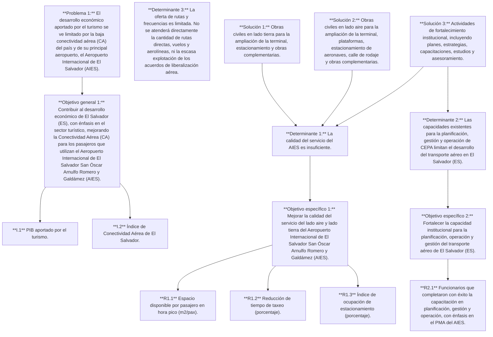
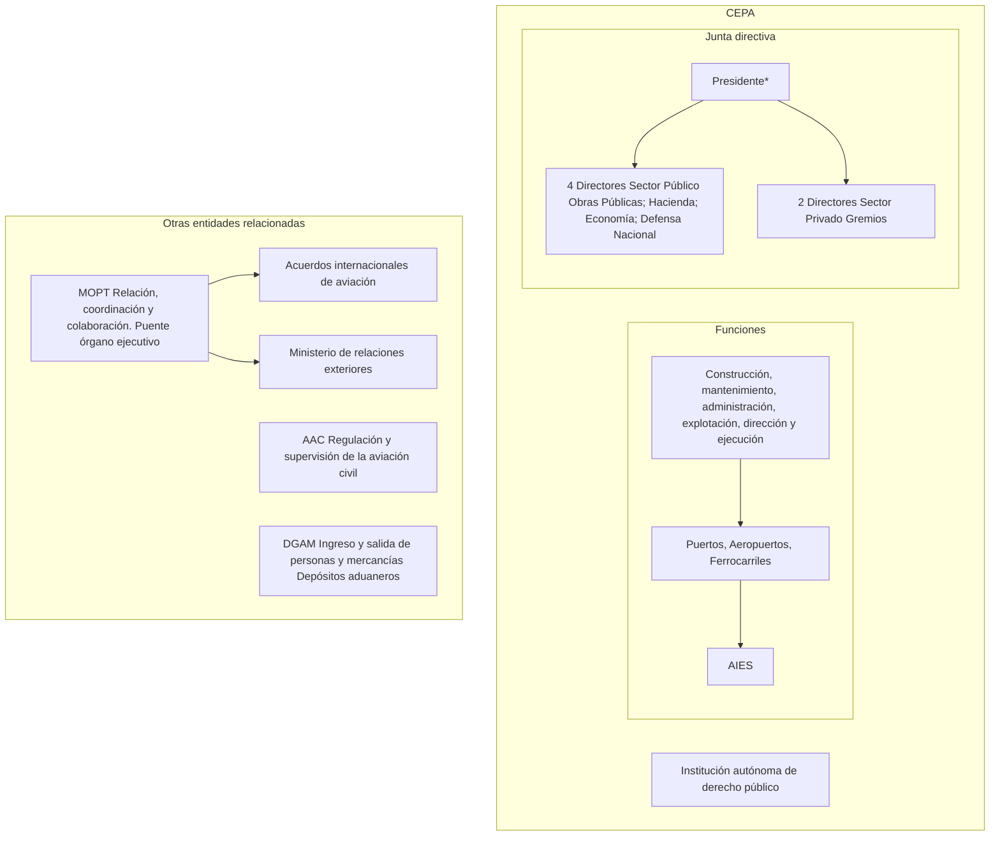

PÚBLICO

## DOCUMENTO DEL BANCO INTERAMERICANO DE DESARROLLO

### **EL SALVADOR**

## **PROGRAMA DE MODERNIZACIÓN DEL AEROPUERTO INTERNACIONAL DE EL SALVADOR**

#### **(ES-L1173)**

#### **PROPUESTA DE PRÉSTAMO**

Este documento fue preparado por el equipo de proyecto integrado por: René Cortés (INE/TSP), Jefe de Equipo; Rodrigo Rendón (INE/TSP) y Queila Delgado (PTI/TIN), Jefes de Equipo Alternos; Rafael Poveda Flor, Esteban Diez, Mariano Ansaldo, Jonathan Bernal, Daniel Ramírez y Liseth Campos (INE/TSP); Elsy Cabrera (CID/CES); Patricia Toriz y Carlos Carpizo (VPC/FMP); Nidia Hidalgo (SCL/GDI); Karla Meléndez (CSD/CCS); Omar Samayoa (CSD/BNC); Laura Romero, Alejandra Catacolí y Andrés Velásquez (VPS/ESG); Ignacio Barragán y Esteban de Dobrzynski (LEG/SGO).

De conformidad con la Política de Acceso a Información, el presente documento se pone a disposición del público de forma simultánea a su distribución al Directorio Ejecutivo para su información.

## **ÍNDICE**

| RESUMEN DEL PROYECTO | 1 |
| --- | --- |
| RESUMEN DE LA ALINEACIÓN ESTRATÉGICA DEL PROGRAMA | 3 |
| I. JUSTIFICACIÓN Y DESCRIPCIÓN DEL PROGRAMA | 5 |
| A. Descripción del Programa | 5 |
| B. Adicionalidad del Banco | 15 |
| II. COSTOS Y ESTRUCTURA DE FINANCIAMIENTO | 21 |
| A. Componentes del Programa | 21 |
| B. Dimensionamiento y Estructura de Financiamiento | 22 |
| C. Instrumento o Modalidad de Financiamiento | 22 |
| III. PRINCIPALES RIESGOS Y SU ESTRATEGIA DE GESTIÓN | 22 |
| A. Riesgos | 22 |
| B. Sostenibilidad | 24 |
| C. Riesgos ambientales y sociales | 25 |
| IV. ARREGLOS DE EJECUCIÓN, MONITOREO Y EVALUACIÓN | 27 |
| A. Resumen de los Arreglos de Ejecución | 27 |
| B. Arreglos para la Implementación de Monitoreo y Evaluación | 29 |

- ii -

| ANEXOS |  |
| --- | --- |
| Anexo I | Matriz de Efectividad en el Desarrollo (DEM) - Resumen |
| Anexo II | Matriz de Resultados |
| Anexo III | Acuerdos y Requisitos Fiduciarios |

| ENLACES ELECTRÓNICOS REQUERIDOS (EER) |  |
| --- | --- |
| EER#1 | Teoría del Cambio |
| EER#2 | Monitoreo, Evaluación y Aprendizaje (MEL) |
| EER#3 | Plan de Ejecución del Proyecto (PEP), Plan Operativo Anual (POA) y Plan de Adquisiciones (PA) |
| EER#4 | Resumen de la Revisión Ambiental y Social (RRAS) |

| ENLACES ELECTRÓNICOS OPCIONALES (EEO) |  |
| --- | --- |
| EEO#1 | Reglamento Operativo del Programa (ROP) |
| EEO#2 | Evaluación económica (Análisis Beneficio/Costo) |
| EEO#3 | Análisis de costos |
| EEO#4 | Demanda e indicadores |
| EEO#5 | Análisis del sector turismo |
| EEO#6 | Análisis de cambio climático |
| EEO#7 | Análisis de género y diversidad |
| EEO#8 | Gestión de aeropuertos y sostenibilidad de las inversiones |

- iii -

| ABREVIATURAS |  |
| --- | --- |
| AAC | Autoridad de Aviación Civil de El Salvador |
| AIES | Aeropuerto Internacional de El Salvador San Óscar Arnulfo Romero y Galdámez |
| BID | Banco Interamericano de Desarrollo |
| BIM | Modelado de Información de Construcción (Building Information Modelling) |
| CA | Conectividad Aérea |
| CEPA | Comisión Ejecutiva Portuaria Autónoma |
| CO | Capital Ordinario |
| DEM | Matriz de Efectividad en el Desarrollo |
| DGAS | Dirección General de Aduanas |
| EDGE | Excelencia en el diseño para una mayor eficiencia (Excellence in Design for Greater Efficiencies) |
| ES | El Salvador |
| ESP | Préstamo para proyectos específicos |
| FFF | Facilidad de Financiamiento Flexible |
| GdES | Gobierno de la República de El Salvador |
| IATA | Asociación Internacional de Transporte Aéreo |
| MEL | Plan de Monitoreo, Evaluación y Aprendizaje |
| MITUR | Ministerio de Turismo |
| MOPT | Ministerio de Obras Públicas y de Transporte |
| MPAS | Marco de Políticas Ambientales y Sociales |
| NdS | Nivel de Servicio |
| OACI | Organización de Aviación Civil Internacional (ICAO en inglés) |
| ODS | Objetivos de Desarrollo Sostenible |
| OE | Organismo Ejecutor |
| OMT | Organización Mundial del Turismo (United Nations World Tourism Organization) |
| PA | Plan de Adquisiciones |
| PAAS | Plan de Acción Ambiental y Social |
| PcD | Personas con Discapacidad |
| PEP | Plan de Ejecución del Proyecto |
| PIB | Producto Interno Bruto |
| PMA | Plan Maestro Aeroportuario |
| POA | Plan Operativo Anual |
| ROP | Reglamento Operativo del Programa |
| RRAS | Resumen de la Revisión Ambiental y Social |
| SSEI | Servicio de Salvamento y Extinción de Incendios |
| SGAS | Sistema de Gestión Ambiental y Social |
| SOFR | Tasa de financiamiento garantizado a un día (Secured Overnight Financing Rate) |
| UE | Unidad Ejecutora |
| VpD | Valor por Dinero |
| WTTC | Consejo Mundial de Viajes y Turismo (World Travel & Tourism Council) |

## **RESUMEN DEL PROYECTO**

### **EL SALVADOR**

### **PROGRAMA DE MODERNIZACIÓN DEL AEROPUERTO INTERNACIONAL DE EL SALVADOR**
### **ES-L1173**

| Términos y Condiciones Financieras |  |  |  |  |
| --- | --- | --- | --- | --- |
| Prestatario: | Facilidad de Financiamiento Flexible (FFF)(a) |  |  |  |
| República de El Salvador | Plazo de amortización: | 23 años |  |  |
| Período de desembolso: | 5 años |  |  |  |
| Organismo Ejecutor (OE): | Período de gracia: | 7,5 años(b) |  |  |
| Comisión Ejecutiva Portuaria Autónoma (CEPA) | Tasa de interés: | SOFR + Margen de Fondeo + Margen variable del CO (c) |  |  |
| Comisión de crédito: | (d) |  |  |  |
| Instrumento o Modalidad de Financiamiento: | Comisión de inspección y vigilancia: | (d) |  |  |
| Préstamo para Proyectos Específicos (ESP) | Vida Promedio Ponderada (VPP): | 15,25 años |  |  |
| Fuente | Monto (US$) | % | Moneda de aprobación: | Dólares de los Estados Unidos de América |
| BID (Capital Ordinario): | $195.000.000 | 100% | Sector(es): | INE/TSP |
| Total: | $195.000.000 | 100% | Clasificación socioambiental: | B |
| Esquema del Proyecto |  |  |  |  |
| Objetivo general y específicos. Objetivo General: contribuir al desarrollo económico de El Salvador (ES), con énfasis en el sector turístico, mejorando la Conectividad Aérea (CA) para los pasajeros que utilizan el Aeropuerto Internacional de El Salvador San Óscar Arnulfo Romero y Galdámez (AIES). Objetivos Específicos: (i) mejorar la calidad del servicio del AIES; y (ii) fortalecer la capacidad institucional para la planificación, operación y gestión del transporte aéreo de ES. |  |  |  |  |
| Condiciones especiales previas al primer desembolso del financiamiento: (i) el registro de firmas autorizadas; (ii) que se haya seleccionado al personal que conformará la Unidad Ejecutora (UE) para el Programa: coordinador del programa, coordinador general de obra, Especialista de adquisiciones, Especialista financiero, especialista de planificación y monitoreo, especialista técnico y especialista socio-ambiental para integrarla; (iii) que se haya aprobado y se encuentre vigente el Reglamento Operativo del Programa (ROP) en los términos previamente acordados con el Banco, el cual deberá incluir como anexo, el Sistema de Gestión Ambiental y Social (SGAS), y el Plan de Acción Ambiental y Social (PAAS); y (iv) que se haya suscrito y se encuentre vigente un convenio de transferencia de recursos entre el Prestatario y CEPA donde se establezcan los términos de la transferencia de los recursos del préstamo y se pacten las demás obligaciones de ejecución de las partes (¶4.5). Condiciones especiales de ejecución: El Prestatario deberá haber presentado evidencia al Banco, a satisfacción del mismo, el cumplimiento de las siguientes condiciones: (i) previo al inicio de las obras del lado aire, el Organismo Ejecutor (OE) deberá contar con un protocolo de seguridad operacional ad hoc aprobado por la Autoridad de Aviación Civil (AAC) el cual deberá ser implementado por los contratistas y la supervisión (¶4.6); (ii) previo al inicio de obras en la plataforma para las posiciones remotas, todas las edificaciones para el Servicio de Salvamento y Extinción de Incendios (SSEI) deben haber sido reubicadas y encontrarse en funcionamiento y operación (¶4.6); y (iii) condiciones ambientales y sociales, descritas en el Anexo B del Resumen de la Revisión Ambiental y Social (RRAS) (EER#4). |  |  |  |  |
| Excepciones a las políticas del Banco: Ninguna |  |  |  |  |

- 2 -

(a) Bajo los términos de la FFF (documento FN-655-1) el Prestatario tiene la opción de solicitar modificaciones en el cronograma de amortización, así como conversiones de moneda, de tasa de interés, de productos básicos y de protección contra catástrofes. En la consideración de dichas solicitudes, el Banco tomará en cuenta aspectos operacionales y de manejo de riesgos.

(b) Bajo las opciones de reembolso de la FFF, cambios en el periodo de gracia son posibles siempre que la VPP Original del préstamo y la última fecha de pago, documentadas en el contrato de préstamo, no sean excedidas.

(c) Tasa SOFR compuesta diariamente a plazo vencido. Margen de Fondo del BID es determinado en forma trimestral. Margen variable del Capital Ordinario (CO) del BID determinado por el Directorio en forma anual.

(d) La comisión de crédito y la comisión de inspección y vigilancia serán establecidas periódicamente por el Directorio Ejecutivo como parte de su revisión de los cargos financieros del Banco, de conformidad con las políticas correspondientes.

- 3 -

## **RESUMEN DE LA ALINEACIÓN ESTRATÉGICA DEL PROGRAMA**

| Justificación y Enlaces |  |
| --- | --- |
| Crecimiento Económico Sostenible | El desarrollo económico aportado por el turismo está siendo limitado por la baja CA, fundamental para la llegada de turistas y, en general, para incrementar las oportunidades y acceso a bienes, servicios y personas en un entorno globalizado. Este programa mejorará la capacidad, calidad y Nivel de Servicio (NdS) del aeropuerto, impactando positivamente la CA. Consecuentemente, se espera mayor desarrollo económico del país, fortaleciendo el turismo. Lo anterior se medirá con el indicador I.1. |
| Capacidad Institucional y Estado de Derecho | CEPA, operadora del AIES, enfrenta oportunidades de mejora en planificación. El rápido crecimiento de la demanda ha derivado en decisiones reactivas que afectan la eficiencia de las expansiones, la sostenibilidad operativa y la calidad del servicio. El programa fortalecerá la planificación mediante: (i) el Plan Estratégico del Sistema Aeronáutico de ES, (ii) el Plan Maestro Aeroportuario y (iii) un estudio sobre separación de flujos en la terminal antigua. También impulsará capacidades institucionales, diversificación de orígenes-destinos y mejor conectividad terrestre hacia el AIES. Finalmente, se realizarán capacitaciones en torno a inclusión e igualdad de oportunidades. Lo anterior, se medirá con el indicador R2.1, P2.1, P2.2, P2.3, P2.4, P2.5, P2.7, P2.8, P2.9. |
| Transformación Digital | Entre los retos administrativos de CEPA está la digitalización de la infraestructura. Los entornos digitales y colaborativos permiten ahorros de 23–30% en tiempo y 8–23% en costos de operación y mantenimiento. El programa impulsará una estrategia para implementar la metodología BIM, facilitando mayor control y monitoreo de la infraestructura antes, durante y después de su expansión. También se capacitará al personal de ingeniería de CEPA en BIM, asegurando transferencia de conocimiento para este y futuros programas. El avance se medirá con el indicador P2.3. |
| Igualdad de Género | Mundialmente, 30% de los viajeros son familias y 20% viajan con menores de 12 años. El cuidado de dependientes recae principalmente en mujeres, quienes destinan 22% de su tiempo a estas tareas (hombres: 13%). El programa incorporará infraestructura orientada a la movilidad del cuidado. En el AIES, las mujeres son 29% de los trabajadores y ocupan una de cada cuatro jefaturas. Por ello, se implementará un programa de capacitación en igualdad de género e inclusión de PcD para CEPA, orientado a reclutamiento, selección y desarrollo profesional. Estas acciones fomentarán condiciones más equitativas para trabajadores y usuarios. Estas acciones promoverán entornos con condiciones para trabajadores y usuarios más equitativas. Indicadores relacionados: P1.1.1, P2.9, T2. |
| Diversidad | Pueblos Indígenas [ ] Personas con Discapacidad (PcD) [x] Afrodescendientes [ ] LGBTQ+ [ ] |
| En ES, el 4,9% de la población1 son PcD, quienes enfrentan limitaciones de movilidad y participación social y económica. El 16,3 % de las PcD reporta dificultades para usar el transporte aéreo; y el 29,1% en oficinas públicas2. El programa promoverá la inclusión de PcD, dado que la construcción de la nueva terminal de pasajeros cumplirá con estándares de accesibilidad universal para personas con movilidad reducida (EEO#7). El programa incluirá formación específica al equipo de Talento Humano de CEPA en igualdad de género e inclusión de PcD en los procesos de reclutamiento, selección y desarrollo profesional. Estas intervenciones contribuirán a consolidar un entorno institucional más accesible, inclusivo y respetuoso. Esto se medirá con el indicador P1.1.1, P1.2.1, P2.9 y T2. |  |

1 Censo de Población y Vivienda de ES, 2024.
2 UNICEF, DIGESTYC y CONAIPD, 2018.

- 4 -

| Cambio Climático (CC) | Acuerdo de París |  |
| --- | --- | --- |
| Alineado con la meta de resiliencia climática: Análisis específico requerido (riesgo moderado-alto) | Alineado con la meta de descarbonización: Análisis específico requerido |  |
| Financiamiento Climático y Verde | Financiamiento Climático |  |
| Financiamiento climático y verde (%) del presupuesto total del programa: | Mitigación (%) | 63,17% |
| Adaptación (%) | 0% |  |
| Dual (%) | 0,30% |  |
| Financiamiento Climático Total (%) | 63,47% |  |
| Indicador de Adaptación: [ ] | Indicador de Mitigación: [x] |  |
| La operación incluye la construcción de edificios con estándares de certificación EDGE Advanced, así como la instalación de celdas fotovoltaicas que cubrirán 50% de la demanda energética del aeropuerto. Las actividades financiadas se alinean al objetivo de mitigación del AP: (i) son congruentes con los instrumentos climáticos nacionales; (ii) el índice de CA del país está por debajo del promedio de la región y el AIES tiene una calidad de servicio insuficiente; (iii) se apoya el incremento de la oferta de vuelos internacionales los cuales tienen menor intensidad de carbono que los vuelos domésticos; y (iv) no se identifican riesgos de bloqueo tecnológico. Se financia el desarrollo del Plan estratégico para el desarrollo del Sistema Aeronáutico de El Salvador, este incluirá dentro de sus ejes estratégicos: tecnologías y normas de reducción de emisiones, mejoras operacionales, promoción del uso de combustibles sostenibles para la aviación (SAF) y enfoque en energía renovable, eficiencia energética y conectividad sostenible. En adaptación, la operación incorpora estrategias para mitigar el riesgo de desastres y CC que incluyen: (i) medidas de resiliencia climática en la infraestructura (drenajes, techos resilientes); (ii) implementación de un taller de modos de fallo para la gestión de riesgos de desastres; (iii) actualización de un Plan de Gestión de Riesgos que incluya cambio climático; y (iv) contratación de servicios de diseños de ingeniería que incluirán un Análisis de Riesgo de Desastres y Cambio Climático. El programa cuenta con los siguientes indicadores asociados a la mitigación climática: Indicadores de Producto: P1.2.1 Edificio de estacionamiento con accesibilidad universal para PcD y sistema de generación de energía solar P2.6 Certificación EDGE Indicadores de Resultados: Indicador T1: Energía generada por el sistema de energía solar |  |  |

**Objetivos de Desarrollo Sostenible (ODS):** ODS-3; ODS-5; ODS-7; ODS-8; ODS-9; ODS-12; ODS-13.

### **Estrategia del país**

| Estrategia del país |  |
| --- | --- |
| Estrategia del país | GN-3299-3 (2025-2029). El programa se alinea con dos objetivos estratégicos del área prioritaria “Fomentar un sector privado competitivo”: (i) mejorar la infraestructura productiva, y (ii) facilitar el comercio, la logística y la integración regional. Esto se debe a que el programa financiará la ampliación de la infraestructura del principal aeropuerto del país, considerando sostenibilidad e inclusión. |

### **Contribución a iniciativas regionales**

| Contribución a iniciativas regionales |  |
| --- | --- |
| Iniciativas Regionales | Esta operación se alinea con el programa regional América en el Centro, contribuyendo directamente a la implementación de la actividad estratégica de Modernización de Corredores Logísticos Regionales, dentro del área temática de Infraestructura Regional Sostenible. Esto, en tanto el desarrollo del AIES constituye una de las inversiones vinculadas al Corredor Pacífico (la principal ruta de carga en Centroamérica), priorizadas dentro del Plan Maestro Regional de Movilidad y Logística 2035, aprobado por el Consejo Sectorial de Ministros de Transporte de Centroamérica (COMITRAN) en 2023. Asimismo, la operación contribuirá al desarrollo de otras áreas temáticas y actividades contempladas en el programa, incluyendo el apoyo para potenciar la participación del país en cadenas de valor a nivel regional y global, facilitando el comercio transfronterizo, la promoción de las inversiones y el acceso a mercados; así como la preparación para hacer frente a los desafíos sociales inducidos por el clima, a través de la ejecución de inversiones de infraestructura y planes de gestión que incorporen critérios de resiliencia ante desastres naturales y eventos climáticos. |

- 5 -

## **I. JUSTIFICACIÓN Y DESCRIPCIÓN DEL PROGRAMA**

**Aspectos destacables del Proyecto.** El presente proyecto contribuirá al desarrollo económico de El Salvador (ES) fortaleciendo el turismo a través de una mejora en la Conectividad Aérea (CA). Esto se logrará mediante la ampliación del Aeropuerto Internacional de El Salvador (AIES) y el fortalecimiento institucional de su operador público, la Comisión Ejecutiva Portuaria Autónoma (CEPA). Las nuevas obras beneficiarán directamente a 7,7 millones de pasajeros anuales en 2030, incluyendo familias, Personas con Discapacidad (PcD) y grupos con responsabilidades de cuidado, gracias a una infraestructura diseñada con criterios de accesibilidad universal para PcD e inclusión social. Además, se implementará un programa de capacitaciones en igualdad de oportunidades para el personal de CEPA, promoviendo entornos laborales más equitativos. El proyecto incorpora un enfoque sostenible, con la instalación de paneles solares, reducción de emisiones por optimización operativa y diseño verde orientado a la certificación EDGE, posicionando al aeropuerto como un motor de desarrollo, inclusión y resiliencia climática.

### **A. Descripción del Programa**

**1.1 Objetivos.** El Objetivo General es contribuir al desarrollo económico de El Salvador (ES), con énfasis en el sector turístico, mejorando la Conectividad Aérea (CA)3 para los pasajeros que utilizan el Aeropuerto Internacional de El Salvador San Óscar Arnulfo Romero y Galdámez (AIES). Los Objetivos Específicos son: (i) mejorar la calidad del servicio del AIES; y (ii) fortalecer la capacidad institucional para la planificación, operación y gestión del transporte aéreo de ES.

**1.2 Desarrollo económico de ES.** ES experimenta un crecimiento económico históricamente bajo. Entre 2004-2023, el Producto Interno Bruto (PIB) creció 2,1%/año, debajo del promedio de 3,8% en Centroamérica y República Dominicana4. Para 2025, el Banco Central de Reserva y el Fondo Monetario Internacional proyectan un crecimiento del 3% del PIB, debajo del promedio. Dentro de los factores que definen el desarrollo económico de ES se encuentran su alta dependencia a las remesas (24% del PIB [2023]) y sus bajos niveles de inversión (entre 2012-2023, la formación bruta de capital fijo promedió el 18% del PIB), debajo del promedio de América Latina y el Caribe (ALC) (20%).

**1.3** El PIB de ES se distribuye principalmente en los sectores de servicios (59,6%), industria (15,0%), y agricultura y pesca (4,7%)5. Como parte de los servicios, está el sector turismo que, en 2024, contribuyó directamente alrededor de US$2.400 millones a la economía salvadoreña, 6,9% del PIB6. Este aporte ha crecido 11,4%/año desde 2018, muy por encima del resto de la región. Cuando los impactos indirectos e inducidos del sector son contabilizados, se puede

3 La CA define el nivel en que un país está conectado mediante transporte aéreo y es la ponderación del número de pasajeros y destinos aéreos del sitio analizado. Esta es fundamental para acceder desde diversos mercados turísticos.
4 <u>FMI, 2025.</u>
5 <u>FocusEconomics,</u> 2022.
6 <u>WTTC,</u> 2025.

- 6 -

observar que el turismo contribuyó en US$5.255 millones, 15,2% del PIB, en 20247. En 2024, la contribución total al empleo fue de 417.900 personas, 14,1% de la fuerza laboral, y la contribución directa, 151.400 personas, 5,1%8.

1.4 **Problema: El desarrollo económico aportado por el sector turismo se ve limitado por la baja CA del país.** ES presenta un crecimiento constante en la llegada de turistas. Partiendo de un total de 3,37 millones de turistas internacionales en 20239 y un incremento del 17% en 2024 respecto al 2023, el país superará los cinco millones de llegadas internacionales de turistas en 2030 si se garantizan condiciones favorables de seguridad, conectividad y promoción turística. Las proyecciones del Economic Impact Research del Consejo Mundial de Viajes y Turismo (WTTC)10 estiman que ES mantendrá un crecimiento sostenido del turismo internacional en los próximos años, consolidándose como uno de los destinos emergentes más dinámicos de ALC. De manera específica, 50% de los turistas internacionales de ES llegan por vía aérea11.

1.5 A pesar de la creciente demanda, ES tiene un amplio grado de mejora para su gestión turística. Su índice de competitividad turística es de 3,34, ubicándolo en el puesto 97/14012. El índice indica que, en referencia a la infraestructura y servicios, el indicador de infraestructura de transporte aéreo de ES tiene una puntuación de 2,95, por debajo del promedio de la región de ALC, 3,213. Esto refleja una deficiencia en el nivel en que la infraestructura aérea ofrece CA y acceso para los turistas14.

1.6 ES tiene una limitada CA que restringe el desarrollo económico aportado por el sector turístico. En 2024, el país registró un índice de CA de 1.403.066, inferior al promedio de ALC (3.312.545)15, lo que lo ubica en puesto 82 (vs. Costa Rica [65]; Panamá [53]; República Dominicana [41]; México [16]), con 33 destinos internacionales y 436 frecuencias semanales16, inferior a referentes regionales como Panamá (84 destinos y 1.260 frecuencias semanales)17. Esta brecha limita el crecimiento del turismo y la competitividad del país, limitando la captación plena de beneficios económicos y sociales asociados a un sistema aeroportuario moderno, eficiente y conectado.

1.7 Según Oxford Economics, un aumento del 10% en conectividad directa puede generar un incremento de 0,5 % del PIB per cápita y 1,6% del empleo, reflejando el fuerte impacto multiplicador del transporte aéreo en economías turísticas18. En este contexto, una infraestructura aeroportuaria moderna, eficiente y con alta

| 7 | WTTC, 2024. |
| --- | --- |
| 8 | WTTC, 2025. |
| 9 | MITUR, 2024. |
| 10 | Ídem. |
| 11 | Ídem. |
| 12 | WEF, 2024. |
| 13 | WEF, 2024. |
| 14 | WEF, 2024. |
| 15 | IATA, 2023; IATA, 2024. |
| 16 | CEPA, 2024. |
| 17 | Tocumen, 2025. |
| 18 | Oxford Economics, s.f. |

- 7 -

conectividad es crítica para sostener el crecimiento turístico, aumentar el gasto medio por visitante y diversificar mercados emisores19.

1.8 **Determinantes del problema.** Para ES, la CA se concentra en el AIES, aeropuerto que atiende 99,8% de las operaciones del país y 100% de los vuelos internacionales. El AIES es gestionado por la Comisión Ejecutiva Portuaria Autónoma (CEPA)20. Para mejorar la CA y, con ello, impulsar el desarrollo del sector turístico, es esencial comprender los determinantes que la condicionan. Para ES, las problemáticas se agrupan en tres grandes determinantes: (i) la calidad del servicio del AIES es insuficiente; (ii) las capacidades existentes para la planificación, gestión y operación de CEPA limitan el desarrollo del transporte aéreo en ES; y (iii) la oferta de rutas y frecuencias es limitada (no abordado)21.

1.9 **Primer determinante: La calidad del servicio del AIES es insuficiente.** De acuerdo con la Organización de Aviación Civil Internacional (OACI), la calidad de la experiencia de los pasajeros es fundamental para la CA, pues fomenta mayor demanda de servicios de transporte aéreo e incentiva el crecimiento de la oferta22. En línea con el concepto de calidad, la Asociación Internacional de Transporte Aéreo (IATA) ha generado lineamientos de diseño para estandarizar conceptualmente el Nivel de Servicio (NdS)23 en infraestructura aeroportuaria, para atender de manera eficiente la demanda en hora pico.

1.10 El NdS del lado tierra24, específicamente en las áreas de intervención de la presente operación (Tabla 1), es uno de los indicadores que permite medir la calidad del servicio del AIES. Contar con un NdS adecuado permite cubrir las horas pico de operación y el crecimiento de la demanda. Un bajo NdS, puede reducir la CA, debido a bajos índices de competitividad del aeropuerto generando reducción de los vuelos programados y, consecuentemente, la CA.

*Tabla 1. Lineamientos IATA (m2/pasajero) áreas de intervención AIES25*

|  | Guías de Espacio (m2/PAX) |  |  |  |
| --- | --- | --- | --- | --- |
|  |  | Sobre-Diseño | Óptimo | Sub-Óptimo |
| Salas de Espera en Puerta | Asientos | >2.2 | 1.8 - 2.2 | <1.8 |
| De Pie | >1.5 | 1.2 - 1.5 | <1.2 |  |

1.11 El NdS del AIES se ha visto deteriorado significativamente, específicamente, el asociado a la ocupación de la terminal de pasajeros. Según IATA26, el NdS óptimo para esta infraestructura se encuentra entre 1,8 m2/pax. y 2,2 m2/pax. La demanda del aeropuerto ha crecido de manera acelerada (¶1.17), pasando el indicador de

19 <u>OMT</u>, 2025; <u>ATAG</u>, 2024; <u>ACI Europe</u>, 2023.
20 <u>CEPA</u>, 2025.
21 Los determinantes han sido planteados con base en <u>OACI</u> (2017).
22 <u>OACI</u>, 2013.
23 El NdS consiste en un indicador de calidad de un servicio, cuya medición varía según el caso (velocidad, tiempo de servicio, ocupación, densidad, etc.).
24 El lado tierra de un aeropuerto incluye todas las áreas accesibles al público, como entradas, mostradores y estacionamientos. El lado aire abarca las zonas donde operan las aeronaves, como pistas, plataformas y hangares.
25 <u>IATA</u>, 2022
26 <u>IATA</u>, 2025.

- 8 -

2,84 m2/pax.27 en 2022 a 1,89 m2/pax. en la actualidad (2025) y a 1,42 m2/pax. en 2029 (<u>EEO#4</u>).

1.12 Por su parte, el estacionamiento, con 1.460 cupos, cuenta con un nivel de ocupación del 75%. Se prevé que, en congruencia con la demanda de transporte aéreo, el estacionamiento sea insuficiente para el año 2026 (<u>EEO#4</u>). Este servicio aeroportuario forma parte de la calidad del servicio del AIES e influye en la experiencia del usuario. En horas pico y durante los periodos de mayor demanda, los vehículos estacionan en las bermas de la vía de acceso y salida del aeropuerto, generando riesgos de siniestros viales.

1.13 Debido a lo expuesto anteriormente, existe la necesidad inminente de intervenir el AIES para garantizar un NdS adecuado mediante la ampliación de la infraestructura (¶1.25).

1.14 **Segundo determinante: Las capacidades existentes para la planificación, gestión y operación de CEPA limitan el desarrollo del transporte aéreo en ES.** Para contar con un NdS adecuado en el transporte aéreo, es fundamental la planificación estratégica y la robustez institucional, que guíe el desarrollo físico y operativo a corto, mediano y largo plazo, alineándose con la demanda proyectada y los objetivos nacionales e internacionales de aviación.

1.15 Una herramienta fundamental para la planificación estratégica es el Plan Maestro Aeroportuario (PMA). Este instrumento incluye la planificación a largo plazo, anticipando el crecimiento del tráfico aéreo y proyectando la infraestructura necesaria para satisfacer la demanda sin interrupciones o reducciones en la eficiencia operativa.

1.16 Para el caso del AIES, se tiene un amplio margen de mejora. En 2014, ES formuló un PMA con cuatro fases de expansión a 2032 (Ilustración 1), que permitiría al AIES atender a 6.600.000 pasajeros/año (partiendo de una capacidad inicial de 1.600.000 pasajeros/año).

27 Cálculo realizado considerando las ampliaciones realizadas en 2022 (¶1.17).

- 9 -

*Ilustración 1. Ampliaciones proyectadas en el PMA*

drawing: airport master plan map with legend

* **Ampliación edificio fase 1** (Yellow)
* **Ampliación edificio fase 2** (Magenta)
* **Ampliación edificio fase 3** (Blue)
* **Ampliación edificio fase 4** (Purple)
* **Ampliación edificio fase 2A** (Light Green)
* **Nuevos pavimentos fase 0** (Light Green)
* **Nuevos pavimentos fase 1** (Gold)
* **Nuevos pavimentos fase 2** (Pink)
* **Nuevos pavimentos fase 3** (Light Blue)
* **Nuevos pavimentos fase 4** (Light Purple)

* icon: star Implementado por CEPA a 2025
* icon: star Segunda etapa (proyecto actual)

*Fuente: PMA (2014)*

1.17 No obstante, ES presenta crecimiento de la demanda de pasajeros aéreos desde 2012. En promedio, la demanda creció 7,76% anualmente entre 2011-202428 (Ilustración 2). En 2024 el aeropuerto movilizó 5.298.491 pasajeros29. Los pasajeros movilizados superaron considerablemente las proyecciones de demanda del PMA, que preveían alcanzar tan solo 4.737.900 en 2032.

28 Previo a este crecimiento, entre 2004 y 2011, la demanda del AIES se había mantenido estable en aproximadamente dos millones de pasajeros (CEPA, 2025).
29 Entradas: 41%, Salidas: 39%, Transbordo: 19%, Tránsito: 1%.

- 10 -

### *Ilustración 2. Pasajeros del AIES 2013-2032 (millones)* — series: Demanda real, Proyección PMA 2014

| Año | Demanda real (millones) | Proyección PMA 2014 (millones) |
| --- | --- | --- |
| 2013 | 2,36 | 2,34 |
| 2014 | 2,44 | 2,50 |
| 2015 | 2,71 | 2,67 |
| 2016 | 2,97 | 2,85 |
| 2017 | 3,15 | 3,05 |
| 2018 | 3,39 | 3,15 |
| 2019 | 3,72 | 3,25 |
| 2020 | 1,08 | 3,35 |
| 2021 | 2,52 | 3,46 |
| 2022 | 3,44 | 3,57 |
| 2023 | 4,55 | 3,68 |
| 2024 | 5,30 | 3,78 |
| 2025 |  | 3,89 |
| 2026 |  | 4,00 |
| 2027 |  | 4,11 |
| 2028 |  | 4,23 |
| 2029 |  | 4,35 |
| 2030 |  | 4,48 |
| 2031 |  | 4,61 |
| 2032 |  | 4,74 |

1.18 El PMA (2014) determinó una serie de ampliaciones para mejorar la calidad del servicio del lado tierra del AIES. Estableció oportunidades de mejora en el NdS mediante la: (i) construcción de nuevas posiciones de contacto; (ii) ampliación de andenes; (iii) mejora en el control de acceso; y (iv) construcción de nuevas áreas de "check-in", inmigración, aduanas y manejo de equipaje. Todo lo anterior, para una demanda considerablemente menor a la que se presenta actualmente.

1.19 Reaccionando al comportamiento de la demanda, ES aumentó en 2022 las salas de espera, puestos de migración y bandas de equipaje. En 2023, se construyeron cinco puentes de abordaje y 250 estacionamientos. En 2025, amplió la zona de "check-in". Con esto, la terminal alcanzó capacidad para atender 5.000.000 pasajeros/año, quedando aún por debajo de la demanda alcanzada en 2024. En 2025, CEPA inició la ampliación de las zonas de migración, bandas de entrega de equipaje y andenes.

1.20 Sin embargo, el análisis de demanda (<u>EEO#4</u>) proyecta 7.730.000 pasajeros en 2030 lo que evidencia que la modernización institucional de CEPA no ha acompañado el ritmo de crecimiento de la demanda. La discrepancia con las proyecciones de pasajeros del PMA es un síntoma que refleja limitaciones estructurales en la capacidad de planificación de CEPA. Se observa que: (i) no se cuenta con un sistema de actualización periódica de proyecciones que incorpore nuevas dinámicas de mercado (*low-cost carriers*, conectividad regional, tendencias post-pandemia); (ii) las herramientas técnicas disponibles para análisis de escenarios, estimación de demanda y modelación de alternativas son limitadas; y (iii) el PMA existente ha demostrado rezago frente a la realidad del crecimiento de pasajeros, lo que ha obligado a soluciones reactivas de ampliación. Aunque CEPA ha dado respuesta a la demanda creciente mediante ampliaciones parciales del AIES, la ausencia de una capacidad institucional robusta y sistemática para planificar prospectivamente basado en evidencia actualizada

- 11 -

constituye una brecha concreta. Por ello, la falta de capacidades de planificación es un criterio crítico que impacta negativamente la sostenibilidad y efectividad de las inversiones. Adicionalmente, ES carece de una estrategia consolidada para desarrollar el sector aeronáutico a nivel nacional, lo cual impide trascender el enfoque de ampliaciones reactivas en un solo aeropuerto y dotar al país de una visión integral y de largo plazo para la red aeroportuaria nacional. La ausencia de esta estrategia dificulta alinear inversiones, proyecciones de demanda y prioridades estratégicas del sector aéreo con los objetivos de desarrollo económico y social del país.

### 1.21 **Tercer determinante (no atendido): La oferta de rutas y frecuencias es limitada.**
La oferta de rutas y frecuencias está estrechamente ligada con la CA, al definir el número de pares de ciudades conectadas, asientos y horarios disponibles para atender la demanda. De esta manera, el incrementar la oferta de vuelos directos, especialmente internacionales, incrementa la CA de la zona analizada con el resto del mundo, considerando la diversidad e importancia de destinos, frecuencias y cantidad de sillas ofertadas.

### 1.22
La oferta aérea está dictaminada por el grado de liberalización aérea (tratados bilaterales aeronáuticos que autorizan la creación de rutas aéreas entre aeropuertos) y la explotación de estas rutas. ES ha realizado esfuerzos relevantes para potenciar su liberalización del espacio aéreo, siendo uno de los países en la región con mayor nivel de liberalización aérea, con una puntuación de 23,50 de 50, duplicando la media de ALC (11,33)30. Cuenta con un elevado número de acuerdos internacionales de aviación (22 vigentes). Sin embargo, existe oportunidad para la explotación de la liberalización aérea de ES. La oferta de vuelos hacia y desde ES está poco diversificada; 3/5 partes de las frecuencias semanales de una semana típica tienen como origen o destino EE.UU. e, incluso, el top 5 de destinos, todos estadounidenses, concentra el 43% del total de pasajeros.

### 1.23
Los cambios en la demanda turística evidencian la importancia de la conectividad directa, a la hora de generar crecimiento más allá de EE.UU.31. En la última década, los mercados emisores con vuelos directos han experimentado un crecimiento más rápido que aquellos donde la escala es necesaria (9,57% vs. 8,54% anual)32. Destaca el caso de España (crecimiento anual promedio de 10,31% desde 2010, vs. 9% en el resto de Europa). De forma similar, la apertura de vuelos desde República Dominicana y Belice en 2022 trajo un crecimiento anual de llegadas desde estos países de 56,81% y 40,37% respectivamente33 (vs. 21,64% y 7,95% anual en la década previa34). De estas tasas de crecimiento, es posible inferir la existencia de demanda latente por ES, la cual puede ser desatada parcialmente con mejoras en la CA.

30 <u>ACI</u>, 2024
31 Además de la conectividad y acuerdos de liberalización aérea, la demanda turística depende de visados, y vínculos económicos, históricos y culturales, factores macroeconómicos (tipo de cambio, ingreso), percepción de seguridad y estabilidad, infraestructura, productos turísticos, estrategias de promoción, distancia, costos de transporte, clima y calidad institucional.
32 <u>OMT</u>, 2025.
33 <u>Belize Hub</u>, 2022.
34 <u>ONU Turismo</u>, 2025.

- 12 -

1.24 **Soluciones propuestas.** Este programa atenderá el primer y segundo determinante, correspondiente a la calidad del servicio y a la planificación estratégica del AIES (ver Ilustración 3). La operación potenciará la infraestructura aeroportuaria y fortalecerá institucionalmente a CEPA, permitiendo una gestión más eficiente y adecuada del aeropuerto. Se espera que estas intervenciones conduzcan a una mayor calidad del servicio mediante la mejora en la planificación, infraestructura y gestión del aeropuerto.

1.25 Para fortalecer la calidad del servicio en el AIES, se desarrollarán las siguientes actividades a nivel de infraestructura de lado aire y lado tierra: (i) construcción de una nueva sección de la terminal de pasajeros con seis posiciones de contacto (posiciones de amarre de aeronaves en plataforma con puente de embarque/desembarque) y sus correspondientes salas de espera, además de la reubicación de tres posiciones remotas y la unidad de Servicio de Salvamento y Extinción de Incendios (SSEI) del aeropuerto; (ii) construcción de la calle de rodaje Foxtrot, para generar un enlace más corto entre la plataforma nueva y la calle de rodaje Alfa existente. Esto reducirá el tiempo de recorrido entre la cabecera noreste de la pista y la terminal (principalmente para las posiciones de la terminal nueva); y (iii) construcción del edificio de estacionamiento vehicular, incluyendo la instalación de paneles para generación de energía solar. Estas intervenciones se ilustran en la Ilustración 3.

*Ilustración 3. Ampliaciones del AIES proyectadas en la operación*

drawing: airport expansion site plan

*Fuente: CEPA (2025)*

1.26 Esta operación desarrollará obras de la segunda de cuatro fases de la ampliación del AIES previstas en el PMA (2014). Además de lo indicado en el párrafo anterior, se financiarán actividades de fortalecimiento institucional y planificación estratégica. Las intervenciones por realizarse esperan mejorar la calidad de servicio del AIES y desarrollar las capacidades institucionales para la planificación, operación y gestión del transporte aéreo de ES. A su vez, estos

- 13 -

objetivos buscan contribuir al desarrollo económico con énfasis en el sector turístico mediante la mejora de la CA.

1.27 El tercer determinante, la oferta de vuelos, no será atendido directamente en esta operación, ya que está fuera del alcance directo y depende principalmente de factores externos, como la gestión de aerolíneas, condiciones de mercado, turismo y seguridad, entre otras. La gestión de este determinante estará a cargo del Gobierno de ES (GdES) y CEPA. Asimismo, el Banco ha venido impulsando el sector turístico del país (¶1.36), para mejorar la competitividad turística. El Componente II de esta operación incluye un estudio de mercado para diversificar orígenes y destinos internacionales en el AIES que apoyará a CEPA en definir directrices para atraer mercado y conectar al AIES con destinos estratégicos. Estos estudios permitirán identificar rutas con demanda latente y evaluar su viabilidad comercial, proporcionando insumos técnicos para la formulación de una estrategia nacional de atracción de aerolíneas. Esta estrategia se alineará con los objetivos de desarrollo económico del país, al facilitar la apertura de nuevas rutas que potencien el turismo, el comercio y la inversión. Lo anterior facilitará la gestión de la entidad en la atención de este determinante.

1.28 **Evidencia de la efectividad.** Un estudio del BID35 encontró que programas de inversión enfocados en mejorar la CA, a través de un fortalecimiento de los operadores aeroportuarios, desarrollo de nuevos servicios y la mejora en la infraestructura aeroportuaria incrementaron significativamente el tráfico en los aeropuertos intervenidos36. Se observa que las intervenciones realizadas por CEPA en el AIES han permitido atender a la demanda creciente, considerablemente mayor a la demanda esperada. A su vez, la CA impulsa el desarrollo económico al conectar personas y brindar mayores oportunidades de acceso a bienes y servicios, fortaleciendo la competitividad del país en el mercado37. Se estima que, por cada punto porcentual de incremento en CA, el comercio internacional incrementa un 6,3% y la participación en actividades de las cadenas de suministro se incrementan en 2,9%38 (¶1.7, ¶1.17, ¶1.18, <u>EER#1</u>).

1.29 **Contribución esperada del programa.** En general, el programa busca contribuir a mejorar la CA de ES. Con ello, se espera fortalecer el desarrollo económico del país mediante el impulso al sector turístico.

1.30 La estrategia se centra en la mejora de la calidad del servicio del lado aire y lado tierra del AIES para los pasajeros, mediante la mejora del NdS de sus subsistemas. Para el lado tierra, se mejorará el NdS de los servicios aeroportuarios, al incrementar el espacio disponible por pasajero en hora pico en la terminal y reducir el índice de ocupación del estacionamiento. Esto llevará a que el NdS se mantenga adecuado. Para el lado aire, se reducirá el tiempo de rodaje de las aeronaves en el aeropuerto, mejorando la eficiencia operacional y reduciendo las emisiones generadas por el taxeo.

35 <u>BID</u>, 2018.
36 <u>BID</u>, 2018.
37 <u>BID</u>, 2018.
38 <u>IATA</u>, 2016.

- 14 -

1.31 Aunque la operación se centra en transporte aéreo de pasajeros, la mejora en la CA también beneficiará la logística y el transporte de carga, especialmente por la carga en aviones de pasajeros. Sin embargo, al no ser parte del objetivo ni de la lógica del programa, su análisis queda fuera de alcance.

1.32 Las intervenciones aportarán a la resiliencia climática y a la reducción de emisiones, incorporando estándares de certificación verde con soluciones basadas en la naturaleza, medidas de adaptación, optimización de recursos (agua y energía), uso de materiales de construcción sostenibles y la adquisición de paneles solares para la generación de energía renovable39. Se apoyarán también acciones para la equidad de género e inclusión, digitalización de infraestructura y formación de personal. Estas acciones no solo representan aportes para la expansión física del aeropuerto, sino que estarían posicionándolo como un referente regional en infraestructura verde e inclusiva, con certificación EDGE Advanced, una iniciativa destacada dentro de la región40. Al alinearse con los Objetivos de Desarrollo Sostenible (ODS), especialmente en áreas como acción por el clima, igualdad de género, trabajo seguro e innovación, el proyecto se convertirá en un hito regional en sostenibilidad e inclusión, fortaleciendo la agenda global de infraestructura resiliente y equitativa de ES.

1.33 **Igualdad de oportunidades e inclusión de PcD.** El Programa desarrollará la nueva terminal de pasajeros con condiciones de accesibilidad universal para PcD e infraestructura que facilite la movilidad del cuidado41. Además, se desarrollará un plan de capacitaciones en igualdad de oportunidades entre hombres y mujeres e inclusión de PcD para CEPA y sus unidades.

1.34 **Beneficiarios.** De acuerdo con los análisis de crecimiento de la demanda del AIES, teniendo en cuenta el crecimiento histórico de esta, el del PIB del país y de mercados relevantes como el estadounidense, y proyectos complementarios como el Aeropuerto del Pacífico, se estimó la cantidad de pasajeros que tendrá el AIES en los siguientes años. De esta manera, los beneficiarios serán de manera directa los 7.730.000 pasajeros anuales, que se estima usarán la nueva infraestructura en 2030 (<u>EEO#4</u>). De manera indirecta, la operación beneficiaría a las cerca de 518.657 personas que trabajarán directa o indirectamente en el turismo en 203042. Contando a sus familias (3,5 personas/familia), el total de beneficiarios indirectos se estima en 1.815.299 personas.

1.35 **Análisis Económico.** Se aplicó la metodología de Análisis Beneficio/Costo (B/C) (<u>EEO#2</u>) para evaluar la rentabilidad socioeconómica del programa, considerando los costos de inversión, operación y mantenimiento, y monetizando como beneficios principales: (i) ahorro en tiempo de viaje; (ii) reducción de la huella de

39 El proyecto implementará las Medidas del Grupo BID para Abordar el Riesgo de Trabajo Forzoso en la Cadena de Suministro de Paneles Solares con Componentes de Silicio (GN-3062-1).
40 Esta certificación EDGE Advanced representa un hito regional, al consolidarse —según fuentes oficiales— como el segundo aeropuerto con certificación EDGE en toda ALC (después del Aeropuerto Internacional Jorge Chávez en Lima). Además, el proyecto supera ampliamente los umbrales de ahorro requeridos por EDGE Advanced, alcanzando más del 50% de generación mediante energías renovables, lo que lo posiciona muy cerca del estándar de una edificación carbono neutro.
41 Viajes destinados/vinculados a actividades de cuidado deben considerarse: la infraestructura debe facilitar estas actividades mediante zonas de juego, baños familiares con cambiador, cambiadores en baños de hombres y mujeres, salas de maternidad, etc.
42 Asumiendo un incremento proporcional al de turistas.

- 15 -

carbono; (iii) ahorro de tiempo en parqueo de los usuarios que llegan en vehículo privado; (iv) impacto en turismo; y (v) generación de empleo. El análisis se realizó para el escenario base y escenarios de sensibilidad. Los resultados del escenario base muestran que el programa es rentable, con una Tasa Interna de Retorno Económica (TIR) consolidada de 22,81%, superior al costo de oportunidad de 12% y un Valor Presente Neto (VPN) de US$276,86 millones. El análisis de sensibilidad muestra que, en el caso de un incremento del 25% en los costos y una reducción del 25% en los beneficios, la TIR y el VPN serían de 15,3% y US$116,05 millones respectivamente.

*Ilustración 4. Resumen de la teoría del cambio (ToC)*

flow_chart: Resumen de la teoría del cambio (ToC)

**No abordado por el proyecto**

**Determinante 3:** La oferta de rutas y frecuencias es limitada. No se atenderá directamente la cantidad de rutas directas, vuelos y aerolíneas, ni la escasa explotación de los acuerdos de liberalización aérea.

## **B. Adicionalidad del Banco**

1.36 **Enfoque programático.** El GdES ha venido desarrollando una estrategia orientada a fortalecer la oferta de infraestructura aeroportuaria en el AIES, para garantizar servicios de alta calidad ante el crecimiento sostenido en la demanda de pasajeros (¶1.19, ¶1.20). Esta estrategia inició en abril-2018, con las obras de la Fase I de ampliación de la terminal de pasajeros, entrando en operación en marzo-2022. Actualmente, se ejecutan otras intervenciones complementarias (¶1.19), enmarcadas en una estrategia integral de desarrollo nacional, alineada con el Plan Cuscatlán y el proyecto Surf City, que buscan posicionar al país como un destino competitivo en los ámbitos turístico y de inversión regional. El diálogo

- 16 -

técnico del Banco y su apoyo constante al GdES ha permitido identificar acciones relevantes para CEPA derivadas de un ejercicio de planificación de infraestructura (<u>ATN/OC-16849-ES</u>), así como sinergias identificadas para el AIES por parte del Ministerio de Turismo (MITUR) con el apoyo del Banco (<u>ATN/OC-19631-ES</u>). Este conocimiento, en conjunto con las experiencias obtenidas en la ejecución de operaciones de financiamiento para ambos sectores (<u>2572/OC-ES</u>, <u>3170/OC-ES</u>, <u>5620/OC-ES</u>, <u>5590/OC-ES</u> y <u>5851/OC-ES</u>), así como la trayectoria destacada del Banco en proyectos de infraestructura aeroportuaria en la región han permitido enriquecer el diálogo y las propuestas. En el ámbito turístico, destaca el Programa de Apoyo a la Recuperación y Expansión del Sector Turismo (<u>5590/OC-ES</u>), que contempla inversiones para el diseño de la ampliación de la terminal del AIES. Otros proyectos en el ámbito del turismo han reforzado el diálogo, incluyendo el Programa de Desarrollo Turístico de la Franja Costero-Marina (<u>2966/OC-ES</u>), y el Programa de Corredores Productivos (<u>3170/OC-ES</u>, <u>3170/OC-ES-1</u>, <u>3170/OC-ES-2</u>). Estas operaciones responden a una visión programática integrada que vincula desarrollo territorial, CA, conectividad43 y competitividad turística como ejes para la recuperación económica del país.

*Ilustración 5. Línea de tiempo de apoyo del Banco*

image: timeline of projects

| Préstamos INV | CT |
| --- | --- |
| ES-T1275 Updating of the transport model and travel distribution matrix for the Metropolitan Area of San Salvador |  |
| ES-T1289 Infrastructure Masterplan for El Salvador |  |
| ES-L1066 - Touristic Development of the Coastal Zone | ES-T1348 Supporting the Sustainable Development of El Salvador Tourism Sector |
| ES-L1075 - Productive Corridors Program | ES-L1151 - Program to Support the Recovery and Expansion of the Tourism Sector in El Salvador |
| ES-L1050 - Transportation Program for the San Salvador Metropolitan Area | ES-T1314 Support to the Urban Mobility Strategy of the San Salvador Metropolitan Area |
|  | ES-T1315 Support for the Promotion of a Safe, Inclusive and Productive Mobility in El Salvador |
|  | ES-L1155 - Rural Roads Program |
|  | ES-T1360 Support for the preparation of the Port Technology Improvement and Trade Facilitation Program |
|  | ES-L1157 - Trade Facilitation and Port Operation Modernization Program |
|  | ES-T1371 Support for the preparation and implementation of the "Support Program for the urban mobility system of the Metropolitan Area of San Salvador (AMSS)" |

| Apoyo previo | 2020 | 2021 | 2022 | 2023 | 2024 |
| --- | --- | --- | --- | --- | --- |

1.37 **Adicionalidad.** El programa se alinea con la Estrategia Institucional del Grupo BID (BIDImpact+) (CA-631). Esta operación propone una adicionalidad desde la perspectiva del Banco al incorporar enfoques innovadores en CC, inclusión social, fortalecimiento institucional y género. En cuanto al CC, el programa integra medidas de mitigación y adaptación, incluyendo infraestructura resiliente, generación de energía renovable y eficiencia energética y soluciones basadas en la naturaleza para alcanzar la certificación EDGE (¶1.51). Adicionalmente, se contempla la inclusión de PcD mediante el diseño universal de instalaciones y servicios aeroportuarios y la generación de nuevas áreas comerciales para potencial explotación del sector privado. (¶2.1). El componente de desarrollo de capacidades fortalece las competencias técnicas del personal involucrado,

43 <u>2951/BL-BO</u>; <u>5601/OC-BO</u>; <u>5964/OC-SU</u> y <u>3907/OC-BH</u>.

- 17 -

incluyendo capacitación y certificación en BIM, y estudios de: (i) mercado para diversificación de orígenes - destinos internacionales, (ii) obras requeridas para la separación de flujos de llegadas y salidas en la terminal antigua, (iii) movilidad del entorno del aeropuerto con énfasis en el estacionamiento y en la conectividad hacia el AIES. Además de la actualización del Plan Maestro para el AIES y del sistema aeronáutico en general de ES (¶2.2) que permitan garantizar sostenibilidad del programa a largo plazo. En materia de género, se promueven acciones para aumentar la participación de mujeres en sectores tradicionalmente masculinizados, como construcción y gestión aeroportuaria (¶1.33). Es importante destacar que, con la presente operación de préstamo, el Banco busca implementar un papel relevante más allá del financiamiento, considerando que cataliza reformas institucionales y sienta las bases para una posible colaboración con el sector privado (por ejemplo, a través de BID Invest en fases futuras) o con el apoyo del BID al sector público para lograr la preparación de eventuales las Asociaciones Público-Privadas (APP).

1.38 **Institucionalidad y situación financiera de CEPA.** El AIES depende de CEPA, institución autónoma del GdES, adscrita al Ministerio de Obras Públicas y de Transporte (MOPT), encargada de administrar y desarrollar infraestructura estratégica en los sectores portuario, aeroportuario y ferroviario (Ilustración 6). Su institucionalidad se articula también con otras entidades: (i) El MOPT como órgano de coordinación interinstitucional y enlace con acuerdos internacionales de aviación; (ii) la Autoridad de Aviación Civil (AAC), responsable de la regulación y supervisión de la aviación civil; (iii) la Dirección General de Aduanas (DGAM) y la Dirección de Migración, encargadas de los procesos operativos en frontera; y (iv) el Ministerio de Relaciones Exteriores, que gestiona el marco jurídico internacional en materia aeronáutica.

- 18 -

*Ilustración 6. Esquema institucional de CEPA*

flow_chart: Organizational chart of CEPA and related entities

\*Nombrado por el Presidente de la República

1.39 La situación financiera de CEPA refleja una institución con estabilidad presupuestaria, capacidad de pago y una trayectoria sólida en la ejecución de inversiones tanto en el ámbito portuario como aeroportuario. Entre 2018 y 2023, CEPA ha mantenido un crecimiento sostenido en ingresos, con inversiones significativas en activos fijos que representan entre el 25% y 30% del gasto total, dirigidas a obras portuarias, modernización de equipos y mejoras en infraestructura aeroportuaria. CEPA demuestra una posición financiera excepcionalmente sólida en comparación con sus pares regionales, destacándose como una institución aeroportuaria con robustos indicadores económicos en Centroamérica44: Entre 2021-2024, los ingresos de la entidad crecieron 70,6% superando a Aeris en Costa Rica (+28,3%) y Tocumen en Panamá (+45,1%); y la utilidad neta se duplicó, alcanzando US$67,7M. Esta presenta alta liquidez (US$131,9M y ratio 6,3x) y bajo endeudamiento (0,39x), lo que le da flexibilidad para invertir sin comprometer su estabilidad. Sus flujos operativos también aumentaron significativamente, permitiendo inversiones sostenidas, sobre todo en infraestructura.

1.40 Su cobertura de intereses y flujo operativo cubren holgadamente las obligaciones financieras. Además, si bien cuenta con respaldo estatal (16% de los ingresos

44 El AIES se posiciona como el más competitivo para vuelos internacionales de ida con una tasa de US$32/pax, vs. Panamá (PTY) (US$40/pax.), Costa Rica (SJO) (US$49/pax).

- 19 -

totales en 202445), su operación no depende exclusivamente de él. A pesar de su participación en proyectos vinculados a puertos y otros aeropuertos, la carga financiera derivada de estas iniciativas se ha mantenido dentro de niveles estables, con un servicio de deuda promedio de US$14 millones anuales. El análisis financiero confirma que estas operaciones no generan riesgos adicionales para el proyecto del AIES incluido en este programa, ya que CEPA conserva liquidez operativa suficiente, un saldo de caja saludable y una estructura de inversión que no compromete la sostenibilidad fiscal ni la ejecución del proyecto en cuestión.

### 1.41 **Sinergias con el sector privado y análisis de esquemas de gestión aeroportuaria.**
Se ha realizado un análisis de alternativas de ejecución, considerando diferentes esquemas de contratación para el desarrollo de proyectos, casos de referencia de la región, incluidos modelos de obra pública y con la participación del sector privado (<u>EEO#8</u>). Se consideraron variables como el comparador público-privado preliminar, asignación de riesgos, disponibilidad de recursos públicos, espera pública y capacidad institucional.

### 1.42
Este análisis de gestión aeroportuaria destaca la solidez institucional y la experiencia acumulada por CEPA (<u>EEO#8</u>) donde se destacan: (i) mandato legal claro: atribuciones directas para ejecutar obras y operar infraestructura aeroportuaria; (ii) capacidad operativa demostrada: ha liderado exitosamente proyectos como la modernización del AIES; (iii) gobernanza mixta público-privada que facilita la eficiencia en la toma de decisiones46; (iv) integración institucional fluida con entidades regulatorias y técnicas del GdES, permitiendo ejecución ágil y coordinada; y (v) sostenibilidad financiera: ingresos propios provenientes de tasas aeroportuarias y actividad comercial.

### 1.43
El análisis de gestión contractual aeroportuaria incluyó la aplicación del modelo del comparador público-privado y un análisis de Valor por Dinero (VpD), medida que evalúa la eficiencia económica y la optimización de calidad, eficiencia y beneficios sostenibles al invertir recursos públicos. Al analizar la transferencia de riesgos de construcción, financiero, de operación y de mantenimiento, se demostró menores costos y una mayor eficiencia para expandir la terminal por obra pública (<u>EEO#8</u>).

### 1.44
Por su parte, este proyecto no solo considera la ampliación de la capacidad y mejora de la conectividad del aeropuerto, sino que también abre la puerta para fortalecer la coordinación con iniciativas de atracción de inversión privada. Esto generará un ecosistema alrededor del AIES que promueva servicios logísticos, comerciales y turísticos, contribuyendo a posicionarlo como un nodo estratégico para la competitividad del país y un motor de desarrollo territorial sostenible.

### 1.45
El análisis del proyecto de expansión de la terminal de pasajeros del AIES indica que el esquema de obra pública tradicional es el más adecuado en el corto plazo. El comparador público-privado preliminar muestra que, aunque el modelo de APP ofrece eficiencias operativas, sus mayores costos financieros y complejidad contractual no se compensan. CEPA cuenta con una sólida capacidad financiera

45 CEPA, 2025.
46 La junta directiva de CEPA es público-privada.

- 20 -

institucional para gestionar riesgos, lo que refuerza la viabilidad del modelo público. La validación preliminar de bancabilidad confirma un perfil favorable en ingresos, sostenibilidad ambiental y potencial acceso a financiamiento verde, aunque también señala desafíos en la asignación de riesgos bajo esquemas privados. Dado que el proyecto contempla varias fases de expansión, es recomendable avanzar inicialmente con obra pública, mientras se desarrollan los estudios necesarios para evaluar una eventual APP en etapas futuras. Por lo anterior, se concluye que CEPA debe continuar liderando la estructuración y ejecución del programa en su fase actual (<u>EEO#8</u>) y mantener un análisis continuo de la conveniencia de incorporar esquemas de participación privada con el apoyo de BID Invest para fases futuras, garantizando la generación de valor público, sostenibilidad financiera y cumplimiento de los estándares de calidad del servicio aeroportuario.

1.46 En contraste, el <u>EEO#8</u> incorpora una sección específica sobre la concesión del Terminal de Carga del AIES, otorgada bajo la modalidad de APP por un período de 35 años. En este caso, la adopción del modelo APP resultó viable debido a diversos factores, entre los cuales destacan: la naturaleza especializada del servicio, con menor sensibilidad social y política; una demanda escalonada estructurada por fases; la existencia de fuentes de ingresos diversificadas y predecibles que facilitaron su estructuración financiera; el acompañamiento técnico de entidades como FOMILENIO II y la Millennium Challenge Corporation (MCC); un marco jurídico habilitante proporcionado por la Ley Especial de APP; y una operación menos compleja que permitió una gestión eficiente por parte del concesionario privado.

1.47 **Colaboración con otras instituciones.** Con recursos de la operación <u>ES-L1151</u>, MITUR y CEPA trabajan en los diseños para la ampliación del AIES, incluyendo la segunda etapa del edificio terminal con nuevas salas, puentes de abordaje y mejoras en el área de llegada de pasajeros.

1.48 **Aportes complementarios.**

1.49 El programa fortalecerá la capacidad institucional de CEPA, abarcando aspectos operacionales, estratégicos y de conectividad. Este fortalecimiento incluye el diseño y aplicación de diversos instrumentos de planificación que permitirán a CEPA tomar decisiones informadas a corto, mediano y largo plazo. Se destaca el Plan Estratégico para el Desarrollo del Sistema Aeronáutico de ES, que trazará una hoja de ruta nacional para la expansión y modernización del sector aéreo. La actualización del PMA permitirá redefinir las prioridades de infraestructura, operación y servicios, asegurando alineación con estándares internacionales y proyecciones de crecimiento.

1.50 Otra línea de fortalecimiento se centrará en la digitalización de la infraestructura a través de la metodología BIM, mejorando la planificación, diseño, construcción y mantenimiento del aeropuerto. En términos de conectividad terrestre e integración con San Salvador, destinos turísticos y el resto del país, se desarrollará un estudio específico para mejorar el acceso terrestre al aeropuerto, incorporando criterios de sostenibilidad ambiental e inclusión social. Paralelamente, se realizará un estudio de mercado sobre diversificación de orígenes y destinos internacionales

- 21 -

que permitirá a CEPA ampliar la red de rutas aéreas y atraer nuevas aerolíneas, fortaleciendo así la integración internacional.

1.51 Se incluyen también estándares de sostenibilidad mediante la implementación de la certificación EDGE, que promueve edificaciones energéticamente eficientes, y se incluirá un programa de capacitación en igualdad de oportunidades entre hombres y mujeres e inclusión de PcD, dirigido al personal de CEPA. Adicionalmente, se realizará un estudio que permita identificar las obras requeridas para la separación de flujos de llegadas y salidas de pasajeros de la terminal antigua. Finalmente, este componente de desarrollo de capacidades realizará un estudio que permita identificar los retos de movilidad en el entorno del AIES y proponga soluciones específicas con énfasis en las colas y demoras al ingreso del nuevo edificio de estacionamientos. Mayor detalle de estos aportes se encuentra en el <u>EER#1</u>.

## **II. COSTOS Y ESTRUCTURA DE FINANCIAMIENTO**

### **A. Componentes del Programa**

2.1 **Componente I. Obras y adecuaciones (US$184.669.000).** Financiará: (i) construcción de la segunda etapa de la ampliación de la terminal de pasajeros y la plataforma del AIES incluyendo medidas de eficiencia energética, enfoque sostenible, accesibilidad universal para PcD e infraestructura que facilite la movilidad del cuidado; (ii) ampliación de la plataforma de aeronaves, con posiciones de amarre de contacto y remotas; (iii) construcción de la calle de rodaje Foxtrot; (iv) construcción del edificio de estacionamiento vehicular con accesibilidad universal para PcD y sistema de generación de energía solar; (v) construcción del edificio de SSEI y sus correspondientes vías de acceso; (vi) adecuación de la nueva infraestructura, incluyendo la adquisición e instalación de mobiliario, escáneres y otros equipos; (vii) supervisión técnica y ambiental.

2.2 **Componente II. Fortalecimiento institucional (US$5.000.000).** Financiará: (i) Plan estratégico para el desarrollo del Sistema Aeronáutico de ES; (ii) actualización del PMA, incluyendo capacitaciones para su adecuada implementación; (iii) estrategia y capacitación en la metodología BIM; (iv) estudio para mejorar la conectividad terrestre del AIES, con enfoque de sostenibilidad e inclusión; (v) estudio de mercado para diversificación de orígenes-destinos internacionales; (vi) auditoría y capacitación para obtener la certificación EDGE; (vii) estudio de obras requeridas para la separación de flujos de llegadas y salidas en la terminal antigua; (viii) estudio de movilidad del entorno del aeropuerto con énfasis en el estacionamiento; y (ix) programa de capacitaciones en igualdad de oportunidades entre hombres y mujeres e inclusión de PcD para el personal de CEPA.

2.3 **Administración, evaluación y auditorías (US$5.331.000).** Financiará: (i) coordinación técnica de la ejecución; (ii) evaluaciones; (iii) auditorías.

- 22 -

### **B. Dimensionamiento y Estructura de Financiamiento**

2.4 Se presentan detalles sobre las fuentes de financiamiento. Para esta operación no se considera cofinanciamiento. El préstamo será financiado con recursos de CO, con un período de desembolso de 5 años. El presupuesto detallado está disponible en el Plan de Ejecución del Proyecto (PEP) (<u>EER#3</u>).

*Tabla 2. Costos estimados del Programa (US$ millones)*

| Componentes | BID | Total | % |
| --- | --- | --- | --- |
| Componente I. Obras, adecuaciones | 184,67 | 184,67 | 94,70% |
| Componente II. Fortalecimiento institucional | 5,00 | 5,00 | 2,56% |
| Administración u otros gastos contingentes | 5,33 | 5,33 | 2,73% |
| Total | 195,00 | 195,00 | 100,00% |

### **C. Instrumento o Modalidad de Financiamiento**

2.5 La operación se estructura como un préstamo de inversión bajo la modalidad de Préstamo para Proyectos Específicos (ESP), dado que financiará intervenciones claramente delimitadas, con objetivos, alcances y costos definidos. Estas intervenciones están organizadas en un componente de obras civiles más un componente con actividades de fortalecimiento institucional. La modalidad ESP resulta la más adecuada para abordar esta problemática, ya que permite canalizar recursos hacia obras con diseños previamente definidos, cronogramas de ejecución establecidos y costos estimados con base en estudios técnicos actualizados, garantizando así su viabilidad técnica, financiera y ambiental. Además, la implementación integral de estas intervenciones es condición necesaria para alcanzar los resultados esperados del programa. No se anticipan excepciones a las políticas aplicables al instrumento o modalidad de financiamiento.

## **III. PRINCIPALES RIESGOS Y SU ESTRATEGIA DE GESTIÓN**

### **A. Riesgos**

3.1 **Riesgos de contexto.** El programa enfrenta los siguientes riesgos medio-altos y su estrategia de mitigación:

*Tabla 3. Riesgos de contexto*

| TAXONOMÍA | RIESGO | ACTIVIDAD |
| --- | --- | --- |
| Entorno político | Si los procesos electorales provocan cambios en las autoridades superiores de las instituciones, se podrían propiciar modificaciones en la visión, coordinación y articulación del programa, afectando los resultados esperados. | ACEPTAR: Formalización de acuerdos interinstitucionales y blindaje técnico del proyecto. Documentar acuerdos y planes de trabajo para asegurar continuidad ante cambios de autoridades. |

3.2 **Riesgos de capacidad.** El programa enfrenta los siguientes riesgos medio-altos y su estrategia de mitigación:

- 23 -

### *Tabla 4. Riesgos de capacidad*

| TAXONOMÍA | RIESGO | ACTIVIDAD |
| --- | --- | --- |
| Estructura organizativa - Procesos internos | Si no se logra una Gobernanza eficiente para el desarrollo del programa con otras instituciones del GOES (MITUR, Casa Presidencial), el diseño podría tener demoras considerables, por lo que habría un detrimento de la eficiencia esperada afectando los resultados del programa. | MITIGAR: Desarrollo de reuniones periódicas entre Casa Presidencial, CEPA y MITUR (1 vez al mes) para la toma de decisiones de alto nivel con el propósito de alinear prioridades, que incluya tareas de seguimiento periódico al proyecto con enfoque preventivo. |
| Estructura organizativa - Procesos internos | Si dentro de los primeros 6 meses no se generan dinámicas articuladas y fortalecimiento de la Unidad Ejecutora de CEPA en cuanto a personal especializado y procesos internos, no se podrían ejecutar las actividades previstas en la planificación inicial, generando retraso en la ejecución del Componente I. | MITIGAR: Implementar el plan de desarrollo de capacidades en la Unidad Ejecutora de CEPA incluyendo la contratación del equipo técnico clave (coordinador del programa, analista de adquisiciones, especialistas socioambientales). En el marco del desarrollo del programa, la Unidad Ejecutora apoyará a CEPA en su fortalecimiento institucional a través de la ejecución del Componente II, incluyendo instancias de seguimiento periódicas. |
| Estructura organizativa - Procesos internos | Si la coordinación de CEPA con el Banco es débil, la implementación de las intervenciones en infraestructura (Componente I) podría demorar el inicio de estas, retrasando el cumplimiento de los hitos de infraestructura en los plazos requeridos, generando deterioro en la calidad del servicio de la infraestructura aeroportuaria. | MITIGAR: Establecer mecanismos de comunicación y aprobación clara con el Banco. Designar un enlace técnico permanente para la comunicación con el Banco y sostener reuniones periódicas. |
| Integridad | Si la Unidad Ejecutora no cuenta con el personal experimentado en operaciones BID con las competencias necesarias y con las herramientas adecuadas que le permitan conducir procesos de adquisiciones basados en principios de integridad, incluyendo transparencia, competencia, equidad, trazabilidad, gestión de conflictos de interés, ni supervisar de forma efectiva la ejecución contractual, podrían ocurrir prácticas prohibidas y generarse retrasos en el cronograma, aumento de costos, baja calidad en las obras y un daño reputacional para el programa y el Banco. | MITIGAR: (i) Incorporar en el Reglamento Operativo del Programa (ROP) disposiciones que aseguren procesos de adquisiciones basados en principios de integridad: transparencia, trazabilidad, competencia, equidad y control de conflictos de interés; (ii) requerir que los estudios técnicos, diseños y presupuestos estén actualizados y debidamente fundamentados antes de lanzar los procesos de contratación; (iii) requerir que el organismo ejecutor realice estudios de mercado y adopte mecanismos para ampliar la transparencia y la difusión de oportunidades de negocio incentivando invitar a los oferentes; (iv) incorporar al ROP los mecanismos de debida diligencia del organismo ejecutor y de gestión de conflictos de interés; (v) capacitar al personal clave del organismo ejecutor en estándares de integridad en adquisiciones y supervisión contractual; (vi) promover el establecimiento de mecanismos adecuados de seguimiento durante la ejecución contractual, proporcionales al nivel de exposición al riesgo, que aseguren trazabilidad y control efectivo, y (vii) incorporar al ROP la función antisoborno de CEPA y generarle un rol para el apoyo en el manejo de riesgos de integridad del programa |

- 24 -

## 3.3 **Riesgos específicos al programa.** El programa enfrenta los siguientes riesgos medio-altos y su estrategia de mitigación:

### *Tabla 5. Riesgos específicos al programa*

| TAXONOMÍA | RIESGO | ACTIVIDAD |
| --- | --- | --- |
| Planificación | Si CEPA no identifica adecuadamente la necesidad de traslado y/o intervención, y/o protección, y/o reubicación y/o construcción de redes menores (hidrosanitarias, eléctricas, telefónicas, etc.) que puedan interferir con el desarrollo del proyecto, dentro de su fase de estructuración y planeación, se generarán reprocesos en el proceso de contratación y durante la ejecución del proyecto, lo cual terminaría en atrasos para el Componente I frente a los plazos inicialmente previstos. | EVITAR: Realizar un estudio detallado de redes existentes antes de iniciar obras y coordinar con proveedores de servicios. Establecer un protocolo de manera anticipada que establezca términos y responsables para las coordinaciones del caso cuando sean requeridas. Incluir en el presupuesto del proyecto una partida específica para intervención y traslado de redes, con posibilidad de ajustes por incertidumbre. Validar y revisar diseños con metodología BIM |
| Diseño técnico | Si CEPA realiza cambios en cualquier momento durante la ejecución del proyecto frente a los costos, plazos, cantidades de obra y, en general, cualquier variación derivada de la elaboración inicial, modificaciones o ajustes de los estudios y diseños del proyecto, que deban realizarse para asegurar las especificaciones técnicas, podría generar controversias entre las partes y por ende, reprocesos en la ejecución de las obras generando retrasos en los tiempos de aprobación y sobrecostos en el cumplimiento del Componente I. | MITIGAR: Validar y revisar diseños con metodología BIM y aprobación de entes reguladores previo a la licitación. |
| Planificación | RIESGO ALTO: Si para la finalización de las obras del Componente I CEPA no reubica el edificio de salvamento, no se podría poner en operación las obras de dicho componente por incumplimiento de estándares de seguridad, lo cual implicaría el retraso en la finalización de dicho componente. | MITIGAR: Incorporar el diseño, traslado y construcción del edificio de Salvamento en etapas tempranas, que incluya un plan de contingencia con protocolos para emergencias y ajustes de cronograma. |
| Planificación | Si durante la ejecución de las obras no se generan protocolos para el desarrollo de las mismas por cualquier contratista, sobre todo por aquellos que no estén familiarizados con restricciones y normas del lado aire (Safety y Security), se podrían generar afectaciones en la seguridad operacional y seguridad física del aeropuerto, lo cual podría derivar en paralización de los trabajos y por ende, retrasos en su ejecución, pero además un impacto reputacional negativo en el desarrollo de todo el Programa. | MITIGAR: Previo al inicio de las obras del lado aire, el ejecutor deberá contar con un protocolo de seguridad operacional ad-hoc aprobado por la autoridad de la aeronáutica civil el cual deberá ser implementado por los contratistas, la supervisión y el operador. Adicionalmente, al equipo mínimo de la Unidad Ejecutora se deberá incluir un coordinador general de obra con enfoque PMO que articule los diferentes contratistas y mitigue los riesgos de desfase. |

## **B. Sostenibilidad**

## 3.4 **Sostenibilidad de los resultados.** El programa ha identificado riesgos que podrían afectar su sostenibilidad a largo plazo, tanto financieros, institucionales como técnicos. Para mitigarlos, se han diseñado estrategias específicas alineadas con la matriz de riesgos y asegurar la continuidad de los beneficios tras la ejecución.

- 25 -

3.5 En el aspecto financiero, existen iniciativas complementarias que no están incluidas dentro del marco del programa actual, por ejemplo, el riesgo de dependencia de fondos públicos puede respaldarse por tarifas y renta de espacios comerciales. También puede contemplarse el uso de seguros contra sobrecostos y asociaciones público-privadas para servicios no esenciales, apoyados por estudios de viabilidad tarifaria y contratos con cláusulas de indexación. En particular, el Banco puede apoyar compartiendo lecciones aprendidas en procesos de modernización aeroportuaria (¶1.36) y en la estructuración de APP, lo cual es valioso para fortalecer el diseño y la supervisión de componentes con participación privada en fases futuras del proyecto.

3.6 A nivel institucional, se prevé un programa de fortalecimiento que incluye formación en herramientas como BIM, estudios especializados, manuales de procedimiento y acuerdos interinstitucionales como políticas de Estado derivados del PMA y del Plan Estratégico Aeroportuario para ES con metas vinculantes que permitan garantizar sostenibilidad del programa a largo plazo (¶1.37). Se plantea realizar talleres normativos y establecer un sistema de monitoreo de capacidades. En lo técnico, los riesgos como la obsolescencia se manejarán con diseños modulares, actualizaciones del PMA, mapeo de redes subterráneas y auditorías periódicas.

3.7 Riesgos críticos, como cambios regulatorios o políticos, se atenderán con monitoreo normativo y la creación de un comité técnico. El seguimiento del programa se realizará con un tablero de control con indicadores.

3.8 Finalmente, el modelo del programa tiene potencial de replicarse en otras terminales gracias a su enfoque integral: combina infraestructura física con fortalecimiento institucional y sostenibilidad ambiental. Esto lo convierte en una experiencia útil para futuras expansiones o intervenciones similares en la región.

## **C. Riesgos ambientales y sociales**

3.9 De acuerdo con el Marco de Políticas Ambientales y Sociales (MPAS) del Banco y con base en la información existente, el programa se ha clasificado como categoría “B”. Se espera que los impactos negativos ambientales y sociales durante la etapa de construcción sean moderados, de corta duración y manejables. Las actividades se realizarán dentro del área actual del AIES y, dada la tipología de intervenciones, las afectaciones ambientales y sociales negativas serán moderadas durante el período de ejecución de las obras. Se cuenta con medidas de mitigación apropiadas para gestionar dichos impactos y riesgos. Estos impactos incluyen pérdida de la capa orgánica del suelo, disminución en la permeabilidad del suelo, afectación de la calidad del aire, afectación del drenaje natural, reducción de la recarga de agua por impermeabilización del suelo, disminución del hábitat de la fauna por tala y descapote, e incremento del consumo de agua. Durante la operación, los impactos negativos destacados son la reducción de la calidad del aire, incremento de los niveles sonoros por mayor frecuencia de aterrizajes, incremento del consumo de agua, e incremento del volumen de aguas residuales y residuos sólidos generados por trabajadores, viajeros y concesionarios. Durante la Debida Diligencia se verificó el estado de cumplimiento de la norma de ruido ambiental con la operación actual, así como

- 26 -

las proyecciones de incremento con foco en los receptores sensibles. No se requiere la adquisición de tierras, y no se han identificado riesgos por reasentamiento físico, desplazamiento económico o afectaciones en hábitats naturales o territorios indígenas o afrodescendientes. La clasificación de riesgo social y ambiental del programa es sustancial debido principalmente a que la operación del aeropuerto se mantendrá durante la ejecución de las obras, lo que conlleva a la exposición de la totalidad de los trabajadores, proveedores y usuarios a polvo, gases y ruido; el incremento en la ocurrencia de accidentes de trabajo y de usuarios. El OE cuenta con procedimientos para la gestión ambiental, social, de seguridad y salud ocupacional, y de gestión de género. Además, está en proceso de creación de capacidades institucionales para la implementación del MPAS del BID.

3.10 El riesgo de desastres por amenazas naturales se ha clasificado como "alto" debido a las características físicas de la infraestructura la cual está expuesta a diversas amenazas de origen natural como erupciones volcánicas, huracanes e inundación fluvial, clasificadas como moderadas, y olas de calor y tsunamis, clasificadas como altas; las cuales pueden incrementarse debido a escenarios de CC (RCP8.5). El AIES cuenta con un estudio de impacto ambiental (EIA) aprobado y los permisos ambientales correspondientes. Además se realizará un taller de modos de fallo el cual busca reunir expertos y partes interesadas clave para identificar cómo puede fallar la infraestructura ante las amenazas identificadas, estimar la criticidad de esos posibles modos de fallo, y dejar una hoja de ruta para la gestión posterior del riesgo.

3.11 Siendo esta una operación de obras específicas fue preparado una Evaluación Ambiental y Social (EAS) para el programa, con su respectivo Plan de Gestión Ambiental y Social (PGAS), los cuales serán administrados como parte del Sistema de Gestión Ambiental y Social (SGAS) de CEPA. Cabe anotar que durante la debida diligencia se evaluó dicho SGAS y no se encontraron brechas frente a la NDAS 1, por lo que se encuentra apropiado para la escala y naturaleza de las intervenciones. Asimismo, se encontró que el AEIS cuenta con los permisos ambientales y de operación establecidos por la legislación local y está en cumplimiento de sus obligaciones, de acuerdo con los reportes emitidos por la Autoridad Ambiental Competente. No se identificaron pasivos ambientales o sociales derivados de las obras existentes. Es importante anotar que CEPA cuenta con un Sistema para la Gestión de los Riesgos Ambientales, de Seguridad y Salud en el Trabajo, Riesgos de Género y Sociales. La responsabilidad del mantenimiento de dicho Sistema está distribuida en diferentes departamentos de CEPA, según el organigrama que se presenta en la figura 8, del Anexo C. Los riesgos e impactos de las obras y actividades del proyecto serán gestionados a través de dicho Sistema con el soporte de las áreas correspondientes. Los roles y responsabilidades en materia de gestión ambiental y social se documentan en el Manual de Organización y funciones de oficina central.

3.12 Conforme al Programa de Participación de Partes Interesadas, el 28 de marzo de 2025 se realizó una consulta pública híbrida con 23 representantes de arrendatarios, aerolíneas y entidades estatales. La retroalimentación destacó la necesidad de medidas para accesibilidad de pasajeros con movilidad reducida, control de polución del aire y comunicación continua del avance de obras para

- 27 -

prevenir afectaciones operativas. Las versiones finales de los documentos y el reporte de consulta se publicaron en el sitio web del Banco, según el MPAS.

## IV. **ARREGLOS DE EJECUCIÓN, MONITOREO Y EVALUACIÓN**

### A. **Resumen de los Arreglos de Ejecución**

4.1 **Mecanismo de ejecución.** El prestatario será la República de ES. El OE será CEPA, donde se creará la Unidad Ejecutora (UE), cuyos integrantes tendrán dedicación exclusiva al Programa. CEPA será responsable de coordinar y dar seguimiento al cumplimiento de los objetivos y resultados del Programa. CEPA, a través de la UE, será responsable por la gestión y coordinación del programa y se encargará, entre otras tareas, de: (i) la administración financiera y la gestión de adquisiciones; (ii) la coordinación del seguimiento de las actividades; (iii) gestionar la auditoría externa; (iv) presentar al Banco los planes operativos, incluyendo el plan financiero, Plan de Adquisiciones (PA) y el Plan Operativo Anual (POA), entre otros; (v) presentar al Banco los informes de auditoría, progreso, evaluaciones, cumplimiento socioambiental, entre otros; (vi) supervisar la ejecución de las obras y de los estudios previstos en la operación; (vii) presentar al Banco solicitudes de desembolsos; y (viii) actuar como enlace con el Banco.

4.2 Para el manejo de los desembolsos del Contrato de Préstamo, la CEPA gestionará con la Dirección General de Tesorería del Ministerio de Hacienda la apertura de una Cuenta Especial en el Banco Central de Reserva de El Salvador a nombre del Programa.

4.3 **Lecciones aprendidas para la implementación del programa.** El Banco cuenta con experiencia en financiamiento de programas ejecutadas en ES47 y en la región, gracias a un apoyo técnico continuo por más de 10 años vía Cooperaciones Técnicas No Reembolsables48. Entre las principales lecciones aprendidas para el sector, resalta la relevancia de: (i) contar con gobernanza fortalecida al interior de las instituciones involucradas como CEPA y la UCP permitiendo una ejecución más eficiente y transparente de las actividades; (ii) obtener datos desagregados por género, condición de discapacidad y otros factores clave, asegurando que las intervenciones realizadas por CEPA sean inclusivas en los procesos de reclutamiento, selección y desarrollo profesional con perspectiva de igualdad; y (iii) diseñar campañas de sociabilización, a través de prever campañas informativas antes (periodo de construcción) y durante la puesta en operación de las intervenciones, fortaleciendo la aceptación y compromiso de los pasajeros y aerolíneas. Para el sector aéreo: (i) implementar planes de rehabilitación de pistas o plataformas sin cierre de operaciones, la cual ha sido considerada en el cronograma de obras del programa, minimizando interrupciones en los servicios aeroportuarios; (ii) identificar y asegurar que las infraestructuras que promueven servicios aeroportuarios para la seguridad operacional se mantengan en plena operación durante la ejecución de la obras, como es el caso de sistemas aeronáuticos, Servicios de Extinción de Incendios, etc., para lo cual el programa exige que el nuevo edificio del SSEI esté operando previo a la construcción de obras en el lado aire, (iii) incorporar la gestión de riesgos de

47 <u>ES-L1050, ES-L1075, ES-L1155.</u>
48 <u>ES-T1275, ES-T1289, ES-T1314, ES-T1315.</u>

- 28 -

desastres y CC en la revisión de los diseños en terminales para contar con certificaciones tipo EDGE, con esto el programa promueve una infraestructura resiliente y sostenible y pone en valor las acciones para reducir el consumo de agua, energía y uso de materiales en la terminal aérea, parqueaderos y SSEI; (iv) potenciar la seguridad operacional durante el periodo de construcción de las obras, para esto el programa exige como condición de ejecución contar con un plan de seguridad operacional socializado con el contratista y la supervisión, (vi) contar con instrumentos técnicos como un SGAS, que permita aplicar las políticas socio ambientales del país y de instituciones financieras como el Banco. Las lecciones aprendidas a nivel de la aviación fueron: (i) diseñar planes nacionales de los sistemas aeronáuticos, para la promoción de la política pública y de infraestructuras a mediano y largo plazo, como contar con planes específicos de desarrollo aeroportuario y del sistema nacional aeronáutico, para lo cual en el componente II el programa incluye planes de desarrollo para el AIES y todo el sistema aeronáutico de ES; y (ii), promoción de nuevas rutas y frecuencias para potenciar la integración regional a través del sistema aéreo, mediante una mayor CA, alineada con los objetivos de desarrollo del programa.

4.4 **Planificación de actividades para el arranque y adquisiciones clave.** La ejecución comenzará con la licitación de actividades contempladas en el Componente I de la operación. A su vez, se lanzarán las primeras licitaciones del Componente II correspondiente a la estrategia de fortalecimiento institucional, capacitaciones en BIM, actualización del PMA; estudio para mejorar la conectividad terrestre del AIES con enfoque de turismo, sostenibilidad e inclusión; y el estudio de mercado para diversificación de destinos. La ejecución física puede iniciar entre 6 y 9 meses después de la entrada en vigor del contrato de préstamo. Los principales procesos de licitación se describen en el Anexo III.

4.5 **Condiciones especiales a los desembolsos y condiciones de ejecución.** Serán condiciones previas al primer desembolso: (i) el registro de firmas autorizadas; (ii) que se haya seleccionado al personal que conformará la UE para el programa: coordinador del programa, coordinador general de obra, especialista de adquisiciones, especialista financiero, especialista de planificación y monitoreo, especialista técnico y especialista socioambiental para integrarla; (iii) que se haya aprobado y se encuentre vigente el Reglamento Operativo del Programa (ROP) en los términos previamente acordados con el Banco, el cual deberá incluir como anexo, el SGAS y el Plan de Acción Ambiental y Social (PAAS); y (iv) que se haya suscrito y se encuentre vigente un convenio de transferencia de recursos entre el Prestatario y CEPA donde se establezcan los términos de la transferencia de los recursos del préstamo y se pacten las demás obligaciones de ejecución de las partes. La contratación de consultores se hará teniendo en cuenta lo establecido en la (GN-2350-15), donde se verificará si los consultores propuestos tienen conflicto de intereses o algún impedimento que afecte su contratación.

4.6 **Condiciones contractuales especiales de ejecución.** El Prestatario deberá haber presentado evidencia al Banco, a satisfacción del mismo, el cumplimiento de las siguientes condiciones: (i) previo al inicio de las obras del lado aire, el OE deberá contar con un protocolo de seguridad operacional *ad hoc* aprobado por la AAC, el cual deberá ser implementado por los contratistas y la supervisión; (ii) previo al inicio de obras en la plataforma para las posiciones remotas, todas

- 29 -

las edificaciones para el SSEI deben haber sido reubicadas y encontrarse en total funcionamiento y operación); y (iii) condiciones ambientales y sociales descritas en el Anexo B del Resumen de la Revisión Ambiental y Social (RRAS) (<u>EER#4</u>).

## **B. Arreglos para la Implementación de Monitoreo y Evaluación**

4.7 **Monitoreo.** Se realizará a través de informes semestrales de progreso, los cuales deben ser presentados por el MOPT dentro de los 60 días siguientes a la finalización de cada semestre. Los informes deberán incluir el contenido detallado en el MEL (<u>EER#2</u>), así como el cumplimiento de lo establecido en el ROP (<u>EEO#1</u>).

4.8 **Evaluación.** Constará de: (i) un análisis antes y después del desempeño de los indicadores de resultado e impacto asociados a objetivos específicos y objetivo general; (ii) una revisión de la teoría de cambio de la intervención; (iii) una revisión de la evidencia en la literatura sobre la efectividad de intervenciones similares en contextos comparables; y (iv) una evaluación cualitativa que provea información complementaria de la atribución de los resultados alcanzados al programa. Las principales preguntas de esta evaluación estarán referidas a si las inversiones realizadas lograron contribuir a los objetivos del programa (<u>EER#2</u>).

4.9 **Información para el monitoreo y la evaluación del programa.** El OE será responsable del mantenimiento de los sistemas de recopilación de datos y seguimiento (<u>EER#2</u>). El MOPT se comprometerá a mantener un sistema de monitoreo y evaluación del programa, sobre la base del cual preparará los informes y datos que remitirán al Banco. Para efectos de la evaluación, el OE recopilará, almacenará y mantendrá consigo toda la información, indicadores y parámetros, incluyendo los planes anuales, y las evaluaciones intermedia y final, necesarios para la elaboración del Informe de Terminación de Proyecto (PCR).

4.10 **Consideraciones excepcionales de monitoreo y evaluación.** Se solicita que el Informe de Terminación de Proyecto (PCR) sea entregado en un plazo de hasta 24 meses posterior al cierre operativo de la operación. Esto se justifica debido a que los resultados previstos requieren de un plazo superior al cierre operativo de la operación para poder materializarse de manera plena.

Anexo I - ES-L1173 | Página 1 de 1

| Matriz de Efectividad en el Desarrollo |  |  |
| --- | --- | --- |
| Resumen | ES-L1173 |  |
| I. Resultados de Desarrollo - Evaluabilidad |  | Evaluable |
| 1. Evaluación basada en pruebas y solución | 7.5 |  |
| 1.1 Diagnóstico del Programa | 1.9 |  |
| 1.2 Intervenciones o Soluciones Propuestas | 1.6 |  |
| 1.3 Calidad de la Matriz de Resultados | 4.0 |  |
| 2. Análisis económico ex ante | 10.0 |  |
| 3. Evaluación y seguimiento | 9.5 |  |
| 3.1 Mecanismos de Monitoreo | 4.0 |  |
| 3.2 Plan de Evaluación | 5.5 |  |
| II. Matriz de Seguimiento de Riesgos y Mitigación |  |  |
| Calificación de riesgo global = magnitud de los riesgos*probabilidad | Medium Low |  |
| Clasificación de los riesgos ambientales y sociales | B |  |
| Nota de Valoración de la Evaluabilidad (completada por SPD): Esta nota tiene por objeto presentar una valoración global de la evaluabilidad del proyecto, y permitir al Directorio entender por qué se asignaron o no puntuaciones al proyecto. |  |  |
| I. Calidad del diagnóstico y las soluciones propuestas |  |  |
| El objetivo general del programa es contribuir al desarrollo económico de El Salvador (ES), con énfasis en el sector turístico, mejorando la Conectividad Aérea (CA) para los pasajeros que utilizan el Aeropuerto Internacional de El Salvador San Óscar Arnulfo Romero y Galdámez (AIES). Los objetivos específicos son: (i) mejorar la calidad del servicio del AIES; y (ii) fortalecer la capacidad institucional para la planificación, operación y gestión del transporte aéreo de ES. El proyecto presenta un diagnóstico completo y tiene una descripción de la situación actual del AIES y de sus capacidades para enfrentar el crecimiento de la demanda esperado. Si bien el diagnóstico es riguroso y los determinantes se justifican con evidencia, la brecha asociada al segundo determinante (Las capacidades existentes para la planificación, gestión y operación de la Comisión Ejecutiva Portuaria Autónoma limitan el desarrollo del transporte aéreo en El Salvador) es difícil de cuantificar y su dimensionamiento podría mejorarse. Los indicadores de resultado propuestos son consistentes con el diagnóstico, incluyen línea de base consistente y medios de verificación. Además, la lógica vertical presenta evidencia adecuada sobre la efectividad de las soluciones para alcanzar los objetivos. |  |  |
| II. Calidad de la Matriz de Resultados |  |  |
| Los indicadores son SMART y reflejan las dimensiones relevantes de los objetivos. Las líneas de base y metas son justificadas con evidencia de manera razonable. |  |  |
| III. Análisis Económico |  |  |
| El análisis económico del proyecto se llevó a cabo mediante un análisis de costo-beneficio (ACB). Los beneficios son consistentes con la matriz de resultados. El análisis cuantifica beneficios en (i) ahorro en tiempo de viaje; (ii) reducción de la huella de carbono; (iii) ahorro de tiempo en parqueo de los usuarios que llegan en vehículo privado; (iv) impacto en turismo; y (v) generación de empleo. El análisis concluye que el proyecto es económicamente viable, con una TIR de 22,81%, superior al costo de oportunidad de 12% y un Valor Presente Neto (VPN) de US$276,86 millones. Se incluyeron análisis de sensibilidad relevantes para determinar cuanto puede verse afectado el retorno económico del proyecto por la variación de |  |  |
| IV. Monitoreo y Evaluación |  |  |
| El plan de monitoreo y evaluación propone mediar la efectividad de la intervención mediante una una comparación antes-después, un análisis costo-beneficio ex post. Las metodologías propuestas son razonables, dada la dificultad en establecer una metodología con atribución para una evaluación de impacto. Sin embargo, sería interesante explorar la posibilidad de hacer una evaluación con atribución dada la poca evidencia que existe para operaciones similares en contextos parecidos. |  |  |
| V. Otros temas sobre evaluabilidad para resaltar (si corresponde) |  |  |

Anexo II - ES-L1173 | Página 1 de 4

## **Anexo II – Matriz de Resultados**

### **Declaración de Objetivos de Desarrollo del proyecto**

| No. | Indicador | Unidad de Medida | Línea de Base (pre-intervención) | Escenario de evaluación (post-intervención) | Observaciones |  |  |
| --- | --- | --- | --- | --- | --- | --- | --- |
| Valor | Año | Meta | Año esperado de medición |  |  |  |  |
| I.1 | PIB de turismo en El Salvador. | Millones de US$ | 0 | 2025 | 19,41 | 2032 | Gasto anual efectuado por los turistas Internacionales que llegan por vía aérea y hacen uso de la capacidad incrementada del aeropuerto. |
| I.2 | Índice de Conectividad Aérea de El Salvador. | Índice | 1.415.986 | 2025 | 2.316.733 | 2032 | Se usa como referencia el indicador “Air Connectivity Score” de IATA, basado en datos del ejecutor. |

#### **A. Objetivo General de Desarrollo**

**

| No. | Indicador | Unidad de Medida | Línea de Base (pre-intervención) | Escenario de evaluación (post-intervención) | Observaciones |  |  |
| --- | --- | --- | --- | --- | --- | --- | --- |
| Valor | Año | Meta | Año esperado de medición |  |  |  |  |
| I.1 | PIB de turismo en El Salvador. | Millones de US$ | 0 | 2025 | 19,41 | 2032 | Gasto anual efectuado por los turistas Internacionales que llegan por vía aérea y hacen uso de la capacidad incrementada del aeropuerto. |
| I.2 | Índice de Conectividad Aérea de El Salvador. | Índice | 1.415.986 | 2025 | 2.316.733 | 2032 | Se usa como referencia el indicador “Air Connectivity Score” de IATA, basado en datos del ejecutor. |

**

Anexo II - ES-L1173 | Página 2 de 4

## **B. Objetivos Específicos de Desarrollo**

**

| No. | Indicador | Unidad de Medida | Línea de base (pre-intervención) | Escenario de evaluación (post-intervención) | Observaciones1 |  |  |
| --- | --- | --- | --- | --- | --- | --- | --- |
| Valor | Año | Meta | Año esperado de medición |  |  |  |  |
| R1.1 | Espacio disponible por pasajero en hora pico. | m2/pax. | 1,89 | 2025 | 2,24 | 2031 | La evaluación se hace con base en la metodología IATA. El detalle de las áreas consideradas para el cálculo consta en el MEL. |
| R1.2 | Ahorro de Tiempo de Taxeo | Porcentaje | 0 | 2025 | -28% | 2031 | La reducción de tiempo de taxeo es debido al menor rodaje de las aeronaves por la nueva calle Foxtrot para conectar con las posiciones 17 a 29 del aeropuerto, mejorando el nivel de servicio que brindan las aerolíneas. La reducción es en comparación al escenario 2031 sin Calle Foxtrot. |
| R1.3 | Índice de ocupación de parqueadero. | Índice | 75% | 2025 | 75% | 2031 | En la situación sin proyecto, la demanda del parqueadero superaría su capacidad en un 47% para el año 2031.Se espera mantener una ocupación menor al 75% para 2031, optimizando el uso de la infraestructura y manteniendo un nivel de servicio adecuado. |
| R2.1 | Funcionarios que completaron con éxito la capacitación en planificación, gestión y operación, con énfasis en el PMA del AIES. | Personas | 0 | 2025 | 21 | 2031 | La capacitación estará enfocada en los funcionarios de CEPA de las áreas: (i) Gerencia de Ingeniería, (ii) Gerencia de Planificación Institucional, (iii) Gerencia de Gestión de Proyectos Estratégicos; y (iv) Gerencia Aeroportuaria del AIES. CEPA podrá determinar invitar a funcionarios de otras áreas o funcionarios que considere clave. Se evaluarán los conocimientos adquiridos al finalizar la capacitación para cuantificar los funcionarios. |

**

Anexo II - ES-L1173 | Página 3 de 4

## **C. Productos**

TABLE_MACHINERY_TOP_LIST_0

Anexo II - ES-L1173 | Página 4 de 4

| P2.3 | Estrategia y capacitación en la metodología de Building Information Modelling (BIM) desarrolladas. | Unidad | 0 | 2025 | 1 |  |
| --- | --- | --- | --- | --- | --- | --- |
| P2.4 | Estudio para mejorar la conectividad terrestre del AIES, con enfoque de sostenibilidad e inclusión desarrollado. | Unidad | 0 | 2025 | 1 |  |
| P2.5 | Estudio de mercado para diversificación de orígenes - destinos internacionales desarrollado. | Unidad | 0 | 2025 | 1 |  |
| P2.6 | Auditoría y capacitación para obtener la certificación EDGE realizadas. | Unidad | 0 | 2025 | 1 |  |
| P2.7 | Estudio de obras requeridas para la separación de flujos de llegadas y salidas en la terminal antigua desarrollado. | Unidad | 0 | 2025 | 1 |  |
| P2.8 | Estudio de movilidad del entorno del aeropuerto con énfasis en el estacionamiento. | Unidad | 0 | 2025 | 1 |  |

## **D. Otros indicadores de temas transversales**

| No. | Indicador | Unidad de Medida | Línea de base (pre-intervención) | Escenario de Evaluación (Post-intervención) | Componente | Observaciones |  |  |
| --- | --- | --- | --- | --- | --- | --- | --- | --- |
| Valor | Año | Meta | Año |  |  |  |  |  |
| Indicadores de Impacto/Resultado |  |  |  |  |  |  |  |  |
| T1 | Energía generada por el sistema de energía solar | GWh | 0 | 2025 | 3,16 | 2031 | I |  |
| T2 | Funcionarios que completaron con éxito la capacitación en igualdad de oportunidades entre hombres y mujeres e inclusión de PcD. | Personas | 0 | 2025 | 300 | 2031 | II |  |
| Indicadores de Producto |  |  |  |  |  |  |  |  |
| P2.9 | Programa de capacitaciones en igualdad de oportunidades entre hombres y mujeres e inclusión de PcD desarrollado. | Cantidad | 0 | 2025 | 1 | 2031 | II |  |

Anexo III – ES-L1173 | Página: 1 de 7

**País:** El Salvador
**División:** INE/TSP
**No. de Proyecto:** ES-L1173
**Año:** 2025

## **ACUERDOS Y REQUISITOS FIDUCIARIOS**

**Organismo Executor (OE):** Comisión Ejecutiva Portuaria autónoma (CEPA)

**Nombre del Programa/Proyecto:** Programa de Modernización del Aeropuerto Internacional de El Salvador

### **Aspectos relevantes de ejecución y Equipo Fiduciario requerido.**

| [ ] | Cofinanciamiento |  |
| --- | --- | --- |
| [ ] | Co-ejecutores /Sub-ejecutores |  |
| [ ] | Proyectos con Intermediarios Financieros |  |
| [x] | Conformación del Equipo Fiduciario | El personal financiero tendrá dedicación exclusiva durante la ejecución del Programa. Tendrá un título profesional en contabilidad, administración, finanzas o áreas afines, y al menos 5 años de experiencia en la gestión financiera pública, de preferencia en proyectos financiados por organismos multilaterales. El personal de adquisiciones será seleccionado como condición previa al primer desembolso y contratado exclusivamente para la ejecución del Programa. Debe estar graduado de alguna materia económico - administrativa o legal, y tener mínimo 6 años de experiencia en la gestión de Contrataciones Públicas, así como demostrar conocimiento basto de las Políticas de adquisiciones con financiamiento externo, preferentemente normativa BID, así como evidenciar la aprobación de los 3 módulos de la ruta fiduciaria de aprendizaje del Banco. |
| [ ] | Otros temas |  |

## **I. Contexto Fiduciario**

### **1. Entorno país y sector**

El país cuenta actualmente con 22 operaciones en ejecución, 5 en preparación y 33 cooperaciones técnicas.

En cuanto a los subsistemas nacionales de gestión financiera (Presupuesto, Tesorería y Contabilidad) de ES tienen un nivel de desarrollo medio y se consideran adecuados para contribuir a que la ejecución del Programa sea eficiente, oportuna y transparente. Por otra parte, los subsistemas de auditoría interna y control externo no han sido validados por el BID y, en consecuencia, no son utilizados en las operaciones financiadas por el Banco en el país.

El peso del sistema de compra y contratación pública en ES en el total de los gastos del gobierno es para 2021 del 24,1%1, el cual se ubica por encima del promedio de ALC. El impacto del sistema de compra y contratación pública en el producto interno bruto (PIB) es de 7,9%, superior al promedio de la región en 2021. El país presenta gran concentración del gasto de gobierno a nivel central equivalente al 87,3% y 12,7% de los gobiernos locales.

1 <u>OECD,</u> (2024).

Anexo III – ES-L1173 | Página: 2 de 7

A pesar que en años anteriores el sistema nacional de información era el único sistema nacional validado por el BID para el país, a partir de julio 2023, la limitación de la publicidad del actual sistema cesó su validación.

El 25 de enero de 2023, fue aprobado un nuevo marco legal de Contrataciones Públicas en el país y con ello nace: 1- la nueva Ley de Compras Públicas cuyo decretó se publica el 13 de marzo de 2023 y es vigente 5 días posteriores, 2- el Sistema Nacional de Compras Públicas (SINAC), 3- la Dirección Nacional de Compras Públicas (DINAC), y 4- se implementan las Unidades de Compras Públicas (UCP) en cada institución, abrogar el anterior ordenamiento y toda disposición o institución previa.

Durante los meses subsecuentes, la asamblea fue aprobando ajustes a esta nueva Ley, entre las cuales, se determinó que todo a partir del 1 de julio de ese mismo año se debería utilizar la nueva plataforma en proceso de creación, también llamada COMPRASAL, la cual iría incorporando gradualmente nuevos módulos transaccionales de gestión de los procesos de contratación, destacando que esta nueva versión no está abierta al público en general, ya que el Estado está encargado de otorgar usuarios tanto para los servidores públicos que realizan los procesos de contratación, como para los proveedores o contratistas registrados, quienes son los únicos habilitados para visualizar tanto las nuevas oportunidades de contratos, como verificar el progreso y adjudicación de los procesos de contratación.

A partir de ello, el país ha enfrentado ciertos desafíos entre los cuales se destacan:

* Falta de visibilidad de los procesos de contratación en COMPRASAL al público general
* Incremento de procedimientos de contratación cancelados o declarados desiertos
* Baja participación de proveedores y contratistas para contratar con el Estado
* Solicitud para disminuir requisitos de participación y criterios de evaluación

## **2. Uso de sistema de país en la operación**

| [x] Presupuesto | [ ] Reportes | [ ] Sistema Informativo | [ ] Licitación Pública Nacional (LPN) |
| --- | --- | --- | --- |
| [x] Tesorería | [ ] Auditoría Interna | [ ] Comparación de Precios | [ ] Otros (Se realizo una validación para uso de sistema a nivel ejecutor) |
| [x] Contabilidad | [ ] Control Externo | [ ] Consultores Individuales | [ ] Otros |

## **3. Capacidad y nivel de desempeño del Ejecutor**

Conforme al Análisis de Capacidad Institucional, el Organismo Ejecutor no cuenta con experiencia previa en proyectos BID, sin embargo, un personal de adquisiciones informa haber participado en 3 préstamos con recursos BID hace 10 años. El resto de los funcionarios permanecen en sus puestos alrededor de 4 años y el personal cuenta con amplio conocimiento general en la Ley de Compras Públicas del país, Conforme al resultado del PACI, se considera un Nivel MEDIO de riesgo en la capacidad institucional fiduciaria, conforme lo siguiente: (i) El personal tiene conocimiento en normas de contratación, pero no tiene experiencia reciente en procesos BID, por lo que se propone contratar especialistas con dedicación exclusiva al proyecto y que éste sea capacitado. (ii) Se registran reprocesos o doble licitación debido a la sub o sobre valoración de costos y falta de capacidad técnica, lo que genera cuellos de botella en la gestión, para ello se propone realizar un mapeo de procesos que identifique soluciones y acompañamientos oportunos durante la ejecución. (iii) COMPRASAL tiene una publicidad limitada local que restringe la libre la competencia, por lo que se propone la difusión de los procesos de contratación en la página WEB del Organismo Ejecutor y del Banco, además de buscar otros mecanismos para incrementar la participación de oferentes.

Anexo III – ES-L1173 | Página: 3 de 7

## **4. Ciclo Presupuestario y Flujo del Dinero**

| Programación y Presupuesto | De acuerdo con la Ley Orgánica de CEPA, la institución cuenta con carácter autónomo y personalidad jurídica propia. Para fines de aprobación presupuestaria, CEPA está vinculada al Ministerio de Obras y Transporte, órgano que recibe la propuesta de presupuesto anual aprobado por el Junta Directiva de CEPA y lo somete a la Asamblea Legislativa para su aprobación e incorporación en el Presupuesto General del Estado. Con base en la experiencia reciente de programación presupuestaria de CEPA, así como en la asignación presupuestaria de los proyectos de inversión que forman parte de la cartera de préstamos del Banco en ES, no se prevén desafíos en la asignación de presupuesto para el Programa. |
| --- | --- |
| Flujo del Dinero | El Banco depositará los recursos del Programa en una cuenta en un banco comercial a nombre del Programa y cuyo titular será CEPA. Esta cuenta será de uso exclusivo para la ejecución del Programa. Para el procesamiento de los pagos, el registro de la contabilidad, y la preparación de los estados financieros, CEPA utilizará su propio sistema de gestión financiera llamada SADFI, así como el sistema SIGCE. |

## **5. Riesgos que impacten la función fiduciaria – Indicar los riesgos que pueden impactar fiduciariamente la operación.**

| Taxonomía de riesgo |  |
| --- | --- |
| Organizacional | Dado que el personal actual permanece en el puesto alrededor de 4 años pero sólo tiene conocimiento en las normas de contratación del país y no tiene experiencia reciente en procesos BID, su curva de aprendizaje podría generar atrasos considerables durante la ejecución de los procesos de contratación, por lo que la medida de mitigación propuesta es contratar especialistas con dedicación exclusiva al proyecto, que además de aprobar los 3 módulos de la ruta fiduciaria, se capacite en temas de adquisiciones. |
| Institucional | Si ocurre una doble licitación de un proceso de contratación derivado de la sub o sobre valoración de costos y la falta capacidad técnica, se generarán cuellos de botella para la adjudicación, se ampliarán los plazos de respuesta y se atrasarían las metas del proyecto, por lo que como medida de prevención se propone un mapeo de procesos para la identificación oportuna de actividades que simplifiquen el flujo del proceso de contratación, previo a que algún proceso genere problemas, además de un acompañamiento puntual durante la ejecución. |
| Sistemas | Puesto que el actual sistema de gestión de las adquisiciones COMPRASAL tiene una publicidad limitada, que es exclusiva para los oferentes cautivos en el RUPES, se disminuye la competencia, la imparcialidad y la transparencia, por lo que se propone mitigar este riesgo al ampliar la difusión de los procesos de contratación en la página del Organismo Ejecutor y en el portal del Banco, además de buscar otros medios para incrementar la participación de oferentes como ferias o redes sociales. |

## **II. Aspectos para Considerar en las Estipulaciones Especiales**

| Excepciones a las políticas fiduciarias |  |
| --- | --- |

Anexo III – ES-L1173 | Página: 4 de 7

| Condiciones especiales previas al primer desembolso: | El registro de firmas autorizadas. Que se haya seleccionado al personal que conformará la UE para el Programa: coordinador del programa, coordinador general de obra, Especialista de adquisiciones, Especialista financiero, especialista de planificación y monitoreo, especialista técnico y especialista socioambiental para integrarla. Que se haya aprobado y se encuentre vigente el ROP en los términos previamente acordados con el Banco, el cual deberá incluir como anexos, el SGAS, y el PAAS. Que se haya suscrito y se encuentre vigente un convenio de transferencia de recursos entre el Prestatario y CEPA donde se establezcan los términos de la transferencia de los recursos del préstamo y se pacten las demás obligaciones de ejecución de las partes. Justificación: Estas condiciones se deben a que el OE gestiona múltiples proyectos y tiene una capacidad limitada, lo que dificulta la atención adecuada de aspectos socioambientales y de seguridad. |
| --- | --- |
| Condiciones especiales de ejecución: | Previo al inicio de las obras del lado aire, el OE deberá contar con un protocolo de seguridad operacional ad hoc aprobado por la AAC, el cual deberá ser implementado por los contratistas y la supervisión. Previo al inicio de obras en la plataforma para las posiciones remotas, todas las edificaciones para el SSEI deben haber sido reubicadas y encontrarse en total funcionamiento y operación. Condiciones ambientales y sociales descritas en el Anexo B del Resumen de la Revisión Ambiental y Social (RRAS) (EER#4). Justificación: estas cláusulas son necesarias para asegurar que la operación se ejecute según los requisitos del MPAS y los instrumentos socioambientales específicos del programa. |
| Tasa de Cambio | Para efectos de lo estipulado en el Artículo 4.10 de las Normas Generales, las Partes acuerdan que la tasa de cambio aplicable será la indicada en el inciso (b)(ii) de dicho Artículo. Para dichos efectos, la tasa de cambio acordada será la tasa de cambio en la fecha efectiva en que el Prestatario, el Organismo Ejecutor o cualquier otra persona natural o jurídica a quien se le haya delegado la facultad de efectuar gastos, efectúe los pagos respectivos en favor del contratista, proveedor o beneficiario. |
| Tipo de Auditoría Externa | Durante la ejecución del programa, se presentarán anualmente Estados Financieros Auditados (EFA) a más tardar 120 días del después del cierre de cada periodo fiscal. La auditoría externa del programa será realizada por una firma externa aceptable para el Banco. Los EFA finales del programa serán presentados a más tardar 120 días después de la fecha del último desembolso. |
| Otros |  |

## **III. Aspectos Clave de Adquisiciones**

| [ ] | Uso Sistema Ejecutor |  |
| --- | --- | --- |
| [ ] | Arreglos Alternativos para las Adquisiciones |  |
| [ ] | Agencias UN |  |

Anexo III – ES-L1173 | Página: 5 de 7

| ☑ | Documentos para procesos nacionales | Para las Licitaciones Nacionales y Comparaciones de Precios se utilizarán los documentos acordados con el país y el Banco. Para la adquisición de Obras, Bienes y Servicios diferentes de Consultoría ejecutadas de acuerdo con las Políticas de Adquisiciones (GN-2349-15 o la que se encuentre vigente) sujetas a LPI, se utilizarán los Documentos Estándar de Licitación del Banco. Así mismo, para la selección y contratación de Servicios de Consultoría de acuerdo con las Políticas de Selección de Consultores (GN-2350-15 o la que se encuentre vigente), se utilizará la Solicitud Estándar de Propuestas emitida por el Banco, dispuestos en la página del BID. La revisión de las especificaciones técnicas, así como de los términos de referencia de las adquisiciones durante la preparación de procesos de selección, es responsabilidad del especialista sectorial del proyecto. Esta revisión técnica puede ser ex-ante y es independiente del método de revisión de la adquisición. |
| --- | --- | --- |
| [ ] | Contratación y Selección Directa |  |
| ☑ | Gastos no derivados de procesos de adquisiciones | Los gastos recurrentes y de mantenimiento requeridos para poner en funcionamiento el proyecto ascienden a US$200.000,00 durante toda la ejecución. Siempre que no vulneren los principios economía, eficiencia y competencia, estos gastos serán aprobados por el Jefe de Equipo anualmente y seguirán los procedimientos administrativos del Ejecutor referenciados en su ROP. Estos gastos se consideran conforme a la Política de Elegibilidad de Gastos GN 2331-11 y actualizaciones y cumple con los criterios de elegibilidad y sostenibilidad |
| [ ] | Adquisiciones Anticipadas Financiamiento Retroactivo |  |

## **IV. Proyectos con Intermediarios Financieros**

| [ ] | Proyectos con Intermediarios Financieros (PRM &FM) |  |
| --- | --- | --- |

## **V. Insumos Iniciales Estrategia de Adquisiciones**

### **Adquisiciones <u>CLAVE</u>**

| Producto Matriz de Resultados | Descripción de la adquisición | Método de Adquisición | Fecha Estimada de inicio | Monto Estimado US$ | Razones de ser clave |
| --- | --- | --- | --- | --- | --- |
|  | Obras |  |  |  |  |
| P1.1.1 | Ampliación de la terminal de pasajeros con accesibilidad universal e infraestructura que facilite la movilidad del cuidado | LPI | Sep/2026 | 78.992.537 | Hito clave para la modernización del aeropuerto |

Anexo III – ES-L1173 | Página: 6 de 7

| P1.1.2 y P1.1.3 | Plataformas de contacto y remotas y Calle de rodaje Foxtrot | LPI | Ago/2026 | 23.206.513 | Hito clave para la modernización del aeropuerto |
| --- | --- | --- | --- | --- | --- |
| P1.2.1 | Edificios de estacionamiento con accesibilidad universal y sistema de generación de energía solar | LPI | Dic/2026 | 64.202.613 | Hito clave para la modernización del aeropuerto |
| P1.3.1 | Edificio de Servicio de Salvamento y Extinción de Incendios (SSEI) | SBCC | Ene/2027 | 9.473.574 | Requisito para construcción de plataforma remota (P1.1.2) |
|  | Servicios de no consultoría |  |  |  |  |
|  | Firmas |  |  |  |  |
| P1.4.1 a P1.4.3 | Supervisión de las cuatro obras programadas | SBCC | Sep/2026 | 8.793.763 | Hito clave para la supervisión de la modernización del aeropuerto |
| P2.1 | Plan Estratégico para el desarrollo del Sistema Aeronáutico | SBCC | Jun/2026 | 800.000 | Hito clave para la modernización del aeropuerto |
| P2.2 | Actualización del Plan Maestro Aeroportuario | SBCC | Jun/2026 | 3.000.000 | Hito clave para la modernización del aeropuerto |
| P2.3 y P2.6 | Estrategia y capacitación BIM y Certificación EDGE | SCC | Jun/2026 | 275.000 | Hito clave para la supervisión de la modernización del aeropuerto |
| P2.4 | Estudio para mejorar la conectividad terrestre del aeropuerto con enfoque de sostenibilidad e inclusión | SBCC | Ene/2027 | 350.000 | Hito clave para la modernización del aeropuerto |
| P2.5 | Estudio de mercado para diversificación de orígenes - destinos internacionales | SBCC | Ene/2027 | 350.000 | Hito clave para la modernización del aeropuerto |
| P2.7 | Estudio de obras requeridas para la separación de flujos de llegadas y salidas en la terminal antigua | SCC | Mar/2027 | 100.000 | Hito clave para la modernización del aeropuerto |
| P2.8 | Estudio de movilidad del entorno del aeropuerto con énfasis en el estacionamiento | SCC | Dic/2026 | 100.000 | Hito clave para la modernización del aeropuerto |
| P2.9 | Programa de capacitaciones en igualdad de oportunidades e inclusión de Personas con Discapacidad | SCC | Nov/2026 | 25.000 | Hito clave para la modernización del aeropuerto |

Anexo III – ES-L1173 | Página: 7 de 7

| P3.2.1 y P3.2.2 | Evaluaciones de medio término y cierre | SCC | Nov/2027 May/2029 | 300.000 | Seguimiento a la ejecución de la modernización del aeropuerto |
| --- | --- | --- | --- | --- | --- |
|  | Consultores Individuales |  |  |  |  |
| P3.3.1 a P3.3.7 | Unidad Ejecutora del Programa | 3CV | Feb/2026 | 4.071.000 | Personal clave para la ejecución del Programa |

**Indique si alguna de las adquisiciones principales requiera un enfoque y/o acompañamiento especial:**

| [x] | Estrategia Inicial de Adquisiciones | Tomando en cuenta la magnitud y complejidad de las obras, así como para alentar la competencia, se solicitará la precalificación de empresas basada en la capacidad y recursos para ejecutar el contrato, cuyos documentos se presentarán al Banco en su versión preliminar, a efecto de asegurar que se comprometan los recursos dentro del plazo de ejecución. Para mayor detalle de las licitaciones, hacer clic aquí. |
| --- | --- | --- |
| [x] | Actividades necesarias para una buena implementación | Con objeto de garantizar la adjudicación de los procesos de contratación de obra de este programa, el resultado del estudio de mercado de obras en los sectores prioritarios del país que será entregado al Banco en octubre de este año, servirá de base para verificar la disponibilidad de oferta de contratistas de la región, así como la incorporación oportuna de recomendaciones en los TdR y la adopción de modalidades de contratación conforme las estrategias recomendadas en el estudio, las cuales serán implementadas para facilitar la contratación de obras de infraestructura, así como para asegurar el inicio y ejecución de las obras en tiempo y forma. |
| [ ] | Innovación |  |
| [ ] | Entorno de FCV |  |

Enlace al <u>PA</u>

## DOCUMENTO DEL BANCO INTERAMERICANO DE DESARROLLO

### PROYECTO DE RESOLUCIÓN DE-__ /25

El Salvador. Préstamo __ /OC-ES a la República de El Salvador.
Programa de Modernización del Aeropuerto Internacional de El Salvador

#### El Directorio Ejecutivo

**RESUELVE:**

Autorizar al Presidente del Banco, o al representante que él designe, para que, en nombre y representación del Banco, proceda a formalizar el contrato o contratos que sean necesarios con la República de El Salvador, como prestatario, para otorgarle un financiamiento destinado a cooperar en la ejecución del Programa de Modernización del Aeropuerto Internacional de El Salvador. Dicho financiamiento será hasta por la suma de US$195.000.000, que formen parte de los recursos del Capital Ordinario del Banco, y se sujetará a los Términos y Condiciones Financieras y a las Condiciones Contractuales Especiales del Resumen del Proyecto de la Propuesta de Préstamo.

(Aprobada el __ de  de 2025)

LEG/SGO/CID/EZIDB0000366-275433124-9979
ES-L1173