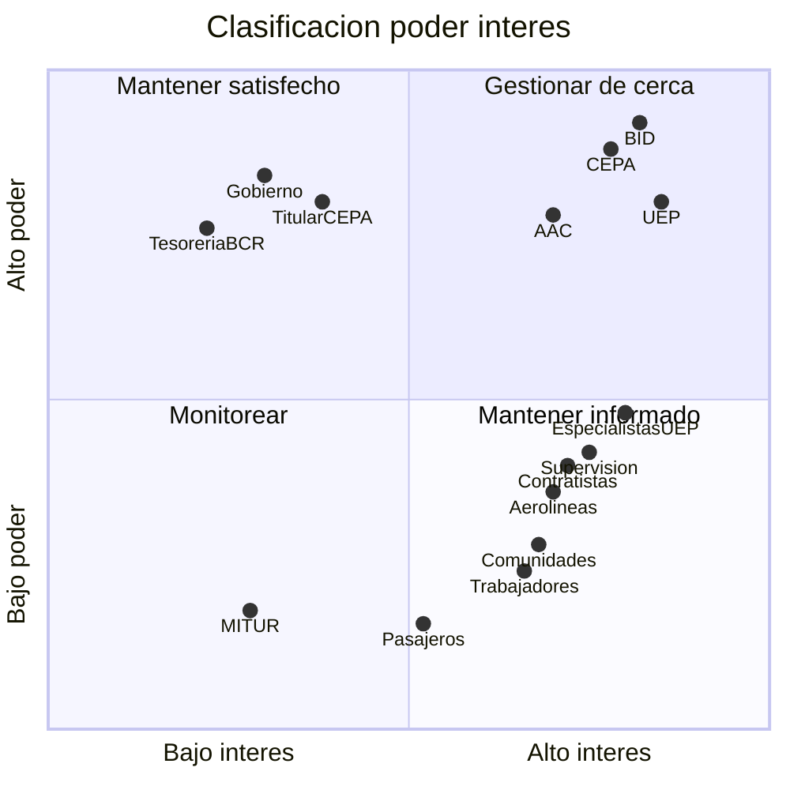

# Identificación de involucrados y matriz de comunicaciones

Programa de Modernización del Aeropuerto Internacional de El Salvador (ES-L1173). Organismo ejecutor: CEPA, mediante la UEP. Fuente de financiamiento: préstamo del BID.

La clase 9 pide identificar a los interesados y sus necesidades de información antes de armar la matriz. La identificación parte de la lista del acta de constitución y usa los campos de la clase 3 (interés, poder, impactos y estrategia). La matriz cubre los campos de la consigna: información, interesados o destinatarios, responsable, medio o formato y frecuencia. Los responsables son los mismos roles del diccionario de la EDT y de la matriz de adquisiciones.

## 1. Identificación de involucrados

Los interesados son las personas u organizaciones que el programa afecta o que pueden afectar su resultado. Se clasifican como internos (organismo ejecutor, unidad ejecutora y su personal) o externos (financiador, regulador, prestatario, contratistas, operadores, comunidades y beneficiarios). El poder y el interés determinan la estrategia: gestionar de cerca, mantener satisfecho, mantener informado o monitorear.

| Interesado | Tipo | Objetivo o resultado relacionado | Interés | Poder | Impacto positivo | Impacto negativo | Estrategia |
|---|---|---|---|---|---|---|---|
| Banco Interamericano de Desarrollo (BID) | Externo | Desembolso, no objeciones, PMR, auditorías, evaluaciones y PCR. Condiciones del préstamo y de las políticas de adquisiciones y salvaguardias. | Alto | Alto | Libera recursos, emite no objeciones y valida el cumplimiento. | Suspende desembolsos o niega no objeciones si faltan informes o se incumplen condiciones. | Gestionar de cerca |
| CEPA (organismo ejecutor) | Interno | Ejecución del programa, operación de la infraestructura y recepción de las obras. Objetivos de capacidad, rodaje y estacionamiento. | Alto | Alto | Aprueba planes, contratos y recepciones; sostiene la operación durante las obras. | Retrasa decisiones institucionales o no asigna personal de apoyo. | Gestionar de cerca |
| Unidad Ejecutora del Programa / Coordinador del Programa | Interno | Dirección, coordinación, informes de avance y enlace con el BID. Paquetes 3.1 a 3.5. | Alto | Alto | Produce la información de gestión y mantiene la coordinación diaria. | Si se debilita, se atrasan informes, contrataciones y el seguimiento de la ruta crítica. | Gestionar de cerca |
| Autoridad de Aviación Civil (AAC) | Externo | Protocolo de seguridad operacional de las obras de lado aire (EDT 3.3.2; hito H04). Restricción del acta. | Alto | Alto | Autoriza el protocolo y habilita plataformas, calle Foxtrot y SSEI. | Sin aprobación no pueden iniciar las obras de lado aire. | Gestionar de cerca |
| Gobierno de El Salvador (prestatario) | Externo | Compromisos del financiamiento y convenio de transferencia de recursos (EDT 3.1.3). | Medio | Alto | Firma el convenio y respalda las condiciones previas al primer desembolso. | Retrasa el convenio o cambia prioridades de política pública. | Mantener satisfecho |
| Titular de CEPA | Interno | Aprobación del POA, del ROP y de los informes que se remiten al BID. | Medio | Alto | Aprueba planes anuales y da respaldo institucional a la UEP. | Observa o demora el POA y los informes de avance. | Mantener satisfecho |
| Dirección General de Tesorería y Banco Central de Reserva | Externo | Cuenta especial y canal de desembolsos (EDT 3.1.4 y 3.5.1). | Bajo | Alto | Abren la cuenta y procesan los fondos del préstamo. | Sin cuenta o sin conciliación no hay desembolso. | Mantener satisfecho |
| Coordinador general de obra y especialistas de la UEP | Interno | Paquetes de obra, adquisiciones, finanzas, planificación, ingeniería aeroportuaria y socioambiental. | Alto | Medio | Preparan especificaciones, administran contratos y generan los reportes de su área. | Un informe tardío o incompleto retrasa no objeciones y pagos. | Mantener informado |
| Firma de supervisión | Externo | Control de calidad, estimaciones y PGAS de las cuatro obras (EDT 1.7.1 a 1.7.3). | Alto | Medio | Certifica avance y calidad; alimenta las estimaciones de pago. | Un hallazgo no reportado afecta recepción, seguridad o salvaguardias. | Mantener informado |
| Contratistas y consultores | Externo | Obras del Componente I y estudios, planes y capacitaciones del Componente II. | Alto | Medio | Ejecutan el alcance contratado y entregan productos. | Atrasos, reclamos o incumplimientos mueven costo, plazo o calidad. | Mantener informado |
| Aerolíneas y operadores | Externo | Continuidad de la operación y uso de las nuevas posiciones, salas y accesos. | Alto | Medio | Coordinan horarios y restricciones de lado aire y lado tierra. | Una interferencia mal avisada interrumpe vuelos o genera quejas. | Mantener informado |
| Comunidades del área de influencia | Externo | Gestión de impactos ambientales y sociales; consulta de categoría B (PGAS, NDAS 10). | Alto | Bajo | Aceptan las obras si se atienden ruido, tráfico y quejas. | Protestas o quejas no resueltas escalan al BID y a la autoridad ambiental. | Mantener informado |
| Trabajadores de obra | Externo | Seguridad y salud en el trabajo y canal de quejas laborales (EDT 3.3.3; PGAS). | Alto | Bajo | Reportan condiciones inseguras y usan el MGQR. | Accidentes o conflictos laborales detienen frentes de obra. | Mantener informado |
| Pasajeros | Externo | Beneficiarios del espacio por pasajero, del estacionamiento y de la calidad de servicio. | Medio | Bajo | Perciben la mejora al entrar en operación las nuevas instalaciones. | Congestión o desvíos mal comunicados durante la construcción. | Monitorear |
| Ministerio de Turismo (MITUR) | Externo | Dato del indicador de gasto turístico de la Matriz de Resultados (MEL). | Bajo | Bajo | Aporta la cifra de turismo para la evaluación de cierre. | Un dato tardío debilita el PCR, no la ejecución de las obras. | Monitorear |

La clasificación no es un plan de relaciones públicas ni de redes sociales. Sirve para decidir a quién se le destina cada comunicación de la sección 2 y con qué intensidad. Los de alto poder y alto interés reciben los informes contractuales y las decisiones de alcance, costo y plazo. Los de alto interés y menor poder reciben avisos operativos, actas de obra y el canal de quejas. Los de bajo interés se atienden cuando el MEL o la operación lo exigen.

## 2. Matriz de comunicaciones

| N.º | Información | Interesados / destinatarios | Responsable | Medio / formato | Frecuencia |
|---:|---|---|---|---|---|
| 1 | Informe de seguimiento del progreso (PMR), con notas de desviación respecto de lo planificado (EDT 3.5.1; ROP 6.3.1) | BID; CEPA | Especialista de planificación y monitoreo; el Coordinador del Programa aprueba el envío | Informe escrito en el Portal del Cliente BID | Semestral, dentro de los 60 días siguientes al cierre de cada semestre |
| 2 | Actualización del Plan de Adquisiciones (EDT 3.2.3) | BID | Especialista de adquisiciones | Plan electrónico en el Portal del Cliente BID | Trimestral, o cuando cambie un proceso |
| 3 | Plan Operativo Anual del año siguiente (EDT 3.2.2; ROP 6.1.2) | Titular de CEPA; BID | Especialista de planificación y monitoreo | Documento formal y solicitud de no objeción | Anual, aprobado por CEPA a más tardar el 30 de noviembre |
| 4 | Plan de Ejecución Plurianual y sus actualizaciones (EDT 3.2.1) | CEPA; BID | Especialista de planificación y monitoreo | Documento formal | Al arranque y cuando cambie la línea base de alcance, plazo o costo |
| 5 | Solicitudes de desembolso, justificaciones de gasto y plan financiero (EDT 3.5.1) | BID; CEPA; BCR | Especialista financiero | Formatos del Portal del Cliente BID | Según el plan financiero y las necesidades de liquidez |
| 6 | Solicitudes de no objeción de adquisiciones, enmiendas y cambios contractuales (revisión ex ante) | BID | Especialista de adquisiciones; el Coordinador del Programa firma cuando el ROP lo exige | Expediente y solicitud en el Portal del Cliente BID | Por evento, al menos 15 días antes de la fecha de aplicación del cambio |
| 7 | Informes de cumplimiento ambiental y social (EDT 3.3.4; PGAS y MEL) | BID; CEPA | Especialista socioambiental | Informe digital | Según los plazos del MEL y del PGAS |
| 8 | Estados financieros auditados del programa (EDT 3.5.2) | BID; CEPA | Firma de auditoría externa; gestiona el Especialista financiero | Informe de auditoría | Anual, a más tardar 120 días después del cierre de cada ejercicio (30 de abril); estados finales en el cierre. Los del ejercicio 2026 se presentan el 23 de junio de 2027, fuera de plazo (riesgo R18) |
| 9 | Evaluación de medio término (EDT 3.5.3) | BID; CEPA | Consultor de evaluación; gestiona el Especialista de planificación y monitoreo | Informe de evaluación | Una vez, el 13 de marzo de 2028 (3.5.3-03). Plazo: 60 días después de lo primero entre el 50% del tiempo de ejecución planificado (2 de marzo de 2028) y el 50% de los recursos desembolsados (proyectado al 31 de enero de 2028); hoy vence el 31 de marzo de 2028 (riesgo R19) |
| 10 | Evaluación final de productos y resultados (EDT 3.5.3) | BID; CEPA | Consultor de evaluación; gestiona el Especialista de planificación y monitoreo | Informe de evaluación | Una vez, el 15 de noviembre de 2029 (3.5.3-05). Plazo: 90 días después de lo primero entre el 95% desembolsado y el fin del plazo original de desembolsos; la línea base (US$160.3 millones) no llega al 95% del préstamo, así que vence el 29 de abril de 2031 |
| 11 | Insumos para el informe de terminación (PCR): PEP de cierre, PMR final, PA final, ejecución financiera e indicadores (EDT 3.5.4; hito H10) | BID | Coordinador del Programa | Expediente de cierre | Al último desembolso; el BID elabora el PCR |
| 12 | Misiones de administración e inspecciones de obra (ROP 6.2) | BID; UEP; CEPA | Coordinador del Programa | Reunión y minuta | Cuando el BID las convoque |
| 13 | Informe mensual de avance físico y financiero, frente al POA | Titular de CEPA; Coordinador del Programa | Especialista de planificación y monitoreo, con insumos del Coordinador general de obra y del Especialista financiero | Informe escrito y reunión de seguimiento | Mensual |
| 14 | Informe mensual de avance de las adquisiciones | Coordinador del Programa; BID | Especialista de adquisiciones | Informe escrito | Mensual |
| 15 | Cierres y conciliaciones de la cuenta especial y de la ejecución financiera | Coordinador del Programa; CEPA | Especialista financiero | Conciliación y reporte financiero | Mensual |
| 16 | Reunión de coordinación de obra y acta de acuerdos (hitos H03 a H09) | Coordinador general de obra; firma de supervisión; contratistas | Coordinador general de obra | Reunión presencial o virtual y acta | Semanal, mientras duren las obras |
| 17 | Informe de supervisión técnica, estimaciones y control de calidad (EDT 1.7.1 y 1.7.2) | UEP; CEPA | Firma de supervisión | Informe técnico | Mensual, desde el inicio de cada obra hasta su recepción |
| 18 | Protocolo de seguridad operacional de lado aire y avisos de interferencia (EDT 3.3.2; hito H04) | AAC; contratistas de lado aire; firma de supervisión | Coordinador general de obra | Protocolo aprobado y circular operativa | Una vez antes de iniciar obras de lado aire; actualizaciones por evento |
| 19 | Comunicación de hitos críticos: UEP conformada, primer desembolso, contratos, SSEI, recepción y cierre (H01 a H10) | CEPA; BID | Coordinador del Programa | Oficio o correo formal | En cada hito del cronograma: H01 15-may-2026, H02 10-jul-2026, H04 11-mar-2027, H03 28-jul-2027, H05 24-feb-2028, H08 31-may-2028, H06 31-ago-2028, H07 16-mar-2029, H09 5-jul-2029 y H10 1-abr-2030 |
| 20 | Atención de quejas y reclamos del MGQR (EDT 3.3.3; PGAS, NDAS 10) | Comunidades del área de influencia; trabajadores de obra; aerolíneas; arrendatarios | Especialista socioambiental | Buzón, correo, registro escrito y respuesta al quejoso | Continuo, durante la ejecución |
| 21 | Avisos de afectación operativa (cierres parciales, desvíos, restricciones de plataforma o de estacionamiento) | Aerolíneas y operadores; operaciones de CEPA | Coordinador general de obra | Circular operativa o reunión de operaciones | Según la programación de cada frente de obra |
| 22 | Consulta y divulgación ambiental de categoría B (PGAS; NDAS 10) | Comunidades del área de influencia | Especialista socioambiental | Reunión de consulta y material impreso o digital | Al inicio de las obras y cuando el PGAS lo exija |

La matriz no incluye mensajes de marca, redes sociales ni diferenciación demográfica. Cada fila existe porque el préstamo, el ROP, el MEL o el PGAS la exigen, o porque hace falta para decidir o para no interrumpir la operación del aeropuerto.

## 3. Criterios

- **Alcance de la comunicación.** Solo se genera información que contribuya al éxito del programa o que cumpla una obligación contractual, fiduciaria o de salvaguardias. No se duplican reportes: el PMR semestral consolida el avance ante el BID; el informe mensual cubre la dirección de CEPA.
- **Destinatarios.** Salen de la identificación de la sección 1. No se agregan actores que no figuren en el acta, el ROP, el MEL o el PGAS.
- **Responsables.** Son los roles del diccionario de la EDT y de la matriz de adquisiciones. El Coordinador del Programa es el responsable de que la matriz se cumpla. Quien prepara el informe no siempre es quien lo firma o lo carga al portal.
- **Frecuencias.** Las obligaciones con el BID salen del ROP (PMR a 60 días, POA al 30 de noviembre, PA al menos cada tres meses, auditorías a 120 días) y del MEL (evaluaciones de medio término y de cierre). Las internas de obra siguen el ritmo semanal y mensual de la supervisión. Los hitos usan las fechas del cronograma.
- **Medios.** El canal formal con el BID es el Portal del Cliente. Las decisiones de obra quedan en acta. Las afectaciones operativas van por circular. Las quejas se registran por escrito y se responde al interesado.
- **Confirmación de recepción.** En los informes al financiador y en las no objeciones, la carga en el portal y la respuesta del BID constituyen el acuse. En obra, el acta firmada. En el MGQR, el registro de ingreso y de cierre del caso.
- **Ajuste.** La matriz se revisa en el taller de arranque, con la evaluación de medio término y si cambia un interesado o una obligación de reporte.

*Fuente: elaboración con base en el acta de constitución, la EDT, el cronograma, la matriz de adquisiciones, el Reglamento Operativo del Programa (EEO#1, secciones 6.1 a 6.4), el Plan de Monitoreo, Evaluación y Aprendizaje (EER#2), el PGAS (NDAS 10 y MGQR) y el material de las clases 3 y 9.*
