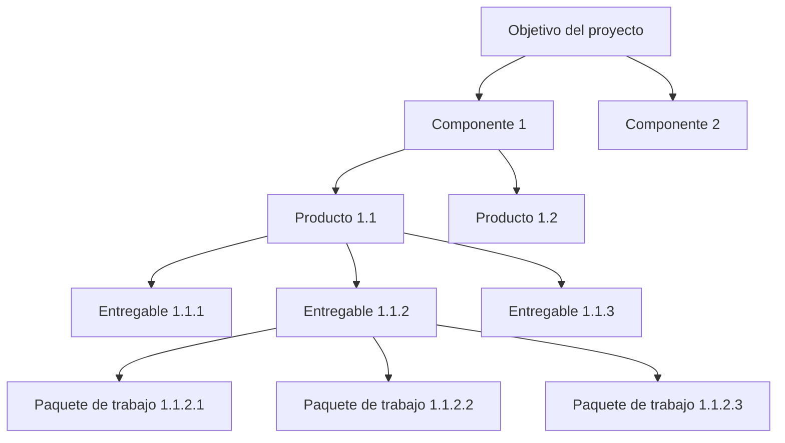
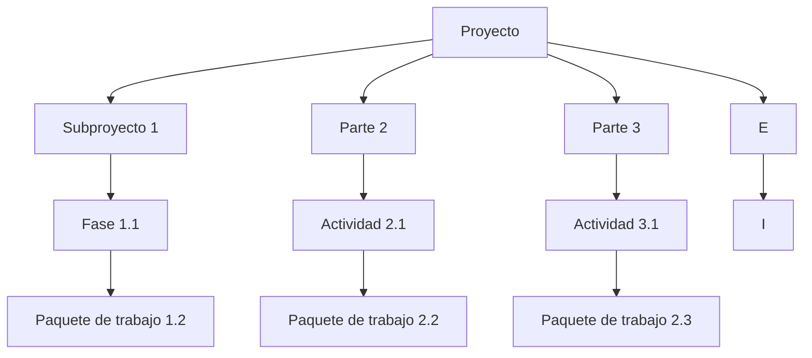
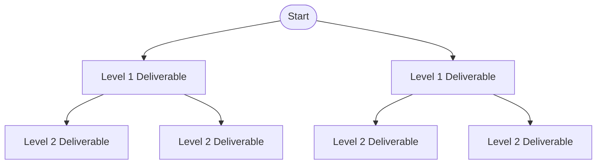
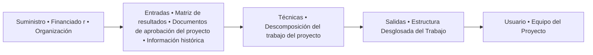
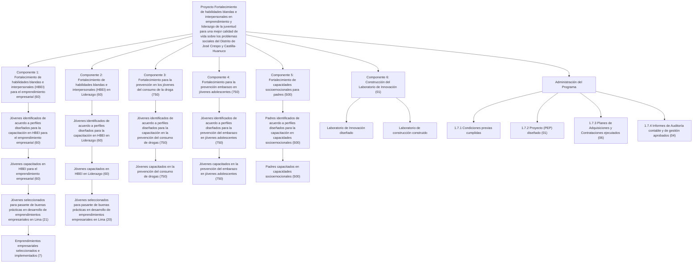

## **Unidad II. Gestión DE PROYECTOS**

photo: people assembling a colorful puzzle structure

### **Clase 4 -Estructura desglosada de trabajo (EDT)**

1

## **OBJETIVO**

Comprender el concepto de la EDT, analizar el proceso para su creación y la forma correcta de descomponer un proyecto, identificando errores comunes que deben evitarse, así como reconocer las diferencias en la aplicación de la EDT según las guías PMBOK sexta y séptima edición, con el fin de fortalecer las competencias en la planificación y gestión de proyecto

2

## Agenda

* La EDT
* Proceso para la creación de la EDT
* **Cómo descomponer un proyecto correctamente**
* **5 errores para evitar al crear tu EDT**
* EDT en Pmbok 6
* EDT en Pmbok 7

3

## **Herramientas para la gestión de proyectos**

image: Project management process infographic

## **PLANIFICACIÓN**

### **PASO 1. ALCANCE**
¿Por qué desglosamos el proyecto en partes más pequeñas y manejables?
* Estructura Desglosada del Trabajo (EDT)

### **PASO 2. TIEMPOS**
¿De qué forma secuenciamos las actividades y sus tiempos para controlar el avance del proyecto?
* Cronograma

### **PASO 3. COSTOS**
¿Cómo podemos visualizar el avance financiero del proyecto?
* Curva S

### **PASO 4. ADQUISICIONES**
¿Por qué relacionamos las adquisiciones con las entregables del proyecto?
* Matriz de Adquisiciones

### **PASO 5. RIESGOS**
¿Cómo gestionamos la incertidumbre en el proyecto?
* Matriz de Riesgos

### **PASO 6. COMUNICACIONES**
¿Qué conseguimos planificando las comunicaciones?
* Matriz de Comunicaciones

### **PASO 7. RACI**
¿Cómo asignamos y gestionamos los responsables de los trabajos en el proyecto?
* Matriz RACI

## **EJECUCIÓN**
Monitoreamos el proyecto apoyados de la Matriz de Planificación, si hay cambios re planificamos desde el paso 1.

## **MONITOREO Y CONTROL**

## **CIERRE**
Terminados todos los entregables cerramos el proyecto

## **Paso I: El desglose del alcance del proyecto**

image: infographic about project planning

## **PLANIFICACIÓN**

### **PASO 1. ALCANCE**

¿Por qué desglosamos el proyecto en partes más pequeñas y manejables?
* Estructura Desglosada del Trabajo (EDT)

5

## La EDT

Se trata de una herramienta que consiste en la descomposición jerárquica del trabajo para lograr los objetivos del proyecto y crear los entregables requeridos.

Es una descomposición jerárquica e incremental en fases de proyectos, entregables y paquetes de trabajo. Es una estructura de árboles, que muestra una subdivisión de esfuerzo necesaria para lograr un objetivo. Por ejemplo, un programa, proyecto y contrato.

La EDT organiza y define el alcance total del proyecto; sin embargo, no es funcional cuando se transforma en una lista de cientos de actividades que requeriría el trabajo de una o más personas para actualizarla periódicamente.

flow_chart: Hierarchical decomposition of project objective

6

Es una herramienta excelente para trabajar con alcances de proyectos complejos o con miembros del equipo que prefieran usar otras vistas en vez de una de lista. Si bien la mayoría de los gerentes de proyectos prefieren algunos tipos de imágenes antes que otros, todas las estructuras de desglose del trabajo están compuestas de las mismas piezas clave.

## La EDT debería contar con lo siguiente:

* La base de referencias del proyecto, que incluye el plan del proyecto, la descripción y el nombre.
* Participantes del proyecto
* Un programa organizado del proyecto.
* Los entregables del proyecto y las subtareas.

flow_chart: Project hierarchy diagram

7

El propósito de desarrollar una EDT es para usarla como una herramienta de trabajo diario y no como un documento que se actualiza una vez por año para justificar los gastos del proyecto. Para que resulte útil, la EDT tiene que ser un documento fácil de modificar, enfocado en resultados definidos SMART, que ha sido diseñado o ratificado por el equipo responsable de implementar el proyecto o por quienes deben rendir cuentas sobre sus resultados.

La EDT no debe llegar al nivel de actividades (la definición y gestión de las actividades se realiza en el cronograma), sino que debe quedar en un nivel superior llamado paquete de trabajo. El paquete de trabajo, último nivel de desglose de la EDT, es aquel cuya duración y costo pueden ser estimados y que puede ser monitoreado y controlado.

icon: diagram with three colored bars and checkmarks

8

Otra característica del paquete de trabajo es que puede ser usado para asignar a un responsable. En cuanto al nivel de desglose, no existe una regla que indique cuántos niveles debe tener una EDT; sin embargo, se recomienda que tenga entre tres y cinco.

El equipo del proyecto es el que debe decidir hasta qué nivel de detalle se requiere, lo cual está muy ligado a la complejidad del proyecto. Una EDT no representa la secuencia de ejecución, es una organización jerárquica de los entregables del proyecto. En una EDT no se deben utilizar verbos, no tiene tiempos, costos ni recursos.

flow_chart: hierarchical diagram of project deliverables

9

## **Algunas razones ampliamente utilizadas para crear un EDT incluyen:**

* Ayuda con una organización de proyectos precisa
* Ayuda a asignar responsabilidades
* Mostrar puntos de control de proyectos e hitos
* Permitir una estimación más precisa de los costos, riesgos y tiempo
* Ayuda a explicar el alcance del proyecto a las partes interesadas

10

## **Proceso para la creación de la EDT**

En la etapa de planificación, el primer proceso comúnmente usado por los proyectos de desarrollo para gestionar el alcance es la creación de la EDT. Para hacerlo, se emplean como entradas los documentos producidos durante el diseño del proyecto.

flow_chart: Process flow from Suministro to Usuario

11

## **Entradas**

El documento más importante de los producidos en el diseño del proyecto es la matriz de resultados (MdR) ya que describe los objetivos del proyecto y los indicadores que permiten verificar si el objetivo se cumplió. Es importante entender la lógica de la matriz -que va de insumos a productos- dado que sirve para identificar los objetivos intermedios y las actividades que servirán para desarrollar el cronograma y el presupuesto del proyecto. Otro insumo adicional para la elaboración de la EDT es la información histórica, es decir que el gerente del proyecto puede usar información de proyectos anteriores similares que otorguen pautas para definir los componentes de trabajo de un objetivo. Esto puede reducir significativamente el proceso de desglose. 12

## **Técnicas**

La creación de la EDT no es un ejercicio o un trabajo de una sola persona. Para poder lograr una EDT efectiva, se debe contar con la participación del equipo del proyecto y de otros interesados para que puedan identificar los componentes de la EDT según el tipo de trabajo. El gerente del proyecto deberá asegurase de recibir el aporte de las personas que más conocen el proyecto durante este proceso de elaboración. Además, el gerente, junto con el equipo y otros interesados (stakeholders) o expertos que conocen los temas del proyecto, debe desglosar todos los entregables siguiendo un orden jerárquico que permita establecer la relación de cada elemento con la meta del proyecto.

icon: illustration of a team meeting with various digital icons above them

13

Una EDT debe ser lo suficientemente detallada como para poder asignar fácilmente el trabajo a terceros y poder monitorear su estado de manera adecuada. Para determinar si se ha logrado este nivel de claridad, las variables de tiempo y costos deberían ser fácilmente identificables. Si esta regla no se cumple, se debe subdividir aún más hasta que sea útil para estimar tiempos y costos.

14

El equipo del proyecto inicia el desglose de las actividades empezando por el objetivo final del proyecto hasta llegar al nivel de paquetes de trabajo.

Una estructura que facilita el orden de los diferentes niveles de la EDT es la siguiente:

1. **Objetivo del proyecto**: el impacto esperado de los componentes del proyecto.
2. **Componentes**: el conjunto de productos agrupados según su naturaleza.
3. **Productos**: el resultado agregado de los entregables del proyecto.
4. **Entregables**: los servicios, bienes y trabajos que produce el proyecto mediante la ejecución de los paquetes de trabajo.
5. **Paquetes de trabajo**: los grupos de actividades o tareas que se realizan para lograr los entregables del proyecto; es el nivel más bajo de la EDT.

15

flow_chart: Hierarchical diagram of project objective and components

16

logo: BID Banco Interamericano de Desarrollo

## **EDT**

logo: PM4R

flow_chart: Project structure diagram for strengthening soft skills and interpersonal leadership in entrepreneurship

17

flow_chart: Hierarchical diagram of the Information System Project

```mermaid
flowchart TD
    A["1. Proyecto de Sistema de Información"]
    B["1.1 Documento de Análisis"]
    C["1.2 Documento de Diseño"]
    D["1.3 Software Desarrollado e Instalado"]
    E["1.4 Reportes de Prueba"]
    F["1.5 Entrega a Operaciones"]
    G["1.1.1 Especificación Funcional"]
    H["1.1.2 Requerimientos Funcionales"]
    I["1.1.3 Requerimientos No Funcionales"]
    J["1.2.1 Diseño Funcional"]
    K["1.2.2 Diseño Técnico"]
    L["1.2.3 Casos de Prueba"]
    M["1.2.4 Planificación"]
    N["1.3.1 Ambiente de Desarrollo"]
    O["1.3.2 Módulo 1"]
    P["1.3.3 Módulo 2"]
    Q["1.3.4 Módulo 3"]
    R["1.3.5 Módulo 4"]
    S["1.4.1 Ambiente de Pruebas"]
    T["1.4.2 Pruebas Integrales"]
    U["1.4.3 Pruebas de Aceptación de Usuario"]
    V["1.4.4 Certificaciones Técnicas"]
    W["1.5.1 Reporte de Puesta en Producción"]
    X["1.5.2 Pruebas Posproducción"]
    Y["1.5.3 Garantía"]
    A --> B
    A --> C
    A --> D
    A --> E
    A --> F
    B --> G
    B --> H
    B --> I
    C --> J
    C --> K
    C --> L
    C --> M
    D --> N
    D --> O
    D --> P
    D --> Q
    D --> R
    E --> S
    E --> T
    E --> U
    E --> V
    F --> W
    F --> X
    F --> Y
```

10

## **Salidas**

Como resultado, el proyecto contará con una lista jerárquica de todo el trabajo requerido en forma de entregables y paquetes de trabajo. En el contexto de la EDT, un entregable es el resultado del esfuerzo, no el esfuerzo en sí mismo. Por lo anterior, no se deben utilizar verbos en la EDT. Esta lista es la línea de base que permite estimar los tiempos y el costo del proyecto.

El aspecto más importante para el desarrollo de la EDT, más allá de los insumos, es el proceso a través del cual se realiza. Este proceso debería ser participativo y estar enfocado en obtener resultados y no en la enumeración de acciones o tareas. La EDT, además, ayuda a establecer la correlación de cada paquete de trabajo con la meta final y a identificar el 100% del trabajo requerido para llevar a cabo el proyecto.

19

*Es común encontrar que los trabajos definidos para un proyecto no representan el 100% de su alcance. Con frecuencia se omiten trabajos necesarios y casi nunca se identifican los relativos a la gestión del proyecto; estos requieren el uso de recursos del proyecto; por lo tanto, deben ser parte de la EDT.*

Uno de sus usos más importantes es apoyar el proceso de la verificación del alcance del proyecto. Esta verificación incluye actividades tales como medir, examinar y verificar, y busca determinar si los servicios o productos y entregables cumplen con los requisitos y los criterios de aceptación. La aceptación formal significa también que el proyecto ha cumplido con su objetivo y que no se requiere ningún otro trabajo o esfuerzo. La EDT se aplica para verificar que los servicios o los productos y entregables están comprendidos en el alcance del proyecto aprobado y los cambios autorizados.

20

## **Cómo descomponer un proyecto correctamente**

Para empezar, el director del proyecto y los expertos determinan los principales resultados finales del proyecto.

Una vez determinado, es posible comenzar a descomponer estos resultados en **bloques de trabajo más pequeños y más pequeños.**

**Pero qué tan pequeño?** Esto depende del tipo de proyecto y del estilo de gestión, pero se debe establecer algún tipo de regla para determinar el tamaño y el alcance de los bloques de trabajo más pequeños.

Por ejemplo, **se** podría elegir **la regla de dos semanas**, en la que ninguna pieza / actividad es menor que dos semanas de trabajo requerido para completar.

O, otro método es la **regla 8/80**, donde ningún bloque debe tardar menos de 8 horas o más de 80 horas en completarse.

Determinar estas reglas para los tamaños de bloque puede tomar alguna práctica, pero estos hacen que EDT definitivamente sea más fácil de user.

En cuanto al formato elegido para el diseño WBS, algunos gestores de proyectos prefieren crear tablas o listas, pero la mayoría utilizan gráficos para visualizar los componentes del proyecto, como una estructura de árbol jerárquica o un diagrama.

2.1

## 5 errores para evitar al crear un EDT

* Incluso un EDT bien pensado puede fallar si cometes errores estratégicos en su construcción. Aquí están los más comunes:

* **Entrando en demasiados detalles**
    La sobre-subdivisión crea confusión y ralentiza la gestión. Manténlo útil, no obsesivo.

* **Saltar la regla 8/80**
    Cada paquete de trabajo debe tardar **entre 8 y 80 horas** en completarse. Demasiado pequeño o demasiado grande = inmanejable.

* **Confundir actividades con entregables**
    El EDT muestra *lo que* hay *que* entregar, no *cómo*. Las actividades van en el plan de proyectos, no en el EDT.

* **No asignar responsabilidades**
    Cada paquete debe tener una persona de contacto. Sin responsabilidad = no ejecución.

* **Haciendo un EDT, sólo por el bien de ella.**
    Usarlo sólo como documento estático significa que pierdes su potencial. Se debe de integrar con otras herramientas (como gráficos de Gantt, seguimiento de esfuerzos, costos).22

22

Pmbok 6
(pág 165)

Pmbok 8 apartado 2.2.2.4
pág 42
140

23

24

icon: 3D illustration of a person sitting in the center of large red question marks